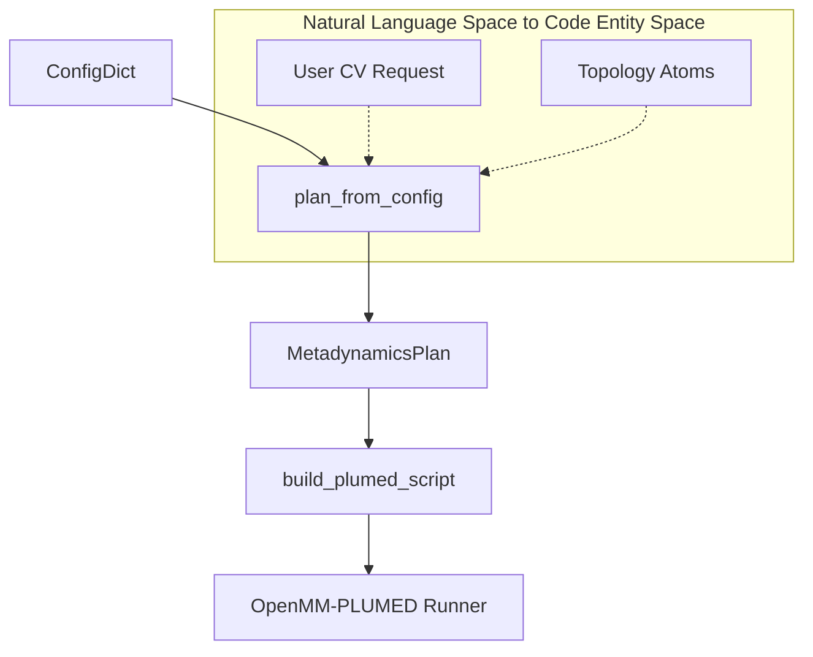
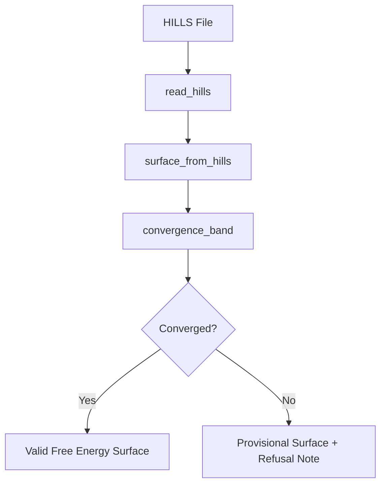
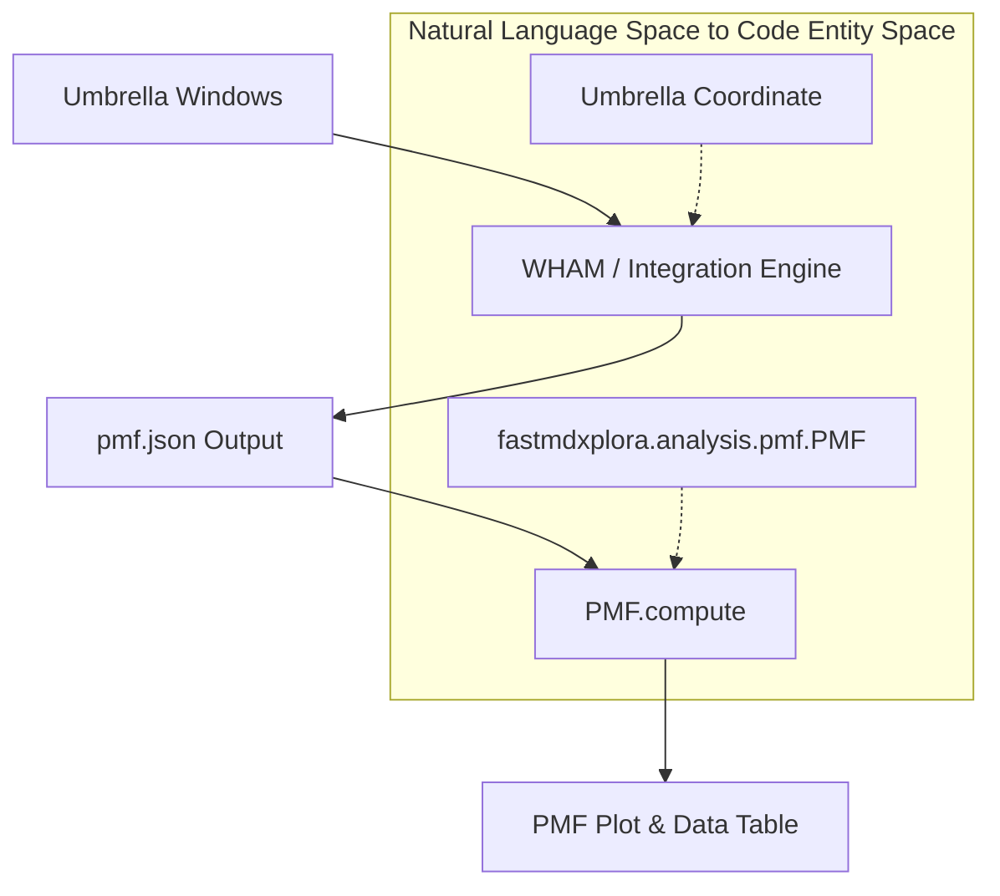

# Enhanced Sampling and Free Energy

Relevant source files

The following files were used as context for generating this wiki page:

- [docs/developers.md](docs/developers.md)
- [docs/selections.md](docs/selections.md)
- [docs/studies.md](docs/studies.md)
- [preregistration/agent-looks.md](preregistration/agent-looks.md)
- [preregistration/stopping-calibration-shared-start-heldout.json](preregistration/stopping-calibration-shared-start-heldout.json)
- [preregistration/stopping-calibration-shared-start-registered.json](preregistration/stopping-calibration-shared-start-registered.json)
- [preregistration/stopping-calibration.md](preregistration/stopping-calibration.md)
- [src/fastmdxplora/analysis/metad_surface.py](src/fastmdxplora/analysis/metad_surface.py)
- [src/fastmdxplora/analysis/pmf.py](src/fastmdxplora/analysis/pmf.py)
- [src/fastmdxplora/analysis/steered_work.py](src/fastmdxplora/analysis/steered_work.py)
- [src/fastmdxplora/batch/aggregate.py](src/fastmdxplora/batch/aggregate.py)
- [src/fastmdxplora/batch/compare.py](src/fastmdxplora/batch/compare.py)
- [src/fastmdxplora/gui/directory_inspect.py](src/fastmdxplora/gui/directory_inspect.py)
- [src/fastmdxplora/simulation/binding.py](src/fastmdxplora/simulation/binding.py)
- [src/fastmdxplora/simulation/metad_surface.py](src/fastmdxplora/simulation/metad_surface.py)
- [src/fastmdxplora/simulation/metadynamics.py](src/fastmdxplora/simulation/metadynamics.py)
- [src/fastmdxplora/simulation/reference_state.py](src/fastmdxplora/simulation/reference_state.py)
- [src/fastmdxplora/simulation/steered.py](src/fastmdxplora/simulation/steered.py)
- [src/fastmdxplora/simulation/stopping.py](src/fastmdxplora/simulation/stopping.py)
- [src/fastmdxplora/validation/__init__.py](src/fastmdxplora/validation/__init__.py)
- [src/fastmdxplora/validation/corpus.py](src/fastmdxplora/validation/corpus.py)
- [src/fastmdxplora/validation/stopping_calibration.py](src/fastmdxplora/validation/stopping_calibration.py)
- [tests/test_a_binding_free_energy_carries_its_spread.py](tests/test_a_binding_free_energy_carries_its_spread.py)
- [tests/test_a_binding_free_energy_says_where_its_reference_fails.py](tests/test_a_binding_free_energy_says_where_its_reference_fails.py)
- [tests/test_a_charged_ligand_is_said.py](tests/test_a_charged_ligand_is_said.py)
- [tests/test_a_closed_turn_measures_itself.py](tests/test_a_closed_turn_measures_itself.py)
- [tests/test_a_crossing_goes_between_basins.py](tests/test_a_crossing_goes_between_basins.py)
- [tests/test_a_figure_is_plotted.py](tests/test_a_figure_is_plotted.py)
- [tests/test_a_hill_reaches_round_the_turn.py](tests/test_a_hill_reaches_round_the_turn.py)
- [tests/test_a_study_runs_until_it_knows.py](tests/test_a_study_runs_until_it_knows.py)
- [tests/test_a_surface_says_whether_it_converged.py](tests/test_a_surface_says_whether_it_converged.py)
- [tests/test_binding.py](tests/test_binding.py)
- [tests/test_compare.py](tests/test_compare.py)
- [tests/test_guardrail_corpus.py](tests/test_guardrail_corpus.py)
- [tests/test_metad_surface.py](tests/test_metad_surface.py)
- [tests/test_metad_surface_analysis.py](tests/test_metad_surface_analysis.py)
- [tests/test_metadynamics.py](tests/test_metadynamics.py)
- [tests/test_pmf_analysis.py](tests/test_pmf_analysis.py)
- [tests/test_replicas_share_their_start.py](tests/test_replicas_share_their_start.py)
- [tests/test_steered.py](tests/test_steered.py)
- [tests/test_the_agents_looking_is_measured.py](tests/test_the_agents_looking_is_measured.py)
- [tests/test_the_config_asks_for_less.py](tests/test_the_config_asks_for_less.py)
- [tests/test_the_stopping_rule_is_calibrated.py](tests/test_the_stopping_rule_is_calibrated.py)
- [tests/test_the_study_reads_its_own_curve.py](tests/test_the_study_reads_its_own_curve.py)
- [tests/validation/test_the_tips_are_for_users.py](tests/validation/test_the_tips_are_for_users.py)

The purpose of this page is to detail FastMDXplora's subsystem for enhanced sampling, free energy surface reconstruction, work pathways, binding thermodynamics, and adaptive stopping rules. FastMDXplora integrates OpenMM with PLUMED to bypass the friction of writing low-level bias scripts while preserving rigorous convergence diagnostics and refusal protocols.

---

## 1. PLUMED Integration and Collective Variables

FastMDXplora abstracts PLUMED scripts for common molecular mechanics enhanced-sampling workflows. Instead of manually writing syntax for atoms, arguments, and strides, users declare collective variables (CVs) within config files or API specs [src/fastmdxplora/simulation/metadynamics.py:1-12](). 

The module `src/fastmdxplora/simulation/metadynamics.py` defines nine standard collective variables, each explicitly documenting what it separates and what it fails to resolve [src/fastmdxplora/simulation/metadynamics.py:53-121]():
* `ligand_rmsd`: Distance from starting pose.
* `ligand_distance`: Center-of-mass distance between ligand and binding site.
* `torsion`: Single dihedral angle.
* `radius_of_gyration`: Protein compactness.
* `coordination`: Smooth contact count via switching functions.
* `membrane_depth`: Distance from bilayer center along normal.
* `angle`: Three-body angle.
* `q`: Native contact fraction (Best, Hummer & Eaton).
* `distance`: General distance between two atom groups.

Sources: [src/fastmdxplora/simulation/metadynamics.py:1-47](), [tests/test_metadynamics.py:30-78]()

---

## 2. Metadynamics and Free Energy Surfaces

Metadynamics runs deposit Gaussian hills along collective variables. FastMDXplora checks whether a run has actually converged before treating the resulting bias as a free energy measurement. The analysis and simulation modules (`src/fastmdxplora/simulation/metad_surface.py` and `src/fastmdxplora/analysis/metad_surface.py`) enforce strict convergence criteria [src/fastmdxplora/simulation/metad_surface.py:1-47]():

* **Barrier Recrossings:** Defined by `MINIMUM_RECROSSINGS = 4`. A barrier crossed only once yields an anecdote, not a measurement [src/fastmdxplora/simulation/metad_surface.py:77-80]().
* **Bias Flattening:** Governed by `SETTLED_HEIGHT_FRACTION = 0.1`. Well-tempered deposition heights must shrink as basins fill [src/fastmdxplora/simulation/metad_surface.py:82-85]().
* **Surface Drift:** Evaluated via `SETTLED_DRIFT_KJMOL = 2.5` between three-quarters and full hill datasets [src/fastmdxplora/simulation/metad_surface.py:87-90]().
* **Exploration Threshold:** Governed by `MINIMUM_EXPLORED_HILL_WIDTHS = 6.0` to catch narrow, unchanging wells [src/fastmdxplora/simulation/metad_surface.py:110-111]().

Sources: [src/fastmdxplora/simulation/metad_surface.py:1-128](), [src/fastmdxplora/analysis/metad_surface.py:39-128]()

---

## 3. Umbrella Sampling and PMF Analysis

Umbrella sampling divides a reaction coordinate into windows, restraining the system along discrete target values. The Weighted Histogram Analysis Method (WHAM) or umbrella integration stitches these windows together into a complete potential of mean force (PMF).

The analysis module `src/fastmdxplora/analysis/pmf.py` (tested via `tests/test_pmf_analysis.py`) reads the computed `pmf.json` artifact generated beside simulation windows, verifying overlap metrics, handling unsampled bins as `NaN` values rather than artificial zeros, and rendering coordinate plots [tests/test_pmf_analysis.py:21-162]().

Sources: [tests/test_pmf_analysis.py:1-162]()

---

## 4. Steered Molecular Dynamics

Steered MD attaches a harmonic spring to a collective variable and moves its anchor over time [src/fastmdxplora/simulation/steered.py:1-25](). Managed through `src/fastmdxplora/simulation/steered.py`, plans are instantiated via `plan_steered()` and compiled to scripts using `build_steered_script()` [src/fastmdxplora/simulation/steered.py:46-136]().

* **Default Force Constant:** `DEFAULT_FORCE = 2000.0` kJ/mol/nm² [src/fastmdxplora/simulation/steered.py:48-52]().
* **Claim Boundaries:** Steered MD yields a pathway and work profile (`MOVINGRESTRAINT`), *not* a direct free energy, because finite pulling rates dissipate work [src/fastmdxplora/simulation/steered.py:8-19, 127]().
* **Umbrella Generation:** The primary operational utility of steered MD in FastMDXplora is generating starting structures along a pathway for subsequent umbrella sampling windows [src/fastmdxplora/simulation/steered.py:20-24]().

Sources: [src/fastmdxplora/simulation/steered.py:1-155](), [tests/test_steered.py:1-168]()

---

## 5. Binding Free Energy Calculation

Binding free energy modules (`src/fastmdxplora/simulation/binding.py`) process end-state or pathway results, incorporating standard state corrections and reference state tracking (`src/fastmdxplora/simulation/reference_state.py`) [tests/test_binding.py]()]. The framework inspects truncated PMF profiles, detects missing convergence or ligand drift, and refuses to report uncalibrated binding affinities.

Sources: [src/fastmdxplora/simulation/binding.py](), [tests/test_binding.py]()

---

## 6. Adaptive Stopping Rules

To prevent running simulations for arbitrary fixed lengths, FastMDXplora implements adaptive stopping rules in `src/fastmdxplora/simulation/stopping.py` [src/fastmdxplora/simulation/stopping.py:1-26](). 

* **Stop Targets:** Declared under `simulation.stop_when`, specifying absolute `standard_error` or `relative_error` bounds for target analyses (e.g. RMSD, SASA) [src/fastmdxplora/simulation/stopping.py:75-90]().
* **Replica Consensus:** To avoid being trapped in local minima while appearing converged, stopping rules require replica sweeps (`simulation.random_seed`). Replicas must agree within Cochran's Q threshold (`AGREE_WITHIN = 2.0`) before a study terminates [src/fastmdxplora/simulation/stopping.py:15-26, 55-58]().
* **Execution Loop:** Runs in incremental rounds, adding at most `MOST_PER_ROUND = 3.0` times the current production length until convergence criteria are met or `MOST_ROUNDS = 25` is exhausted [src/fastmdxplora/simulation/stopping.py:5-9, 45-54]().

Sources: [src/fastmdxplora/simulation/stopping.py:1-146]()

---