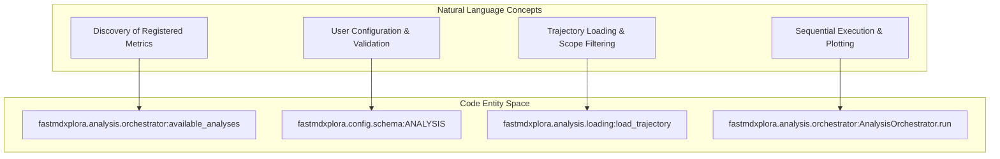
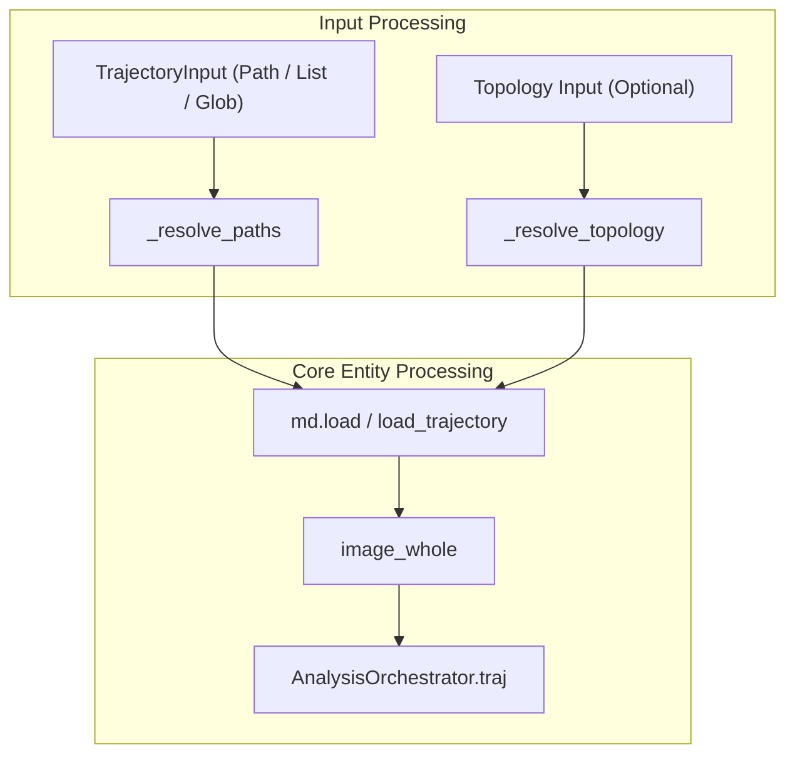

# Analysis Phase

Relevant source files

The following files were used as context for generating this wiki page:

- [src/fastmdxplora/analysis/__init__.py](src/fastmdxplora/analysis/__init__.py)
- [src/fastmdxplora/analysis/base.py](src/fastmdxplora/analysis/base.py)
- [src/fastmdxplora/analysis/loading.py](src/fastmdxplora/analysis/loading.py)
- [src/fastmdxplora/analysis/orchestrator.py](src/fastmdxplora/analysis/orchestrator.py)
- [src/fastmdxplora/analysis/plotting.py](src/fastmdxplora/analysis/plotting.py)
- [src/fastmdxplora/analysis/residues.py](src/fastmdxplora/analysis/residues.py)
- [src/fastmdxplora/analysis/ss.py](src/fastmdxplora/analysis/ss.py)
- [src/fastmdxplora/report/region_highlights.py](src/fastmdxplora/report/region_highlights.py)
- [src/fastmdxplora/report/summary_figure.py](src/fastmdxplora/report/summary_figure.py)
- [tests/test_a_distant_molecule_is_measured_in_its_nearest_copy.py](tests/test_a_distant_molecule_is_measured_in_its_nearest_copy.py)
- [tests/test_a_figure_shows_what_the_mean_rests_on.py](tests/test_a_figure_shows_what_the_mean_rests_on.py)
- [tests/test_a_residue_is_named_by_its_chain.py](tests/test_a_residue_is_named_by_its_chain.py)
- [tests/test_imaging_survives_an_older_mdtraj.py](tests/test_imaging_survives_an_older_mdtraj.py)
- [tests/test_plotting_style.py](tests/test_plotting_style.py)
- [tests/test_secondary_structure_is_given_as_fractions.py](tests/test_secondary_structure_is_given_as_fractions.py)
- [tests/test_the_frames_of_several_files_keep_their_times.py](tests/test_the_frames_of_several_files_keep_their_times.py)

The analysis phase serves as the scientific evaluation stage of FastMDXplora, transforming raw molecular dynamics trajectory files and topological artifacts into quantitative time-series data, statistical metrics, and publication-ready graphical figures [src/fastmdxplora/analysis/base.py:1-29](). Managed primarily by `AnalysisOrchestrator` [src/fastmdxplora/analysis/orchestrator.py:1-24](), this phase executes registered analysis modules [src/fastmdxplora/analysis/__init__.py:63-120](), enforces robust atom selection rules [src/fastmdxplora/analysis/orchestrator.py:54-95](), handles trajectory concatenation and period image unwrapping [src/fastmdxplora/analysis/loading.py:1-15](), and standardizes figure styling through centralized plotting conventions [src/fastmdxplora/analysis/plotting.py:1-11]().

---

## 1. Analysis Orchestration and Lifecycle

The analysis phase is coordinated by `AnalysisOrchestrator` [src/fastmdxplora/analysis/orchestrator.py:147-164](), which acts as the downstream counterpart to project-level workflows. Following a rigorous seven-phase execution pipeline [src/fastmdxplora/analysis/orchestrator.py:10-20](), the orchestrator discovers available metrics, validates configuration payloads, compiles execution lists, applies default parameters, filters arguments against module signatures, executes each module sequentially while catching exceptions, and consolidates findings into a phase-level manifest (`analysis_manifest.json`).

**Diagram 1**: Mapping analysis conceptual phases to underlying orchestration code entities.

Sources: `[src/fastmdxplora/analysis/orchestrator.py:10-20]`, `[src/fastmdxplora/analysis/orchestrator.py:128-141]`, `[src/fastmdxplora/analysis/orchestrator.py:147-164]()`

---

## 2. Trajectory Loading and Topology Resolution

Trajectories are loaded into memory via `load_trajectory()` [src/fastmdxplora/analysis/loading.py:1-15](), which normalizes single paths, sequences of paths, or glob patterns into a unified, sorted list of concrete paths [src/fastmdxplora/analysis/loading.py:73-98](). 

Topology resolution automatically detects self-topologizing formats (`.pdb`, `.cif`, `.h5`) or searches for sibling `.pdb` files when handling external formats (`.dcd`, `.xtc`, `.nc`) [src/fastmdxplora/analysis/loading.py:32-40, 101-140](). Furthermore, the loader preserves simulation clocks from formats carrying native timesteps [src/fastmdxplora/analysis/loading.py:58-60]() and applies whole-molecule periodic boundary condition (PBC) image unwrapping [src/fastmdxplora/analysis/loading.py:142-162]().

**Diagram 2**: Trajectory loading and topology resolution pipeline.

Sources: `[src/fastmdxplora/analysis/loading.py:1-15]`, `[src/fastmdxplora/analysis/loading.py:73-140]`, `[src/fastmdxplora/analysis/loading.py:142-162]()`

---

## 3. Plotting Conventions and Styling

All figure generation is governed by `fastmdxplora.analysis.plotting`, ensuring visual consistency across papers, dashboards, and automated reports [src/fastmdxplora/analysis/plotting.py:1-11](). To support headless environments (such as HPC nodes and continuous integration runners), the plotting subsystem forces a non-interactive `Agg` matplotlib backend upon import [src/fastmdxplora/analysis/plotting.py:8-34]().

Color schemes adhere to the colorblind-safe Okabe-Ito palette or can be dynamically switched to greyscale mode via `use_greyscale()` or context managers (`drawn_in`) [src/fastmdxplora/analysis/plotting.py:51-180](). Higher-level summary artifacts aggregate individual analysis subplots into compact multi-panel overviews (`analysis_summary.png`) [src/fastmdxplora/report/summary_figure.py:1-65]().

Sources: `[src/fastmdxplora/analysis/plotting.py:1-180]`, `[src/fastmdxplora/report/summary_figure.py:1-65]()`

---

## 4. Child Pages & Overview of Concrete Analyses

The analysis phase delegates specific scientific metrics to dedicated child modules. For detailed documentation on individual calculators, see the following sub-pages:

* **[Structural and Dynamic Analyses](#3.3.1)** — Covers root-mean-square deviation (`rmsd`), root-mean-square fluctuation (`rmsf`), radius of gyration (`rg`), solvent-accessible surface area (`sasa`), native contact fraction (`qvalue`), hydrogen bonds (`hbonds`), secondary structure (`ss`), backbone dihedrals (`dihedrals`), geometric contacts, moments of inertia, end-to-end distances, radial distribution functions (`rdf`), clustering, and dimensionality reduction (`dimred`) [src/fastmdxplora/analysis/__init__.py:66-110]().
* **[Ligand, Interaction and Solvent Analyses](#3.3.2)** — Covers protein-ligand contact maps (`contacts`), protein-ligand hydrogen bonds (`pl_hbonds`), non-bonded interaction summaries (`pl_interactions`), ligand-specific RMSD/RMSF, chemical properties, and water site occupancies (`water_sites`) [src/fastmdxplora/analysis/__init__.py:111-120]().
* **[Membrane, Thermodynamic and Reweighted Analyses](#3.3.3)** — Covers bilayer thickness (`bilayer_thickness`), lipid order parameters (`lipid_order`), area per lipid (`area_per_lipid`), thermodynamic observables (`thermodynamics`), and reweighting techniques for enhanced-sampling trajectories (`pmf`, `metad_surface`) [src/fastmdxplora/analysis/__init__.py:66-108]().

Sources: `[src/fastmdxplora/analysis/__init__.py:66-120]()`

---