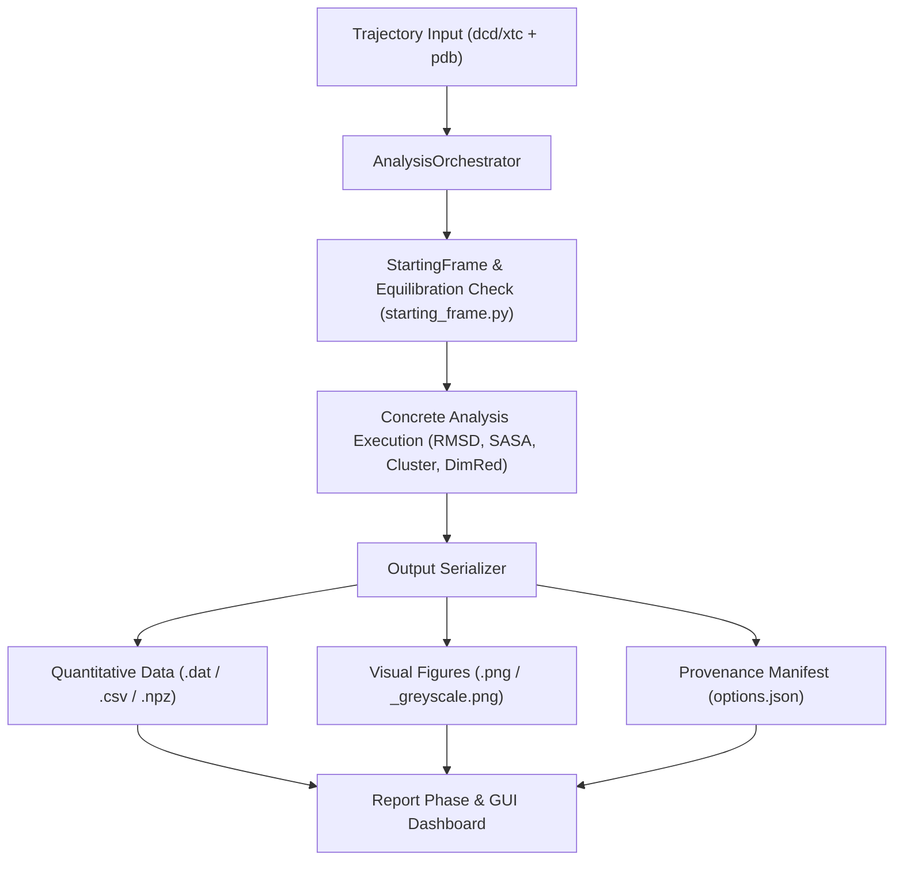

# Structural and Dynamic Analyses

Relevant source files

The following files were used as context for generating this wiki page:

- [docs/analyses.md](docs/analyses.md)
- [src/fastmdxplora/analysis/bfactor_comparison.py](src/fastmdxplora/analysis/bfactor_comparison.py)
- [src/fastmdxplora/analysis/cluster.py](src/fastmdxplora/analysis/cluster.py)
- [src/fastmdxplora/analysis/dimred.py](src/fastmdxplora/analysis/dimred.py)
- [src/fastmdxplora/analysis/end_to_end.py](src/fastmdxplora/analysis/end_to_end.py)
- [src/fastmdxplora/analysis/hbonds.py](src/fastmdxplora/analysis/hbonds.py)
- [src/fastmdxplora/analysis/moments_of_inertia.py](src/fastmdxplora/analysis/moments_of_inertia.py)
- [src/fastmdxplora/analysis/order_parameters.py](src/fastmdxplora/analysis/order_parameters.py)
- [src/fastmdxplora/analysis/qvalue.py](src/fastmdxplora/analysis/qvalue.py)
- [src/fastmdxplora/analysis/rdf.py](src/fastmdxplora/analysis/rdf.py)
- [src/fastmdxplora/analysis/rmsd.py](src/fastmdxplora/analysis/rmsd.py)
- [src/fastmdxplora/analysis/rmsf.py](src/fastmdxplora/analysis/rmsf.py)
- [src/fastmdxplora/analysis/sasa.py](src/fastmdxplora/analysis/sasa.py)
- [tests/test_a_capped_chain_has_an_end_to_end_distance.py](tests/test_a_capped_chain_has_an_end_to_end_distance.py)
- [tests/test_a_clustering_is_the_one_it_records.py](tests/test_a_clustering_is_the_one_it_records.py)
- [tests/test_a_flat_curve_has_no_peak.py](tests/test_a_flat_curve_has_no_peak.py)
- [tests/test_a_projection_keeps_its_own_labels.py](tests/test_a_projection_keeps_its_own_labels.py)
- [tests/test_a_residue_s_surface_is_reported_once_over.py](tests/test_a_residue_s_surface_is_reported_once_over.py)
- [tests/test_bfactor_comparison.py](tests/test_bfactor_comparison.py)
- [tests/test_cli_flags.py](tests/test_cli_flags.py)
- [tests/test_concrete_analyses.py](tests/test_concrete_analyses.py)
- [tests/test_end_to_end.py](tests/test_end_to_end.py)
- [tests/test_moments_of_inertia.py](tests/test_moments_of_inertia.py)
- [tests/test_order_parameters.py](tests/test_order_parameters.py)
- [tests/test_rdf.py](tests/test_rdf.py)
- [tests/test_rdf_needs_water_and_says_so.py](tests/test_rdf_needs_water_and_says_so.py)
- [tests/test_save_selection.py](tests/test_save_selection.py)

## Purpose and Scope

Section 3.3.1 covers the technical implementation, mathematical framing, and artifact generation contracts for the structural and dynamic analyses executed during the FastMDXplora analysis phase. The codebase provides twenty-seven trajectory analyses and three biased-run readers [docs/analyses.md:1-4] that process raw simulation outputs into quantitative time series, statistical summaries, publication-ready figures (`.png` and optional `_greyscale.png`), and provenance-tracked metadata (`options.json`) [docs/analyses.md:6-14].

Each analysis inherits from the base `Analysis` class and is managed through the analysis orchestration registry [src/fastmdxplora/analysis/base.py:1-48, src/fastmdxplora/analysis/orchestrator.py:1-50]. Analyses respect equilibration detection via starting frame rules (`starting_frame`) [src/fastmdxplora/analysis/starting_frame.py:1-50] and implement robust data validation, error handling, and refusal mechanisms (`StudyError`, `BackendDefect`) [src/fastmdxplora/analysis/sasa.py:30-33].

Sources: `docs/analyses.md`, `src/fastmdxplora/analysis/sasa.py`, `src/fastmdxplora/analysis/starting_frame.py`

---

## Architectural Bridge: Analysis Subsystems to Code Entities

The following diagram maps natural language analysis concepts and domain categories directly to their implementing classes and functions within the codebase.

```mermaid
graph TD
    subgraph NaturalLanguageSpace["Natural Language Space"]
        ShapeSize["Shape and Size (RMSD, Rg, SASA, SS)"]
        Flexibility["Flexibility & Fluctuations (RMSF, S2, B-factors, RDF)"]
        Geometry["Geometry & Topology (Moments, End-to-End, Dihedrals)"]
        Conformations["Conformations & Landscapes (Clustering, DimRed)"]
        FoldingWater["Folding & Water (HBonds, Q-Value, Water Sites)"]
    end

    subgraph CodeEntitySpace["Code Entity Space"]
        RMSDClass["RMSD (src/fastmdxplora/analysis/rmsd.py)"]
        RgClass["Rg (src/fastmdxplora/analysis/rg.py)"]
        SasaClass["Analysis / shrake_rupley (src/fastmdxplora/analysis/sasa.py)"]
        RmsfClass["RMSF (src/fastmdxplora/analysis/rmsf.py)"]
        OrderParam["order_parameters (src/fastmdxplora/analysis/order_parameters.py)"]
        BFactorComp["BFactorComparison (src/fastmdxplora/analysis/bfactor_comparison.py)"]
        RdfClass["rdf (src/fastmdxplora/analysis/rdf.py)"]
        DihedralsClass["Dihedrals (src/fastmdxplora/analysis/dihedrals.py)"]
        MomentsClass["MomentsOfInertia (src/fastmdxplora/analysis/moments_of_inertia.py)"]
        EndToEndClass["EndToEnd (src/fastmdxplora/analysis/end_to_end.py)"]
        ClusterClass["Cluster (src/fastmdxplora/analysis/cluster.py)"]
        DimRedClass["DimRed (src/fastmdxplora/analysis/dimred.py)"]
        HBondsClass["HBonds (src/fastmdxplora/analysis/hbonds.py)"]
        QValueClass["QValue (src/fastmdxplora/analysis/qvalue.py)"]
    end

    ShapeSize --> RMSDClass
    ShapeSize --> RgClass
    ShapeSize --> SasaClass
    Flexibility --> RmsfClass
    Flexibility --> OrderParam
    Flexibility --> BFactorComp
    Flexibility --> RdfClass
    Geometry --> DihedralsClass
    Geometry --> MomentsClass
    Geometry --> EndToEndClass
    Conformations --> ClusterClass
    Conformations --> DimRedClass
    FoldingWater --> HBondsClass
    FoldingWater --> QValueClass
```

Sources: `docs/analyses.md`, `src/fastmdxplora/analysis/rmsd.py`, `src/fastmdxplora/analysis/rg.py`, `src/fastmdxplora/analysis/sasa.py`, `src/fastmdxplora/analysis/rmsf.py`, `src/fastmdxplora/analysis/order_parameters.py`, `src/fastmdxplora/analysis/bfactor_comparison.py`, `src/fastmdxplora/analysis/rdf.py`, `src/fastmdxplora/analysis/dihedrals.py`, `src/fastmdxplora/analysis/moments_of_inertia.py`, `src/fastmdxplora/analysis/end_to_end.py`, `src/fastmdxplora/analysis/cluster.py`, `src/fastmdxplora/analysis/dimred.py`, `src/fastmdxplora/analysis/hbonds.py`, `src/fastmdxplora/analysis/qvalue.py`

---

## Shape and Size Analyses

### RMSD and Radius of Gyration (`Rg`)
* **RMSD (`RMSD`)**: Measures structural divergence from a reference frame (`ref`) with optional optimal coordinate superposition (`align=True`) via MDTraj's QCP implementation [tests/test_concrete_analyses.py:127-172]. Negative reference indices (`ref=-1`) resolve to the final trajectory frame [tests/test_concrete_analyses.py:154-160].
* **Radius of Gyration (`Rg`)**: Quantifies overall structural compactness via mass-weighted root-mean-square distance of atoms from the center of mass [docs/analyses.md:35].

### Solvent-Accessible Surface Area (`SASA`)
Implemented in `src/fastmdxplora/analysis/sasa.py`, SASA uses the Shrake-Rupley rolling-sphere algorithm (`mdtraj.shrake_rupley`) with a 1.4 Å probe radius [docs/analyses.md:36, src/fastmdxplora/analysis/sasa.py:1-107]. 
* **Modes**: Supports `total` (whole molecule per frame), `residue` (per-residue time series), and `average_residue` (mean SASA over the run) [src/fastmdxplora/analysis/sasa.py:35-39].
* **Platform Defect Recovery (`_areas_that_were_written`)**: Handles partial writes and platform-specific truncation faults on Windows by evaluating unwritten frame signatures (`_unwritten_frames`) across up to `ATTEMPTS = 5` retries, raising a `BackendDefect` refusal if unwritten frames persist [src/fastmdxplora/analysis/sasa.py:46-131].
* **Relative SASA**: Computes relative accessibility against maximum theoretical values (`MAX_ASA_TIEN_2013_A2`) from Tien et al. (2013) [src/fastmdxplora/analysis/sasa.py:134-145].

Sources: `docs/analyses.md`, `tests/test_concrete_analyses.py`, `src/fastmdxplora/analysis/sasa.py`

---

## Flexibility, Fluctuations, and Inter-Atomic Properties

### RMSF and B-Factor Comparison
* **RMSF (`RMSF`)**: Computes per-atom or per-residue root-mean-square fluctuations about mean atomic positions after rigid-body alignment [src/fastmdxplora/analysis/rmsf.py:1-31]. By default, computations omit un-equilibrated starting frames based on Chodera's equilibration detection [src/fastmdxplora/analysis/rmsf.py:24-30]. Per-residue aggregation uses mass-weighted mean square fluctuation: 
  $$\text{RMSF}_{\text{res}} = \sqrt{\frac{\sum_{i \in \text{res}} m_i \text{MSF}_i}{\sum_{i \in \text{res}} m_i}}$$ [src/fastmdxplora/analysis/rmsf.py:11-15].
* **B-Factor Comparison (`BFactorComparison`)**: Compares simulated per-residue RMSF against crystallographic B-factors parsed from deposited PDB structures via fixed-width column parsing (`bfactors_from_pdb`) [src/fastmdxplora/analysis/bfactor_comparison.py:1-80]. Applies the isotropic conversion:
  $$B = \frac{8\pi^2}{3} \langle u^2 \rangle$$ [src/fastmdxplora/analysis/bfactor_comparison.py:43-46].

### Order Parameters, Dihedrals, and RDF
* **Order Parameters (`order_parameters.py`)**: Computes backbone $N-H$ generalised order parameters $S^2$ representing internal bond vector reorientation, verified against two-halves trajectory stability criteria [src/fastmdxplora/analysis/order_parameters.py:1-44].
* **Dihedrals (`Dihedrals`)**: Calculates backbone $\phi$, $\psi$, and $\omega$ torsion angles and generates Ramachandran scatter distributions [docs/analyses.md:49, tests/test_concrete_analyses.py:1-35].
* **Radial Distribution Function (`rdf.py`)**: Evaluates pair density distributions $g(r)$ between two selections within periodic boundary conditions, automatically bounding integration to half the box length to prevent truncation artifacts [docs/analyses.md:47, src/fastmdxplora/analysis/rdf.py:1-24]. Subsamples massive pair lists (`MAX_PAIRS = 400_000`) efficiently using vectorized indexing (`_pairs_between`) [src/fastmdxplora/analysis/rdf.py:39-84].

Sources: `docs/analyses.md`, `tests/test_concrete_analyses.py`, `src/fastmdxplora/analysis/rmsf.py`, `src/fastmdxplora/analysis/bfactor_comparison.py`, `src/fastmdxplora/analysis/order_parameters.py`, `src/fastmdxplora/analysis/rdf.py`

---

## Geometry, Conformations, and Dimensionality Reduction

### Moments of Inertia and End-to-End Distance
* **Moments of Inertia (`MomentsOfInertia`)**: Computes the three principal moments of the gyration tensor to differentiate molecular shapes (rods vs. discs) and evaluates asphericity, acylindricity, and relative shape anisotropy [docs/analyses.md:60].
* **End-to-End Distance (`EndToEnd`)**: Measures spatial separation between terminal residues of polymer chains [docs/analyses.md:59].

### Conformational Clustering (`Cluster`)
Implemented in `src/fastmdxplora/analysis/cluster.py`, clustering groups trajectory frames by structural similarity:
* **Algorithms**: Supports `kmeans`, `hierarchical` (agglomerative with linkage choices such as `ward`, `average`, `complete`, `single`), and density-based `dbscan` [src/fastmdxplora/analysis/cluster.py:1-31, 96-127].
* **Feature Spaces (`VALID_FEATURES`)**: Operates directly in pairwise RMSD distance matrix space (`rmsd`) or superposed coordinate space scaled by $1/\sqrt{N_{\text{atoms}}}$ (`coordinates`) [src/fastmdxplora/analysis/cluster.py:72-88].
* **Outputs**: Generates per-frame integer labels (`cluster_<method>.dat`), population summaries (`cluster_<method>_populations.csv`), water-stripped representative medoid PDB structures (`cluster_<method>_medoid_<k>.pdb`), and frame-to-frame RMSD matrix maps (`cluster_rmsd_matrix.npz`) [docs/analyses.md:93-99, src/fastmdxplora/analysis/cluster.py:15-31].

### Dimensionality Reduction (`DimRed`)
Implemented in `src/fastmdxplora/analysis/dimred.py`, projecting high-dimensional Cartesian coordinates into 2D/3D embeddings:
* **Methods**: Principal Component Analysis (`pca`), t-Distributed Stochastic Neighbor Embedding (`tsne`), Uniform Manifold Approximation and Projection (`umap`), and Multidimensional Scaling (`mds`) [docs/analyses.md:81, src/fastmdxplora/analysis/dimred.py:1-28].
* **Free-Energy Landscapes (`dimred_pca_landscape.npz`)**: For PCA, computes the 2D free-energy surface on the first two principal components via $G = -kT \ln P$, normalized over bin areas in units of $\text{kJ/mol}$ at simulation temperature [docs/analyses.md:101-110, src/fastmdxplora/analysis/dimred.py:80-108].

Sources: `docs/analyses.md`, `src/fastmdxplora/analysis/cluster.py`, `src/fastmdxplora/analysis/dimred.py`

---

## Folding, Hydrogen Bonds, and Water Sites

### Hydrogen Bonds (`HBonds`)
Implemented in `src/fastmdxplora/analysis/hbonds.py`, identifies hydrogen bonds via Baker-Hubbard or Wernet-Nilsson geometric criteria [docs/analyses.md:115, src/fastmdxplora/analysis/hbonds.py:1-23]:
* **Parameters**: Configurable distance cutoffs (`distance_cutoff`, default 0.25 nm), angle cutoffs (`angle_cutoff`, default 120°), occupancy persistence thresholds (`freq`), side-chain filtering (`sidechain_only`), water exclusion (`exclude_water`), and periodic boundary handling (`periodic`) [src/fastmdxplora/analysis/hbonds.py:48-96].
* **Outputs**: Writes per-frame H-bond count time series (`hbonds.dat`) and summary figures (`hbonds.png`) [src/fastmdxplora/analysis/hbonds.py:101-109].

### Q-Value (`QValue`)
Implemented in `src/fastmdxplora/analysis/qvalue.py`, computes the fraction of native contacts retained per frame following Best, Hummer, & Eaton (2013) [docs/analyses.md:116, src/fastmdxplora/analysis/qvalue.py:1-44]:
* **Native Contact Set (`native_contact_pairs`)**: Identifies heavy-atom pairs separated by $\ge \text{min\_seq\_separation}$ (default 4) within a reference cutoff (0.45 nm) [src/fastmdxplora/analysis/qvalue.py:61-136].
* **Switching Function**: Evaluates contact retention smoothly via a sigmoid function with $\beta = 50\,\text{nm}^{-1}$ and $\lambda = 1.8$, avoiding binary threshold discontinuities [src/fastmdxplora/analysis/qvalue.py:26-39].

Sources: `docs/analyses.md`, `src/fastmdxplora/analysis/hbonds.py`, `src/fastmdxplora/analysis/qvalue.py`

---

## Data Flow and Artifact Generation Pipeline

The following diagram illustrates the lifecycle of artifact generation during an analysis execution run.

Sources: `docs/analyses.md`, `src/fastmdxplora/analysis/starting_frame.py`, `src/fastmdxplora/analysis/base.py`

---