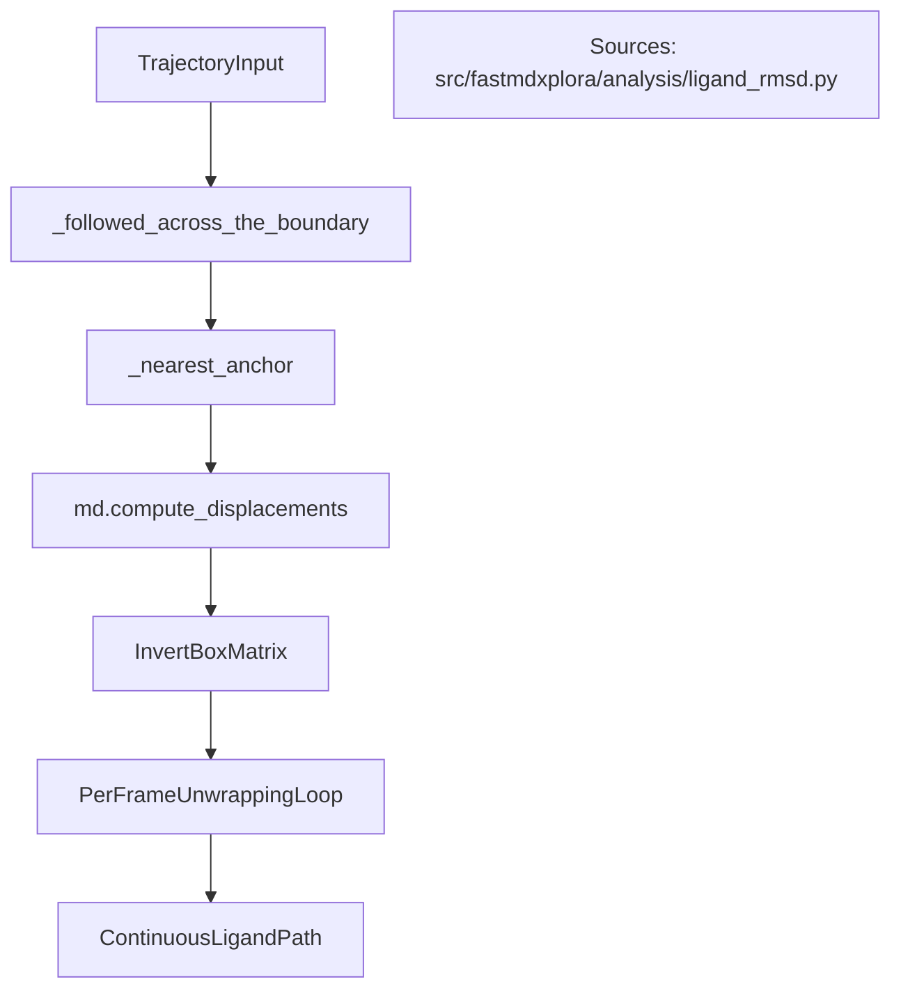
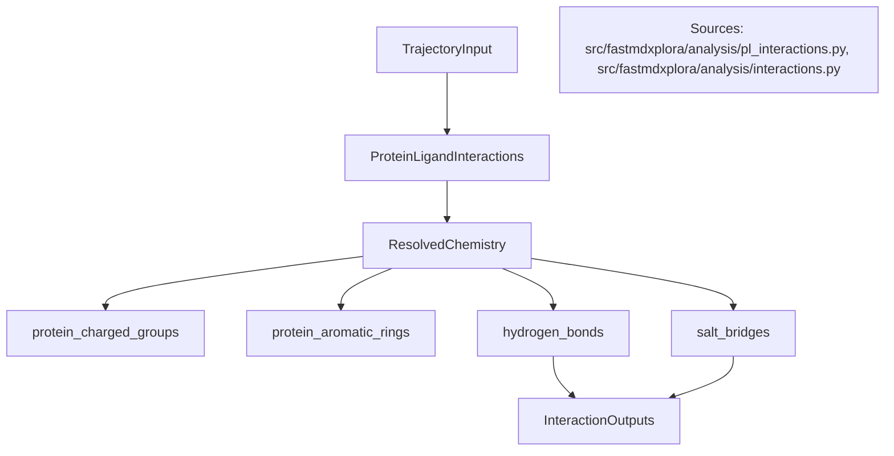

# Ligand, Interaction and Solvent Analyses

Relevant source files

The following files were used as context for generating this wiki page:

- [docs/interactions.md](docs/interactions.md)
- [docs/interactions_design.md](docs/interactions_design.md)
- [src/fastmdxplora/analysis/contacts.py](src/fastmdxplora/analysis/contacts.py)
- [src/fastmdxplora/analysis/describe.py](src/fastmdxplora/analysis/describe.py)
- [src/fastmdxplora/analysis/dihedrals.py](src/fastmdxplora/analysis/dihedrals.py)
- [src/fastmdxplora/analysis/interactions.py](src/fastmdxplora/analysis/interactions.py)
- [src/fastmdxplora/analysis/ligand_rmsd.py](src/fastmdxplora/analysis/ligand_rmsd.py)
- [src/fastmdxplora/analysis/ligand_rmsf.py](src/fastmdxplora/analysis/ligand_rmsf.py)
- [src/fastmdxplora/analysis/pl_hbonds.py](src/fastmdxplora/analysis/pl_hbonds.py)
- [src/fastmdxplora/analysis/pl_interactions.py](src/fastmdxplora/analysis/pl_interactions.py)
- [src/fastmdxplora/analysis/water_names.py](src/fastmdxplora/analysis/water_names.py)
- [src/fastmdxplora/analysis/water_sites.py](src/fastmdxplora/analysis/water_sites.py)
- [tests/test_a_charge_is_read_from_its_hydrogens.py](tests/test_a_charge_is_read_from_its_hydrogens.py)
- [tests/test_a_circle_is_measured_the_short_way.py](tests/test_a_circle_is_measured_the_short_way.py)
- [tests/test_a_ligand_is_followed_across_the_boundary.py](tests/test_a_ligand_is_followed_across_the_boundary.py)
- [tests/test_a_torsion_does_not_cross_a_gap.py](tests/test_a_torsion_does_not_cross_a_gap.py)
- [tests/test_a_water_site_turns_with_its_protein.py](tests/test_a_water_site_turns_with_its_protein.py)
- [tests/test_an_anchor_is_compared_to_its_reference.py](tests/test_an_anchor_is_compared_to_its_reference.py)
- [tests/test_analysis_layer.py](tests/test_analysis_layer.py)
- [tests/test_ligand_rmsd.py](tests/test_ligand_rmsd.py)
- [tests/test_pl_interactions_reports_what_it_saw.py](tests/test_pl_interactions_reports_what_it_saw.py)
- [tests/test_sub3_analyses.py](tests/test_sub3_analyses.py)
- [tests/test_the_narrow_repairs_hold.py](tests/test_the_narrow_repairs_hold.py)
- [tests/test_water_sites.py](tests/test_water_sites.py)
- [tests/test_what_holds_the_ligand_is_measured.py](tests/test_what_holds_the_ligand_is_measured.py)

## Purpose and Scope

This page documents the technical implementation of FastMDXplora's ligand, interaction, and solvent analysis subsystem. This subsystem quantifies protein-ligand binding stability, types non-covalent interactions frame-by-frame, resolves ligand chemistry and protonation states, and identifies persistent solvent molecules (water sites) within binding pockets. 

The primary components covered include pose RMSD and RMSF (`src/fastmdxplora/analysis/ligand_rmsd.py` [src/fastmdxplora/analysis/ligand_rmsd.py:1-41](), `src/fastmdxplora/analysis/ligand_rmsf.py`), typed non-covalent interaction profiling (`src/fastmdxplora/analysis/pl_interactions.py` [src/fastmdxplora/analysis/pl_interactions.py:1-17](), `src/fastmdxplora/analysis/interactions.py` [src/fastmdxplora/analysis/interactions.py:1-16]()), contact fingerprinting (`src/fastmdxplora/analysis/contacts.py` [src/fastmdxplora/analysis/contacts.py:1-23]()), and spatial water clustering (`src/fastmdxplora/analysis/water_sites.py` [src/fastmdxplora/analysis/water_sites.py:1-35]()).

Sources: `src/fastmdxplora/analysis/ligand_rmsd.py`, `src/fastmdxplora/analysis/pl_interactions.py`, `src/fastmdxplora/analysis/interactions.py`, `src/fastmdxplora/analysis/contacts.py`, `src/fastmdxplora/analysis/water_sites.py`

---

## Ligand Pose RMSD and RMSF

Measuring whether a ligand remains stable in its binding site requires separating global receptor tumbling from local ligand displacement. Standard global RMSD align and measure over the same atom set; ligand pose RMSD uses dual selections.

### Protein Alignment and Unwrapped Periodic Trajectories

In `src/fastmdxplora/analysis/ligand_rmsd.py` [src/fastmdxplora/analysis/ligand_rmsd.py:1-41](), each trajectory frame is rigidly superposed onto a reference frame using **protein atoms** to eliminate receptor tumbling. The RMSD is subsequently computed on the **ligand heavy atoms** using these pre-aligned coordinates.

A critical challenge in molecular dynamics trajectories is periodic boundary crossing. When a ligand unbinds or diffuses across a periodic box face, raw Cartesian coordinates jump by a lattice vector, producing artificial coordinate displacements. `src/fastmdxplora/analysis/ligand_rmsd.py` addresses this via the helper `_followed_across_the_boundary` [src/fastmdxplora/analysis/ligand_rmsd.py:58-107]():

Sources: `src/fastmdxplora/analysis/ligand_rmsd.py`

The unwrapping algorithm works as follows:
1. `_nearest_anchor` finds the protein anchor atom closest to any ligand atom in the initial frame using minimum image conventions [src/fastmdxplora/analysis/ligand_rmsd.py:93-104]().
2. `md.compute_displacements` calculates periodic displacements from the anchor to the ligand across all frames [src/fastmdxplora/analysis/ligand_rmsd.py:115-116]().
3. Consecutive frames enforce continuity: each frame selects the periodic image closest to its *predecessor* rather than the receptor origin, eliminating boundary jump artifacts [src/fastmdxplora/analysis/ligand_rmsd.py:121-125]().

Sources: `src/fastmdxplora/analysis/ligand_rmsd.py`

---

## Typed Protein-Ligand Interactions

Counting raw atom contacts reports spatial proximity rather than the physical forces anchoring a ligand. FastMDXplora implements typed non-covalent interaction classification in `src/fastmdxplora/analysis/pl_interactions.py` [src/fastmdxplora/analysis/pl_interactions.py:1-17]() and `src/fastmdxplora/analysis/interactions.py` [src/fastmdxplora/analysis/interactions.py:1-16]().

### Interaction Taxonomy and Geometric Criteria

Eight distinct interaction types are evaluated against rigorous published criteria:

| Interaction Type | Geometric Criterion | Published Source | Code Entity / Rule |
|---|---|---|---|
| **Hydrogen Bond** | Donor-Acceptor distance $< 3.5\text{ \AA}$, D-H...A angle $> 120^\circ$ | McDonald & Thornton (1994) [docs/interactions.md:24]() | `hydrogen_bonds` [src/fastmdxplora/analysis/interactions.py:30]() |
| **Hydrophobic Contact** | C...C distance $< 4.0\text{ \AA}$, carbons bonded only to C or H | PLIP [docs/interactions.md:25]() | `hydrophobic_contacts` [src/fastmdxplora/analysis/interactions.py:31]() |
| **Salt Bridge** | Opposite charged group centers $< 4.5\text{ \AA}$ | ProLIF [docs/interactions.md:26]() | `salt_bridges` [src/fastmdxplora/analysis/interactions.py:32]() |
| **$\pi$-Stacking** | Ring centers $< 5.5\text{ \AA}$, planes within $30^\circ$ parallel/perpendicular, offset $< 2.0\text{ \AA}$ | PLIP [docs/interactions.md:27]() | `pi_stacking` [src/fastmdxplora/analysis/interactions.py:37]() |
| **$\pi$-Cation** | Charge to ring center $< 6.0\text{ \AA}$, offset $< 2.0\text{ \AA}$ | PLIP [docs/interactions.md:28]() | `pi_cation` [src/fastmdxplora/analysis/interactions.py:38]() |
| **Halogen Bond** | X...A distance $< 3.5\text{ \AA}$, C-X...A angle $130^\circ-180^\circ$ | ProLIF [docs/interactions.md:29]() | `halogen_bonds` [src/fastmdxplora/analysis/interactions.py:41]() |
| **Metal Coordination** | Metal to donor distance $< 3.0\text{ \AA}$ | PLIP [docs/interactions.md:30]() | `metal_coordination` [src/fastmdxplora/analysis/interactions.py:42]() |
| **Water Bridge** | Water oxygen $2.5-4.1\text{ \AA}$ from acceptor and donor | PLIP [docs/interactions.md:31]() | `water_bridges` [src/fastmdxplora/analysis/interactions.py:44]() |

Sources: `src/fastmdxplora/analysis/interactions.py`, `docs/interactions.md`

### Chemistry Resolution and Refusal Philosophy

Chemical properties (bond orders, aromaticity, formal charges, and protonation states) are resolved prior to geometric evaluation [docs/interactions.md:67-78](). The pipeline checks three sources in order:
1. Supplied ligand SDF file via `ligand_chemistry` [docs/interactions.md:74]()
2. Setup-generated SDF (`setup/ligands/<resname>.sdf`) [docs/interactions.md:75-76]()
3. Coordinate-based RDKit inference [docs/interactions.md:77]()

Sources: `src/fastmdxplora/analysis/pl_interactions.py`, `src/fastmdxplora/analysis/interactions.py`

**Refusal Principles**:
- **Ambiguous Charges**: Formal charges inferred solely from coordinates are often ambiguous (e.g., guanidinium resonance). If charge cannot be verified, salt bridges and $\pi$-cation interactions are refused rather than guessed, while hydrogen bond analyses proceed [docs/interactions.md:109-114]().
- **Bondless Topologies**: Trajectories loaded from bare coordinate files (e.g., raw DCDs lacking bond definitions) are refused outright with a `StudyError` rather than returning zero interactions [docs/interactions.md:115-121]().

Sources: `src/fastmdxplora/analysis/interactions.py`, `docs/interactions.md`

### Contact Fingerprints

The `Contacts` analysis class (`src/fastmdxplora/analysis/contacts.py` [src/fastmdxplora/analysis/contacts.py:41]()) computes two complementary views:
1. **Per-frame contact count**: Number of protein residues with heavy atoms within `cutoff` (default $0.4\text{ nm}$) of the ligand [src/fastmdxplora/analysis/contacts.py:49-51]().
2. **Per-residue contact frequency**: Fraction of trajectory frames in which each specific residue contacts the ligand (`pl_contacts_per_residue.csv`) [src/fastmdxplora/analysis/contacts.py:20-22]().

Sources: `src/fastmdxplora/analysis/contacts.py`

---

## Solvent and Water Site Analysis

Persistent water molecules acting as structural bridges between protein and ligand are identified using spatial clustering in `src/fastmdxplora/analysis/water_sites.py` [src/fastmdxplora/analysis/water_sites.py:1-35]().

### Distinguishing Bound Waters from Bulk Passage

Clustering water oxygen coordinates alone cannot differentiate between a tightly bound water molecule (low positional variance, long residence time) and a structural site through which many distinct bulk waters pass [src/fastmdxplora/analysis/water_sites.py:13-23](). 

`WaterSites` computes both metrics for every identified cluster:
- **Occupancy**: Fraction of trajectory frames where the spatial cluster is occupied [src/fastmdxplora/analysis/water_sites.py:89-91]().
- **`n_distinct_waters`**: Count of unique water residue IDs visiting the cluster [src/fastmdxplora/analysis/water_sites.py:105-106]().
- **`longest_stay_frames`**: Maximum continuous residence time for a single water molecule [src/fastmdxplora/analysis/water_sites.py:106]().
- **`interpretation`**: Automatically flags whether a site holds a *bound* water or acts as a *passed through* structural density path [src/fastmdxplora/analysis/water_sites.py:70-90]().

To eliminate artifacts from protein rotation, water coordinates in every frame are transformed into the protein's local frame using Kabsch least-squares alignment (`_into`) prior to clustering [src/fastmdxplora/analysis/water_sites.py:31-35,57-68]().

Sources: `src/fastmdxplora/analysis/water_sites.py`

---