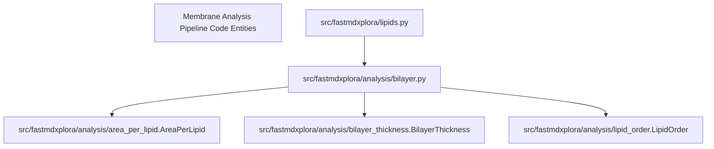
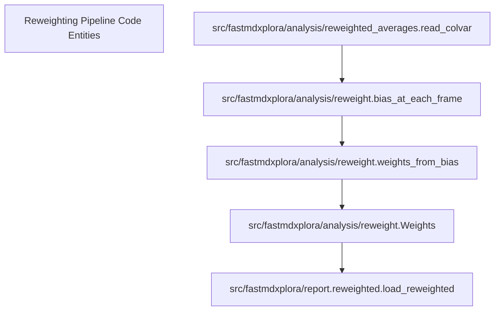

# Membrane, Thermodynamic and Reweighted Analyses

Relevant source files

The following files were used as context for generating this wiki page:

- [docs/membranes.md](docs/membranes.md)
- [src/fastmdxplora/analysis/area_per_lipid.py](src/fastmdxplora/analysis/area_per_lipid.py)
- [src/fastmdxplora/analysis/bilayer.py](src/fastmdxplora/analysis/bilayer.py)
- [src/fastmdxplora/analysis/bilayer_thickness.py](src/fastmdxplora/analysis/bilayer_thickness.py)
- [src/fastmdxplora/analysis/interaction_summary.py](src/fastmdxplora/analysis/interaction_summary.py)
- [src/fastmdxplora/analysis/lipid_order.py](src/fastmdxplora/analysis/lipid_order.py)
- [src/fastmdxplora/analysis/reweight.py](src/fastmdxplora/analysis/reweight.py)
- [src/fastmdxplora/analysis/reweighted_averages.py](src/fastmdxplora/analysis/reweighted_averages.py)
- [src/fastmdxplora/analysis/rg.py](src/fastmdxplora/analysis/rg.py)
- [src/fastmdxplora/analysis/thermodynamics.py](src/fastmdxplora/analysis/thermodynamics.py)
- [src/fastmdxplora/gui/figure_data.py](src/fastmdxplora/gui/figure_data.py)
- [src/fastmdxplora/gui/static/figure-chart.js](src/fastmdxplora/gui/static/figure-chart.js)
- [src/fastmdxplora/lipids.py](src/fastmdxplora/lipids.py)
- [src/fastmdxplora/report/reweighted.py](src/fastmdxplora/report/reweighted.py)
- [tests/test_a_bilayer_by_any_force_field_is_analysed.py](tests/test_a_bilayer_by_any_force_field_is_analysed.py)
- [tests/test_a_carried_on_study_reads_its_energy_whole.py](tests/test_a_carried_on_study_reads_its_energy_whole.py)
- [tests/test_four_more_figures_are_plotted.py](tests/test_four_more_figures_are_plotted.py)
- [tests/test_report_reweighted.py](tests/test_report_reweighted.py)
- [tests/test_residue_occupancy.py](tests/test_residue_occupancy.py)
- [tests/test_reweight.py](tests/test_reweight.py)
- [tests/test_reweighted_averages.py](tests/test_reweighted_averages.py)
- [tests/test_thermodynamics.py](tests/test_thermodynamics.py)

This page details the implementation, data flow, and classes responsible for membrane property calculations (area per lipid, bilayer thickness, lipid order), thermodynamic observable processing from simulation state tables, and the mathematical reweighting pipeline for biased molecular dynamics (such as metadynamics).

---

## 1. Membrane Analysis Pipeline

Membrane analyses require precise spatial identification of lipid molecules, their head groups, the bilayer centre, and individual leaflets. Because force fields vary significantly in how they name lipid components (e.g., CHARMM36 versus AMBER's Lipid17 and Lipid21), FastMDXplora abstracts these naming conventions through a centralized module [tests/test_a_bilayer_by_any_force_field_is_analysed.py:1-10]().

### Core Components and Data Flow

The analysis shares a common spatial infrastructure defined in `src/fastmdxplora/analysis/bilayer.py` [src/fastmdxplora/analysis/bilayer.py:1-20](). The membrane normal is assumed to lie along the $z$-axis [src/fastmdxplora/analysis/bilayer.py:8-12](). The centre of the bilayer is computed by finding the largest empty stretch along $z$ containing no lipid atoms, thereby correctly handling periodic boundary crossings [src/fastmdxplora/analysis/bilayer.py:15-19]().

Water molecules—including diverse models such as TIP3P, OPC, and SPC/E—are filtered out using name registries and chemical composition checks (`_is_water`) to prevent them from being misclassified as protein or lipid components [src/fastmdxplora/analysis/bilayer.py:87-161](). Phosphorus atoms in phospholipids are located via element symbols rather than static residue names, ensuring compatibility with alternative naming schemas like AMBER's `P31` [src/fastmdxplora/analysis/bilayer.py:163-173](), [tests/test_a_bilayer_by_any_force_field_is_analysed.py:81-92]().

*Sources: [src/fastmdxplora/analysis/bilayer.py:1-55](), [src/fastmdxplora/analysis/lipid_order.py:27-46](), [tests/test_a_bilayer_by_any_force_field_is_analysed.py:27-30]()*

### Lipid Order Parameters ($S_{CD}$)

The calculation of deuterium order parameters $S_{CD}$ for acyl-chain carbons is implemented in `src/fastmdxplora/analysis/lipid_order.py` [src/fastmdxplora/analysis/lipid_order.py:1-15](). To handle trajectories where atoms are wrapped across periodic boundaries, displacements are mapped to their nearest periodic image using fractional coordinate transformations in `_minimum_image` [src/fastmdxplora/analysis/lipid_order.py:60-75](). Covalent bonds and hydrogen neighbors are identified via interatomic distance criteria against covalent radii [src/fastmdxplora/analysis/lipid_order.py:77-90]().

Sources: [src/fastmdxplora/analysis/bilayer.py:1-173](), [src/fastmdxplora/analysis/lipid_order.py:1-167](), [tests/test_a_bilayer_by_any_force_field_is_analysed.py:1-153]()

---

## 2. Thermodynamic Analyses

Thermodynamic properties—such as potential energy, kinetic energy, total energy, temperature, volume, and density—are extracted directly from the state tables (energy logs) written during the simulation phase [src/fastmdxplora/analysis/thermodynamics.py:1-10]().

### Implementation and Ensemble Detection

State tables are parsed using `read_state_table()` in `src/fastmdxplora/analysis/thermodynamics.py` [src/fastmdxplora/analysis/thermodynamics.py:70-98](). Because OpenMM CSV headers quote field names (some containing internal commas), standard CSV reader parsing is utilized [src/fastmdxplora/analysis/thermodynamics.py:70-76]().

A critical aspect of thermodynamic reporting is ensemble awareness:
* **Density Verification:** Density is meaningful only under constant pressure (NPT). Under constant volume (NVT), the box does not fluctuate (`VOLUME_VARIES_ABOVE`), so density variance is zero; reporting a standard error in NVT would be mathematically misleading [src/fastmdxplora/analysis/thermodynamics.py:16-22]().
* **Joined Trajectory Segments:** For studies extended across multiple simulation segments, `state_record_pieces()` reconstructs the thermodynamic time series across checkpoints while accounting for segment overlaps and clock resets [src/fastmdxplora/analysis/thermodynamics.py:133-167]().

Each observable is treated as a correlated time series, incorporating statistical inefficiency corrections via `summarise()` to reflect the true number of independent samples [src/fastmdxplora/analysis/thermodynamics.py:11-15]().

Sources: [src/fastmdxplora/analysis/thermodynamics.py:1-167]()

---

## 3. Reweighted Analyses and Metadynamics Correction

Biased simulations—specifically metadynamics—deliberately distort the underlying free energy landscape to escape local minima [src/fastmdxplora/analysis/reweight.py:1-8](). Raw averages over biased trajectory frames represent sampling artifacts rather than true equilibrium properties. Fastmdxplora provides a rigorous reweighting pipeline to recover unbiased ensemble averages [src/fastmdxplora/analysis/reweighted_averages.py:1-23]().

### Time-Dependent Bias Reconstruction

The pipeline reconstructs the exact bias experienced by each frame using the history of deposited hills [src/fastmdxplora/analysis/reweight.py:16-22]():
1. **Colvar Parsing:** `read_colvar()` parses PLUMED `COLVAR` files by header field names to correctly interpret multi-dimensional collective variables and bias columns [src/fastmdxplora/analysis/reweighted_averages.py:68-103]().
2. **Per-Frame Bias:** `bias_at_each_frame()` calculates the sum of Gaussian hills deposited strictly *before* each specific frame timestamp, avoiding the common error of applying final-state bias retroactively [src/fastmdxplora/analysis/reweight.py:91-130]().
3. **Weight Normalization:** `weights_from_bias()` converts the bias array into normalized statistical weights via $\exp((V - \max(V)) / k_B T)$, preventing floating-point overflow during exponentiation [src/fastmdxplora/analysis/reweight.py:132-161]().

*Sources: [src/fastmdxplora/analysis/reweighted_averages.py:68-103](), [src/fastmdxplora/analysis/reweight.py:91-161](), [src/fastmdxplora/report/reweighted.py:41-65]()*

### Effective Sample Size and Withholding Philosophy

The resulting `Weights` dataclass tracks two vital quality metrics [src/fastmdxplora/analysis/reweight.py:54-90]():
* **Effective Sample Size (`effective_sample_size`):** Kish's formula computes weight-concentration effective frames $(\sum w)^2 / \sum w^2$, identifying situations where weights concentrate in only a handful of frames [src/fastmdxplora/analysis/reweight.py:61-72]().
* **Independent Samples:** Dividing the effective frame count by the collective variable's statistical inefficiency yields the true independent sample count [src/fastmdxplora/analysis/reweight.py:67-72]().

### Exclusion of Non-Reweightable Biases

Umbrella sampling and steered molecular dynamics are deliberately excluded from reweighting [src/fastmdxplora/analysis/reweighted_averages.py:9-15]():
* **Umbrella Windows:** Individual umbrella windows sample constrained states held by harmonic restraints; combining them requires a Potential of Mean Force (PMF) reconstruction rather than simple frame reweighting [src/fastmdxplora/analysis/reweighted_averages.py:11-14]().
* **Steered Pulls:** Steered MD represents a non-equilibrium process lacking an equilibrium ensemble [src/fastmdxplora/analysis/reweighted_averages.py:13-14]().

These limitations are explicitly codified in `NOT_REWEIGHTABLE` and surfaced directly in the generated reports [src/fastmdxplora/analysis/reweighted_averages.py:154-163](), [src/fastmdxplora/report/reweighted.py:1-65]().

Sources: [src/fastmdxplora/analysis/reweight.py:1-162](), [src/fastmdxplora/analysis/reweighted_averages.py:1-163](), [src/fastmdxplora/report/reweighted.py:1-320](), [tests/test_reweighted_averages.py:1-100]()

---