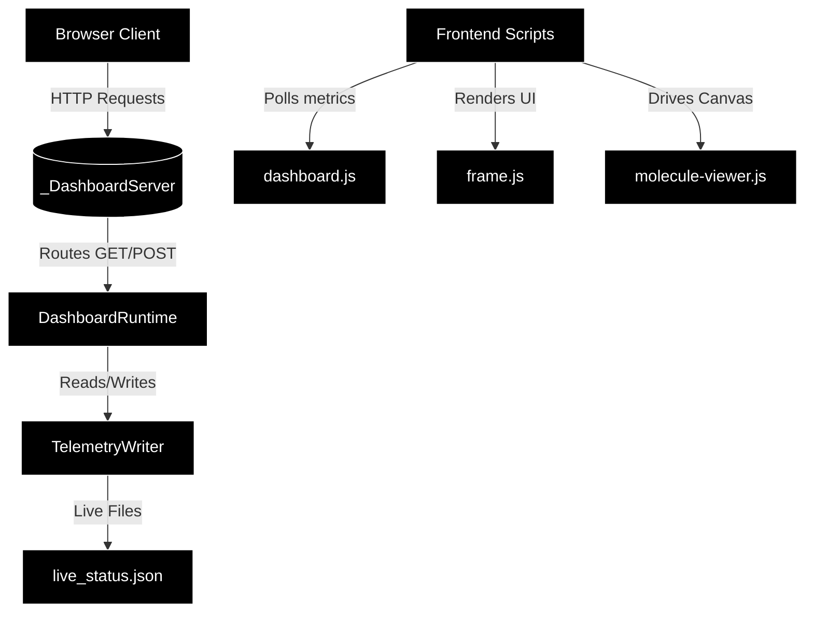
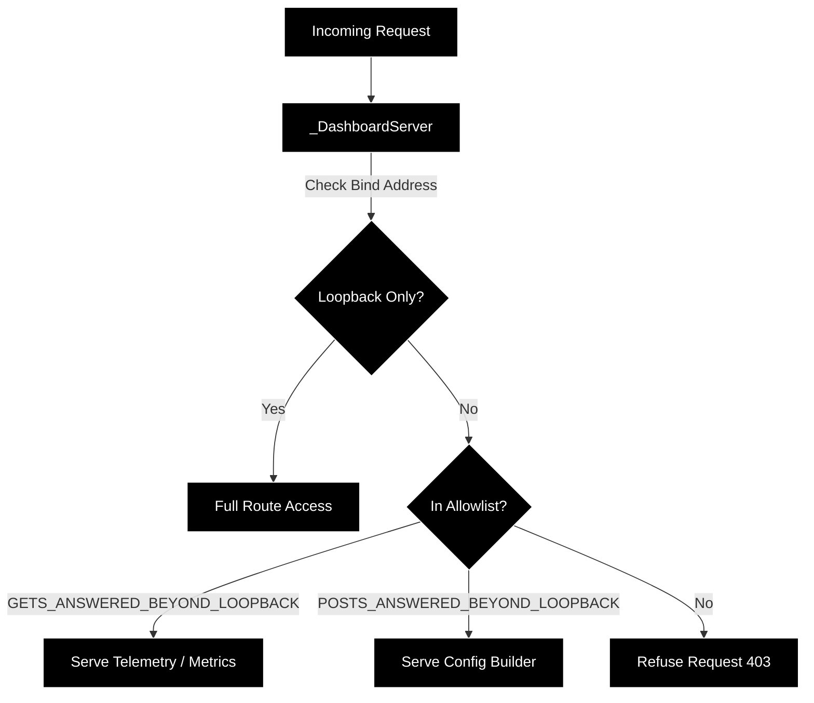

# Graphical User Interface

Relevant source files

The following files were used as context for generating this wiki page:

- [CHANGELOG.md](CHANGELOG.md)
- [docs/gui.md](docs/gui.md)
- [src/fastmdxplora/gui/report_dashboard.py](src/fastmdxplora/gui/report_dashboard.py)
- [src/fastmdxplora/gui/server.py](src/fastmdxplora/gui/server.py)
- [src/fastmdxplora/gui/static/dashboard.css](src/fastmdxplora/gui/static/dashboard.css)
- [src/fastmdxplora/gui/static/dashboard.js](src/fastmdxplora/gui/static/dashboard.js)
- [src/fastmdxplora/gui/static/frame.js](src/fastmdxplora/gui/static/frame.js)
- [src/fastmdxplora/gui/static/molecule-viewer.js](src/fastmdxplora/gui/static/molecule-viewer.js)
- [src/fastmdxplora/gui/static/viewer-engine.js](src/fastmdxplora/gui/static/viewer-engine.js)
- [src/fastmdxplora/gui/telemetry.py](src/fastmdxplora/gui/telemetry.py)
- [src/fastmdxplora/gui/templates/dashboard.html](src/fastmdxplora/gui/templates/dashboard.html)
- [tests/test_a_public_dashboard_answers_only_what_it_lists.py](tests/test_a_public_dashboard_answers_only_what_it_lists.py)
- [tests/test_gui.py](tests/test_gui.py)
- [tests/test_live_status.py](tests/test_live_status.py)
- [tests/test_the_frame_holds_the_study.py](tests/test_the_frame_holds_the_study.py)

## Purpose and Scope
This page provides an architectural overview of FastMDXplora's dependency-free localhost dashboard (`fastmdx gui`), spanning its HTTP server backend, responsive three-column shell, Mol*-based molecular viewer, schema-driven configuration and reporting pages, and runtime exploration controls. 

For deep technical details, implementation specifics, and edge-case handling, refer to the child pages linked throughout this document.

---

## Architecture Overview

The graphical user interface is built as a zero-dependency localhost web application. It requires no external CDN assets or internet access, making it fully compatible with air-gapped clusters and compute nodes [docs/gui.md:35-37]. The system connects natural language space requirements and user interactions to specific code entities across the Python backend and browser frontend.

*Figure 4.1: High-level GUI server-client integration linking backend handlers to frontend controller modules.*

Sources: `src/fastmdxplora/gui/server.py:89-122`, `src/fastmdxplora/gui/static/dashboard.js:1-12`, `src/fastmdxplora/gui/static/frame.js:1-12`, `src/fastmdxplora/gui/static/molecule-viewer.js:1-10`

---

## GUI Server, Routing and Security

The dashboard server is implemented around `_DashboardServer`, a subclass of `ThreadingHTTPServer` defined in `src/fastmdxplora/gui/server.py` [src/fastmdxplora/gui/server.py:89-122]. It overrides error handlers to gracefully suppress `ConnectionError` traces when browser tabs disconnect mid-transfer [src/fastmdxplora/gui/server.py:116-122]. 

Security boundaries are enforced via allowlists such as `GETS_ANSWERED_BEYOND_LOOPBACK` and `POSTS_ANSWERED_BEYOND_LOOPBACK` [src/fastmdxplora/gui/server.py:144-162], preventing unauthorized remote access to sensitive file-system navigation routes or execution controls when bound outside the loopback address.

*Figure 4.2: Security and route filtering flow through `_DashboardServer` routing definitions.*

Sources: `src/fastmdxplora/gui/server.py:89-162`

For implementation details, route pre-importing, workspace browsing, and file picker mechanics, see [GUI Server, Routing and Security](#4.1).

---

## Dashboard Shell and Live Telemetry

The visual shell uses a matte black design system and a three-column application layout managed by `frame.js` and `dashboard.css` [src/fastmdxplora/gui/static/dashboard.css:1-3, src/fastmdxplora/gui/static/frame.js:1-12]. It maintains split-pane sizing, side panel collapses, and theme selection (system, light, dark) stored in local browser state.

Live telemetry relies on background polling orchestrated by `dashboard.js` [src/fastmdxplora/gui/static/dashboard.js:1-8], reading asynchronous status updates, energy metrics, and event logs generated by `TelemetryWriter` [tests/test_gui.py:91-106].

For details on the three-column shell, live status files, telemetry parsing, and theme integration, see [Dashboard Shell and Live Telemetry](#4.2).

Sources: `src/fastmdxplora/gui/static/dashboard.css:1-3`, `src/fastmdxplora/gui/static/dashboard.js:1-8`, `src/fastmdxplora/gui/static/frame.js:1-12`, `tests/test_gui.py:91-106`

---

## Molecular Viewer and Scenes

Molecular visualization is driven by `molecule-viewer.js` [src/fastmdxplora/gui/static/molecule-viewer.js:1-10] wrapping the Mol* engine wrapper (`viewer-engine.js`). It handles structural loading, live simulation coordinate streaming [src/fastmdxplora/gui/static/molecule-viewer.js:45-51], atomic selections, pocket detection settings, trajectory superpositions, and custom rendering states.

For details on trajectory frame serving, motion analysis, measurements, saved views, and MolViewSpec scenes, see [Molecular Viewer and Scenes](#4.3).

Sources: `src/fastmdxplora/gui/static/molecule-viewer.js:1-10`

---

## Config Builder, Overview, Analysis and Report Pages

The configuration builder translates the core Python validation schema into interactive form fields. It provides real-time warnings, draft preservation [CHANGELOG.md:83-90], and schema payloads. Analytical results and summaries are rendered via structured report modules like `report_dashboard.py` [src/fastmdxplora/gui/report_dashboard.py:1-5], grouping analyses into thematic categories [src/fastmdxplora/gui/report_dashboard.py:25-86].

For details on the schema-driven form builder, validation warnings, overview metrics, series charts, and report templates, see [Config Builder, Overview, Analysis and Report Pages](#4.4).

Sources: `CHANGELOG.md:83-90`, `src/fastmdxplora/gui/report_dashboard.py:1-86`

---

## Running Studies from the GUI

Exploration tasks, run lifecycles, and in-place extensions are managed through `exploration.py` [src/fastmdxplora/gui/exploration.py:1-36]. Users can trigger study executions, resume interrupted segments [CHANGELOG.md:96-104], perform re-analyses, inspect run notices, and manage workspace files directly from the dashboard interface.

For details on the run lifecycle, segment joining, fix applications, and run execution management, see [Running Studies from the GUI](#4.5).

Sources: `CHANGELOG.md:96-104`, `src/fastmdxplora/gui/exploration.py:1-36`

---