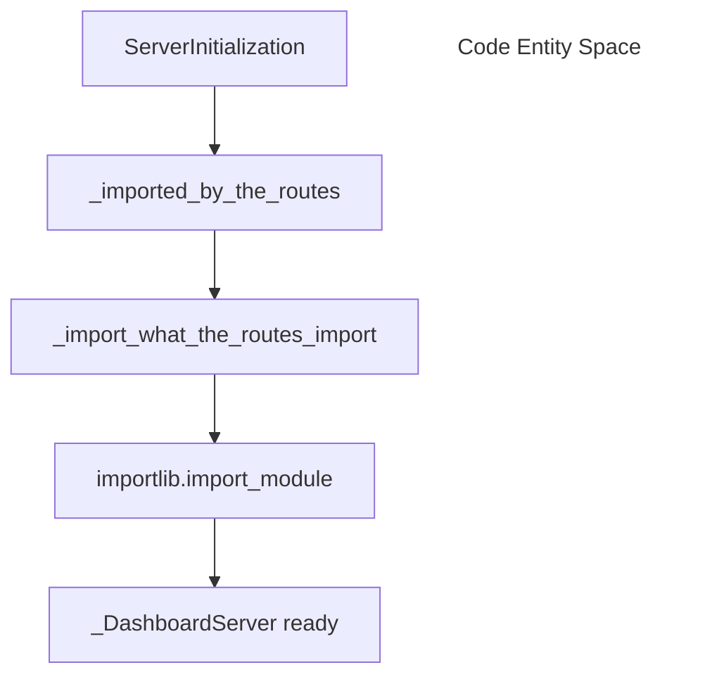
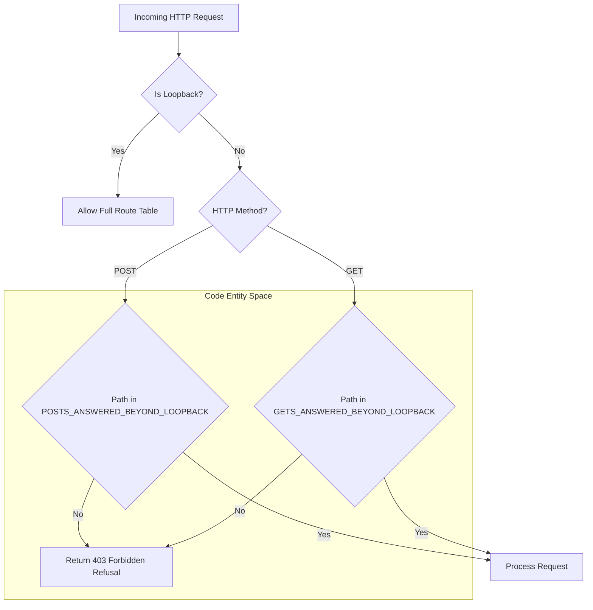
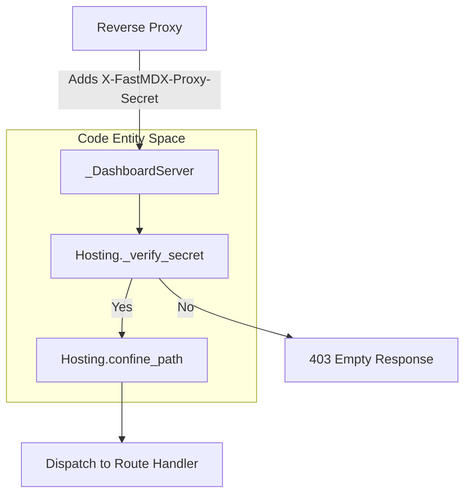

# GUI Server, Routing and Security

Relevant source files

The following files were used as context for generating this wiki page:

- [.github/workflows/container.yml](.github/workflows/container.yml)
- [CHANGELOG.md](CHANGELOG.md)
- [container/docker_from_def.py](container/docker_from_def.py)
- [container/fastmdx.def](container/fastmdx.def)
- [docs/gui.md](docs/gui.md)
- [docs/hosting.md](docs/hosting.md)
- [src/fastmdxplora/__main__.py](src/fastmdxplora/__main__.py)
- [src/fastmdxplora/config/diff.py](src/fastmdxplora/config/diff.py)
- [src/fastmdxplora/gui/browse.py](src/fastmdxplora/gui/browse.py)
- [src/fastmdxplora/gui/hosting.py](src/fastmdxplora/gui/hosting.py)
- [src/fastmdxplora/gui/route_imports.py](src/fastmdxplora/gui/route_imports.py)
- [src/fastmdxplora/gui/server.py](src/fastmdxplora/gui/server.py)
- [src/fastmdxplora/gui/static/dashboard.css](src/fastmdxplora/gui/static/dashboard.css)
- [src/fastmdxplora/gui/static/file-picker.js](src/fastmdxplora/gui/static/file-picker.js)
- [src/fastmdxplora/gui/static/molecule-viewer.js](src/fastmdxplora/gui/static/molecule-viewer.js)
- [src/fastmdxplora/gui/static/palette.js](src/fastmdxplora/gui/static/palette.js)
- [src/fastmdxplora/gui/static/viewer-engine.js](src/fastmdxplora/gui/static/viewer-engine.js)
- [src/fastmdxplora/gui/templates/dashboard.html](src/fastmdxplora/gui/templates/dashboard.html)
- [src/fastmdxplora/gui/workspace.py](src/fastmdxplora/gui/workspace.py)
- [tests/test_a_first_page_load_is_answered_whole.py](tests/test_a_first_page_load_is_answered_whole.py)
- [tests/test_a_public_dashboard_answers_only_what_it_lists.py](tests/test_a_public_dashboard_answers_only_what_it_lists.py)
- [tests/test_anything_is_found_by_typing.py](tests/test_anything_is_found_by_typing.py)
- [tests/test_the_command_runs_once_as_main.py](tests/test_the_command_runs_once_as_main.py)
- [tests/test_the_container_carries_the_ligand_path.py](tests/test_the_container_carries_the_ligand_path.py)
- [tests/test_the_docker_image_is_the_apptainer_image.py](tests/test_the_docker_image_is_the_apptainer_image.py)
- [tests/test_the_lab_mark_and_the_pinned_sidebar.py](tests/test_the_lab_mark_and_the_pinned_sidebar.py)
- [tests/test_two_studies_are_compared_setting_by_setting.py](tests/test_two_studies_are_compared_setting_by_setting.py)

The graphical user interface (GUI) of FastMDXplora is driven by a dependency-free localhost dashboard server. This page details the implementation of `_DashboardServer`, dynamic route importing to prevent deadlocks, loopback and non-loopback allowlists, multi-tenant hosting mode via proxy integration, workspace browsing, and file picking mechanisms.

---

## 1. The Dashboard Server and `_DashboardServer`

The underlying HTTP engine uses standard library primitives (`ThreadingHTTPServer` and `BaseHTTPRequestHandler`) without external web frameworks. To prevent socket exceptions from flooding the terminal during normal browser disconnects (such as closing a tab or reloading mid-request), `_DashboardServer` overrides error logging for network connection drops [src/fastmdxplora/gui/server.py:89-122]().

### Circular Import Preventions and Route Imports

Because the dashboard server handles diverse requests spanning configuration, simulation telemetry, analysis, and molecular structures, it relies on a dedicated module registry (`route_imports.py`) to pre-load required dependencies. `_DashboardServer.__init__` invokes `_import_what_the_routes_import()` ahead of serving requests to avoid Python circular import deadlocks under concurrent request handling [src/fastmdxplora/gui/server.py:69-106]().

Sources: `src/fastmdxplora/gui/server.py` [src/fastmdxplora/gui/server.py:69-123]()

---

## 2. Routing, Dispatch, and Loopback Allowlists

The server dispatches HTTP requests via `make_handler` [tests/test_a_public_dashboard_answers_only_what_it_lists.py:79-80](). When the dashboard is bound to a non-loopback network address (e.g., `0.0.0.0`), the trust model shifts: there is no local login, so the bind address and explicit route allowlists serve as the primary security barrier [tests/test_a_public_dashboard_answers_only_what_it_lists.py:1-22]().

### Allowlists for Non-Loopback Binding

To prevent unauthorized file reads or remote study switches over an open network interface, explicit allowlists define which routes remain accessible:
- `POSTS_ANSWERED_BEYOND_LOOPBACK`: Restricts all POST actions except for safe schema/config generation (`/api/config`) [src/fastmdxplora/gui/server.py:137]().
- `GETS_ANSWERED_BEYOND_LOOPBACK`: Limits GET traffic to basic status checks, active run telemetry, and specific visualization frames [src/fastmdxplora/gui/server.py:144-161]().

Sources: `src/fastmdxplora/gui/server.py` [src/fastmdxplora/gui/server.py:125-161](), `tests/test_a_public_dashboard_answers_only_what_it_lists.py` [tests/test_a_public_dashboard_answers_only_what_it_lists.py:1-22]()

---

## 3. Hosting Mode and Proxy Integration (`Hosting`)

When deploying FastMDXplora for multi-tenant or shared access via `fastmdx gui --hosted`, standard loopback trust is replaced by an external proxy architecture [docs/hosting.md:1-18]().

### Security Headers and Controls

The `Hosting` class enforces strict isolation through environment configuration and incoming HTTP headers [src/fastmdxplora/gui/hosting.py:1-42]():
1. **Proxy Secret (`X-FastMDX-Proxy-Secret`)**: Validated against `FASTMDX_PROXY_SECRET`. Requests lacking this header or carrying an invalid token receive an immediate `403` response before path evaluation [docs/hosting.md:14-39]().
2. **Allowed Hosts**: Host headers and `Origin` fields must match the list provided via `--allowed-host` [docs/hosting.md:15]().
3. **Workspace Confinement**: All file system operations are restricted strictly within the workspace directory. Path traversal attempts or symlinks escaping the workspace are blocked [docs/hosting.md:16]().
4. **Account Naming (`X-FastMDX-Account-Name`)**: Percent-encoded UTF-8 strings identifying the authenticated user are passed by the proxy and displayed as user initials in the sidebar footer [docs/hosting.md:44-92]().
5. **Memory Stores**: Supports custom user memory backends (`--memory-dir` or `--memory-store`) to isolate Agent conversational memory per user [docs/hosting.md:113-142]().

Sources: `src/fastmdxplora/gui/hosting.py` [src/fastmdxplora/gui/hosting.py:1-42](), `docs/hosting.md` [docs/hosting.md:1-49]()

---

## 4. Workspace Browsing and File Picking

The dashboard provides structured workspace navigation to manage multiple MD studies. The backend module `workspace.py` discovers study folders, extracts structural metadata, generates summary cards, and performs pairwise study comparisons [src/fastmdxplora/gui/workspace.py:1-13]().

### Workspace Scanning (`studies_in`)

The function `studies_in` walks the directory tree up to a defined depth (`DEEPEST = 3`, `MOST = 200`), omitting hidden directories and internal simulation subfolders (`_INSIDE_A_STUDY`) [src/fastmdxplora/gui/workspace.py:32-79](). When a directory satisfies `is_study`, it is indexed as a study card containing:
- Resolved configuration or exploration parameters (`card_of`) [src/fastmdxplora/gui/workspace.py:102-118]().
- System identification (`system_id`) [src/fastmdxplora/gui/workspace.py:115]().
- Recorded analytical means, tags, and thumbnails [src/fastmdxplora/gui/workspace.py:122-133]().

Sources: `src/fastmdxplora/gui/workspace.py` [src/fastmdxplora/gui/workspace.py:1-157](), `src/fastmdxplora/gui/browse.py`

---