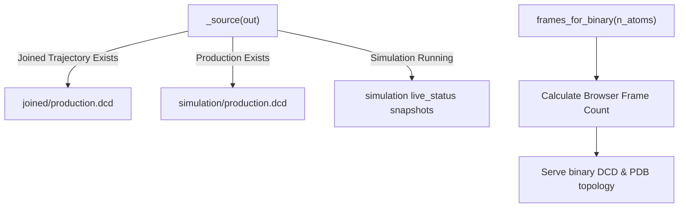

# Molecular Viewer and Scenes

<details>
<summary>Relevant source files</summary>

The following files were used as context for generating this wiki page:

- [src/fastmdxplora/gui/by_residue.py](src/fastmdxplora/gui/by_residue.py)
- [src/fastmdxplora/gui/interactions_over_frames.py](src/fastmdxplora/gui/interactions_over_frames.py)
- [src/fastmdxplora/gui/live_frames.py](src/fastmdxplora/gui/live_frames.py)
- [src/fastmdxplora/gui/measure.py](src/fastmdxplora/gui/measure.py)
- [src/fastmdxplora/gui/motion.py](src/fastmdxplora/gui/motion.py)
- [src/fastmdxplora/gui/occupancy.py](src/fastmdxplora/gui/occupancy.py)
- [src/fastmdxplora/gui/runs_together.py](src/fastmdxplora/gui/runs_together.py)
- [src/fastmdxplora/gui/saved_views.py](src/fastmdxplora/gui/saved_views.py)
- [src/fastmdxplora/gui/selection.py](src/fastmdxplora/gui/selection.py)
- [src/fastmdxplora/gui/static/viewer-selections.js](src/fastmdxplora/gui/static/viewer-selections.js)
- [src/fastmdxplora/gui/static/viewer-views.js](src/fastmdxplora/gui/static/viewer-views.js)
- [src/fastmdxplora/gui/trajectory_frames.py](src/fastmdxplora/gui/trajectory_frames.py)
- [src/fastmdxplora/gui/viewer_selections.py](src/fastmdxplora/gui/viewer_selections.py)
- [src/fastmdxplora/scenes.py](src/fastmdxplora/scenes.py)
- [tests/test_a_scene_is_opened_and_written_by_an_ai_app.py](tests/test_a_scene_is_opened_and_written_by_an_ai_app.py)
- [tests/test_a_series_follows_the_frame_played.py](tests/test_a_series_follows_the_frame_played.py)
- [tests/test_a_study_s_main_motion_is_shown.py](tests/test_a_study_s_main_motion_is_shown.py)
- [tests/test_a_view_is_saved_with_the_study.py](tests/test_a_view_is_saved_with_the_study.py)
- [tests/test_play_plays_from_the_first_frame.py](tests/test_play_plays_from_the_first_frame.py)
- [tests/test_selections_are_typed_named_and_shown.py](tests/test_selections_are_typed_named_and_shown.py)
- [tests/test_the_agent_s_scene_is_shown_before_it_is_written.py](tests/test_the_agent_s_scene_is_shown_before_it_is_written.py)
- [tests/test_the_drawing_scripts_run_in_a_browser.py](tests/test_the_drawing_scripts_run_in_a_browser.py)
- [tests/test_the_frames_are_fitted_to_a_structure.py](tests/test_the_frames_are_fitted_to_a_structure.py)
- [tests/test_the_frames_are_smoothed.py](tests/test_the_frames_are_smoothed.py)
- [tests/test_the_frames_are_superposed_as_asked.py](tests/test_the_frames_are_superposed_as_asked.py)
- [tests/test_the_frames_arrive_in_pieces.py](tests/test_the_frames_arrive_in_pieces.py)
- [tests/test_the_runs_of_a_study_play_together.py](tests/test_the_runs_of_a_study_play_together.py)
- [tests/test_the_viewer_has_one_toolbar.py](tests/test_the_viewer_has_one_toolbar.py)
- [tests/test_the_viewer_has_the_window.py](tests/test_the_viewer_has_the_window.py)
- [tests/test_where_the_ligand_and_water_go.py](tests/test_where_the_ligand_and_water_go.py)

</details>


## Purpose and Scope

This page details the implementation of FastMDXplora's molecular viewer integration, built around a custom Python backend for trajectory frame serving, atomic selections, and scene serialization, combined with a browser-side wrapper for the Mol* viewer engine. It covers binary trajectory streaming, selection syntax validation against topologies, analysis-driven per-residue coloring, saved views, multi-replica synchronized playback, and export/import via MolViewSpec (MVS) scene archives.

---

## 1. Mol* Viewer Wrapper and Architecture

The graphical dashboard integrates Mol* via a unified browser wrapper exposing the global state object `window.FastMDXMoleculeViewer`. The viewer coordinates rendering tasks, camera manipulations, representation modes (`sticks`, `spheres`, `lines`, `surface`, `cartoon`), and color themes (`chain`, `spectrum`, `residue`, `element`, `secondary_structure`) through a single structured toolbar (`tests/test_the_viewer_has_one_toolbar.py:1-15`).

```mermaid
graph TD
    subcode["Code Entity Space"]
        A["window.FastMDXMoleculeViewer"] --> B["FastMDXMoleculeViewer.STATE"]
        B --> C["engine"]
        D["src/fastmdxplora/gui/static/viewer-views.js"] --> E["showScene(name)"]
        F["tests/test_the_drawing_scripts_run_in_a_browser.py"] --> G["page fixture"]
    end
    subnatural["Natural Language Space"]
        H["Browser Rendering Canvas"] --> I["Viewer Toolbar Actions"]
        I --> J["Trajectory Frame Playback"]
    end
    subcode -.-> subnatural
```
**Diagram 1:** Bridging user-facing viewer controls to browser automation and state management entities.

Sources: `tests/test_the_drawing_scripts_run_in_a_browser.py:31-33`, `src/fastmdxplora/gui/static/viewer-views.js:16-136`, `tests/test_the_viewer_has_one_toolbar.py:29-66`

---

## 2. Trajectory Frame Serving and Binary Streaming

To bypass the memory and parsing limits of multi-model PDB files, FastMDXplora serves trajectories as binary binary streams consisting of a single topology PDB (`frames_topology.pdb`) followed by fixed-size coordinate frames via DCD (`frames.dcd`).

The backend module `src/fastmdxplora/gui/trajectory_frames.py` determines the number of frames to send based on system size and a maximum limit defined by `BINARY_ATOM_FRAMES` (10,000,000 atom-frames) and `MOST_FRAMES` (2,000) [src/fastmdxplora/gui/trajectory_frames.py:38-58]().


**Diagram 2:** Trajectory source resolution and binary frame throttling logic.

Sources: `src/fastmdxplora/gui/trajectory_frames.py:38-124`

---

## 3. Selections and Expression Translation

Atomic selections within the viewer are parsed using MDTraj's domain-specific selection language. The utility functions in `src/fastmdxplora/gui/viewer_selections.py` evaluate expressions against the active topology, validating syntax, catching incomplete expressions (`_unfinished`), and returning matching atom index lists [src/fastmdxplora/gui/viewer_selections.py:43-73]().

Additionally, click-to-select interactions map picked atoms back to formal configuration syntax (`selection_for`), allowing researchers to generate precise selection strings for analysis configs [src/fastmdxplora/gui/selection.py:67-140]().

```mermaid
graph TD
    subcode["Code Entity Space"]
        A["src/fastmdxplora/gui/viewer_selections.py"] --> B["atoms_selected(pdb, expression, key)"]
        B --> C["_unfinished(expression)"]
        D["src/fastmdxplora/gui/selection.py"] --> E["selection_for(root, chain, resseq, resname, atom)"]
    end
    subnatural["Natural Language Space"]
        F["Type MDTraj Expression"] --> G["Syntax & Completeness Check"]
        G --> H["Resolved Atom Indices"]
    end
    subcode -.-> subnatural
```
**Diagram 3:** Mapping textual and interactive selection inputs to backend MDTraj evaluation routines.

Sources: `src/fastmdxplora/gui/viewer_selections.py:43-114`, `src/fastmdxplora/gui/selection.py:67-140`

---

## 4. Per-Residue Properties and DSSP Calculation

The GUI supports coloring structures by computed per-residue analysis metrics (such as RMSF, SASA, ligand contacts, and N-H order parameters). The module `src/fastmdxplora/gui/by_residue.py` reads these tables directly from completed analysis runs without recomputing values [src/fastmdxplora/gui/by_residue.py:49-94](). Secondary structures are calculated dynamically frame-by-frame via MDTraj's DSSP implementation to maintain visual consistency with analysis charts.

Sources: `src/fastmdxplora/gui/by_residue.py:1-94`

---

## 5. Saved Views, Scenes, and MolViewSpec

Camera positions, active frames, representation styles, and selections can be saved as named views (`viewer_views.json`) or exported as standardized MolViewSpec (MVS) `.mvsj` scene archives (`src/fastmdxplora/scenes.py`) [src/fastmdxplora/scenes.py:1-24](). MVS archives embed structure files with explicit DSSP `HELIX` and `SHEET` annotations alongside custom FastMDXplora metadata (`custom.fastmdxplora`).

Sources: `src/fastmdxplora/gui/static/viewer-views.js:1-136`, `src/fastmdxplora/scenes.py:1-46`

---

## 6. Multi-Run Synchronized Playback

For studies containing multiple replicas or parameter sweeps, `src/fastmdxplora/gui/runs_together.py` enables simultaneous playback of multiple trajectories in a single viewer canvas [src/fastmdxplora/gui/runs_together.py:1-21](). Replicas sharing identical topologies are spatially aligned on the protein backbone relative to the primary run and rendered using distinct palette colors (`RUN_COLOURS`) [src/fastmdxplora/gui/runs_together.py:34-112]().

Sources: `src/fastmdxplora/gui/runs_together.py:1-112`

---