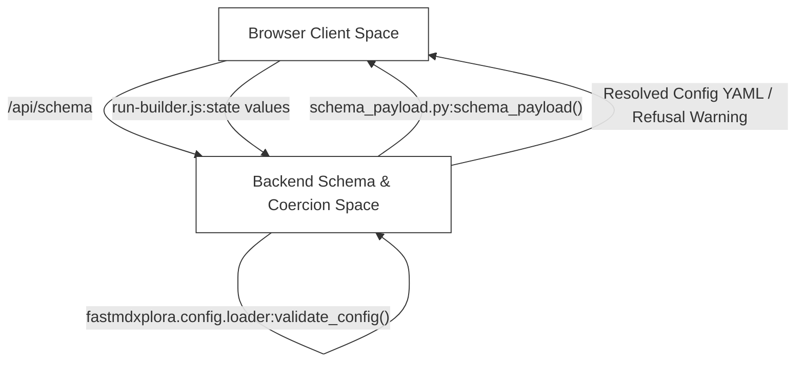
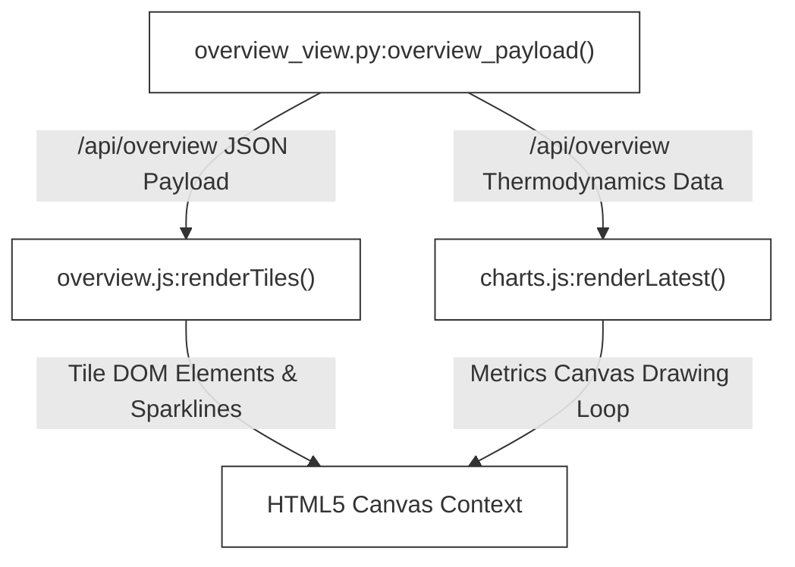
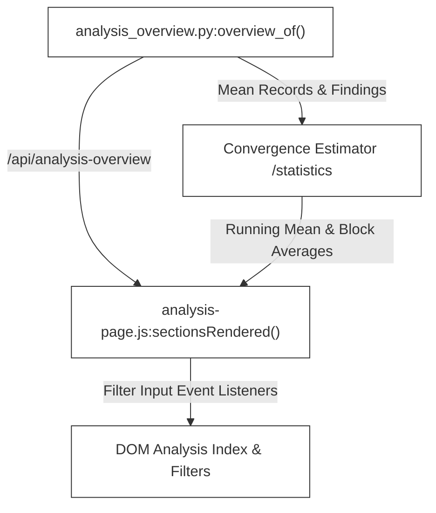
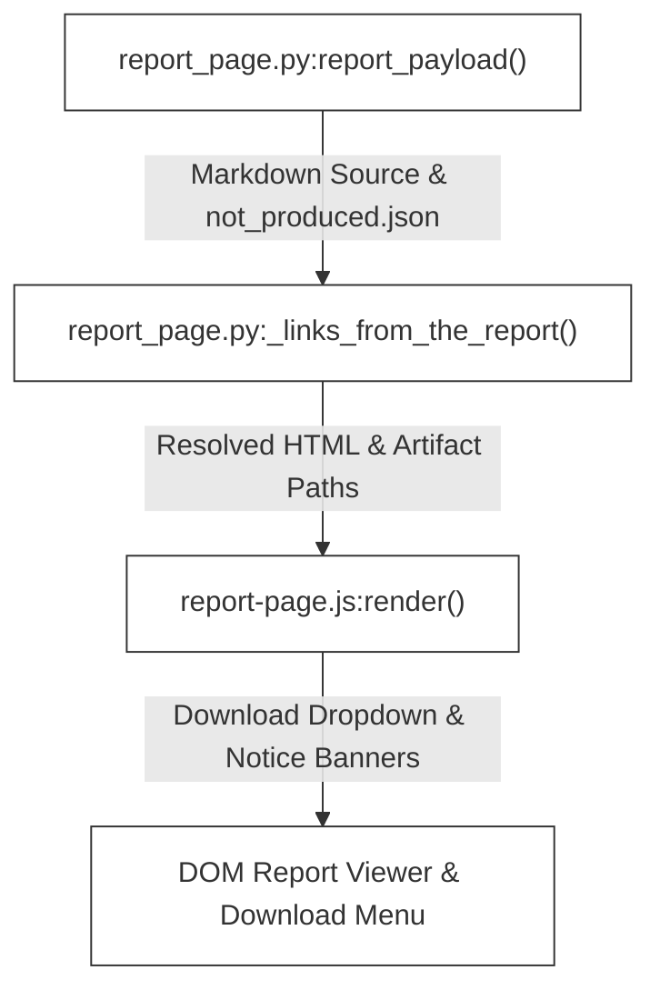

# Config Builder, Overview, Analysis and Report Pages

Relevant source files

The following files were used as context for generating this wiki page:

- [src/fastmdxplora/gui/analysis_overview.py](src/fastmdxplora/gui/analysis_overview.py)
- [src/fastmdxplora/gui/config_builder.py](src/fastmdxplora/gui/config_builder.py)
- [src/fastmdxplora/gui/ligand_detection.py](src/fastmdxplora/gui/ligand_detection.py)
- [src/fastmdxplora/gui/overview_view.py](src/fastmdxplora/gui/overview_view.py)
- [src/fastmdxplora/gui/report_page.py](src/fastmdxplora/gui/report_page.py)
- [src/fastmdxplora/gui/schema_payload.py](src/fastmdxplora/gui/schema_payload.py)
- [src/fastmdxplora/gui/series.py](src/fastmdxplora/gui/series.py)
- [src/fastmdxplora/gui/static/analysis-page.js](src/fastmdxplora/gui/static/analysis-page.js)
- [src/fastmdxplora/gui/static/charts.js](src/fastmdxplora/gui/static/charts.js)
- [src/fastmdxplora/gui/static/overview.js](src/fastmdxplora/gui/static/overview.js)
- [src/fastmdxplora/gui/static/report-page.js](src/fastmdxplora/gui/static/report-page.js)
- [src/fastmdxplora/gui/static/run-builder.js](src/fastmdxplora/gui/static/run-builder.js)
- [src/fastmdxplora/gui/static/series-chart.js](src/fastmdxplora/gui/static/series-chart.js)
- [src/fastmdxplora/gui/structure_info.py](src/fastmdxplora/gui/structure_info.py)
- [src/fastmdxplora/ligand_detection.py](src/fastmdxplora/ligand_detection.py)
- [src/fastmdxplora/simulation/diagnose.py](src/fastmdxplora/simulation/diagnose.py)
- [tests/test_a_cap_is_not_a_ligand.py](tests/test_a_cap_is_not_a_ligand.py)
- [tests/test_a_checkpoint_promises_only_what_it_can_keep.py](tests/test_a_checkpoint_promises_only_what_it_can_keep.py)
- [tests/test_a_frame_is_shown_at_its_recorded_time.py](tests/test_a_frame_is_shown_at_its_recorded_time.py)
- [tests/test_a_long_timestep_is_said_before_and_after.py](tests/test_a_long_timestep_is_said_before_and_after.py)
- [tests/test_a_message_says_what_to_do.py](tests/test_a_message_says_what_to_do.py)
- [tests/test_a_report_figure_says_what_made_it.py](tests/test_a_report_figure_says_what_made_it.py)
- [tests/test_a_report_from_2_5_8_shows_its_figures.py](tests/test_a_report_from_2_5_8_shows_its_figures.py)
- [tests/test_a_study_of_runs_is_shown_as_one.py](tests/test_a_study_of_runs_is_shown_as_one.py)
- [tests/test_a_warning_arrives_while_it_can_help.py](tests/test_a_warning_arrives_while_it_can_help.py)
- [tests/test_an_analysis_is_drawn_from_its_numbers.py](tests/test_an_analysis_is_drawn_from_its_numbers.py)
- [tests/test_diagnose.py](tests/test_diagnose.py)
- [tests/test_every_analysis_has_its_own_section.py](tests/test_every_analysis_has_its_own_section.py)
- [tests/test_the_analysis_page_reads_as_a_whole.py](tests/test_the_analysis_page_reads_as_a_whole.py)
- [tests/test_the_analysis_pages_say_only_what_they_have.py](tests/test_the_analysis_pages_say_only_what_they_have.py)
- [tests/test_the_builder_says_what_unset_means.py](tests/test_the_builder_says_what_unset_means.py)
- [tests/test_the_overview_leads_with_what_was_determined.py](tests/test_the_overview_leads_with_what_was_determined.py)
- [tests/test_the_report_is_read_where_the_study_ran.py](tests/test_the_report_is_read_where_the_study_ran.py)
- [tests/test_the_report_links_only_what_the_study_holds.py](tests/test_the_report_links_only_what_the_study_holds.py)
- [tests/test_the_report_prints_whole.py](tests/test_the_report_prints_whole.py)
- [tests/test_the_words_are_the_physics.py](tests/test_the_words_are_the_physics.py)

## Purpose and Scope
This page details the implementation of the graphical user interface's core functional views within FastMDXplora: the schema-driven configuration builder (`run-builder.js` and `config_builder.py`), the live Overview telemetry dashboard (`overview_view.py`, `overview.js`, and `charts.js`), the aggregated Analysis page (`analysis_overview.py` and `analysis-page.js`), and the Report document page (`report_page.py` and `report-page.js`). These modules decouple the browser dashboard from hardcoded study templates, feeding structured payloads dynamically through backend validation loops and rendering canvas-based statistical plots and document objects.

---

## 1. Schema-Driven Config Builder Architecture
The configuration builder operates on a schema-first paradigm. Rather than maintaining static form fields in HTML or JavaScript, form controls, types, units, and boundary limits are fetched dynamically from backend schema registries (`fastmdxplora.config.schema`) via `schema_payload.py` [src/fastmdxplora/gui/schema_payload.py:1-18] and rendered client-side via `run-builder.js` [src/fastmdxplora/gui/static/run-builder.js:1-19]. 

User configurations are translated into validated YAML dictionaries through `config_builder.py` (`build_config`, `_coerce`, `_coerce_like`) [src/fastmdxplora/gui/config_builder.py:47-120] and validated using the CLI's shared validation harness (`validate_config`) [src/fastmdxplora/config/loader.py] to guarantee that invalid or incompatible configurations are intercepted in the browser prior to job submission.

*Figure 1: Data flow bridging the client-side form state in `run-builder.js` to backend validation and schema definitions in `schema_payload.py` and `config_builder.py`.*

Sources: `src/fastmdxplora/gui/static/run-builder.js:1-115`, `src/fastmdxplora/gui/config_builder.py:33-120`, `src/fastmdxplora/gui/schema_payload.py:1-42`

---

## 2. Overview Dashboard and Telemetry Charts
The Overview page presents high-level study outcomes, thermodynamic metrics, and phase completion statuses. It aggregates findings via `overview_payload()` in `overview_view.py` [src/fastmdxplora/gui/overview_view.py:63-90] and plots time-series metrics through dependency-free HTML5 Canvas charts implemented in `charts.js` [src/fastmdxplora/gui/static/charts.js:1-40] coordinated with `overview.js` [src/fastmdxplora/gui/static/overview.js:1-16].

Key thermodynamic metrics (`potential_energy`, `total_energy`, `temperature`, `density`, and simulation speed) are tracked against the production clock (`clock.startNs`), where equilibration steps occurring prior to production are plotted prior to the $t=0$ axis [src/fastmdxplora/gui/static/charts.js:109-117].

*Figure 2: Overview rendering pipeline from backend data generation to client canvas and tile insertion.*

Sources: `src/fastmdxplora/gui/overview_view.py:63-90`, `src/fastmdxplora/gui/static/overview.js:75-110`, `src/fastmdxplora/gui/static/charts.js:50-96`

---

## 3. Analysis Page, Index, and Convergence
The Analysis page displays analysis outcomes, statistical means, error bounds, and convergence metrics. Backend aggregation is handled by `overview_of()` in `analysis_overview.py` [src/fastmdxplora/gui/analysis_overview.py:44-100], which reads analysis manifests (`analysis_manifest.json`) and individual option files (`options.json`) to extract quantitative findings, uncertainty bounds, sample sizes, and reweighted biased averages (`load_reweighted`) [src/fastmdxplora/gui/analysis_overview.py:77-83].

Client-side interaction, search-based section indexing, and convergence tracking under time-series plots are managed by `analysis-page.js` [src/fastmdxplora/gui/static/analysis-page.js:1-17].

*Figure 3: Data architecture for analysis aggregation, indexing, and convergence payload generation.*

Sources: `src/fastmdxplora/gui/analysis_overview.py:44-100`, `src/fastmdxplora/gui/static/analysis-page.js:84-133`

---

## 4. Report Generation, Methods Prose and Artifacts
The Report subsystem compiles study findings, methods prose, and artifact bundle locations into a unified document viewer. `report_payload()` in `report_page.py` [src/fastmdxplora/gui/report_page.py:22-85] parses `report/report.md`, checks for unproduced artifacts in `not_produced.json` [src/fastmdxplora/gui/report_page.py:45-56], maps relative figure paths (`_links_from_the_report`) [src/fastmdxplora/gui/report_page.py:116-156], and aggregates download targets for PDF, slides, bundles, and summary figures [src/fastmdxplora/gui/report_page.py:58-65].

Client-side UI components (`report-page.js`) render interactive dropdown menus for artifact downloads, handle browser print dialog fallbacks when `WeasyPrint` is absent, and manage unproduced warning banners [src/fastmdxplora/gui/static/report-page.js:1-162].

*Figure 4: Report generation and artifact linking data flow.*

Sources: `src/fastmdxplora/gui/report_page.py:22-85`, `src/fastmdxplora/gui/static/report-page.js:100-162`

---