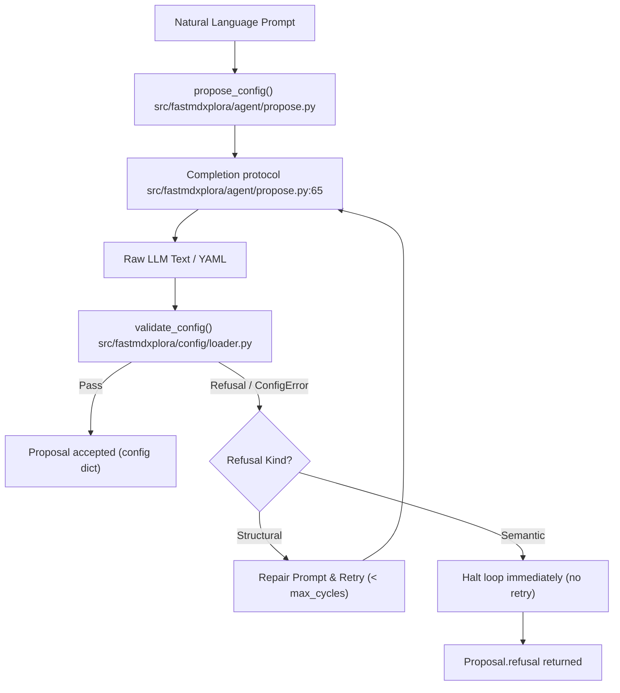
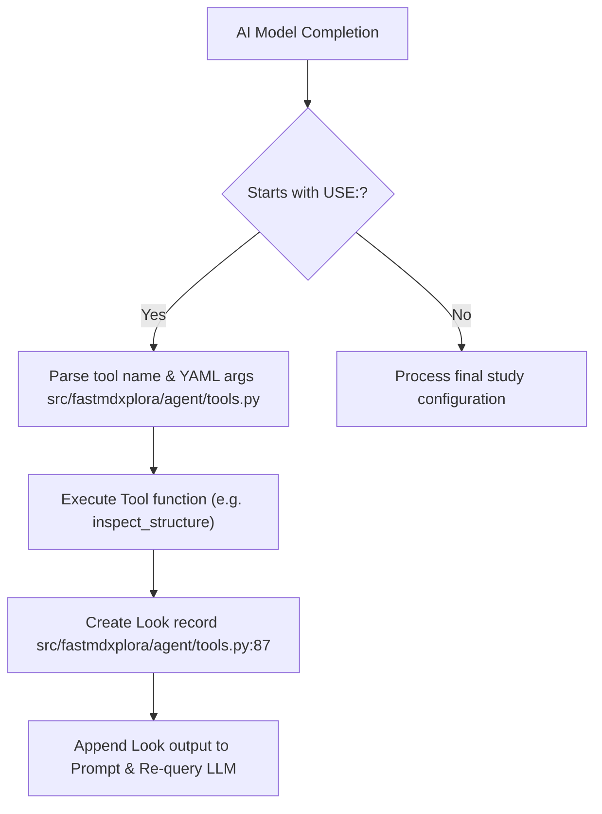

# Agent Proposal Loop and Tools

Relevant source files

The following files were used as context for generating this wiki page:

- [docs/agent.md](docs/agent.md)
- [scripts/gpu_shakedown.py](scripts/gpu_shakedown.py)
- [scripts/name_refusal_families.py](scripts/name_refusal_families.py)
- [src/fastmdxplora/agent/__init__.py](src/fastmdxplora/agent/__init__.py)
- [src/fastmdxplora/agent/context.py](src/fastmdxplora/agent/context.py)
- [src/fastmdxplora/agent/conversation.py](src/fastmdxplora/agent/conversation.py)
- [src/fastmdxplora/agent/models.py](src/fastmdxplora/agent/models.py)
- [src/fastmdxplora/agent/propose.py](src/fastmdxplora/agent/propose.py)
- [src/fastmdxplora/agent/queue.py](src/fastmdxplora/agent/queue.py)
- [src/fastmdxplora/agent/run.py](src/fastmdxplora/agent/run.py)
- [src/fastmdxplora/agent/tools.py](src/fastmdxplora/agent/tools.py)
- [src/fastmdxplora/agent/turns.py](src/fastmdxplora/agent/turns.py)
- [src/fastmdxplora/agent/worker.py](src/fastmdxplora/agent/worker.py)
- [src/fastmdxplora/gui/agent_panel.py](src/fastmdxplora/gui/agent_panel.py)
- [src/fastmdxplora/gui/static/agent-panel.js](src/fastmdxplora/gui/static/agent-panel.js)
- [tests/test_a_proposal_is_refused_until_it_is_not.py](tests/test_a_proposal_is_refused_until_it_is_not.py)
- [tests/test_the_agent_command.py](tests/test_the_agent_command.py)
- [tests/test_the_agent_panel.py](tests/test_the_agent_panel.py)
- [tests/test_the_agent_replies_by_tool_calls.py](tests/test_the_agent_replies_by_tool_calls.py)
- [tests/test_the_command_line_says_the_agent_s_reply_plainly.py](tests/test_the_command_line_says_the_agent_s_reply_plainly.py)
- [tests/test_the_shakedown_says_what_happened.py](tests/test_the_shakedown_says_what_happened.py)
- [tests/test_what_may_be_split_and_what_stops.py](tests/test_what_may_be_split_and_what_stops.py)

## Purpose and Scope
This page details the natural-language agent interface of FastMDXplora (`fastmdxplora.agent`). The agent subsystem translates high-level natural language user requests into valid study configuration files (`resolved_config.yml`) through an iterative proposal, validation, and repair loop. Crucially, the agent operates with **no special privileges**: every configuration generated by the AI model is checked by the exact same deterministic validator (`validate_config`) used by hand-written configurations or CLI invocations. 

This section covers implementation details for proposal cycles, the pre-answer inspection toolbox, conversation tool dispatch, provider abstraction, context receipts, and background worker queues.

Sources: `src/fastmdxplora/agent/__init__.py:1-84`, `docs/agent.md:1-70`, `src/fastmdxplora/agent/propose.py:1-41` [src/fastmdxplora/agent/__init__.py:1-83](), [docs/agent.md:1-70](), [src/fastmdxplora/agent/propose.py:1-41]()

---

## 1. The Proposal Loop and Validation Retries

The core generation loop is managed by `propose_config` defined in `src/fastmdxplora/agent/propose.py`. A caller passes a textual prompt and a `Completion` callable (adhering to a simple protocol taking a prompt string and returning text). 

*Figure 1: Natural Language Space to Code Entity Space for configuration proposal and validation routing.*

### Key Classes and Data Structures
- **`Completion` (Protocol)**: Declared at `src/fastmdxplora/agent/propose.py:65`, defines the interface `__call__(self, prompt: str) -> str`.
- **`Attempt` (Dataclass)**: Represents a single pass around the loop, tracking `number`, `raw` model output, parsed `config`, and any encountered `refusal` [src/fastmdxplora/agent/propose.py:77-90]().
- **`Proposal` (Dataclass)**: Represents the outcome of an asking session, holding the final `config`, tuples of `attempts`, a `refusal` object if failed, optional `question`, `answer`, `action`, and tool `looks` [src/fastmdxplora/agent/propose.py:98-155]().

### Refusal Philosophy and Repair Constraints
The proposal loop enforces strict safety boundaries:
1. **Structural vs. Semantic Refusals**: Structural errors (e.g., misspelled option names, incorrect type) yield retry prompts containing permitted schema values. Semantic errors (e.g., undetermined protonation states at a specific pH margin) halt the loop immediately because a retry would rely on model guessing rather than deterministic chemical rules [src/fastmdxplora/agent/propose.py:32-36]().
2. **Cycle Caps**: `max_cycles` restricts thrashing, preventing infinite loops or random mutation until invalid-but-parsing configurations pass [src/fastmdxplora/agent/propose.py:24-31]().

Sources: `src/fastmdxplora/agent/propose.py:43-155`, `tests/test_a_proposal_is_refused_until_it_is_not.py:1-134` [src/fastmdxplora/agent/propose.py:43-155](), [tests/test_a_proposal_is_refused_until_it_is_not.py:1-134]()

---

## 2. Toolbox and Pre-Answer Inspections

Before final submission or during multi-turn conversations, the agent can inspect the local environment and structures using tools defined in `src/fastmdxplora/agent/tools.py`. 

### Tool Execution Contract
Tools are restricted strictly to **read-only operations** ("looks"). They never run, write, or start simulations. If a model response begins with `USE: <tool>` followed by YAML arguments, the tool executes and feeds its output back into the next AI prompt context.

*Figure 2: Pre-answer tool inspection data flow.*

### Built-in Tools and Limits
- **`MOST_LOOKS`**: Capped at `4` look iterations per user prompt to prevent runaway exploration loops [src/fastmdxplora/agent/tools.py:66]().
- **`Look` (Dataclass)**: Tracks the `tool` name, `asked` parameters, `said` output string, and `ok` boolean flag [src/fastmdxplora/agent/tools.py:87-94]().
- **`LOOK_WORDS`**: Maps internal tool names (e.g., `inspect_structure`, `find_structure`, `read_docs`, `check_config`) to human-readable progress sentences shown in the UI (`fastmdx agent` or the GUI agent panel) [src/fastmdxplora/agent/tools.py:112-125]().

Sources: `src/fastmdxplora/agent/tools.py:1-157` [src/fastmdxplora/agent/tools.py:1-157]()

---

## 3. Conversation Protocol and Tool Calls

When operating via modern LLM tool-calling APIs rather than plain text parsing, `src/fastmdxplora/agent/conversation.py` coordinates structured turns (`src/fastmdxplora/agent/turns.py`).

### Reply Tools and Actions
The AI model can invoke specific reply tools declared via `reply_specs()` [src/fastmdxplora/agent/conversation.py:44]():
- `propose_config`: Supplies the study configuration along with per-setting `reasons` explaining why each parameter was selected [src/fastmdxplora/agent/conversation.py:51-76]().
- `ask_person`: Prompts the user for ambiguous details (e.g., selecting among multiple PDB deposition entries) [src/fastmdxplora/agent/conversation.py:77-85]().
- `act`: Requests execution of actions defined in `ACTS` (e.g., `run`, `stop`, `open viewer`, `rerun windows`, `analyze again`) [src/fastmdxplora/agent/conversation.py:35-41, 86-103]().
- `show_scene`: Proposes 3D molecular visualization states (representations, colors, highlights) [src/fastmdxplora/agent/conversation.py:104-117]().

Sources: `src/fastmdxplora/agent/conversation.py:1-121`, `src/fastmdxplora/agent/turns.py` [src/fastmdxplora/agent/conversation.py:1-121]()

---

##  4. Models, Providers, and Credentials

Model configuration, endpoint translation, and API key isolation are managed in `src/fastmdxplora/agent/models.py`.

### Security and Key Handling
1. **Never Stored in Studies**: API keys are stored in isolated configuration files (e.g., `$FASTMDXPLORA_CONFIG_DIR/model.json` or `$XDG_CONFIG_HOME/fastmdxplora/model.json`) with restricted permissions (`0600` on POSIX systems) [docs/agent.md:116-129](), [tests/test_the_agent_command.py:58-61](). Keys are **never** written into study configurations, manifests, or logs [tests/test_the_agent_command.py:47-54]().
2. **Environment Precedence**: Environment variables (`ANTHROPIC_API_KEY`, `OPENAI_API_KEY`, `FASTMDX_MODEL_API_KEY`) are always checked before reading stored credential files, allowing seamless CI/CD and cluster batch job execution [src/fastmdxplora/agent/models.py:20-23](), [tests/test_the_agent_command.py:88-106]().

### Supported Providers
`PROVIDERS` defines integrations for `anthropic`, `openai`, and `compatible` (supporting local or remote OpenAI chat-compatible servers like Ollama, vLLM, DeepSeek, and OpenRouter) [src/fastmdxplora/agent/models.py:67-117]().

Sources: `src/fastmdxplora/agent/models.py:1-169`, `docs/agent.md:72-135`, `tests/test_the_agent_command.py:1-147` [src/fastmdxplora/agent/models.py:1-169](), [docs/agent.md:72-135](), [tests/test_the_agent_command.py:1-147]()

---

## 5. Context Receipts, Memory, and Workers

To track the provenance of agent sessions and background operations, FastMDXplora implements context receipts and queue workers.

- **Context Receipts (`src/fastmdxplora/agent/receipt.py`)**: Summarize what system state, tools, and previous turns informed a generated configuration.
- **Workers and Queues (`src/fastmdxplora/agent/worker.py`, `src/fastmdxplora/agent/queue.py`, `src/fastmdxplora/agent/run.py`)**: Handle asynchronous execution of agent-proposed studies, budget tracking (`Budget`), and staged execution (`StagedRun`) where system setup precedes cost estimation and full simulation.

Sources: `src/fastmdxplora/agent/__init__.py:22-34`, `src/fastmdxplora/agent/receipt.py`, `src/fastmdxplora/agent/worker.py` [src/fastmdxplora/agent/__init__.py:22-34]()

---