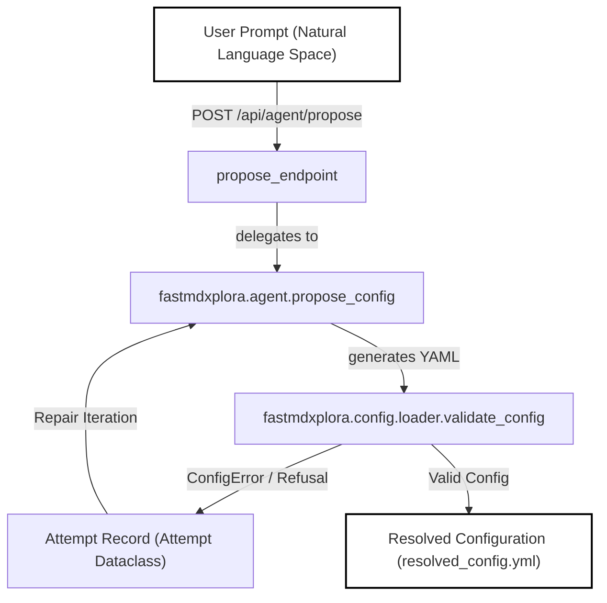
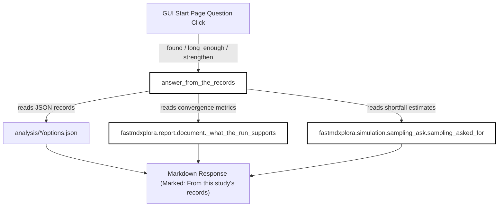

# Agent Panel in the GUI

<details>
<summary>Relevant source files</summary>

The following files were used as context for generating this wiki page:

- [docs/agent.md](docs/agent.md)
- [src/fastmdxplora/agent/propose.py](src/fastmdxplora/agent/propose.py)
- [src/fastmdxplora/gui/agent_panel.py](src/fastmdxplora/gui/agent_panel.py)
- [src/fastmdxplora/gui/records_answer.py](src/fastmdxplora/gui/records_answer.py)
- [src/fastmdxplora/gui/static/agent-beside.js](src/fastmdxplora/gui/static/agent-beside.js)
- [src/fastmdxplora/gui/static/agent-panel.js](src/fastmdxplora/gui/static/agent-panel.js)
- [src/fastmdxplora/gui/static/run-notice.js](src/fastmdxplora/gui/static/run-notice.js)
- [src/fastmdxplora/remedies.py](src/fastmdxplora/remedies.py)
- [src/fastmdxplora/simulation/sampling_ask.py](src/fastmdxplora/simulation/sampling_ask.py)
- [tests/test_a_conversation_follows_a_run_that_wrote_nothing.py](tests/test_a_conversation_follows_a_run_that_wrote_nothing.py)
- [tests/test_a_run_s_progress_is_in_the_tab_s_title.py](tests/test_a_run_s_progress_is_in_the_tab_s_title.py)
- [tests/test_a_withheld_mean_says_how_much_longer.py](tests/test_a_withheld_mean_says_how_much_longer.py)
- [tests/test_statistics.py](tests/test_statistics.py)
- [tests/test_the_agent_answers_from_the_records.py](tests/test_the_agent_answers_from_the_records.py)
- [tests/test_the_agent_opens_beside_any_page.py](tests/test_the_agent_opens_beside_any_page.py)
- [tests/test_the_agent_panel.py](tests/test_the_agent_panel.py)
- [tests/test_the_files_page_is_the_study_in_order.py](tests/test_the_files_page_is_the_study_in_order.py)

</details>


## Purpose and Scope

The Agent Panel provides a natural-language conversation interface embedded within the FastMDXplora graphical user interface (`src/fastmdxplora/gui/static/agent-panel.js` [src/fastmdxplora/gui/static/agent-panel.js:1-17]()). It bridges human descriptions of molecular dynamics studies and structured configuration payloads, handles model selection and credential isolation (`src/fastmdxplora/gui/agent_panel.py` [src/fastmdxplora/gui/agent_panel.py:1-15]()), and supplies offline or model-free responses directly from analysis telemetry records (`src/fastmdxplora/gui/records_answer.py` [src/fastmdxplora/gui/records_answer.py:1-16]()).

---

## 1. Conversation UI and Side-Drawer Architecture

The frontend implementation consists of the core agent panel renderer (`src/fastmdxplora/gui/static/agent-panel.js` [src/fastmdxplora/gui/static/agent-panel.js:1-17]()) and the side drawer manager (`src/fastmdxplora/gui/static/agent-beside.js`), which allows the conversation interface to be overlaid beside any dashboard view via shortcut `Ctrl+J` or command buttons [tests/test_the_agent_opens_beside_any_page.py:1-7]().

### UI Components and Rendering Functions
- `prose(text)`: Sanitizes HTML special characters and parses limited markdown (`code`, bold, italic, and URLs) to prevent cross-site scripting while permitting clean formatting in chat responses [src/fastmdxplora/gui/static/agent-panel.js:72-91]().
- `cite(box, cites)`: Generates interactive citation chips linking conversational mentions to analysis figures on the Analysis page, surfacing mean values and withheld warnings directly from study records [src/fastmdxplora/gui/static/agent-panel.js:97-132]().
- `sceneSaid(scene)`: Translates structural representation suggestions (e.g., representation type, color, frame, superposition) into human-readable descriptions before execution via `/api/scenes` [src/fastmdxplora/gui/static/agent-panel.js:137-150]().

```
Sources:
- [src/fastmdxplora/gui/static/agent-panel.js:1-150]()
- [tests/test_the_agent_opens_beside_any_page.py:1-10]()
```

---

## 2. Server-Side Endpoints and Credential Safety

The GUI backend (`src/fastmdxplora/gui/agent_panel.py`) exposes thin wrapper functions around core agent infrastructure (`fastmdxplora.agent`). It enforces strict security guarantees regarding API keys.

### Core Endpoints

| Function Name | Route / Purpose | Implementation Details |
|---|---|---|
| `model_endpoint` | `/api/agent/model` | Reads or sets AI provider choices. Keys are saved in `$FASTMDXPLORA_CONFIG_DIR/model.json` with `0600` permissions and **never returned to the browser** [src/fastmdxplora/gui/agent_panel.py:34-83](). |
| `propose_endpoint` | `/api/agent/propose` | Accepts a natural-language request string, delegates to `propose_config()`, and returns validated configuration YAML alongside repair attempt history [src/fastmdxplora/gui/agent_panel.py:124-157](). |
| `run_endpoint` | `/api/agent/run` | Initiates simulation runs from proposed or modified configurations while relocating active conversations into the run folder [tests/test_a_conversation_follows_a_run_that_wrote_nothing.py:98-118](). |

### Security Property: Key Isolation
To prevent leakage via browser screenshots, extensions, or DOM inspection logs, `model_endpoint` never echoes stored API credentials back in JSON responses [tests/test_the_agent_panel.py:70-76]().

```python
# src/fastmdxplora/gui/agent_panel.py
def model_endpoint(payload: dict[str, Any]) -> dict[str, Any]:
    ...
    save_choice(ModelChoice(provider, model, base_url), key=str(payload.get("api_key") or ""))
    # Returns choice metadata, omitting the secret key entirely
    return {"ok": True, "models": offered, "current": ModelChoice(provider, model, base_url).as_record()}
```

```
Sources:
- [src/fastmdxplora/gui/agent_panel.py:34-122]()
- [tests/test_the_agent_panel.py:55-98]()
```

---

## 3. Records-Based Fallback Answering

When no AI model is configured (or when users select quick study queries on the start page), FastMDXplora answers predefined questions (`found`, `long_enough`, `strengthen`) directly from simulation telemetry records using `src/fastmdxplora/gui/records_answer.py` [src/fastmdxplora/gui/records_answer.py:1-43]().

### Telemetry Queries Handled
1. **`found`**: Summarizes the report findings (`_supports`) and extracts analysis means, error bounds, effective sample sizes, and equilibration frames (`_means`) [src/fastmdxplora/gui/records_answer.py:56-121]().
2. **`long_enough`**: Evaluates convergence status and calculates exact nanosecond shortfalls (`sampling_asked_for`) with corresponding CLI resume commands [tests/test_the_agent_answers_from_the_records.py:69-80]().
3. **`strengthen`**: Recommends production extensions or replica seed sweeps based on statistical inefficiency metrics [tests/test_the_agent_answers_from_the_records.py:117-128]().

```
Sources:
- [src/fastmdxplora/gui/records_answer.py:1-54]()
- [tests/test_the_agent_answers_from_the_records.py:52-90]()
```

---

## 4. Natural Language Space to Code Entity Space Mappings

The following diagrams illustrate how user prompts and GUI interactions flow from the natural-language interface layer into core validation and execution routines.

### Diagram 1: Proposal and Validation Flow



```
Sources:
- [src/fastmdxplora/gui/agent_panel.py:124-157]()
- [src/fastmdxplora/agent/propose.py:45-110]()
```

### Diagram 2: Telemetry and Records-Based Answering Architecture



```
Sources:
- [src/fastmdxplora/gui/records_answer.py:41-68]()
- [src/fastmdxplora/simulation/sampling_ask.py:97-140]()
```

---