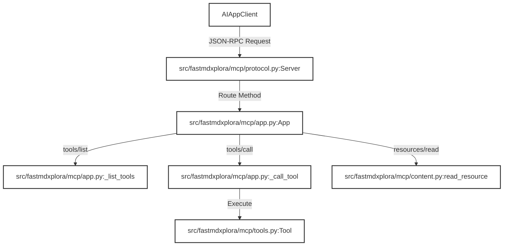
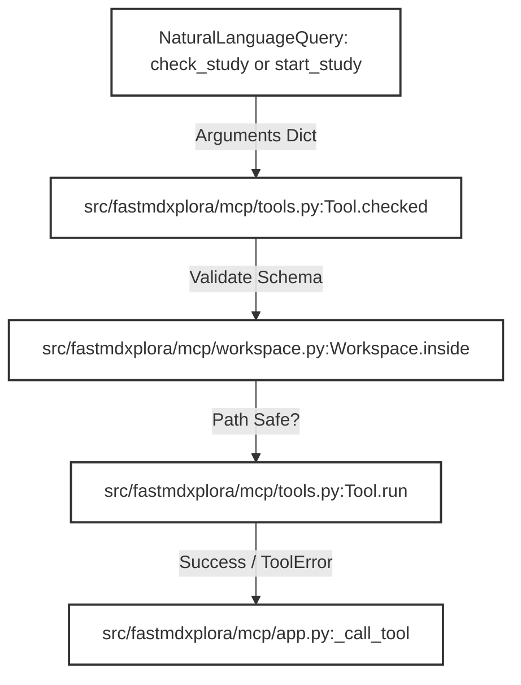

# MCP Server

Relevant source files

The following files were used as context for generating this wiki page:

- [docs/api.md](docs/api.md)
- [docs/mcp.md](docs/mcp.md)
- [docs/remote.md](docs/remote.md)
- [setup.py](setup.py)
- [src/fastmdxplora/gui/sidebar_icons.py](src/fastmdxplora/gui/sidebar_icons.py)
- [src/fastmdxplora/mcp/__init__.py](src/fastmdxplora/mcp/__init__.py)
- [src/fastmdxplora/mcp/app.py](src/fastmdxplora/mcp/app.py)
- [src/fastmdxplora/mcp/content.py](src/fastmdxplora/mcp/content.py)
- [src/fastmdxplora/mcp/protocol.py](src/fastmdxplora/mcp/protocol.py)
- [src/fastmdxplora/mcp/remote_tools.py](src/fastmdxplora/mcp/remote_tools.py)
- [src/fastmdxplora/mcp/tools.py](src/fastmdxplora/mcp/tools.py)
- [src/fastmdxplora/remote/api.py](src/fastmdxplora/remote/api.py)
- [src/fastmdxplora/remote/gpu_room.py](src/fastmdxplora/remote/gpu_room.py)
- [src/fastmdxplora/remote/send.py](src/fastmdxplora/remote/send.py)
- [src/fastmdxplora/software_docs.py](src/fastmdxplora/software_docs.py)
- [tests/test_remote_from_every_interface.py](tests/test_remote_from_every_interface.py)
- [tests/test_the_agent_reads_the_docs.py](tests/test_the_agent_reads_the_docs.py)
- [tests/test_the_top_bars_are_one_height.py](tests/test_the_top_bars_are_one_height.py)

The purpose and scope of the FastMDXplora Model Context Protocol (MCP) server is to expose study orchestration, structural analysis, and remote machine control primitives via the Model Context Protocol standard (`docs/mcp.md:1-8`, `src/fastmdxplora/mcp/app.py:1-33`). This permits AI applications, coding agents, and automated chat interfaces to inspect molecular structures, validate configuration files against schema rules, initiate simulations locally or on remote targets, and review telemetry without bypassing validation checks or file system workspace constraints (`docs/mcp.md:9-20`, `src/fastmdxplora/mcp/app.py:35-70`).

---

## 1. Protocol Handling and Application Server

The core MCP application is implemented in `src/fastmdxplora/mcp/app.py`, which wraps protocol routing logic from `src/fastmdxplora/mcp/protocol.py`. The `App` class configures method dispatch mappings for JSON-RPC operations such as `tools/list`, `tools/call`, `prompts/list`, `prompts/get`, `resources/list`, and `resources/read` (`src/fastmdxplora/mcp/app.py:73-117`).

*Figure 1: MCP Server request routing architecture linking protocol handlers to application tools.*

Sources: `src/fastmdxplora/mcp/app.py:73-117`, `src/fastmdxplora/mcp/protocol.py:1-120`

---

## 2. Exposed Tools and Workspace Isolation

Tools are defined in `src/fastmdxplora/mcp/tools.py` using the `Tool` dataclass. Each tool receives a `Context` instance containing the `Workspace` reference, call metadata, and an execution flag (`runs: bool`) determining whether state-modifying actions are permitted (`src/fastmdxplora/mcp/tools.py:48-70`).

Workspace boundaries are strictly enforced. All file reading, config generation, and study initialization must occur inside the designated workspace root (`src/fastmdxplora/mcp/workspace.py`). Paths crossing outside via `..` or symbolic links are caught and refused with `ToolError` (`src/fastmdxplora/mcp/tools.py:129-142`).

*Figure 2: Natural language input mapping to validated code entities in the MCP tool subsystem.*

Sources: `src/fastmdxplora/mcp/tools.py:32-111`, `src/fastmdxplora/mcp/workspace.py:1-100`

---

## 3. Prompts, Resources, and Content Types

Content types, prompt templates, and virtual resources are managed in `src/fastmdxplora/mcp/content.py`. The server registers templates matching `fastmdxplora://` URIs, enabling AI apps to read configuration guides, working-with-studies specifications, and active study manifests directly (`src/fastmdxplora/mcp/app.py:93-112`).

The server provides predefined prompts via `prompts/list` and `prompts/get` which instruct models on proper protocol behavior, refusing unvalidated settings, and requesting structural parameters (`src/fastmdxplora/mcp/app.py:100-103`).

Sources: `src/fastmdxplora/mcp/content.py:1-150`, `src/fastmdxplora/mcp/app.py:88-117`

---

## 4. Remote Tools and Cross-Machine Control

When operating in active mode (`runs=True`), remote execution tools defined in `src/fastmdxplora/mcp/remote_tools.py` bridge AI application requests to other compute resources via `src/fastmdxplora/mcp/remote_tools.py` and `src/fastmdxplora/remote/api.py` (`src/fastmdxplora/mcp/remote_tools.py:1-37`).

Key safeguards implemented in remote tooling include:
- **Explicit Confirmation**: Studies are dispatched to remote workstations or clusters only after explicit approval context is confirmed, preventing unsupervised execution (`src/fastmdxplora/mcp/remote_tools.py:10-15`).
- **GPU Memory Accounting**: Workstation deployments query GPU utilization and free VRAM using `gpu_room` calculations before transmitting files (`src/fastmdxplora/remote/gpu_room.py:1-42`).
- **Fetch Size Limits**: Unasked data retrieval is bounded by `LARGE_BYTES` (100 MB), forcing manual confirmation for large trajectory bundles (`src/fastmdxplora/mcp/remote_tools.py:39-47`).

Sources: `src/fastmdxplora/mcp/remote_tools.py:1-155`, `src/fastmdxplora/remote/api.py:1-100`

---