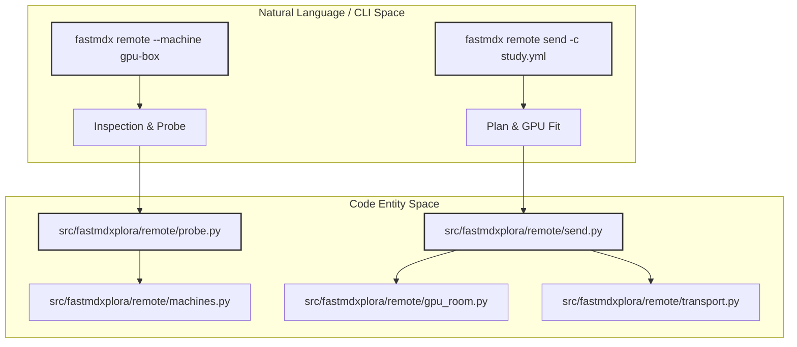
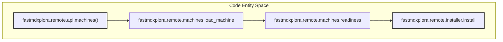

# Remote Execution

Relevant source files

The following files were used as context for generating this wiki page:

- [docs/api.md](docs/api.md)
- [docs/remote.md](docs/remote.md)
- [src/fastmdxplora/mcp/remote_tools.py](src/fastmdxplora/mcp/remote_tools.py)
- [src/fastmdxplora/remote/api.py](src/fastmdxplora/remote/api.py)
- [src/fastmdxplora/remote/gpu_room.py](src/fastmdxplora/remote/gpu_room.py)
- [src/fastmdxplora/remote/send.py](src/fastmdxplora/remote/send.py)
- [tests/test_remote_from_every_interface.py](tests/test_remote_from_every_interface.py)

Studies are often designed locally on laptops or workstations and executed on dedicated GPU lab servers or high-performance computing clusters [docs/remote.md:1-6](). FastMDXplora provides a remote execution subsystem reachable through the command line (`fastmdx remote`), the Python API (`fastmdxplora.remote.api`), model-context-protocol tools (`fastmdxplora.mcp.remote_tools`), and the localhost graphical dashboard [docs/remote.md:4](), [src/fastmdxplora/mcp/remote_tools.py:1-18](), [src/fastmdxplora/remote/api.py:1-24](). Remote execution handles machine inspection, environment probing, version parity verification, automated installation plans, input safety checks, dynamic VRAM allocation, file transfer, and job telemetry retrieval [docs/remote.md:8-17](), [src/fastmdxplora/remote/send.py:1-46]().

*Diagram 1: Bridging remote execution commands to underlying modules [docs/remote.md:13-15](), [src/fastmdxplora/remote/send.py:70-116]().*

Sources: `docs/remote.md:1-24`, `src/fastmdxplora/remote/send.py:1-46`, `src/fastmdxplora/remote/api.py:1-24`.

---

## 6.1. Machines, Probing and Installation

Remote machines are registered and inspected via standard `ssh` configurations (`~/.ssh/config` aliases or `user@host` specifications) [docs/remote.md:28-29](). Inspection scripts read-only evaluate target hosts for hardware (CPUs, system memory, and NVIDIA GPU drivers), Python environments (conda/mamba/micromamba installations holding `fastmdx`), container runtimes (Apptainer), and job schedulers (SLURM) [docs/remote.md:53-65](). 

Readiness requires strict commit parity or release version matching: the remote installation must contain the identical codebase and dependencies to ensure configuration defaults resolve consistently [docs/remote.md:71-75](). When a target is unready, the framework generates a precise **install plan** enumerating non-privileged environment creation commands or `git` commit merging actions restricted strictly to the user account [docs/remote.md:109-156]().

*Diagram 2: Machine loading and inspection function pathways [src/fastmdxplora/remote/api.py:92-107](), [src/fastmdxplora/remote/machines.py:108-114]().*

For detailed documentation on machine records, SSH transport options, probe scripts, readiness parity checks, install plans, job tracking, and cluster schedulers, see [Machines, Probing and Installation](#6.1).

Sources: `docs/remote.md:26-165`, `src/fastmdxplora/remote/api.py:92-120`, `src/fastmdxplora/remote/machines.py:108-114`.

---

## 6.2. Planning, Inputs Safety and GPU Allocation

Before any file transfer occurs, local configuration files undergo strict validation and planning [src/fastmdxplora/remote/send.py:13-15](). Workspace boundaries (`gather_inputs`) ensure that only files within the study's own directory structure travel across the transport link, blocking accidental leakage of private paths or parent directories [src/fastmdxplora/remote/send.py:17-19](), [src/fastmdxplora/remote/gpu_room.py:1-9]().

On multi-GPU workstations, studies dynamically share hardware resources without manual device assignment [src/fastmdxplora/remote/send.py:21-25](). VRAM accounting is managed through `gpu_room.py`, which evaluates current GPU memory usage via `nvidia-smi`, tracks historical process memory footprints, and applies a safety margin (`MARGIN = 1.15`) before dispatching jobs via `CUDA_VISIBLE_DEVICES` [src/fastmdxplora/remote/gpu_room.py:1-48](). Cluster environments bypass local VRAM heuristics, relying instead on scheduler-allocated nodes (e.g., `sbatch`) [src/fastmdxplora/remote/send.py:29-30](), [src/fastmdxplora/remote/gpu_room.py:23-24]().

For detailed coverage of `gather_inputs` boundary enforcement, private-path blocking, plan tokens, and VRAM fitting algorithms, see [Planning, Inputs Safety and GPU Allocation](#6.2).

Sources: `src/fastmdxplora/remote/send.py:1-46`, `src/fastmdxplora/remote/gpu_room.py:1-48`.

---

## 6.3. Remote from the GUI

The graphical user interface and AI integration tiers expose remote execution capabilities through dedicated web routes and automated API agents [src/fastmdxplora/mcp/remote_tools.py:1-18](). The dashboard server maintains non-blocking asynchronous wrappers around remote operations, polling job states at controlled intervals (at most every 30 seconds) to prevent remote daemon saturation [src/fastmdxplora/remote/send.py:36-39]().

Users can inspect machines, view live job telemetry, and execute plan-send-fetch-cancel workflows directly from the browser shell (`remote.js`) or via Model Context Protocol tools (`remote_tools.py`) [src/fastmdxplora/mcp/remote_tools.py:1-18](). Safety guardrails require explicit human confirmation for file dispatch and regulate the automatic retrieval of large output bundles [src/fastmdxplora/mcp/remote_tools.py:10-15]().

For detailed documentation on `RemoteDesk` HTTP routing, dashboard frontend views, and interactive job management workflows, see [Remote from the GUI](#6.3).

Sources: `src/fastmdxplora/mcp/remote_tools.py:1-18`, `src/fastmdxplora/remote/send.py:36-40`.

---