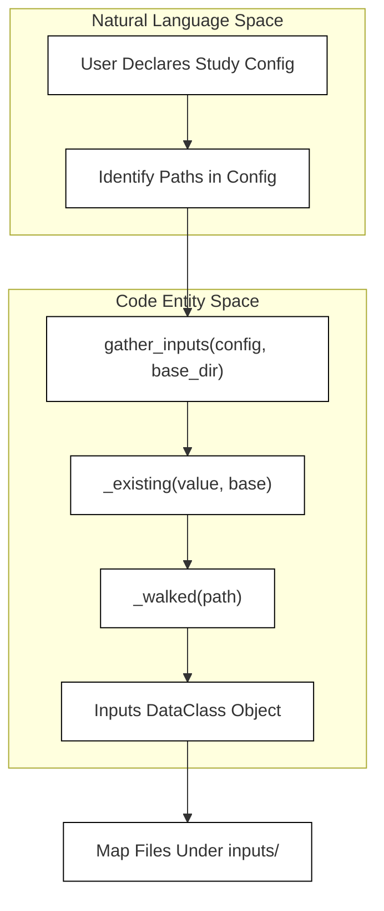
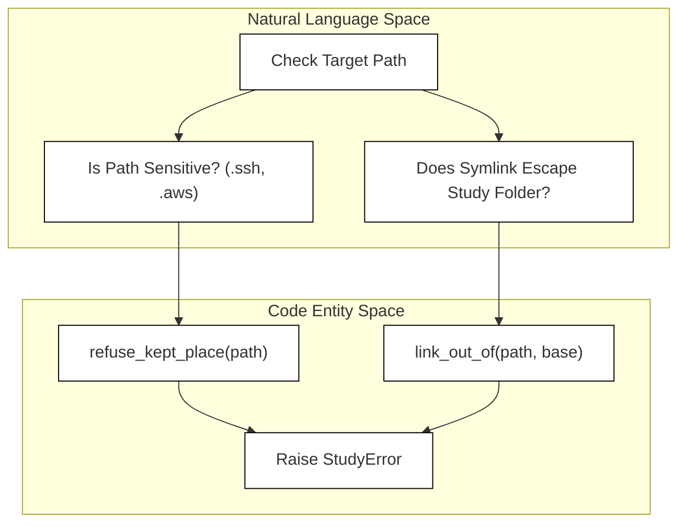
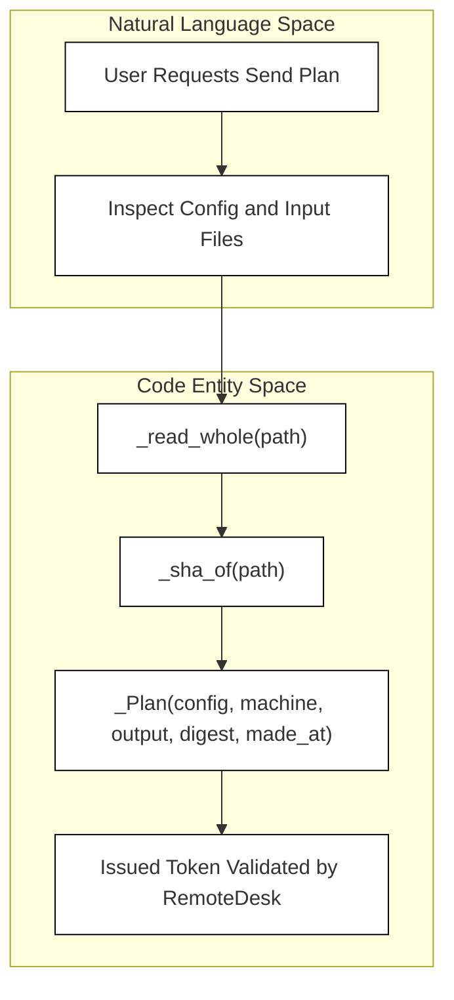
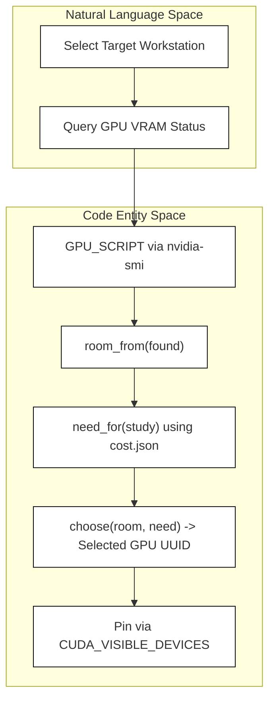

# Planning, Inputs Safety and GPU Allocation

Relevant source files

The following files were used as context for generating this wiki page:

- [docs/api.md](docs/api.md)
- [docs/remote.md](docs/remote.md)
- [src/fastmdxplora/gui/remote_routes.py](src/fastmdxplora/gui/remote_routes.py)
- [src/fastmdxplora/gui/static/remote.css](src/fastmdxplora/gui/static/remote.css)
- [src/fastmdxplora/gui/static/remote.js](src/fastmdxplora/gui/static/remote.js)
- [src/fastmdxplora/mcp/remote_tools.py](src/fastmdxplora/mcp/remote_tools.py)
- [src/fastmdxplora/remote/api.py](src/fastmdxplora/remote/api.py)
- [src/fastmdxplora/remote/gpu_room.py](src/fastmdxplora/remote/gpu_room.py)
- [src/fastmdxplora/remote/inputs.py](src/fastmdxplora/remote/inputs.py)
- [src/fastmdxplora/remote/send.py](src/fastmdxplora/remote/send.py)
- [tests/test_a_send_is_bound_to_what_travels.py](tests/test_a_send_is_bound_to_what_travels.py)
- [tests/test_remote_from_every_interface.py](tests/test_remote_from_every_interface.py)
- [tests/test_the_gui_reaches_your_machines.py](tests/test_the_gui_reaches_your_machines.py)
- [tests/test_your_machines_on_the_page.py](tests/test_your_machines_on_the_page.py)

This page covers the pre-flight planning, input security boundaries, cryptographic fingerprinting, and GPU memory accounting subsystems utilized when sending FastMDXplora studies to remote target machines or workstations (`src/fastmdxplora/remote/send.py:1-46`, `src/fastmdxplora/remote/inputs.py:1-32`, `src/fastmdxplora/remote/gpu_room.py:1-24`).

Sources: `src/fastmdxplora/remote/send.py:1-46`, `src/fastmdxplora/remote/inputs.py:1-32`, `src/fastmdxplora/remote/gpu_room.py:1-24`

---

## 1. Input Gathering and Workspace Boundaries (`gather_inputs`)

When a study configuration is prepared for remote execution, FastMDXplora does not blindly copy the local file system structure. Instead, the configuration is parsed, and every string referencing an existing local file or directory is intercepted and re-mapped under an isolated `inputs/` directory in the remote workspace (`src/fastmdxplora/remote/inputs.py:1-13`).

### Implementation and Data Flow
The core logic resides in `gather_inputs` and supporting validators within `src/fastmdxplora/remote/inputs.py`. It traverses the configuration dictionary, ignoring configuration keys explicitly designated as results output paths (e.g., `_NOT_INPUTS = frozenset({"output"})`, `src/fastmdxplora/remote/inputs.py:53-54`) or words/selections (`word_keys()`, `src/fastmdxplora/remote/inputs.py:95-105`).

*Figure 1: Natural Language to Code Entity mapping for input preparation.*

Sources: `src/fastmdxplora/remote/inputs.py:1-118`

---

## 2. Private-Path Blocking and Security Rules

To prevent accidental data leaks or unauthorized file transfers (e.g., uploading private SSH keys, cloud credentials, or system configurations), strict refusal rules are enforced during input resolution (`src/fastmdxplora/remote/inputs.py:17-32`).

### Key Safety Checks
- **Home Folder and Root Protection:** Files located at or above the user's home directory or system root when expressed via unconstrained absolute paths are refused (`refuse_home_or_above`, `src/fastmdxplora/remote/inputs.py:50`).
- **Sensitive Credential Directories:** Folders containing sensitive credentials such as `.ssh`, `.gnupg`, `.aws`, or FastMDXplora configuration spaces trigger an immediate refusal error if encountered anywhere within a directory traversal (`src/fastmdxplora/remote/inputs.py:29-31`).
- **Symlink Escape Checks:** Symlinks pointing outside the study folder, or recursive links pointing back into the folder, are detected and blocked by `_walked(path)` to prevent infinite copy loops or path traversal attacks (`src/fastmdxplora/remote/inputs.py:140-165`).

*Figure 2: Security refusal pipeline routing unsafe paths to exceptions.*

Sources: `src/fastmdxplora/remote/inputs.py:17-51`, `src/fastmdxplora/remote/inputs.py:140-165`

---

## 3. Cryptographic Fingerprints and Plan Tokens

To ensure that a user's approval of a remote send operation in the GUI or via API is cryptographically bound to the exact file bytes reviewed, FastMDXplora uses SHA-256 hashing (`src/fastmdxplora/gui/remote_routes.py:51-87`, `src/fastmdxplora/remote/send.py:50-50`).

### Fingerprints and Tokens
- **File Hashing (`_read_whole` & `_sha_of`):** Every regular file slated for transfer is read via non-blocking, non-following descriptors (`os.open` with `O_NOFOLLOW`) to compute a stable SHA-256 digest alongside device and inode metadata (`src/fastmdxplora/gui/remote_routes.py:51-85`).
- **Plan Tokens:** When a plan is generated (`plan_send`, `src/fastmdxplora/remote/api.py:125-138`), a unique time-limited token (`PLAN_KEPT_S = 600`, `src/fastmdxplora/gui/remote_routes.py:35-36`) is issued. Executing `send_planned` or submitting via GUI route requires matching this token and verifying that the underlying file digests remain unaltered (`src/tests/test_the_gui_reaches_your_machines.py:111-132`).

*Figure 3: Plan generation and token validation flow.*

Sources: `src/fastmdxplora/gui/remote_routes.py:35-103`, `src/fastmdxplora/remote/api.py:125-138`

---

## 4. GPU VRAM Accounting and Learning (`gpu_room`)

When studies are dispatched to shared local workstations rather than managed cluster queues (like SLURM), FastMDXplora dynamically accounts for and allocates available GPU VRAM (`src/fastmdxplora/remote/gpu_room.py:1-24`).

### Mechanics of GPU Room
- **Hardware Probing (`GPU_SCRIPT`):** The remote workstation is queried via `nvidia-smi` commands formatted in `GPU_SCRIPT` to extract GPU indices, UUIDs, total/free memory, and active compute applications mapped to process groups (`src/fastmdxplora/remote/gpu_room.py:63-76`).
- **Empirical Learning (`cost.json`):** Memory requirements are not hardcoded guesses; each completed run outputs performance metrics and memory footprints into `cost.json`. The subsystem calculates expected memory requirements based on system particle size and precision, scaling it by a safety margin (`MARGIN = 1.15`, `src/fastmdxplora/remote/gpu_room.py:47-48`).
- **Device Selection (`choose`):** The placement algorithm inspects available GPUs, penalizing devices already running tasks from the current user, and selects the device maximizing free memory while respecting `CUDA_VISIBLE_DEVICES` constraints (`src/fastmdxplora/remote/gpu_room.py:3-9`, `src/fastmdxplora/remote/send.py:21-29`).

*Figure 4: GPU room analysis and device selection pipeline.*

### GPU Room Data Structures

| Class Name | Module Path | Role & Description |
| :--- | :--- | :--- |
| `Gpu` | `src/fastmdxplora/remote/gpu_room.py:80-91` | Represents an individual physical GPU device instance (index, UUID, total/free VRAM, core utilization). |
| `App` | `src/fastmdxplora/remote/gpu_room.py:94-104` | Tracks a compute process running on a specific GPU, storing process group IDs and allocated VRAM. |
| `Room` | `src/fastmdxplora/remote/gpu_room.py:106-128` | Aggregates workstation GPU states, active application bindings, and visibility scopes. |
| `Need` | `src/fastmdxplora/remote/gpu_room.py` | Encapsulates the projected VRAM requirement for a pending study execution. |

Sources: `src/fastmdxplora/remote/gpu_room.py:1-171`, `src/fastmdxplora/remote/send.py:21-30`

---