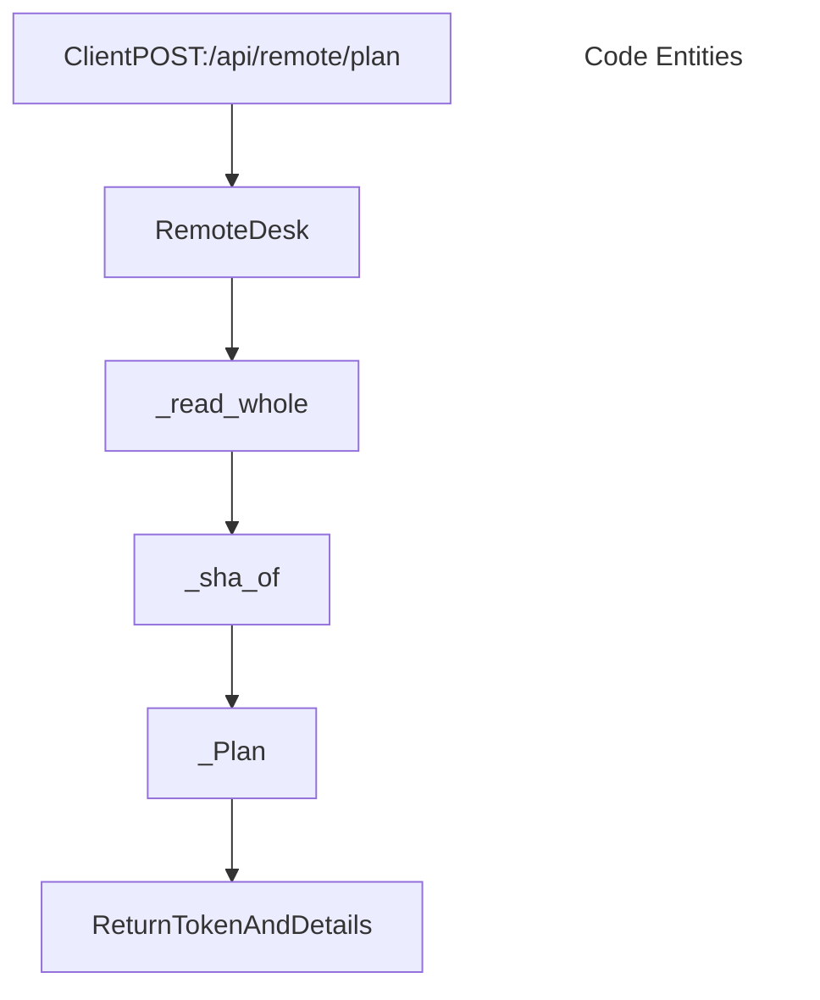
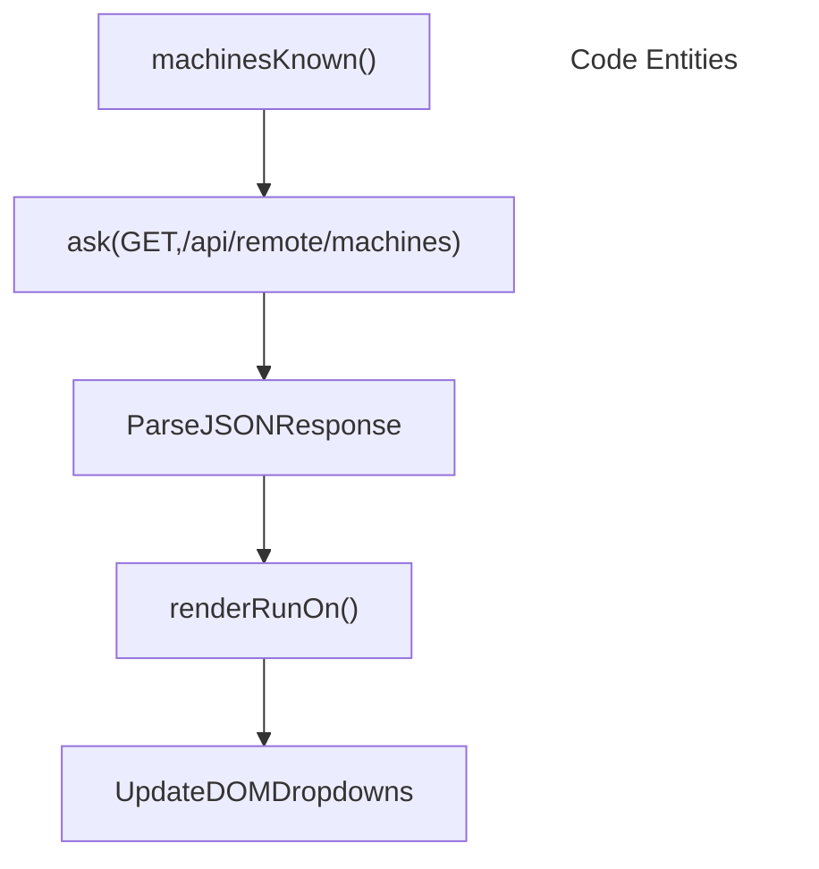

# Remote from the GUI

Relevant source files

The following files were used as context for generating this wiki page:

- [src/fastmdxplora/gui/remote_routes.py](src/fastmdxplora/gui/remote_routes.py)
- [src/fastmdxplora/gui/static/remote.css](src/fastmdxplora/gui/static/remote.css)
- [src/fastmdxplora/gui/static/remote.js](src/fastmdxplora/gui/static/remote.js)
- [src/fastmdxplora/remote/inputs.py](src/fastmdxplora/remote/inputs.py)
- [tests/test_a_send_is_bound_to_what_travels.py](tests/test_a_send_is_bound_to_what_travels.py)
- [tests/test_the_gui_reaches_your_machines.py](tests/test_the_gui_reaches_your_machines.py)
- [tests/test_your_machines_on_the_page.py](tests/test_your_machines_on_the_page.py)

## Purpose and Scope
This page details the implementation of remote execution features within the FastMDXplora graphical user interface. It covers the HTTP routing layer managed by `RemoteDesk` (`[src/fastmdxplora/gui/remote_routes.py:1-20]()`), the cryptographic planning and safety constraints (`[src/fastmdxplora/gui/remote_routes.py:42-49](), [src/fastmdxplora/remote/inputs.py:1-32]()`), the client-side state machine and UI logic in `remote.js` (`[src/fastmdxplora/gui/static/remote.js:1-12]()`), and the corresponding CSS styling (`[src/fastmdxplora/gui/static/remote.css:1-13]()`). These components allow users to inspect recorded machines, plan transmissions, execute remote studies, track telemetry, and fetch or cancel jobs safely directly from the browser dashboard.

---

## 1. RemoteDesk Server Routing and API Endpoints

The GUI exposes remote capabilities through dedicated HTTP routes grouped under `/api/remote/`. These routes mirror the functionality of the `fastmdx remote` CLI command while enforcing strict security rules: loopback access only, host/origin validation, and complete disablement in hosted/cloud deployment modes (`[src/fastmdxplora/gui/remote_routes.py:1-20]()`).

### Route Tables and Handlers
The API is split into GET and POST endpoints defined in `RemoteDesk` (`[src/fastmdxplora/gui/remote_routes.py:108-112]()`):

| HTTP Method | Endpoint | Description |
| :--- | :--- | :--- |
| `GET` | `/api/remote/machines` | Lists recorded remote machines and active remote jobs (`[src/fastmdxplora/gui/remote_routes.py:109]()`). |
| `GET` | `/api/remote/job` | Queries the current status of a specific remote job. |
| `GET` | `/api/remote/fetch-sizes` | Calculates sizes of remote result artifacts prior to retrieval (`[src/fastmdxplora/gui/remote_routes.py:109]()`). |
| `POST` | `/api/remote/plan` | Generates a cryptographically bound transmission plan and token (`[src/fastmdxplora/gui/remote_routes.py:110]()`). |
| `POST` | `/api/remote/send` | Executes the transfer and starts the remote job using an active plan token (`[src/fastmdxplora/gui/remote_routes.py:110]()`). |
| `POST` | `/api/remote/forget` | Removes a completed or abandoned job record from dashboard tracking (`[src/fastmdxplora/gui/remote_routes.py:110-111]()`). |
| `POST` | `/api/remote/fetch` | Downloads completed results from the remote machine (`[src/fastmdxplora/gui/remote_routes.py:111]()`). |
| `POST` | `/api/remote/cancel` | Requests termination of a running remote job (`[src/fastmdxplora/gui/remote_routes.py:112]()`). |

Hosted environments (`_HOSTED`) explicitly reject all remote control mutations with a standard refusal payload (`[src/fastmdxplora/gui/remote_routes.py:114-115]()`).

Sources: `[src/fastmdxplora/gui/remote_routes.py:1-115]()`, `[tests/test_the_gui_reaches_your_machines.py:68-119]()`

---

## 2. Planning, Input Safety, and Cryptographic Binding

To prevent accidental transmission of sensitive files (such as SSH keys or credentials) and ensure the user's explicit consent matches exact file contents, remote transmissions follow a strict Plan-Send protocol.

### The `_Plan` Dataclass and Expiration
When a user clicks "Plan the send", the backend validates the configuration file path, checks workspace boundaries, computes file hashes, and issues an ephemeral `_Plan` object (`[src/fastmdxplora/gui/remote_routes.py:42-49]()`):

*Figure 1: Plan Generation Control Flow linking API entry points to `_Plan` generation.*

Plans are valid for a limited window (`PLAN_KEPT_S = 600` seconds) and can be redeemed exactly once (`[src/fastmdxplora/gui/remote_routes.py:35-36]()`, `[tests/test_the_gui_reaches_your_machines.py:111-143]()`).

### Input Security and Boundary Enforcement
Input collection (`[src/fastmdxplora/remote/inputs.py:1-32]()`) restricts files that can travel:
- Only files within the study's local folder are permitted.
- Symbolic links pointing outside the workspace or back into it are strictly blocked (`[src/fastmdxplora/remote/inputs.py:17-23]()`).
- Sensitive credential paths (`.ssh`, `.gnupg`, `.aws`) trigger hard refusals via `_through_keys` (`[src/fastmdxplora/gui/remote_routes.py:193]()`).
- File contents are verified via `_read_whole` using non-blocking, non-following descriptors (`[src/fastmdxplora/gui/remote_routes.py:51-80]()`).

Sources: `[src/fastmdxplora/gui/remote_routes.py:42-103]()`, `[src/fastmdxplora/remote/inputs.py:1-51]()`, `[tests/test_a_send_is_bound_to_what_travels.py:25-57]()`

---

## 3. Frontend Architecture (`remote.js`) and UI Styling (`remote.css`)

The dashboard user interface is driven by `src/fastmdxplora/gui/static/remote.js` (`[src/fastmdxplora/gui/static/remote.js:1-12]()`), which manages asynchronous API polling, DOM manipulation for the Config Builder, and job listings on the All Studies page.

### Client-Side State and Polling
`remote.js` maintains global lists of `machines` and `jobs`, alongside busy states (`busy`) to prevent redundant rendering during network latency (`[src/fastmdxplora/gui/static/remote.js:53-60]()`). Network requests are handled through a generalized `ask()` helper function (`[src/fastmdxplora/gui/static/remote.js:38-51]()`):

*Figure 2: Frontend Data Synchronization Loop mapping `machinesKnown` to DOM updates.*

### DOM Integration in the Config Builder
The script positions the remote execution panel (`#run-remote`) either beneath the configuration file field or inside the actions card depending on whether the user is running an existing config file or building one interactively (`[src/fastmdxplora/gui/static/remote.js:111-129]()`). 

Remote jobs display dynamic status badges styled via `src/fastmdxplora/gui/static/remote.css`:
- `.remote-job-state[data-state="running"]` / `ready` (`[src/fastmdxplora/gui/static/remote.css:37-38]()`)
- `.remote-job-state[data-state="done"]` (`[src/fastmdxplora/gui/static/remote.css:39]()`)
- `.remote-job-state[data-state="failed"]` (`[src/fastmdxplora/gui/static/remote.css:40]()`)
- `.remote-job-state[data-state="abandoned"]` (`[src/fastmdxplora/gui/static/remote.css:41]()`)

Sources: `[src/fastmdxplora/gui/static/remote.js:38-175]()`, `[src/fastmdxplora/gui/static/remote.css:1-44]()`, `[tests/test_your_machines_on_the_page.py:83-125]()`

---