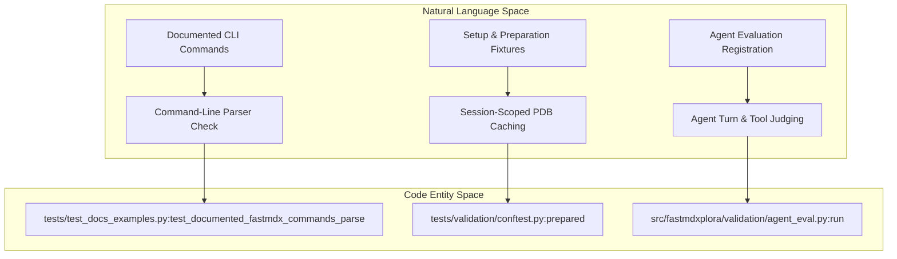
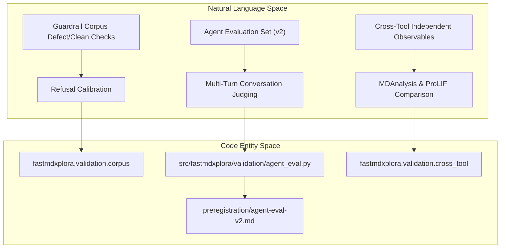
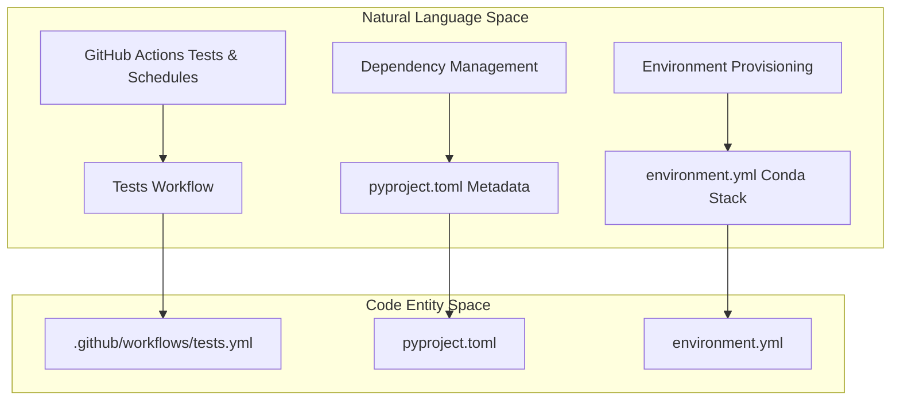

# Quality, Validation and Infrastructure

Relevant source files

The following files were used as context for generating this wiki page:

- [.github/workflows/publish.yml](.github/workflows/publish.yml)
- [.github/workflows/tests.yml](.github/workflows/tests.yml)
- [README.md](README.md)
- [docs/index.md](docs/index.md)
- [docs/installation.md](docs/installation.md)
- [docs/validation.md](docs/validation.md)
- [environment.yml](environment.yml)
- [preregistration/agent-eval-v2.md](preregistration/agent-eval-v2.md)
- [preregistration/agent-eval.md](preregistration/agent-eval.md)
- [pyproject.toml](pyproject.toml)
- [src/fastmdxplora/validation/agent_eval.py](src/fastmdxplora/validation/agent_eval.py)
- [tests/_toml.py](tests/_toml.py)
- [tests/data/agent_eval/context_2026-10-13.json.gz](tests/data/agent_eval/context_2026-10-13.json.gz)
- [tests/data/agent_eval/context_without_2026-10-13.json.gz](tests/data/agent_eval/context_without_2026-10-13.json.gz)
- [tests/data/agent_eval/run_2026-10-13.json.gz](tests/data/agent_eval/run_2026-10-13.json.gz)
- [tests/test_a_movie_is_encoded_by_the_ffmpeg_found.py](tests/test_a_movie_is_encoded_by_the_ffmpeg_found.py)
- [tests/test_a_structure_is_repaired_once_around_its_ligands.py](tests/test_a_structure_is_repaired_once_around_its_ligands.py)
- [tests/test_docs_examples.py](tests/test_docs_examples.py)
- [tests/test_the_agent_is_evaluated.py](tests/test_the_agent_is_evaluated.py)
- [tests/test_the_conda_file_installs_what_it_claims.py](tests/test_the_conda_file_installs_what_it_claims.py)
- [tests/test_the_declarations_agree.py](tests/test_the_declarations_agree.py)
- [tests/validation/conftest.py](tests/validation/conftest.py)

## Purpose and Scope

FastMDXplora ensures scientific rigour, reproducible outcomes, and code reliability through a multi-layered infrastructure combining automated test suites, pre-registered validation frameworks, strict continuous integration (CI) pipelines, and developer tooling. Rather than relying solely on passing unit tests, the system verifies behavior against independent implementations, guardrail corpora, and documented command examples.

For detailed technical implementation, refer to the child pages:
- [Test Suite Organisation](#7.1)
- [Scientific Validation, Corpus and Preregistration](#7.2)
- [CI, Packaging, Scripts and Contributing](#7.3)

---

## 7.1 Test Suite Organisation

The test suite is structured around behavior-named assertions, session-scoped fixtures, and validation of documented command-line examples. Tests are configured via `pytest` and decoupled into unit tests, network-dependent corpus checks, and integration tests covering CLI parsing and configuration loading.

To prevent documentation drift, command examples and markdown snippets are parsed and verified directly by test harnesses such as `tests/test_docs_examples.py`. Session-scoped preparation fixtures like those in `tests/validation/conftest.py` ensure that expensive PDB fetching and system setup operations run once per session, supplying consistent objects to downstream assertions.

### Diagram: Test Suite Mapping (Natural Language Space to Code Entity Space)

**Sources:** `tests/test_docs_examples.py:1-67`, `tests/validation/conftest.py:65-150`, `src/fastmdxplora/validation/agent_eval.py:1-71`

For detailed configuration files, conftest fixtures, Playwright browser tests, and dependency-declaration checks, see [Test Suite Organisation](#7.1).

---

## 7.2 Scientific Validation, Corpus and Preregistration

Scientific validation goes beyond standard code testing by measuring rates, cross-tool comparisons, and agent behavior against pre-registered criteria. The `fastmdxplora.validation` package provides guardrail corpora (`DEFECTS` and `CLEAN`) to evaluate system refusals, cross-tool checks against independent packages like ProLIF and MDAnalysis (`docs/validation.md`), and environment consistency checks using `resolved_config.yml`.

The natural-language agent is judged by a pre-registered evaluation set (`preregistration/agent-eval-v2.md`) implemented in `src/fastmdxplora/validation/agent_eval.py`. This harness tests multi-turn conversations, repairs, edits, and documentation lookups without relying on ad-hoc adjustments.

### Diagram: Validation Pipeline (Scientific & Agent Metrics to Source Modules)

**Sources:** `docs/validation.md:1-125`, `src/fastmdxplora/validation/agent_eval.py:1-115`, `preregistration/agent-eval-v2.md:1-50`

For deep dives into cross-tool checks, agent evaluation harness mechanics, and preregistration documents, see [Scientific Validation, Corpus and Preregistration](#7.2).

---

## 7.3 CI, Packaging, Scripts and Contributing

FastMDXplora uses GitHub Actions workflows (`.github/workflows/tests.yml`) to govern multi-platform testing, scheduled corpus runs, and concurrency cancellation. Packaging constraints are strictly defined in `pyproject.toml`, managing optional dependencies like `[ligand]`, `[pdf]`, and `[validation]` while acknowledging packages requiring conda-forge distribution (such as `openff-toolkit` and `openmm-plumed`).

Developer utilities under `scripts/` provide smoke campaigns and measurement harnesses, aligning contributor contributions with the project's contribution workflow and dependency specifications (`docs/installation.md`).

### Diagram: CI and Packaging Workflow Architecture

**Sources:** `.github/workflows/tests.yml:1-100`, `pyproject.toml:7-110`, `docs/installation.md:68-98`

For comprehensive details on GitHub workflows, container builds, shim-packages, and contributor guidelines, see [CI, Packaging, Scripts and Contributing](#7.3).

---