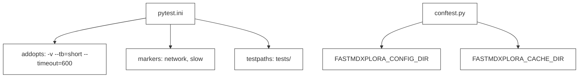
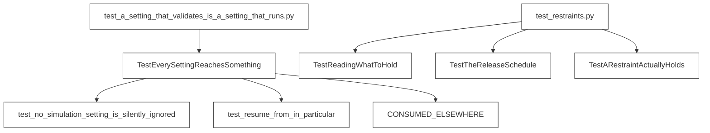
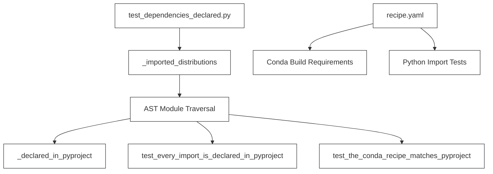

# Test Suite Organisation

Relevant source files

The following files were used as context for generating this wiki page:

- [pytest.ini](pytest.ini)
- [recipes/fastmdxplora/recipe.yaml](recipes/fastmdxplora/recipe.yaml)
- [src/fastmdxplora/analysis/ligand_chemistry.py](src/fastmdxplora/analysis/ligand_chemistry.py)
- [src/fastmdxplora/simulation/restraints.py](src/fastmdxplora/simulation/restraints.py)
- [tests/conftest.py](tests/conftest.py)
- [tests/test_a_real_study_runs_end_to_end.py](tests/test_a_real_study_runs_end_to_end.py)
- [tests/test_a_setting_that_validates_is_a_setting_that_runs.py](tests/test_a_setting_that_validates_is_a_setting_that_runs.py)
- [tests/test_analysis_scope.py](tests/test_analysis_scope.py)
- [tests/test_dashboard_coverage.py](tests/test_dashboard_coverage.py)
- [tests/test_dependencies_declared.py](tests/test_dependencies_declared.py)
- [tests/test_forcefield_selector.py](tests/test_forcefield_selector.py)
- [tests/test_ligand.py](tests/test_ligand.py)
- [tests/test_restraints.py](tests/test_restraints.py)
- [tests/test_setup_phase.py](tests/test_setup_phase.py)
- [tests/test_the_perimeter_and_the_declared_stack.py](tests/test_the_perimeter_and_the_declared_stack.py)
- [tests/test_the_workers_start_clean.py](tests/test_the_workers_start_clean.py)

## Purpose and Scope
The FastMDXplora test suite is structured to prevent silent scientific and operational regressions. It enforces strict dependency tracking, state isolation between tests, automatic process termination for background tasks, and behavior-driven test naming. The suite verifies components across all layers: configuration schemas, setup pipelines, OpenMM-backed simulation runners, trajectory analyses, reporting generators, GUI servers, and AI agent endpoints.

Sources: `tests/conftest.py:1-16`, `pytest.ini:1-14` [pytest.ini:1-13](), [tests/conftest.py:1-16]()

---

## Pytest Configuration and Environment Isolation

Execution parameters are defined in `pytest.ini`, which mandates a strict 10-minute timeout per test using thread-based stack dumping to catch hanging CI runners [pytest.ini:4-8](). Custom markers distinguish network-dependent tests (`network`) from resource-intensive simulation runs (`slow`) [pytest.ini:9-11]().

*Diagram 1: Test Suite Configuration and Environment Mapping*

Sources: `pytest.ini:1-14`, `tests/conftest.py:127-145` [pytest.ini:1-13](), [tests/conftest.py:127-145]()

---

## Shared Fixtures and State Management (`conftest.py`)

To prevent test cross-contamination, `tests/conftest.py` declares several autouse fixtures that reset logging configurations, clean up open matplotlib figures, terminate stray background runner processes, and isolate configuration/cache directories [tests/conftest.py:25-164]().

| Fixture Name | Scope | Role / Mechanism |
| :--- | :--- | :--- |
| `_logging_state_is_restored` | Autouse | Restores `fastmdx` logger propagation levels and console handlers after each test [tests/conftest.py:25-63](). |
| `_a_test_closes_the_figures_it_opens` | Autouse | Closes any matplotlib figures left open during a test [tests/conftest.py:65-77](). |
| `_no_run_outlives_the_test_that_started_it` | Autouse | Wraps `DashboardRuntime._spawn()` to track and forcefully terminate child processes (`SIGTERM` / `SIGKILL`) upon test completion [tests/conftest.py:79-125](). |
| `pytest_configure` | Session | Directs configuration and cache paths to an isolated temporary directory (`FASTMDXPLORA_CONFIG_DIR`) [tests/conftest.py:127-145](). |
| `_this_computer_reads_no_gpu` | Autouse | Mocks `gpu_here.nvidia_smi_here()` to return `False`, ensuring deterministic multi-instance GPU sharing logic tests [tests/conftest.py:146-164](). |

Sources: `tests/conftest.py:25-164` [tests/conftest.py:25-164]()

---

## Behavior-Named Tests and Validation-to-Execution Verification

Tests are organized into descriptive classes and methods documenting expected physical and operational behaviors rather than generic test IDs. For example, restraint parsing and release schedules are validated in `tests/test_restraints.py` [tests/test_restraints.py:57-139](), while configuration execution wiring is verified in `tests/test_a_setting_that_validates_is_a_setting_that_runs.py` [tests/test_a_setting_that_validates_is_a_setting_that_runs.py:94-143]().

*Diagram 2: Behavior-Named Test Architecture and Code Entity Mapping*

Sources: `tests/test_restraints.py:57-139`, `tests/test_a_setting_that_validates_is_a_setting_that_runs.py:94-143` [tests/test_restraints.py:57-139](), [tests/test_a_setting_that_validates_is_a_setting_that_runs.py:94-143]()

---

## Dependency-Declaration and Environment Tests

To ensure that package installations do not fail due to unrecorded transitive imports (such as `scipy`, `netCDF4`, or `pillow`), `tests/test_dependencies_declared.py` statically parses AST imports across the package and compares them against `pyproject.toml` and conda recipes [tests/test_dependencies_declared.py:1-103]().

*Diagram 3: Dependency Verification Pipeline*

Sources: `tests/test_dependencies_declared.py:1-169`, `recipes/fastmdxplora/recipe.yaml:95-135` [tests/test_dependencies_declared.py:1-169](), [recipes/fastmdxplora/recipe.yaml:95-135]()

---

## Integration, Security Perimeter, and End-to-End Suites

Specialized integration test modules validate complex subsystems:
- **Dashboard & GUI Coverage**: `tests/test_dashboard_coverage.py` tests frame caching, fallback mechanisms, trajectory binary inspection (`frames_info`), and process status tracking [tests/test_dashboard_coverage.py:50-108]().
- **Perimeter & Security**: `tests/test_the_perimeter_and_the_declared_stack.py` verifies that non-loopback dashboard bindings block arbitrary filesystem traversal and leak-prone error responses (`/api/browse`, `/api/load-config`) [tests/test_the_perimeter_and_the_declared_stack.py:23-82]().
- **End-to-End Execution**: `tests/test_a_real_study_runs_end_to_end.py` executes a complete solvated peptide workflow on the CPU platform, validating `cost.json` metrics, checkpoint resume sequences, and resolved configurations [tests/test_a_real_study_runs_end_to_end.py:70-156]().

Sources: `tests/test_dashboard_coverage.py:50-108`, `tests/test_the_perimeter_and_the_declared_stack.py:23-82`, `tests/test_a_real_study_runs_end_to_end.py:70-156` [tests/test_dashboard_coverage.py:50-108](), [tests/test_the_perimeter_and_the_declared_stack.py:23-82](), [tests/test_a_real_study_runs_end_to_end.py:70-156]()

---