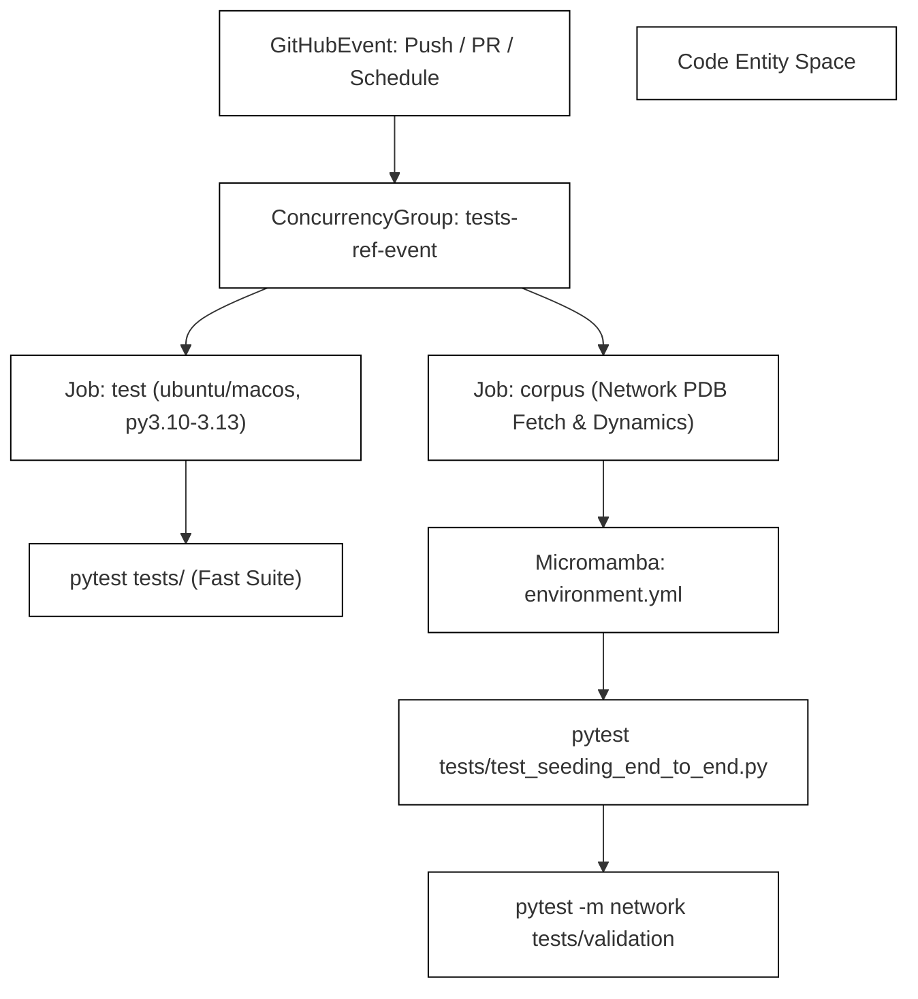
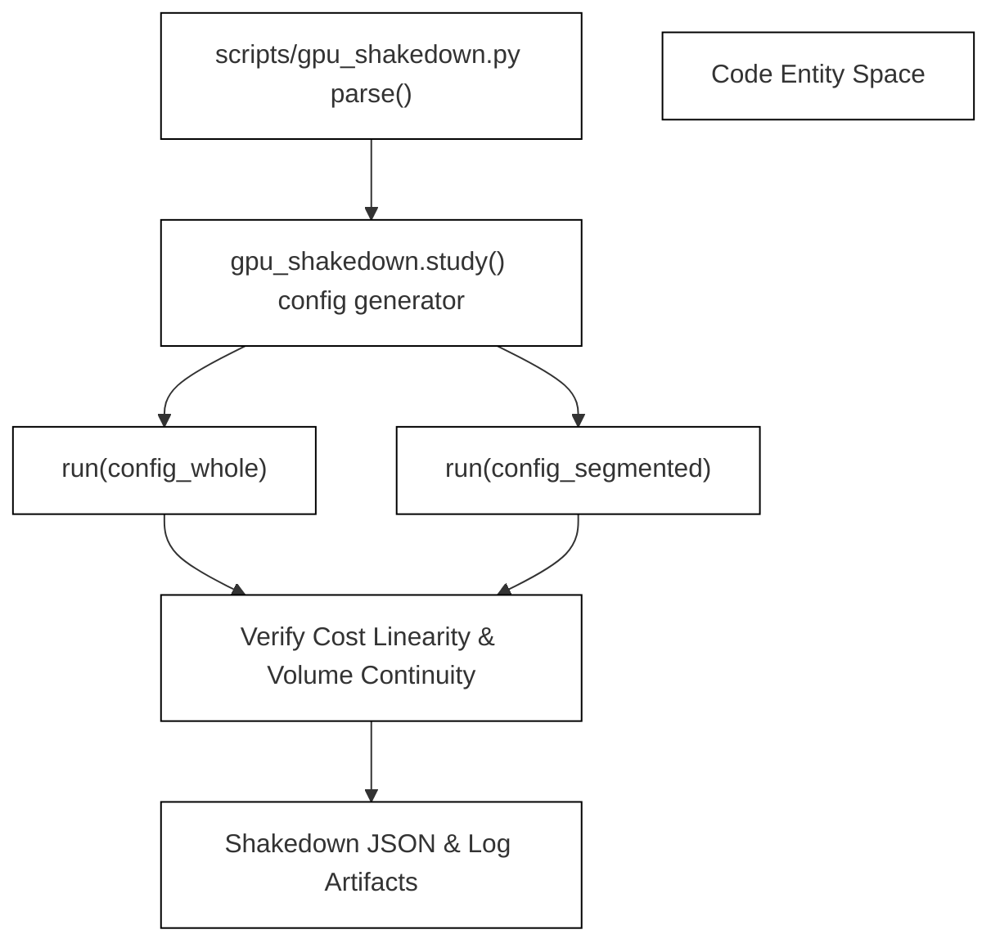

# CI, Packaging, Scripts and Contributing

<details>
<summary>Relevant source files</summary>

The following files were used as context for generating this wiki page:

- [.github/workflows/cla.yml](.github/workflows/cla.yml)
- [.github/workflows/container.yml](.github/workflows/container.yml)
- [.github/workflows/publish.yml](.github/workflows/publish.yml)
- [.github/workflows/tests.yml](.github/workflows/tests.yml)
- [.gitignore](.gitignore)
- [CITATION.cff](CITATION.cff)
- [CLA.md](CLA.md)
- [CONTRIBUTING.md](CONTRIBUTING.md)
- [README.md](README.md)
- [container/docker_from_def.py](container/docker_from_def.py)
- [container/fastmdx.def](container/fastmdx.def)
- [docs/_static/.gitkeep](docs/_static/.gitkeep)
- [docs/conf.py](docs/conf.py)
- [docs/hosting.md](docs/hosting.md)
- [docs/index.md](docs/index.md)
- [docs/installation.md](docs/installation.md)
- [environment.yml](environment.yml)
- [pyproject.toml](pyproject.toml)
- [scripts/cla_co_authors.py](scripts/cla_co_authors.py)
- [scripts/gpu_shakedown.py](scripts/gpu_shakedown.py)
- [scripts/name_refusal_families.py](scripts/name_refusal_families.py)
- [src/fastmdxplora/__main__.py](src/fastmdxplora/__main__.py)
- [src/fastmdxplora/agent/__init__.py](src/fastmdxplora/agent/__init__.py)
- [src/fastmdxplora/agent/queue.py](src/fastmdxplora/agent/queue.py)
- [src/fastmdxplora/agent/run.py](src/fastmdxplora/agent/run.py)
- [src/fastmdxplora/agent/worker.py](src/fastmdxplora/agent/worker.py)
- [src/fastmdxplora/gui/hosting.py](src/fastmdxplora/gui/hosting.py)
- [tests/_toml.py](tests/_toml.py)
- [tests/test_a_contributor_signs_one_agreement.py](tests/test_a_contributor_signs_one_agreement.py)
- [tests/test_a_movie_is_encoded_by_the_ffmpeg_found.py](tests/test_a_movie_is_encoded_by_the_ffmpeg_found.py)
- [tests/test_a_structure_is_repaired_once_around_its_ligands.py](tests/test_a_structure_is_repaired_once_around_its_ligands.py)
- [tests/test_docs_examples.py](tests/test_docs_examples.py)
- [tests/test_every_co_author_signs_the_agreement.py](tests/test_every_co_author_signs_the_agreement.py)
- [tests/test_the_command_runs_once_as_main.py](tests/test_the_command_runs_once_as_main.py)
- [tests/test_the_conda_file_installs_what_it_claims.py](tests/test_the_conda_file_installs_what_it_claims.py)
- [tests/test_the_container_carries_the_ligand_path.py](tests/test_the_container_carries_the_ligand_path.py)
- [tests/test_the_declarations_agree.py](tests/test_the_declarations_agree.py)
- [tests/test_the_docker_image_is_the_apptainer_image.py](tests/test_the_docker_image_is_the_apptainer_image.py)
- [tests/test_the_lab_mark_and_the_pinned_sidebar.py](tests/test_the_lab_mark_and_the_pinned_sidebar.py)
- [tests/test_the_shakedown_says_what_happened.py](tests/test_the_shakedown_says_what_happened.py)
- [tests/test_what_may_be_split_and_what_stops.py](tests/test_what_may_be_split_and_what_stops.py)
- [tests/validation/conftest.py](tests/validation/conftest.py)

</details>


## Purpose and Scope

This page documents the infrastructure supporting FastMDXplora's development, packaging, verification, and contribution workflows. FastMDXplora relies on strict continuous integration (CI) matrices, reproducible conda environments, Apptainer container build pipelines, specialized shakedown and smoke test scripts, and an automated Contributor License Agreement (CLA) framework to maintain scientific and code reliability across platforms.

Sources:
- `pyproject.toml:1-162`
- `.github/workflows/tests.yml:1-141`
- `CONTRIBUTING.md:1-191`

---

## 1. Continuous Integration and GitHub Workflows

The primary test pipeline is defined in `.github/workflows/tests.yml` [__github/workflows/tests.yml:1-141](). To prevent redundant job queues and save computational resources, concurrency groups are organized by reference and event type using cancellation rules:

```yaml
concurrency:
  group: tests-${{ github.ref }}-${{ github.event_name }}
  cancel-in-progress: true
```
*(Source: [.github/workflows/tests.yml:22-25]())*

### The Matrix and Corpus Jobs
FastMDXplora divides testing into standard matrix checks (`ubuntu-latest`, `macos-latest` across Python 3.10–3.13) and a heavy scheduled/manual `corpus` job. 

- **Matrix Jobs (`test`)**: Run unit and integration tests across operating systems and Python versions, verifying core functionality, configuration validation, and CLI parsing without network-intensive structure downloads.
- **Corpus Job (`corpus`)**: Executes daily at 03:00 UTC or upon manual dispatch (`workflow_dispatch`) [__github/workflows/tests.yml:8-12](). It fetches real structures from the RCSB PDB, exercises ligand parameterization, enhanced sampling (umbrella sampling, metadynamics), and validation suites. It uses `mamba-org/setup-micromamba` with `environment.yml` to guarantee that complex chemistry dependencies like `openmm-plumed` and the OpenFF toolkit are present [__github/workflows/tests.yml:78-81]().


*Diagram 1: CI Pipeline & Natural Language to Code Entity Space for GitHub Workflows*

Sources:
- `.github/workflows/tests.yml:1-141`

---

## 2. Packaging, Conda Recipe and Container Builds

FastMDXplora packages its python metadata in `pyproject.toml` [pyproject.toml:1-162]() and relies heavily on conda-forge for chemical components that lack PyPI distributions (such as `openmm-plumed` and AmberTools) [docs/installation.md:14-16]().

### Dependencies and Optional Extras
The project specifies Python requirements (`>=3.10, <3.14`) [pyproject.toml:17]() and defines modular optional-dependencies [pyproject.toml:87-160]():
- `[agent]`: Thin wrapper for agent configuration writers [pyproject.toml:88-93]().
- `[pdf]`: WeasyPrint (`>=60`) for generating publication-quality PDF reports [pyproject.toml:98-100]().
- `[md]`: `pdbfixer` and OpenMM (`>=8.2`) for setup and simulation phases [pyproject.toml:101-108]().
- `[ligand]`: `openmmforcefields`, `rdkit`, and `propka` for ligand parameterization, partial charges, and pKa estimation [pyproject.toml:109-127]().
- `[amber]`: `netCDF4` for high-speed Amber trajectory reading [pyproject.toml:128-132]().
- `[umap]`: `umap-learn` for manifold-learning dimensionality reduction [pyproject.toml:133-137]().
- `[movies]`: Playwright for headless browser scene recording [pyproject.toml:138-145]().

### Container Build Pipeline
For clusters and isolated environments lacking internet connectivity or specific conda-forge access, FastMDXplora builds an Apptainer container (`.sif`) via `.github/workflows/container.yml` [__github/workflows/container.yml:1-150]() using the Apptainer definition file `container/fastmdx.def` [__github/workflows/container.yml:140-141]().

Sources:
- `pyproject.toml:1-162`
- `docs/installation.md:1-161`
- `.github/workflows/container.yml:1-150`

---

## 3. Utility Scripts and Smoke Campaigns

The `scripts/` directory contains operational hardening and diagnostic utilities designed to run outside standard unit tests.

### Smoke Campaigns (`scripts/run_pdb_smoke_campaign.py`)
Smoke campaigns execute FastMDXplora across a curated list of PDB entries or local files to catch parsing errors, missing residues, or unhandled chemical topologies across diverse structural motifs [CONTRIBUTING.md:120-135](). 

Key arguments include `--input-list`, `--output-root`, `--production-steps`, and `--continue-on-error`, ensuring that an individual structural failure is logged rather than prematurely halting the campaign [CONTRIBUTING.md:143-182]().

### GPU Shakedown (`scripts/gpu_shakedown.py`)
`scripts/gpu_shakedown.py` interrogates physical GPU hardware behavior that CPU mock runs cannot fully validate: cost-model linearity, segment resume integrity under PME/barostat pressure, and volume drift across segment joins [scripts/gpu_shakedown.py:1-44](). It executes the exact same study whole and in segmented pieces, comparing trajectory states and volumetric properties [scripts/gpu_shakedown.py:38-44]().


*Diagram 2: Shakedown Script Architecture and Execution Flow*

### Refusal Naming and CLA Co-Authors
- `scripts/name_refusal_families.py`: Organizes and categorizes refusal codes and guardrails across simulation and setup subsystems.
- `scripts/cla_co_authors.py`: Parses commit histories and pull requests to ensure multi-author contributions satisfy licensing requirements.

Sources:
- `scripts/gpu_shakedown.py:1-153`
- `CONTRIBUTING.md:120-191`

---

## 4. Contribution Flow, CLA, and Quality Gates

Contributing to FastMDXplora follows a structured code review and validation methodology outlined in `CONTRIBUTING.md` [CONTRIBUTING.md:1-191]() and enforced by GitHub Actions.

### Development Environment Setup
Contributors clone the repository, establish a virtual environment or conda environment via `environment.yml`, and install the package in editable mode with development tools [CONTRIBUTING.md:9-20]():
```bash
git clone https://github.com/aai-research-lab/FastMDXplora.git
cd FastMDXplora
conda env create -f environment.yml
conda activate fastmdxplora
pip install -e ".[dev]"
```
*(Source: `docs/installation.md:68-77()`)*

### Quality Gates and Linters
1. **Linting (`ruff`)**: CI and local validation enforce code checks using Ruff, specifically verifying functional correctness rules (`ruff check src tests --select F,B`) [CONTRIBUTING.md:75-80]().
2. **Test Suite (`pytest`)**: Contributors must run `pytest` locally. Tests touching setup, chemistry, or guardrails must be validated against the network-marked validation corpus (`pytest -m network tests/validation`) [CONTRIBUTING.md:86-91]().
3. **No-Source-Reading Rule**: `tests/test_no_test_reads_the_source.py` ensures that tests execute actual code behavior rather than merely inspecting function docstrings or source text strings [CONTRIBUTING.md:110-115]().

### Contributor License Agreement (CLA)
Contributions require agreement to FastMDXplora's licensing terms (`CLA.md`). The automated workflow `.github/workflows/cla.yml` checks pull request authors and co-authors to verify that a signed CLA is on file before merging.

Sources:
- `CONTRIBUTING.md:1-191`
- `.github/workflows/cla.yml:1-30`

---