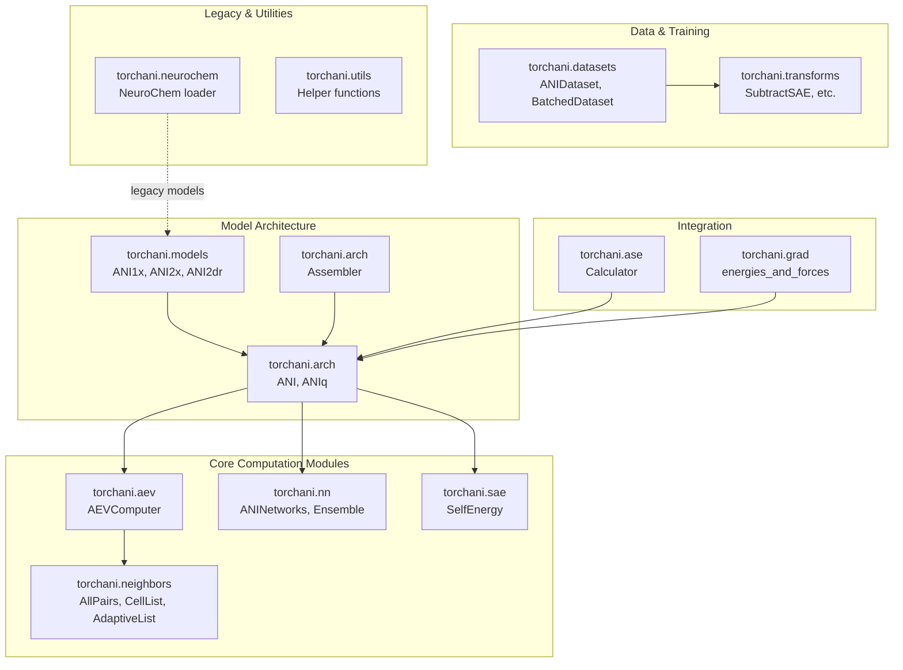
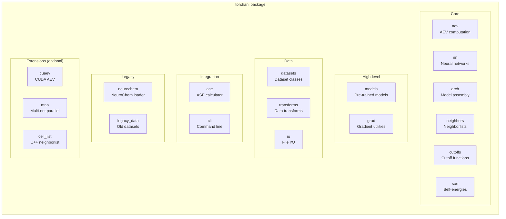

# Overview

<details>
<summary>Relevant source files</summary>

The following files were used as context for generating this wiki page:

- [.gitignore](.gitignore)
- [README.md](README.md)
- [examples/fundamentals.py](examples/fundamentals.py)
- [setup.py](setup.py)
- [torchani/__init__.py](torchani/__init__.py)
- [torchani/neurochem.py](torchani/neurochem.py)

</details>


TorchANI is a PyTorch-based library for training, developing, and applying ANI-style neural network interatomic potentials (NNIPs). It provides both pre-trained models for immediate use and a flexible framework for building custom neural network potentials. The library is maintained by the Roitberg group and designed for computational chemistry applications including molecular dynamics, geometry optimization, and property prediction.

This overview introduces the library's architecture, capabilities, and primary use cases. For installation instructions, see [Installation](#2). For getting started with pre-trained models, see [Quick Start](#3). For training custom models, see [Training](#7).

**Sources:** [README.md:15-31](), [torchani/__init__.py:1-11](), [examples/fundamentals.py:1-15]()

---

## What TorchANI Does

TorchANI implements the ANI neural network potential architecture, which predicts molecular energies and forces from atomic coordinates using:

1. **Atomic Environment Vectors (AEVs)**: Symmetry functions that encode local atomic environments
2. **Element-specific neural networks**: Separate networks for each chemical element
3. **Energy decomposition**: Total molecular energy as sum of atomic contributions

The library supports molecules composed of H, C, N, O, S, F, and Cl atoms, with models trained on quantum chemistry datasets.

**Sources:** [README.md:15-18](), [examples/fundamentals.py:6-14]()

---

## Library Architecture

TorchANI is organized into distinct modules, each handling specific aspects of neural network potential computation:



**Sources:** [torchani/__init__.py:19-94]()

---

## Key Components

| Component | Module | Purpose |
|-----------|--------|---------|
| `AEVComputer` | `torchani.aev` | Computes atomic environment vectors from coordinates and neighborlist |
| `ANINetworks` | `torchani.nn` | Element-specific neural networks for atomic energy prediction |
| `Ensemble` | `torchani.nn` | Aggregates multiple `ANINetworks` for improved accuracy |
| `SelfEnergy` | `torchani.sae` | Adds element-specific self-atomic energies |
| `SpeciesConverter` | `torchani.nn` | Converts atomic numbers to model-specific indices |
| `ANI` | `torchani.arch` | Complete model assembling all components |
| `ANIDataset` | `torchani.datasets` | Map-style dataset for molecular conformers |
| `Calculator` | `torchani.ase` | ASE interface for MD and optimization |

**Sources:** [torchani/__init__.py:48-51](), [examples/fundamentals.py:8-11]()

---

## Pre-trained Models

TorchANI provides several pre-trained models accessible through factory functions in `torchani.models`:

| Model | Factory Function | Elements | Training Data | Ensemble Size |
|-------|-----------------|----------|---------------|---------------|
| ANI-1x | `torchani.models.ANI1x()` | H, C, N, O | ANI-1x dataset | 8 |
| ANI-2x | `torchani.models.ANI2x()` | H, C, N, O, S, F, Cl | ANI-2x dataset | 8 |
| ANI-1ccx | `torchani.models.ANI1ccx()` | H, C, N, O | Coupled-cluster data | 8 |
| ANI-2dr | `torchani.models.ANI2dr()` | H, C, N, O, S, F, Cl | Dispersion-corrected | 8 |

All models return energies in Hartree and forces in Hartree/Angstrom.

**Sources:** [README.md:27-31](), [examples/fundamentals.py:54-61]()

---

## Model Usage Flow

The following diagram shows how components interact during energy/force computation:

```mermaid
flowchart LR
    Input["Input:<br/>atomic_nums, coords"]
    
    Input --> SpeciesConv["SpeciesConverter<br/>torchani.nn"]
    SpeciesConv --> species_idx["species: Tensor<br/>(molecules, atoms)"]
    
    species_idx --> NeighborList["Neighborlist<br/>torchani.neighbors"]
    Input --> NeighborList
    
    NeighborList --> neighbors["Neighbors object<br/>indices, distances, vectors"]
    
    neighbors --> AEVComp["AEVComputer<br/>torchani.aev"]
    species_idx --> AEVComp
    
    AEVComp --> aevs["AEVs: Tensor<br/>(molecules, atoms, features)"]
    
    aevs --> Networks["ANINetworks/Ensemble<br/>torchani.nn"]
    species_idx --> Networks
    
    Networks --> atomic_e["Atomic energies:<br/>(molecules, atoms)"]
    
    atomic_e --> SelfE["SelfEnergy<br/>torchani.sae"]
    SelfE --> shifted_e["Shifted energies"]
    
    shifted_e --> Sum["torch.sum<br/>(per molecule)"]
    Sum --> total_e["Total energy:<br/>(molecules,)"]
    
    total_e --> Grad["torch.autograd.grad"]
    Grad --> forces["Forces:<br/>(molecules, atoms, 3)"]
```



**Sources:** [examples/fundamentals.py:70-76](), [torchani/arch.py:1-500]() (inferred from architecture)

---

## Extension Modules

TorchANI includes optional C++/CUDA extensions for performance:

| Extension | Module | Purpose | Requirements |
|-----------|--------|---------|--------------|
| cuAEV | `torchani.cuaev` | CUDA-accelerated AEV computation | CUDA-capable GPU, CUDA Toolkit |
| MNP | `torchani.mnp` | Multi-network parallel evaluation | OpenMP-capable compiler |
| CellList | `torchani.cell_list` | Fast neighborlist for PBC systems | C++17 compiler |

Extensions are compiled during installation with the `--config-settings=--global-option=ext` flag.

**Sources:** [README.md:148-154](), [setup.py:43-116]()

---

## Primary Use Cases

TorchANI supports three main workflows:

### 1. Inference with Pre-trained Models
```python
import torchani
model = torchani.models.ANI2x()
energy = model((atomic_nums, coords))
```
See [Using Pre-built Models](#5.1) for details.

### 2. Molecular Dynamics via ASE
```python
from torchani.ase import Calculator
from ase.md import VelocityVerlet

calc = Calculator(model)
atoms.calc = calc
dyn = VelocityVerlet(atoms, timestep=0.5)
```
See [ASE Integration](#5.4) for details.

### 3. Training Custom Models
```python
from torchani.arch import Assembler
assembler = Assembler()
assembler.set_symbols(["H", "C", "N", "O"])
# ... configure components ...
model = assembler.assemble()
```
See [Building Custom Models](#5.3) and [Training](#7) for details.

**Sources:** [examples/fundamentals.py:61-76](), [README.md:42-104]()

---

## Installation Requirements

TorchANI requires:
- Python 3.8+
- PyTorch 2.8+ with CUDA 12.8+ (for GPU support)
- Optional: ASE (for molecular dynamics)
- Optional: CUDA Toolkit (for extensions)

Installation methods:
- From source (GitHub): `pip install .`
- With extensions: `pip install --config-settings=--global-option=ext .`
- Coming soon: PyPI and Conda packages

See [Installation](#2) for complete instructions.

**Sources:** [README.md:42-104](), [setup.py:1-289]()

---

## Module Organization



**Sources:** [torchani/__init__.py:19-42]()

---

## Documentation Roadmap

This wiki is organized as follows:

- **[Installation](#2)**: Setup and building extensions
- **[Quick Start](#3)**: First steps with pre-trained models
- **[Core Concepts](#4)**: Architecture details (AEV, neighborlists, potentials)
- **[User Guide](#5)**: Common workflows and use cases
- **[Datasets](#6)**: Built-in datasets and data management
- **[Training](#7)**: Custom model training
- **[Advanced Topics](#8)**: Performance optimization, PBC, benchmarking
- **[API Reference](#9)**: Complete API documentation
- **[Development Guide](#10)**: Contributing and testing

**Sources:** [README.md:15-25](), page table of contents from context

---

## Citations

When using TorchANI, please cite:

1. **TorchANI 2.0** (this implementation): [ChemRxiv preprint](https://chemrxiv.org/engage/chemrxiv/article-details/6890d92523be8e43d6b9bbba)
2. **Original TorchANI**: [J. Chem. Inf. Model. 2020, 60(7), 3408-3415](https://pubs.acs.org/doi/10.1021/acs.jcim.0c00451)

For ANI model references, see the [isayev/ASE_ANI](https://github.com/isayev/ASE_ANI) repository.

**Sources:** [README.md:160-175]()

---