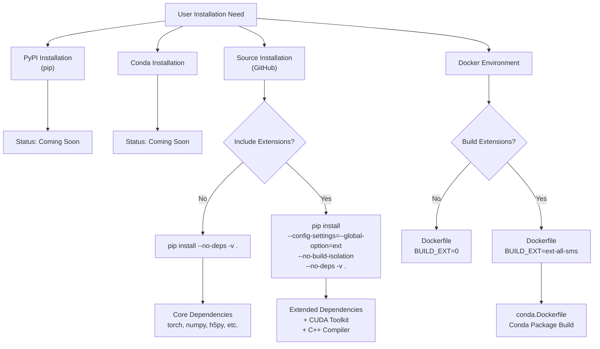
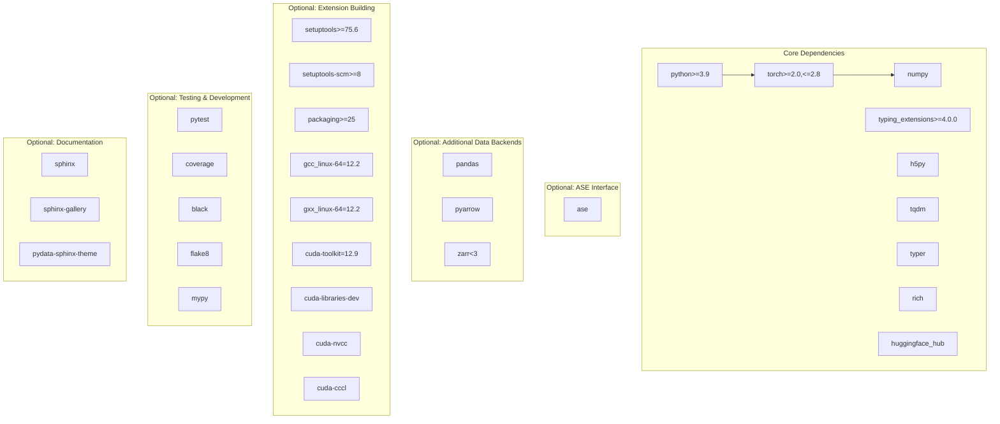
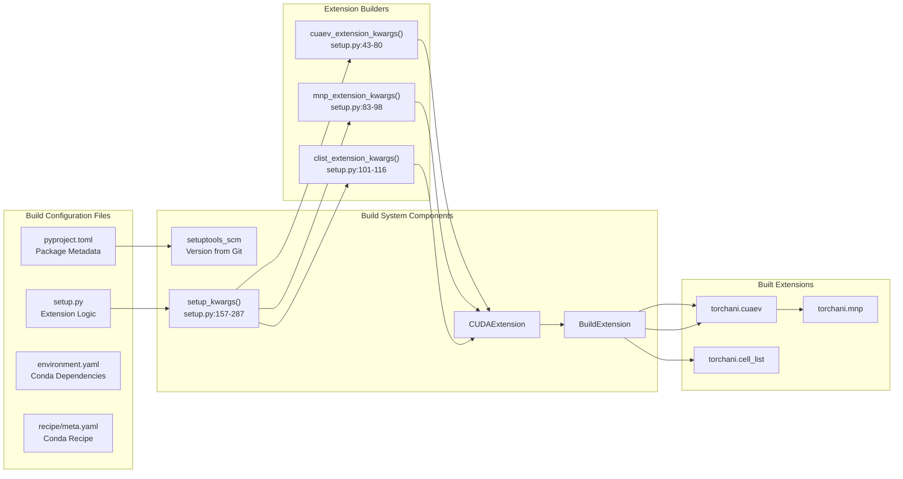
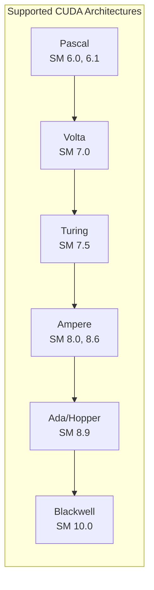
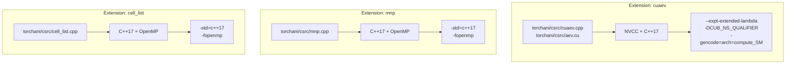
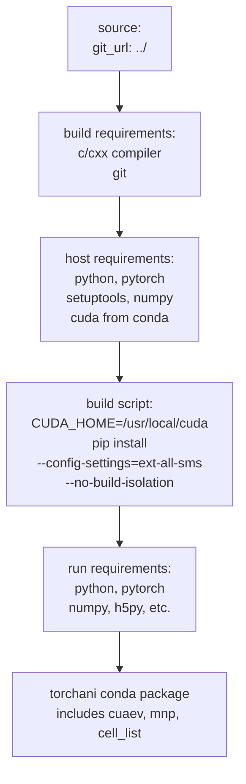

# Installation

<details>
<summary>Relevant source files</summary>

The following files were used as context for generating this wiki page:

- [.gitignore](.gitignore)
- [Dockerfile](Dockerfile)
- [README.md](README.md)
- [conda.Dockerfile](conda.Dockerfile)
- [dev_requirements.txt](dev_requirements.txt)
- [environment.yaml](environment.yaml)
- [pyproject.toml](pyproject.toml)
- [recipe/conda_build_config.yaml](recipe/conda_build_config.yaml)
- [recipe/meta.yaml](recipe/meta.yaml)
- [setup.py](setup.py)
- [torchani/datasets/_utils.py](torchani/datasets/_utils.py)

</details>


This page provides an overview of TorchANI installation options, dependency requirements, and build system architecture. For detailed step-by-step installation instructions, see [Package Installation](#2.1). For information about compiling optional C++/CUDA extensions, see [Building Extensions](#2.2).

## Overview

TorchANI supports multiple installation methods to accommodate different use cases:

- **PyPI (pip)** - Standard Python package installation (coming soon)
- **Conda** - Conda package installation (coming soon)  
- **Source** - Installation from GitHub repository with optional extension compilation
- **Docker** - Pre-configured containerized environments

The package includes optional compiled extensions (`cuaev`, `mnp`, `cell_list`) that significantly improve performance but require additional build tools and CUDA Toolkit.

## Installation Pathways



**Installation Pathway Selection**

| Method | Extensions | Use Case | Prerequisites |
|--------|-----------|----------|---------------|
| PyPI | Optional | Standard users | Python, pip |
| Conda | Included | Reproducible envs | Conda/Mamba |
| Source (no ext) | No | Development, testing | Git, Python |
| Source (with ext) | Yes | Performance-critical | Git, CUDA Toolkit, C++17 compiler |
| Docker | Configurable | Isolated environments | Docker |

Sources: [README.md:42-108](), [Dockerfile:1-56](), [conda.Dockerfile:1-71]()

## Dependency Architecture



**Core Dependencies** are required for all installations and defined in [pyproject.toml:21-34](). **Optional Dependencies** for different use cases are listed in [environment.yaml:18-58]() and [dev_requirements.txt:1-41]().

Sources: [pyproject.toml:20-34](), [environment.yaml:7-65](), [dev_requirements.txt:1-41]()

## Build System Architecture

The TorchANI build system uses `setuptools` with custom extension building logic. The build configuration is split across multiple files:



Sources: [setup.py:1-289](), [pyproject.toml:42-44](), [pyproject.toml:53-55]()

### Build System Flow

The `setup.py` file implements a custom build system that conditionally compiles extensions based on command-line flags:

| Flag | Purpose | Example |
|------|---------|---------|
| `ext` | Auto-detect compatible GPUs | `--config-settings=--global-option=ext` |
| `ext-all-sms` | Build for all supported architectures | `--config-settings=--global-option=ext-all-sms` |
| `ext-sm60`, `ext-sm70`, etc. | Build for specific SM version | `--config-settings=--global-option=ext-sm86` |
| `ext-debug` | Include debug symbols | `--config-settings=--global-option=ext-debug` |
| `ext-no-opt` | Disable fast math optimizations | `--config-settings=--global-option=ext-no-opt` |

The `setup_kwargs()` function [setup.py:157-287]() processes these flags and returns extension configurations.

Sources: [setup.py:138-148](), [setup.py:157-287]()

## Extension Compilation Requirements

### CUDA Architecture Support

TorchANI supports CUDA Compute Capabilities (SM versions) from Pascal through Blackwell:



The supported SM versions are defined in `SUPPORTED_SMS` [setup.py:145](): `{"60", "61", "70", "75", "80", "86", "89", "100"}`.

### CUB Library Handling

For CUDA versions < 12.8, the CUB library is required for `cuaev` compilation. The `maybe_download_cub()` function [setup.py:11-40]() automatically:

1. Checks if CUB is bundled with PyTorch (CUDA >= 12.8)
2. Searches PyTorch include directories for CUB
3. Downloads CUB from GitHub if not found

Sources: [setup.py:11-40](), [setup.py:145]()

## Compiler Requirements for Extensions

Building the C++/CUDA extensions requires specific compiler versions and flags:



**Compiler Version Requirements:**
- GCC/G++: Version 12.2 (specified in [environment.yaml:28-29]() and [recipe/conda_build_config.yaml:1-4]())
- NVCC: Must match PyTorch's CUDA version compatibility
- C++ Standard: C++17 required for all extensions

Sources: [setup.py:66-79](), [setup.py:87-97](), [setup.py:105-115](), [environment.yaml:28-32]()

## Conda Package Build Process

The conda package includes all extensions by default and uses the system CUDA Toolkit:



The conda recipe [recipe/meta.yaml:1-52]() specifies:
- Build string: `py{{ python }}_torch{{ pytorch }}_cuda{{ cuda }}`
- Entry point: `ani = torchani.cli:main`
- Extensions built for all SMs: `ext-all-sms` flag

Build configuration versions are pinned in [recipe/conda_build_config.yaml:1-13]():
- PyTorch: 2.7.1
- Python: 3.11
- CUDA: 12.9
- NumPy: 2.1

Sources: [recipe/meta.yaml:1-52](), [recipe/conda_build_config.yaml:1-13]()

## Platform Support

| Platform | Core Package | Extensions | Notes |
|----------|-------------|-----------|-------|
| Linux | ✓ | ✓ | Primary platform, fully tested |
| macOS | ✓ | ✗ | No CUDA support, MPS untested |
| Windows | ✗ | ✗ | Not officially supported |

**macOS Installation Note:** The [environment.yaml:30-32]() file requires modification for macOS:
- Remove or comment out `nvidia::cuda-toolkit=12.9`
- Remove pip index URL for CUDA wheels (line 63)

Sources: [README.md:134-139](), [README.md:141-146]()

## Docker Environments

TorchANI provides two Docker configurations:

### Development Dockerfile

[Dockerfile:1-56]() creates a development environment with:
- Base: `pytorch/pytorch:2.8.0-cuda12.9-cudnn9-devel`
- Includes test data via `download-dev-data.sh`
- Configurable extension building via `BUILD_EXT` arg
- Installed optional dependencies from `dev_requirements.txt`

```bash
# Build without extensions
docker build --build-arg BUILD_EXT=0 -t torchani:dev .

# Build with extensions for all SMs
docker build --build-arg BUILD_EXT=all-sms -t torchani:dev .

# Build for specific SM
docker build --build-arg BUILD_EXT=sm86 -t torchani:dev .
```

### Conda Package Dockerfile

[conda.Dockerfile:1-71]() builds the conda package:
- Runs `conda build` with recipe from `./recipe`
- Supports uploading to internal server (via `INTERNAL_RELEASE` arg)
- Supports uploading to anaconda.org (via `PUBLIC_RELEASE` arg)

Sources: [Dockerfile:1-56](), [conda.Dockerfile:1-71]()

## Version Management

TorchANI uses `setuptools_scm` for automatic version management from Git tags:

- Version file: [torchani/_version.py]() (auto-generated)
- Configuration: [pyproject.toml:53-55]()
- Fallback version: `"0.0.0"` when Git is unavailable

The conda recipe uses `{{ GIT_DESCRIBE_TAG }}.{{ GIT_BUILD_STR }}` for versioning [recipe/meta.yaml:3]().

Sources: [pyproject.toml:53-55](), [recipe/meta.yaml:1-3]()

## GPU Support and Performance

TorchANI requires CUDA-enabled GPUs for production use:
- **Recommended:** CUDA-enabled GPU with compute capability >= 6.0
- **Supported:** CUDA 12.8+ with PyTorch 2.8
- **Untested:** AMD ROCm/HIP, Apple MPS

Without GPU acceleration, TorchANI will experience "highly degraded performance" [README.md:143-145]().

Sources: [README.md:141-146]()

## Next Steps

For detailed installation instructions:
- Standard installation: See [Package Installation](#2.1)
- Extension compilation: See [Building Extensions](#2.2)
- Quick start guide: See [Quick Start](#3)
- Model usage: See [Using Pre-built Models](#5.1)

---