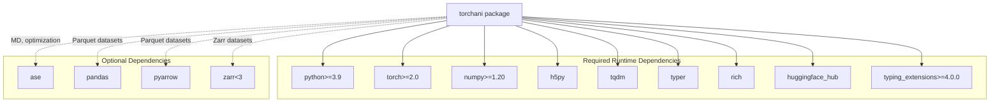
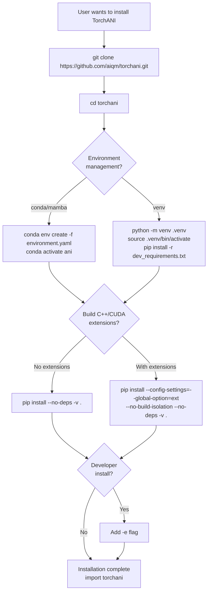
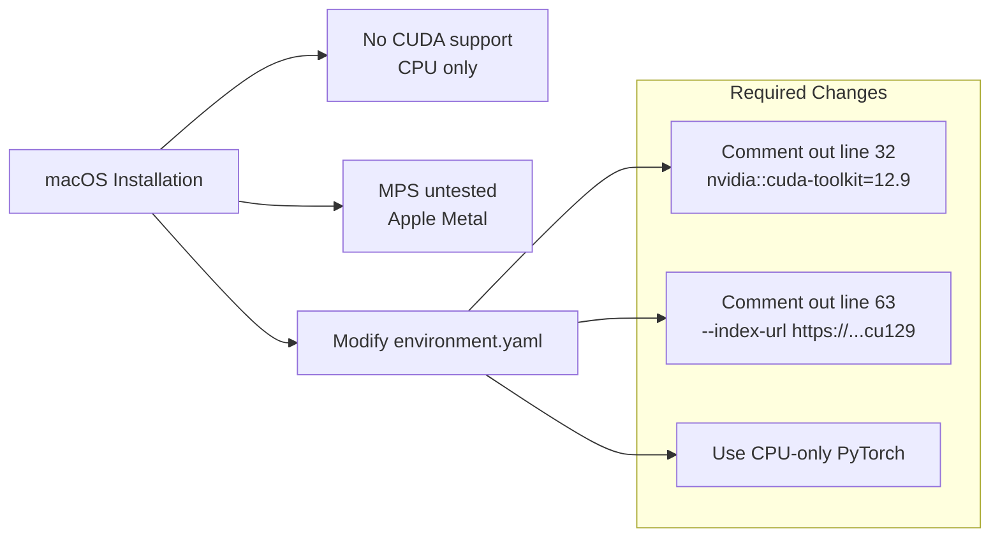
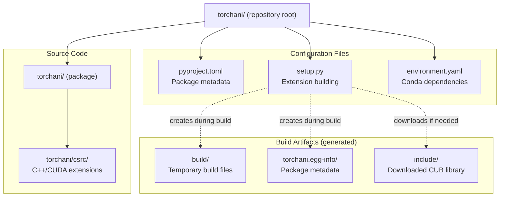

# Package Installation

<details>
<summary>Relevant source files</summary>

The following files were used as context for generating this wiki page:

- [.gitignore](.gitignore)
- [README.md](README.md)
- [environment.yaml](environment.yaml)
- [setup.py](setup.py)

</details>


This page provides step-by-step instructions for installing TorchANI and its dependencies via pip or conda. For information about building the optional C++/CUDA performance extensions (cuAEV, MNP, CellList), see [Building Extensions](#2.2).

## Overview

TorchANI can be installed through three main approaches:
- **From PyPI** (pip) - Coming soon to Python Package Index
- **From Conda** - Coming soon to Anaconda.org
- **From source** (GitHub) - Currently the primary installation method

All installation methods require PyTorch with CUDA support for optimal performance. Running TorchANI on CPU is possible but will result in significantly degraded performance and is only recommended for debugging or simple tests.

## Dependencies

TorchANI has the following core dependencies that are required for basic functionality:

**Core Dependencies Diagram**



**Sources:** [environment.yaml:7-17](), [README.md:143-147]()

### Required Dependencies

| Package | Purpose | Minimum Version |
|---------|---------|-----------------|
| `python` | Runtime environment | 3.9+ (3.11 recommended) |
| `torch` | Deep learning framework | 2.0+ (2.8 tested) |
| `numpy` | Numerical arrays | 1.20+ (2.1 tested) |
| `h5py` | HDF5 dataset backend | Latest |
| `tqdm` | Progress bars | Latest |
| `typer` | CLI support | Latest |
| `rich` | CLI formatting | Latest |
| `huggingface_hub` | Dataset downloading | Latest |
| `typing_extensions` | Type hints | 4.0.0+ |

**Sources:** [environment.yaml:7-17]()

### Optional Dependencies

| Package | Purpose | Installation |
|---------|---------|--------------|
| `ase` | Molecular dynamics, geometry optimization, vibrational analysis | `conda install -c conda-forge ase` |
| `pandas` | Parquet dataset backend | `conda install -c conda-forge pandas` |
| `pyarrow` | Parquet dataset backend | `conda install -c conda-forge pyarrow` |
| `zarr` | Zarr dataset backend | `conda install -c conda-forge "zarr<3"` |

**Sources:** [environment.yaml:20-46](), [README.md:128-132]()

## Installation from PyPI (Coming Soon)

PyPI distribution is planned but not yet available. When released, installation will be:

```bash
pip install torchani
```

**Sources:** [README.md:48-50]()

## Installation from Conda (Coming Soon)

Conda distribution is planned but not yet available. When released, installation will be:

```bash
conda install -c conda-forge torchani
```

**Sources:** [README.md:44-46]()

## Installation from Source (GitHub)

This is the current recommended installation method. The process involves cloning the repository, creating an environment, and installing the package.

**Installation Workflow**



**Sources:** [README.md:54-104](), [setup.py:1-288]()

### Step 1: Clone Repository

```bash
git clone https://github.com/aiqm/torchani.git
cd torchani
```

**Sources:** [README.md:57-59]()

### Step 2: Create Environment

#### Option A: Using Conda/Mamba

The [environment.yaml:1-65]() file contains all dependencies including optional ones for building extensions, documentation, and running tests:

```bash
conda env create -f environment.yaml
conda activate ani
```

**Note:** The `environment.yaml` file includes many optional dependencies. You can comment out sections you don't need:
- Lines 24-32: Extension building dependencies (setuptools, gcc, CUDA toolkit)
- Lines 34-46: Testing dependencies (pytest, coverage, etc.)
- Lines 48-51: Benchmarking tools
- Lines 53-58: Documentation building dependencies

**Sources:** [README.md:61-66](), [environment.yaml:1-65]()

#### Option B: Using Python venv

```bash
python -m venv .venv
source .venv/bin/activate  # On Windows: .venv\Scripts\activate
pip install -r dev_requirements.txt
```

**Sources:** [README.md:68-70]()

### Step 3: Install TorchANI

#### Without Extensions (Recommended for Most Users)

For a standard installation without compiled extensions:

```bash
pip install --no-deps -v .
```

The `--no-deps` flag prevents pip from reinstalling dependencies already installed in your environment. The `-v` flag provides verbose output.

**Sources:** [README.md:74-77]()

#### With Extensions (Advanced)

To install with cuAEV and MNP compiled extensions for improved performance:

```bash
pip install --config-settings=--global-option=ext --no-build-isolation --no-deps -v .
```

**Flags Explanation:**

| Flag | Purpose |
|------|---------|
| `--config-settings=--global-option=ext` | Triggers extension building in [setup.py:229-231]() |
| `--no-build-isolation` | Allows access to pre-installed build dependencies |
| `--no-deps` | Prevents pip from reinstalling dependencies |
| `-v` | Verbose output for debugging |

To build for all supported GPU architectures instead of auto-detecting:

```bash
pip install --config-settings=--global-option=ext-all-sms --no-build-isolation --no-deps -v .
```

**Sources:** [README.md:79-84](), [setup.py:138-148]()

#### Developer Installation

For an editable installation (changes to source files are immediately reflected):

```bash
pip install -e --no-deps -v .
```

The `-e` flag can be added to any of the installation commands above.

**Sources:** [README.md:86-89]()

### Step 4: Optional Post-Installation Steps

#### Download Development Data

Some tests and documentation examples require additional data files:

```bash
bash ./download-dev-data.sh
```

This downloads test datasets and example files to `./dev-data/`.

**Sources:** [README.md:94-96]()

#### Build Documentation

If you installed documentation dependencies:

```bash
sphinx-build docs/src docs/build
```

Documentation will be generated in `./docs/build/`.

**Sources:** [README.md:98-99]()

#### Run Tests

Verify installation by running the test suite:

```bash
cd tests
pytest -v .
```

**Sources:** [README.md:101-104]()

## Platform-Specific Notes

### macOS Installation

TorchANI can be installed on macOS with the following limitations:

**macOS Considerations**



**Sources:** [README.md:134-139]()

The [environment.yaml:1-65]() file requires modifications for macOS:

1. **Line 32:** Comment out or remove the CUDA toolkit:
   ```yaml
   # - nvidia::cuda-toolkit=12.9
   ```

2. **Line 63:** Comment out or remove the CUDA PyTorch index:
   ```yaml
   # - --index-url https://download.pytorch.org/whl/cu129
   ```

3. Install CPU-only PyTorch:
   ```bash
   pip install torch
   ```

**Performance Warning:** CPU-only execution will result in significantly degraded performance. TorchANI is designed for GPU acceleration.

**Sources:** [README.md:136-139](), [environment.yaml:30-32](), [environment.yaml:61-64]()

## GPU Support

TorchANI requires CUDA-enabled GPUs for optimal performance:

| GPU Support | Status |
|-------------|--------|
| NVIDIA CUDA | ✓ Supported (Recommended) |
| AMD ROCm/HIP | ✗ Untested |
| Apple Metal (MPS) | ✗ Untested |
| CPU Only | ✓ Supported (Slow) |

**Recommended:** NVIDIA GPU with compute capability 6.0 or higher (Pascal architecture and newer).

**Tested Configuration:** PyTorch 2.8 with CUDA 12.8

**Sources:** [README.md:141-147](), [setup.py:140-145]()

## Verifying Installation

After installation, verify TorchANI is correctly installed:

```bash
python -c "import torchani; print(torchani.__version__)"
```

Test basic functionality:

```python
import torch
import torchani

# Load a pre-trained model
model = torchani.models.ANI2x(periodic_table_index=True)

# Check if CUDA is available
print(f"CUDA available: {torch.cuda.is_available()}")
print(f"TorchANI version: {torchani.__version__}")
```

If extensions were installed, verify they're available:

```python
import torchani
print(f"cuAEV available: {torchani.cuaev is not None}")
print(f"MNP available: {torchani.mnp is not None}")
print(f"CellList available: {torchani.cell_list is not None}")
```

**Sources:** [README.md:155-158]()

## Troubleshooting Common Issues

**Installation File Structure**



**Sources:** [setup.py:1-288](), [.gitignore:1-88]()

### Issue: Torch Import Error During Installation

**Symptom:** Error message: "Torch could not be imported"

**Solution:** Ensure PyTorch is installed before building TorchANI:
```bash
pip install torch
```

**Sources:** [setup.py:119-135](), [setup.py:175-187]()

### Issue: CUDA Toolkit Not Found

**Symptom:** Extension build fails with missing CUDA headers

**Solution:** Install CUDA toolkit matching your PyTorch version:
```bash
conda install -c nvidia cuda-toolkit=12.9
```

Or specify the CUDA home directory:
```bash
export CUDA_HOME=/usr/local/cuda
```

**Sources:** [environment.yaml:31-32]()

### Issue: CUB Library Not Found

**Symptom:** cuAEV extension fails to build with missing `cub/cub.cuh`

**Solution:** The [setup.py:11-40]() automatically downloads CUB if not found. For CUDA 12.8+, CUB is bundled with PyTorch. For older versions, CUB is downloaded to `./include/cub/`.

**Sources:** [setup.py:11-40](), [.gitignore:58-59]()

### Issue: Build Isolation Conflicts

**Symptom:** Extension build fails with dependency conflicts

**Solution:** Always use `--no-build-isolation` when building extensions:
```bash
pip install --no-build-isolation --no-deps -v .
```

This allows pip to use dependencies from your environment instead of creating an isolated build environment.

**Sources:** [README.md:81-84](), [setup.py:157-172]()

## Next Steps

- For building C++/CUDA extensions with advanced options, see [Building Extensions](#2.2)
- For a quick start guide to using TorchANI, see [Quick Start](#3)
- For loading and using pre-trained models, see [Using Pre-built Models](#5.1)

---