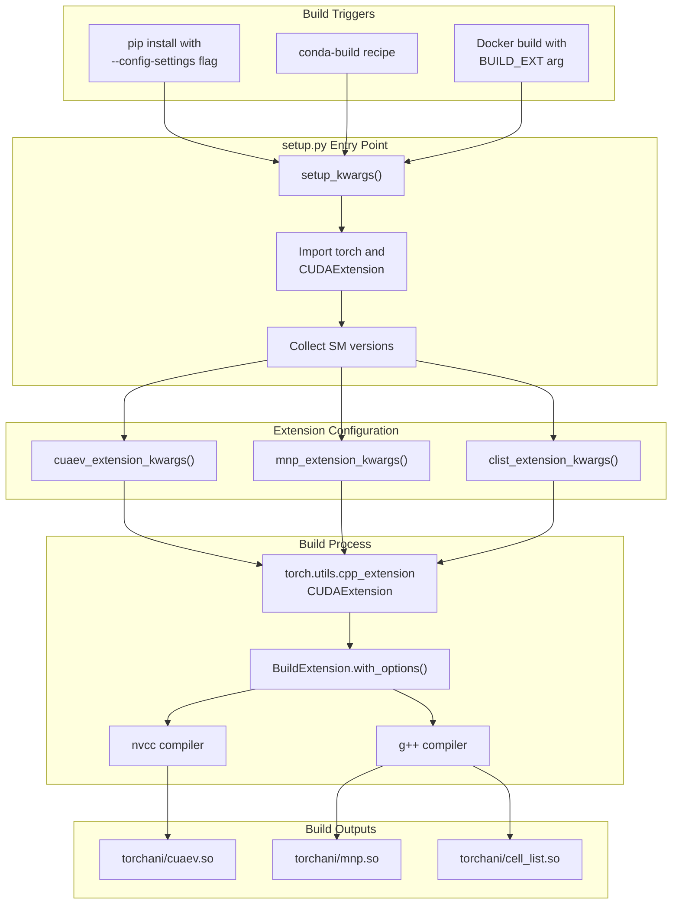
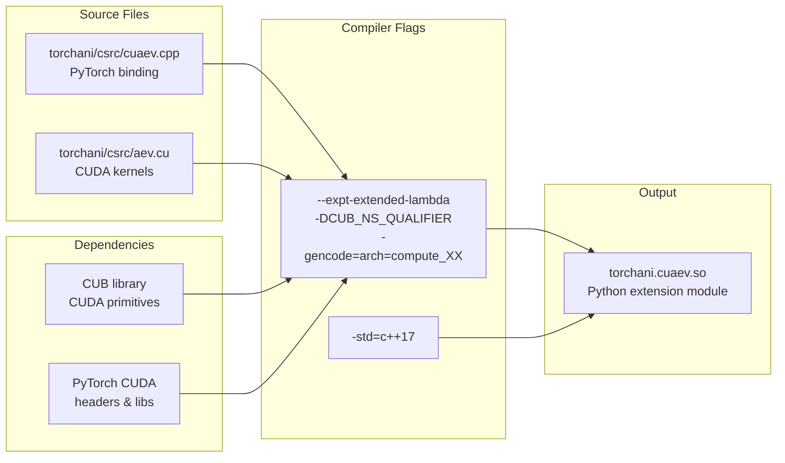
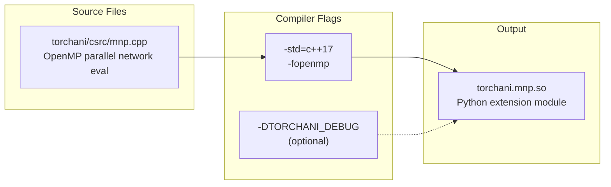
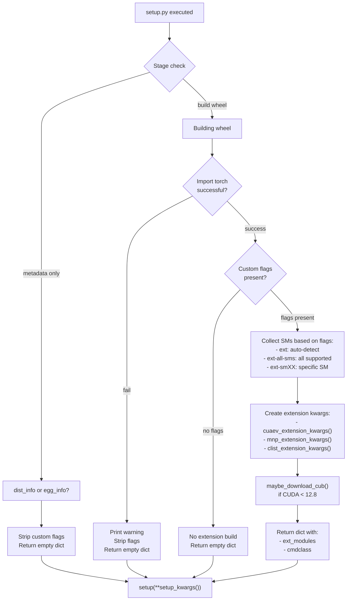

# Building Extensions

<details>
<summary>Relevant source files</summary>

The following files were used as context for generating this wiki page:

- [.gitignore](.gitignore)
- [Dockerfile](Dockerfile)
- [README.md](README.md)
- [conda.Dockerfile](conda.Dockerfile)
- [dev_requirements.txt](dev_requirements.txt)
- [pyproject.toml](pyproject.toml)
- [recipe/conda_build_config.yaml](recipe/conda_build_config.yaml)
- [recipe/meta.yaml](recipe/meta.yaml)
- [setup.py](setup.py)
- [torchani/datasets/_utils.py](torchani/datasets/_utils.py)

</details>


## Purpose and Scope

This document provides detailed instructions for compiling the optional C++/CUDA extensions that accelerate TorchANI computations. These extensions are **not required** for TorchANI to function, but they provide significant performance improvements for production workloads.

For general installation instructions without extensions, see [Package Installation](#2.1). For performance optimization strategies and benchmarking compiled extensions, see [Performance Optimization](#8.1) and [C++ and CUDA Extensions](#8.2).

**Sources:** [README.md:106-108](), [setup.py:119-136]()

---

## Available Extensions

TorchANI includes three optional compiled extensions:

| Extension | Language | Purpose | Key Benefit |
|-----------|----------|---------|-------------|
| `cuaev` | CUDA | Fused AEV computation kernel | 2-10x speedup for AEV calculations on GPU |
| `mnp` | C++ (OpenMP) | Multi-network parallel inference | Parallelizes evaluation across atomic networks |
| `cell_list` | C++ (OpenMP) | Efficient neighbor search | Fast neighborlist construction for large systems |

All three extensions are compiled together when building with extension support enabled. The extensions are compiled as PyTorch C++ extensions using the `torch.utils.cpp_extension` API.

**Sources:** [setup.py:256-279](), [README.md:148-154]()

---

## Extension Build Architecture



**Sources:** [setup.py:157-288](), [Dockerfile:40-55](), [recipe/meta.yaml:9-14]()

---

## Prerequisites

### System Requirements

#### CUDA Toolkit
- **Required for:** `cuaev` extension
- **Version:** Must match PyTorch's CUDA version
- **Components needed:** 
  - CUDA runtime libraries (`cuda-libraries-dev`)
  - CUDA compiler (`cuda-nvcc`)
  - CUDA C++ Core Compute Libraries (`cuda-cccl`)
  - CUB library (automatically downloaded if not found for CUDA < 12.8)

#### C++ Compiler
- **Required for:** All extensions
- **Version:** Must support C++17 standard
- **Recommended:** GCC 12.2 or newer
- **Flags:** `-std=c++17`, `-fopenmp` (for OpenMP support)

#### PyTorch with CUDA Support
- **Version:** 2.0 to 2.8
- Must be compiled with CUDA support
- CUDA runtime libraries from PyTorch are not sufficient for building extensions

**Sources:** [README.md:184-204](), [setup.py:11-40](), [pyproject.toml:20-23]()

### Required Python Packages

The following packages must be available in the build environment:

```python
setuptools>=75.6
setuptools-scm>=8
packaging>=25
torch>=2.0,<=2.8  # with CUDA support
```

These are specified in [pyproject.toml:43]() as build system requirements and in [dev_requirements.txt:3-7]().

**Sources:** [pyproject.toml:42-44](), [dev_requirements.txt:3-7]()

---

## Build Process with pip

### Basic Build with Auto-Detection

To build extensions with automatic CUDA compute capability detection:

```bash
pip install --config-settings=--global-option=ext --no-build-isolation --no-deps -v .
```

This command:
1. Uses `--config-settings=--global-option=ext` to enable extension building
2. Requires `--no-build-isolation` because torch must be importable during build
3. Uses `-v` for verbose output to monitor compilation progress
4. Automatically detects CUDA devices visible to torch and compiles for their SMs

**Sources:** [README.md:79-84](), [setup.py:229-231]()

### Build Flags and Options

The build system recognizes several custom flags passed via `--config-settings=--global-option=<flag>`:

#### SM Selection Flags

| Flag | Behavior | Use Case |
|------|----------|----------|
| `ext` | Auto-detect compatible SMs | Default for development |
| `ext-all-sms` | Build for all supported SMs | Distribution packages |
| `ext-sm60` | Build for SM 6.0 (Pascal) | Specific GPU targeting |
| `ext-sm70` | Build for SM 7.0 (Volta) | Specific GPU targeting |
| `ext-sm75` | Build for SM 7.5 (Turing) | Specific GPU targeting |
| `ext-sm80` | Build for SM 8.0 (Ampere) | Specific GPU targeting |
| `ext-sm86` | Build for SM 8.6 (Ampere) | Specific GPU targeting |
| `ext-sm89` | Build for SM 8.9 (Ada/Hopper) | Specific GPU targeting |
| `ext-sm100` | Build for SM 10.0 (Blackwell) | Specific GPU targeting |

**Sources:** [setup.py:138-148](), [setup.py:189-220]()

#### Optimization Flags

| Flag | Effect | Default |
|------|--------|---------|
| `ext-debug` | Add `-DTORCHANI_DEBUG` flag | Off |
| `ext-no-opt` | Disable fast math optimizations | Off (opt enabled) |

The optimization flags control:
- **With optimization (default):** Uses `-use_fast_math` NVCC flag and enables optimized intrinsics
- **Debug mode:** Enables debug symbols and assertions in compiled code

**Sources:** [setup.py:237-248](), [setup.py:62-65](), [setup.py:87-89]()

### Complete Build Examples

```bash
# Build for all supported compute capabilities (for distribution)
pip install --config-settings=--global-option=ext-all-sms \
    --no-build-isolation --no-deps -v .

# Build for specific GPU (e.g., RTX 3090 = SM 8.6)
pip install --config-settings=--global-option=ext-sm86 \
    --no-build-isolation --no-deps -v .

# Build with debug symbols
pip install --config-settings=--global-option=ext \
    --config-settings=--global-option=ext-debug \
    --no-build-isolation --no-deps -v .

# Editable install with extensions for development
pip install -e --config-settings=--global-option=ext \
    --no-build-isolation --no-deps -v .
```

**Sources:** [README.md:79-90](), [setup.py:150-154]()

---

## Build Process with conda

### Local Conda Package Build

To build the conda package locally with extensions:

```bash
cd /path/to/torchani
conda install conda-build conda-verify
mkdir ./conda-pkgs/
conda build \
    -c pytorch -c nvidia -c conda-forge \
    --no-anaconda-upload \
    --output-folder ./conda-pkgs/ \
    ./recipe
```

The conda recipe [recipe/meta.yaml:12]() automatically builds extensions for all supported SMs using the build script:

```bash
CUDA_HOME=/usr/local/cuda {{ PYTHON }} -m pip install \
    --config-settings=--global-option=ext-all-sms \
    --no-build-isolation -v .
```

**Sources:** [README.md:206-219](), [recipe/meta.yaml:9-14]()

### Conda Build Dependencies

The conda build environment requires:

```yaml
build:
  - {{ compiler('c') }}
  - {{ compiler('cxx') }}
  - conda-forge::git

host:
  - conda-forge::python={{ python }}
  - conda-forge::pip
  - conda-forge::packaging>=25
  - conda-forge::setuptools>=76
  - conda-forge::setuptools_scm>=8
  - conda-forge::pytorch={{ pytorch }}=*cuda*
```

**Sources:** [recipe/meta.yaml:16-30](), [recipe/conda_build_config.yaml:1-12]()

---

## Build Process with Docker

### Development Docker Image

The main `Dockerfile` supports building extensions via the `BUILD_EXT` build argument:

```bash
# Build without extensions
docker build --build-arg BUILD_EXT=0 -t torchani:dev .

# Build with auto-detected SMs
docker build --build-arg BUILD_EXT=ext -t torchani:dev .

# Build for all SMs
docker build --build-arg BUILD_EXT=all-sms -t torchani:dev .

# Build for specific SM (e.g., SM 8.6)
docker build --build-arg BUILD_EXT=sm86 -t torchani:dev .
```

The Dockerfile installs system dependencies required for building extensions:

```dockerfile
# Install build tools
RUN apt update && apt install -y wget git unzip ninja-build

# Set CUDA environment variables
ENV CUDA_HOME=/usr/local/cuda/
ENV PATH=${CUDA_HOME}/bin:$PATH
ENV LD_LIBRARY_PATH=${CUDA_HOME}/lib64:${LD_LIBRARY_PATH}
```

**Sources:** [Dockerfile:40-55](), [Dockerfile:1-16]()

### Conda Package Docker Build

The `conda.Dockerfile` builds a conda package with extensions:

```bash
docker build -f conda.Dockerfile -t torchani:conda .
```

This automatically builds extensions for all supported SMs as part of the conda package creation process.

**Sources:** [conda.Dockerfile:38-44]()

---

## Extension Compilation Details

### cuAEV Extension



The `cuaev` extension requires special handling of the CUB library namespace to avoid conflicts with PyTorch's internal CUB usage:

```cpp
// Namespace qualification macros (from setup.py)
-DCUB_NS_QUALIFIER=::cuaev::cub
-DCUB_NS_PREFIX=namespace cuaev {
-DCUB_NS_POSTFIX=}
```

**Sources:** [setup.py:43-80](), [setup.py:51-60]()

#### CUB Library Handling

For CUDA versions < 12.8, the CUB library is required but may not be bundled with PyTorch. The build system automatically downloads it if needed:

1. Searches for CUB in PyTorch include directories
2. If not found, downloads from `https://github.com/NVIDIA/cub/archive/main.zip`
3. Extracts to `./include/cub/`
4. Adds to include path for compilation

**Sources:** [setup.py:11-40]()

### MNP Extension



The MNP extension uses OpenMP to parallelize neural network evaluation across multiple atomic species. It does not require CUDA but still uses `CUDAExtension` because it links against PyTorch's CUDA libraries.

**Sources:** [setup.py:83-98](), [README.md:150-153]()

### CellList Extension


The `cell_list` extension provides an efficient spatial partitioning algorithm for neighborlist construction, particularly beneficial for large periodic systems.

**Sources:** [setup.py:101-116]()

---

## Build System Integration

### setup.py Execution Flow



The `setup_kwargs()` function is called multiple times during installation:
- **With build isolation (default):** 3 times - `egg_info`, `dist_info`, `bdist_wheel`
- **Without build isolation:** 2 times - `dist_info`, `bdist_wheel`

Custom build flags are only processed during the actual wheel build stage. In metadata stages, the flags are stripped to avoid errors.

**Sources:** [setup.py:157-288]()

### Supported Compute Capabilities

| SM Version | Architecture | GPU Examples | Minimum CUDA |
|------------|--------------|--------------|--------------|
| 6.0, 6.1 | Pascal | GTX 1080, P100 | 10.0 |
| 7.0 | Volta | V100 | 10.0 |
| 7.5 | Turing | RTX 2080, T4 | 10.0 |
| 8.0 | Ampere | A100 | 11.0 |
| 8.6 | Ampere | RTX 3090, A6000 | 11.1 |
| 8.9 | Ada/Hopper | RTX 4090, H100 | 11.1 |
| 10.0 | Blackwell | B100 (future) | 12.8 |

The build system automatically includes SMs based on the detected CUDA version.

**Sources:** [setup.py:138-203]()

---

## Troubleshooting

### Common Build Issues

#### Issue: "Torch could not be imported"

**Symptoms:**
```
Will not install TorchANI extensions (cuAEV and MNP)
To build the extensions with the pip frontend:
- Make sure Torch binaries compiled with CUDA support are installed
```

**Solutions:**
1. Ensure PyTorch is installed: `pip install torch`
2. Verify CUDA support: `python -c "import torch; print(torch.cuda.is_available())"`
3. Must use `--no-build-isolation` flag with pip

**Sources:** [setup.py:119-136]()

#### Issue: "No compatible devices found"

**Symptoms:** Build proceeds but compiles for all SMs instead of detected GPU

**Explanation:** This is expected behavior when no CUDA devices are visible to torch during build. The build system falls back to compiling for all supported SMs.

**Solutions:**
1. Make CUDA devices visible: `CUDA_VISIBLE_DEVICES=0 pip install ...`
2. Or explicitly specify SMs: `--config-settings=--global-option=ext-sm86`

**Sources:** [setup.py:205-220]()

#### Issue: CUB library not found

**Symptoms:**
```
fatal error: cub/cub.cuh: No such file or directory
```

**Solutions:**
1. Build system should auto-download CUB for CUDA < 12.8
2. Ensure internet connectivity during build
3. Or manually download and set include path

**Sources:** [setup.py:11-40]()

#### Issue: CUDA version mismatch

**Symptoms:**
```
The detected CUDA version (X.Y) mismatches the version that was used to compile PyTorch (A.B)
```

**Solutions:**
1. Install PyTorch compiled for your CUDA version
2. Or install matching CUDA Toolkit version
3. Check compatibility: `python -c "import torch; print(torch.version.cuda)"`

**Sources:** [setup.py:14-16](), [README.md:184-204]()

### Verifying Extension Installation

After building, verify extensions are properly installed:

```python
import torch
import torchani

# Check if extensions are available
try:
    import torchani.cuaev
    print("cuAEV extension: Available")
except ImportError:
    print("cuAEV extension: Not available")

try:
    import torchani.mnp
    print("MNP extension: Available")
except ImportError:
    print("MNP extension: Not available")

try:
    import torchani.cell_list
    print("CellList extension: Available")
except ImportError:
    print("CellList extension: Not available")
```

Extensions are optional - TorchANI will automatically fall back to Python/PyTorch implementations if extensions are not available.

**Sources:** [README.md:143-147]()

---

## Platform-Specific Notes

### macOS

- **CUDA extensions not supported:** macOS does not support NVIDIA CUDA
- **MNP and CellList only:** Only CPU-based C++ extensions can be built
- **Metal Performance Shaders (MPS):** Untested and unsupported
- **environment.yaml modifications required:** See [environment.yaml]() for platform-specific adjustments

**Sources:** [README.md:134-139]()

### Linux

- **Fully supported:** All extensions can be built on Linux
- **Recommended platform:** Primary development and testing platform
- **Compiler:** GCC 12.2 or newer recommended

**Sources:** [recipe/conda_build_config.yaml:1-4]()

### Windows

- **Status:** Not officially tested
- **Potential issues:** Path handling, compiler compatibility
- **Community support:** Users have successfully built on Windows but it's not regularly tested

---

## Extension File Locations

After successful compilation, extension modules are installed in the `torchani` package directory:

```
torchani/
├── __init__.py
├── cuaev.so          # CUDA AEV extension
├── mnp.so            # Multi-Net Parallel extension
├── cell_list.so      # CellList extension
└── ...
```

The `.so` extension is used on Linux/macOS. On Windows, these would be `.pyd` files. The PyTorch build system automatically handles platform-specific naming.

**Sources:** [setup.py:76-79](), [setup.py:94-97](), [setup.py:112-115]()

---