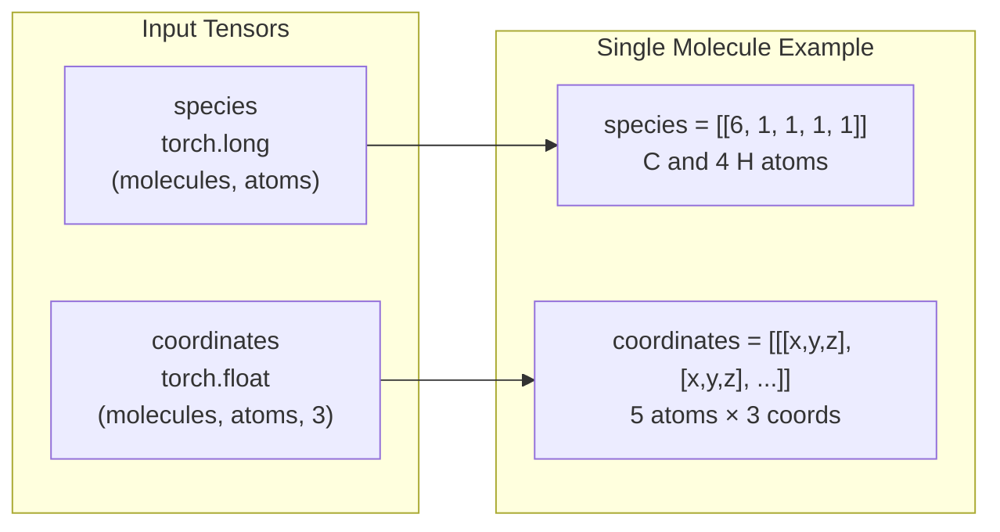
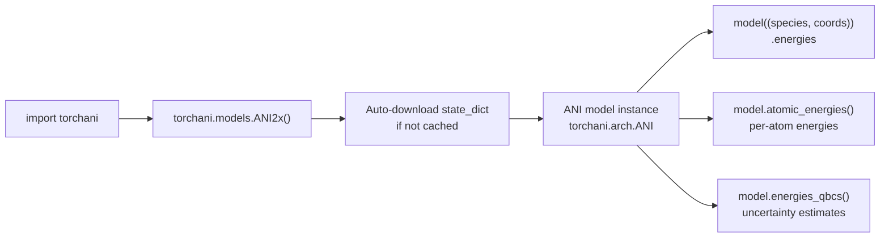
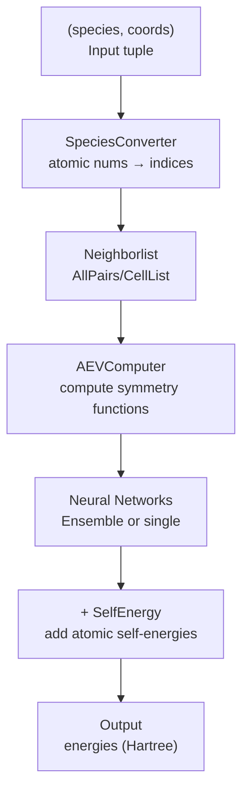
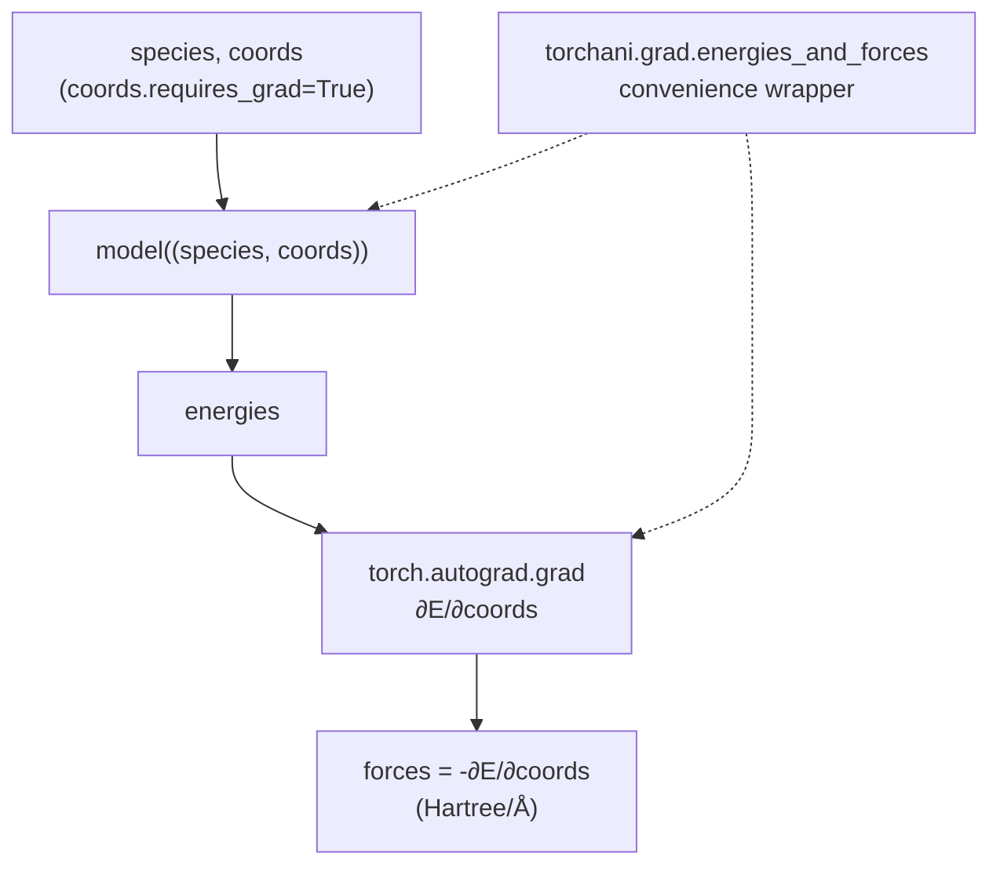
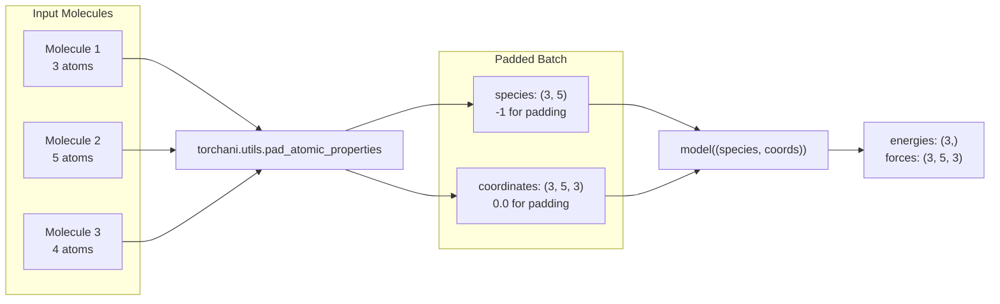
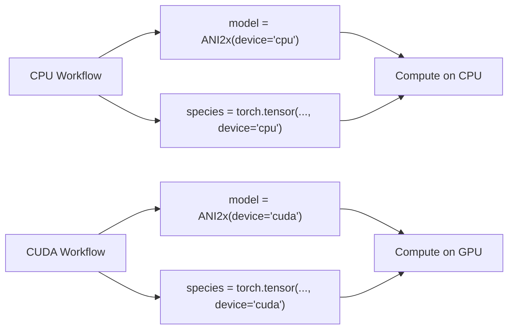

# Quick Start

<details>
<summary>Relevant source files</summary>

The following files were used as context for generating this wiki page:

- [examples/fundamentals.py](examples/fundamentals.py)
- [tests/test_aev.py](tests/test_aev.py)
- [tests/test_energies.py](tests/test_energies.py)
- [tests/test_ensemble.py](tests/test_ensemble.py)
- [tests/test_forces.py](tests/test_forces.py)
- [torchani/__init__.py](torchani/__init__.py)
- [torchani/models.py](torchani/models.py)
- [torchani/neurochem.py](torchani/neurochem.py)
- [torchani/utils.py](torchani/utils.py)

</details>


This page provides a minimal working example to get you started with TorchANI. You will learn how to load a pre-built model and compute molecular energies and forces. For detailed explanations of the underlying concepts, see [Core Concepts](#4). For comprehensive guides on using TorchANI's features, see [User Guide](#5).

## Scope

This guide assumes you have already installed TorchANI (see [Installation](#2)). We will use the pre-trained ANI-2x model to compute energies and forces for a simple molecule. All examples use PyTorch tensors as inputs and outputs.

---

## Input Data Format

TorchANI operates on batches of molecules represented as PyTorch tensors. The primary inputs are:

| Input | Shape | Data Type | Description |
|-------|-------|-----------|-------------|
| `species` | `(molecules, atoms)` | `torch.long` | Atomic numbers or species indices |
| `coordinates` | `(molecules, atoms, 3)` | `torch.float32/64` | Cartesian coordinates in Ångströms |
| `cell` (optional) | `(3, 3)` | `torch.float32/64` | Periodic cell vectors |
| `pbc` (optional) | `(3,)` | `torch.bool` | Periodic boundary conditions per axis |

**Diagram: Input Tensor Structure**



Sources: [examples/fundamentals.py:34-44](), [torchani/models.py:38-41]()

---

## Loading a Pre-built Model

TorchANI provides several pre-trained models accessible through factory functions in `torchani.models`. The most commonly used is `ANI2x()`, which returns an ensemble of 8 neural networks.

**Diagram: Model Loading Workflow**



The model loading process:
1. Call factory function (e.g., `torchani.models.ANI2x()`)
2. State dict is automatically downloaded to cache on first use
3. Model is initialized with pre-trained weights
4. Model is ready for inference (gradients disabled by default)

Sources: [torchani/models.py:166-199](), [examples/fundamentals.py:61]()

---

## Computing Energies

The simplest usage pattern involves calling the model with a tuple of `(species, coordinates)`:

**Diagram: Energy Computation Pipeline**



**Key Code Entities:**

- Model is called with `model((species, coords))` which returns a result object
- Access energy via `.energies` attribute
- Energy units are always **Hartrees**
- Coordinates are always in **Ångströms**

**Example from test suite:**

The test files demonstrate the pattern:
- Create tensors for species and coordinates [tests/test_energies.py:20-31]()
- Call model with tuple: `self.model((species, coordinates))` [tests/test_energies.py:32]()
- Extract energies from result: `.energies` [tests/test_energies.py:32]()

Sources: [tests/test_energies.py:19-34](), [examples/fundamentals.py:71](), [torchani/models.py:42-44]()

---

## Computing Forces

Forces are computed using automatic differentiation through the energy function. The `torchani.grad` module provides the `energies_and_forces()` helper function.

**Diagram: Force Computation via Autograd**



**Key Code Entities:**

- `torchani.grad.energies_and_forces(model, species, coords)` - returns `(energies, forces)` tuple
- Forces have shape `(molecules, atoms, 3)` in Hartree/Ångström
- The function handles setting `requires_grad=True` automatically

**Example from test suite:**

The force tests show usage:
- Call `energies_and_forces(self.model, species, coordinates)` [tests/test_forces.py:27-29]()
- Returns both energies and forces in one call [tests/test_forces.py:27-29]()

Sources: [tests/test_forces.py:27-29](), [examples/fundamentals.py:71-76](), [torchani/grad.py]()

---

## Batch Processing

TorchANI efficiently handles batches of molecules. When molecules have different numbers of atoms, padding is required.

**Diagram: Batch Processing with Padding**



**Key Code Entities:**

- `torchani.utils.pad_atomic_properties(properties)` - pads a sequence of dicts to uniform size
- Padding value for species: `-1`
- Padding value for coordinates/forces: `0.0`
- Model automatically ignores padded atoms (species == -1)

**Example from test suite:**

The padding tests demonstrate this:
- Collect molecules in list of dicts [tests/test_energies.py:139-154]()
- Call `pad_atomic_properties(batch)` [tests/test_energies.py:155]()
- Extract padded tensors and pass to model [tests/test_energies.py:156-159]()

Sources: [tests/test_energies.py:138-160](), [torchani/utils.py:174-220]()

---

## Model Output Structure

When you call a model, it returns a `SpeciesEnergies` named tuple containing both the species indices and computed energies.

| Attribute | Shape | Description |
|-----------|-------|-------------|
| `.species` | `(molecules, atoms)` | Species indices passed through |
| `.energies` | `(molecules,)` | Total molecular energies |

**Additional Entry Points:**

- `model.atomic_energies((species, coords))` - returns per-atom energies, shape `(molecules, atoms)`
- `model.energies_qbcs((species, coords))` - returns energies and QBC uncertainty estimates for active learning
- `model[index]` - access individual ensemble members (if model is an ensemble)

Sources: [torchani/models.py:42-57](), [examples/fundamentals.py:81-92]()

---

## Model Selection Guide

TorchANI provides several pre-trained models:

| Model | Elements | Level of Theory | Notes |
|-------|----------|----------------|-------|
| `ANI1x()` | H, C, N, O | ωB97X/6-31G(d) | Original ANI-1x model |
| `ANI1ccx()` | H, C, N, O | CCSD(T)*/CBS | High-accuracy via transfer learning |
| `ANI2x()` | H, C, N, O, F, S, Cl | ωB97X/6-31G(d) | Most widely used |
| `ANI2xr()` | H, C, N, O, F, S, Cl | ωB97X/6-31G(d) + repulsion | Experimental, smoother PES |
| `ANI2dr()` | H, C, N, O, F, S, Cl | B97-3c + dispersion | Experimental with D3 dispersion |

**Arguments for Model Factories:**

```python
model = torchani.models.ANI2x(
    model_index=None,          # None for ensemble, int for single model
    neighborlist="all_pairs",  # "all_pairs", "cell_list", "adaptive"
    strategy="pyaev",          # "pyaev" or "cuaev" (if compiled)
    periodic_table_index=True, # Use atomic numbers vs model-specific indices
    device=None,               # "cpu", "cuda", or torch.device
    dtype=None,                # torch.float32 or torch.float64
)
```

Sources: [torchani/models.py:92-199](), [torchani/models.py:258-325]()

---

## Device and Dtype Management

Models and tensors must be on the same device:

**Diagram: Device Consistency**



**Common Patterns:**

- Create model on desired device: `model = torchani.models.ANI2x(device="cuda")`
- Move model after creation: `model = model.to("cuda")`
- Ensure input tensors match: `species = species.to(model.device)`

Default dtype is `torch.float32`. For higher precision (at cost of speed), use `dtype=torch.double`.

Sources: [torchani/models.py:86-88](), [examples/fundamentals.py:31-32](), [examples/fundamentals.py:64-67]()

---

## Complete Minimal Example

Based on the fundamentals example, a complete workflow looks like:

1. **Import modules** [examples/fundamentals.py:18-21]()
2. **Create input tensors** (atomic numbers and coordinates) [examples/fundamentals.py:34-44]()
3. **Load model** [examples/fundamentals.py:61]()
4. **Compute energy and forces** [examples/fundamentals.py:71]()
5. **Access results** [examples/fundamentals.py:75-76]()

The output energies are in Hartrees and forces in Hartree/Ångström.

Sources: [examples/fundamentals.py:1-93]()

---

## Next Steps

- **Model Architecture**: Learn about the components (AEV, neural networks, etc.) in [Model Architecture](#4.1)
- **Custom Models**: Build your own models using the Assembler in [Building Custom Models](#5.3)
- **ASE Integration**: Use models for MD simulations in [ASE Integration](#5.4)
- **Training**: Train new models on your data in [Training](#7)
- **Datasets**: Access built-in datasets in [Built-in Datasets](#6.1)
- **Performance**: Optimize inference speed in [Performance Optimization](#8.1)

Sources: Multiple pages from table of contents

---