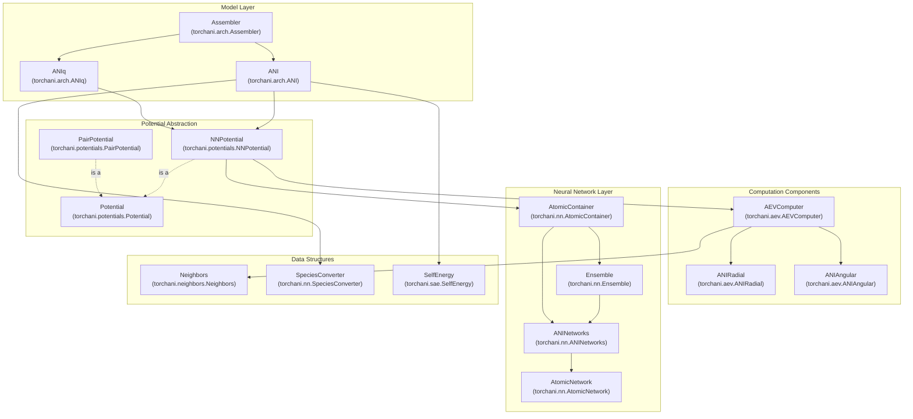
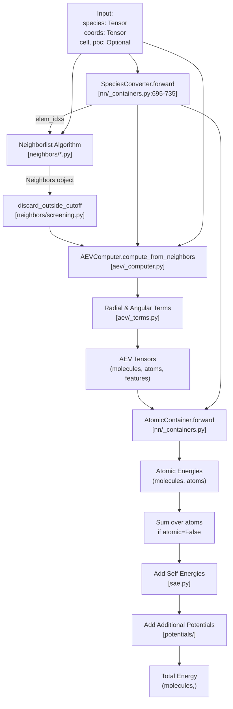
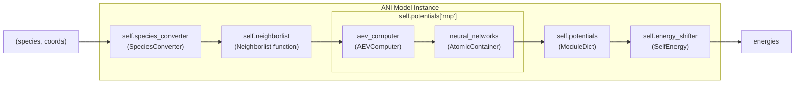
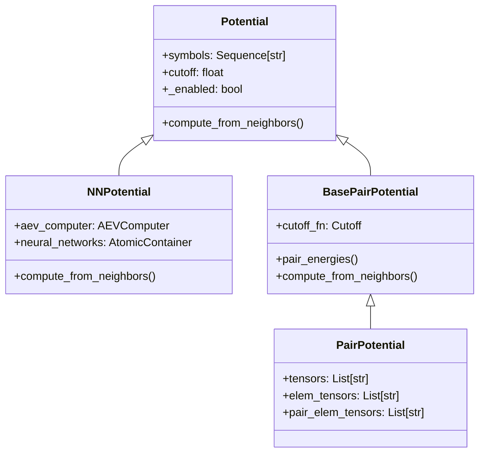
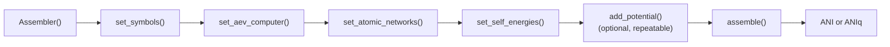

# Core Concepts

<details>
<summary>Relevant source files</summary>

The following files were used as context for generating this wiki page:

- [torchani/arch.py](torchani/arch.py)
- [torchani/electro.py](torchani/electro.py)
- [torchani/nn/__init__.py](torchani/nn/__init__.py)
- [torchani/nn/_containers.py](torchani/nn/_containers.py)
- [torchani/nn/_core.py](torchani/nn/_core.py)
- [torchani/nn/_infer.py](torchani/nn/_infer.py)
- [torchani/nn/_internal.py](torchani/nn/_internal.py)
- [torchani/potentials/core.py](torchani/potentials/core.py)
- [torchani/potentials/nnp.py](torchani/potentials/nnp.py)

</details>


This page provides an overview of the fundamental architectural components and algorithms that make up TorchANI. It introduces the key abstractions and how they interact to enable neural network potential calculations.

For practical usage of these components, see [Using Pre-built Models](#5.1) and [Building Custom Models](#5.3). For training workflows, see [Training](#7).

---

## Overview

TorchANI's architecture is built around several core abstractions that work together to compute molecular energies and forces:

| Component | Primary Classes | Purpose |
|-----------|----------------|---------|
| **Model Architecture** | `ANI`, `ANIq` | Top-level models that orchestrate computation |
| **AEV Computation** | `AEVComputer`, `ANIRadial`, `ANIAngular` | Transform atomic positions into descriptors |
| **Neural Networks** | `AtomicContainer`, `ANINetworks`, `Ensemble` | Map AEVs to atomic energies |
| **Neighborlists** | `Neighbors`, neighborlist algorithms | Efficiently find nearby atoms |
| **Potentials** | `Potential`, `NNPotential`, pair potentials | Abstract different energy contributions |
| **Self Energies** | `SelfEnergy` | Shift energies to proper reference state |

These components are assembled either through pre-built model factories or the `Assembler` class, detailed in [Model Architecture](#4.1).

**Sources:** [torchani/arch.py:1-100]()

---

## System Architecture

The following diagram shows how TorchANI's core components map to specific code entities:



**Sources:** [torchani/arch.py:92-314](), [torchani/potentials/nnp.py:14-33](), [torchani/nn/_containers.py:320-371]()

---

## Forward Pass Data Flow

The following diagram illustrates how data flows through the system during a forward pass, from input coordinates to output energies:



**Sources:** [torchani/arch.py:325-383](), [torchani/potentials/nnp.py:20-32](), [torchani/nn/_containers.py:379-423]()

---

## Core Component Interactions

The `ANI` model class orchestrates all components through its `forward` method and the underlying `compute_from_neighbors` method:



Each potential in `self.potentials` implements the `Potential` base class interface and can compute energy contributions independently. The `NNPotential` is special—it wraps the AEV computation and neural networks:

**Sources:** [torchani/arch.py:98-133](), [torchani/potentials/nnp.py:14-33]()

---

## Component Hierarchy

### Model Classes

- **`_ANI`** [torchani/arch.py:92-320]() - Base class containing common functionality
  - **`ANI`** [torchani/arch.py:322-614]() - Standard energy-only model
  - **`ANIq`** [torchani/arch.py:616-733]() - Model that also predicts atomic charges

Both model classes:
- Store an `AEVComputer` instance
- Store one or more `Potential` instances (at minimum, an `NNPotential`)
- Store a `SelfEnergy` instance
- Store a `SpeciesConverter` instance
- Maintain a reference to a neighborlist algorithm

### Potential Classes



**Sources:** [torchani/potentials/core.py:15-89](), [torchani/potentials/nnp.py:14-33](), [torchani/potentials/core.py:106-220]()

### Neural Network Containers

All neural network containers inherit from `AtomicContainer` [torchani/nn/_core.py:68-117]() and implement:
- `forward(elem_idxs, aevs, atomic, ensemble_values)` - compute atomic or molecular scalars
- `num_species` - number of supported elements
- `atomic_numbers` - atomic numbers of supported elements

Common implementations:
- **`ANINetworks`** [torchani/nn/_containers.py:320-571]() - Element-specific networks
- **`Ensemble`** [torchani/nn/_containers.py:573-662]() - Collection of network containers
- **`SingleNN`** [torchani/nn/_containers.py:20-195]() - Shared network for all elements

**Sources:** [torchani/nn/_core.py:68-117](), [torchani/nn/_containers.py:320-662]()

---

## Assembly Process

Models are constructed using the `Assembler` class, which follows a builder pattern:



**Assembler Configuration Methods:**

| Method | Purpose | File Reference |
|--------|---------|----------------|
| `set_symbols()` | Define supported elements | [torchani/arch.py:816-817]() |
| `set_aev_computer()` | Configure AEV computation | [torchani/arch.py:902-916]() |
| `set_atomic_networks()` | Configure neural networks | [torchani/arch.py:864-876]() |
| `set_self_energies()` | Set reference energies | [torchani/arch.py:825-851]() |
| `add_potential()` | Add additional potentials | [torchani/arch.py:930-945]() |
| `set_global_cutoff_fn()` | Set cutoff function | [torchani/arch.py:924-928]() |
| `assemble()` | Build final model | [torchani/arch.py:947-1027]() |

**Sources:** [torchani/arch.py:782-1027]()

---

## Key Data Structures

### Neighbors

The `Neighbors` namedtuple [torchani/neighbors/__init__.py]() contains neighborlist information:

```python
Neighbors(
    indices: Tensor,        # Shape (2, num_pairs) - atom indices [i, j]
    distances: Tensor,      # Shape (num_pairs,) - distances
    diff_vectors: Tensor,   # Shape (num_pairs, 3) - displacement vectors
)
```

### SpeciesEnergies and EnergiesScalars

Output tuples that bundle species/element indices with computed values:

- **`SpeciesEnergies`** [torchani/tuples.py]() - Output from model `forward()` method
- **`EnergiesScalars`** [torchani/tuples.py]() - Output from `compute_from_neighbors()`
- **`SpeciesEnergiesAtomicCharges`** [torchani/tuples.py]() - Output from `ANIq.forward()`

**Sources:** [torchani/tuples.py](), [torchani/neighbors/__init__.py]()

---

## Computation Strategies

TorchANI supports multiple computation strategies for different components:

### AEV Computation Strategies

Set via `AEVComputer.set_strategy()` or during assembly:

| Strategy | Implementation | Use Case |
|----------|---------------|----------|
| `"pyaev"` | Pure PyTorch | CPU, debugging, standard accuracy |
| `"cuaev"` | CUDA kernel | GPU, production, faster |

**Sources:** [torchani/aev/_computer.py]()

### Inference Optimization

AtomicContainer instances can be converted to optimized versions:

- **`BmmEnsemble`** [torchani/nn/_infer.py:61-130]() - Batched matrix multiplication for ensembles
- **`MNPNetworks`** [torchani/nn/_infer.py:219-370]() - Multi-network parallel (experimental)

Access via `model.to_infer_model(use_mnp=False)` [torchani/arch.py:221-230]()

**Sources:** [torchani/nn/_infer.py:61-370](), [torchani/arch.py:221-230]()

---

## Energy Components

The total energy computed by an `ANI` model is:

```
E_total = E_nn + E_self_energies + E_additional_potentials
```

Where:
- **E_nn**: Neural network prediction from AEVs
- **E_self_energies**: Atomic reference energies (e.g., GSAES)
- **E_additional_potentials**: Optional terms like repulsion or dispersion

Each potential can be enabled/disabled via `model.set_enabled(key, val)` [torchani/arch.py:146-151]()

**Sources:** [torchani/arch.py:387-418](), [torchani/arch.py:146-151]()

---

## Type System

TorchANI uses specific tensor shapes and conventions:

| Name | Shape | Description |
|------|-------|-------------|
| `species` | `(molecules, atoms)` | Atomic numbers or -1 for padding |
| `elem_idxs` | `(molecules, atoms)` | Internal element indices (0, 1, 2, ...) |
| `coords` | `(molecules, atoms, 3)` | Cartesian coordinates in Ångströms |
| `aevs` | `(molecules, atoms, features)` | Atomic environment vectors |
| `energies` | `(molecules,)` or `(molecules, atoms)` | Energies in Hartree |
| `forces` | `(molecules, atoms, 3)` | Forces in Hartree/Ångström |

The `SpeciesConverter` [torchani/nn/_containers.py:664-735]() translates between atomic numbers (`species`) and internal indices (`elem_idxs`).

**Sources:** [torchani/nn/_containers.py:664-735](), [torchani/arch.py:315-319]()

---

## Summary

TorchANI's core architecture separates concerns into modular components:

1. **Models** (`ANI`, `ANIq`) orchestrate the entire computation pipeline
2. **AEV Computation** transforms atomic positions into invariant descriptors
3. **Neural Networks** map descriptors to atomic energies
4. **Potentials** provide a unified interface for different energy contributions
5. **Neighborlists** efficiently find nearby atoms for AEV computation
6. **Assembler** provides a clean API for constructing custom models

For detailed information on each component, see:
- [Model Architecture](#4.1)
- [AEV Computation](#4.2)
- [Neighborlist Algorithms](#4.3)
- [Potentials System](#4.4)

**Sources:** [torchani/arch.py:1-1027](), [torchani/potentials/nnp.py:1-103](), [torchani/nn/_containers.py:1-736]()

---