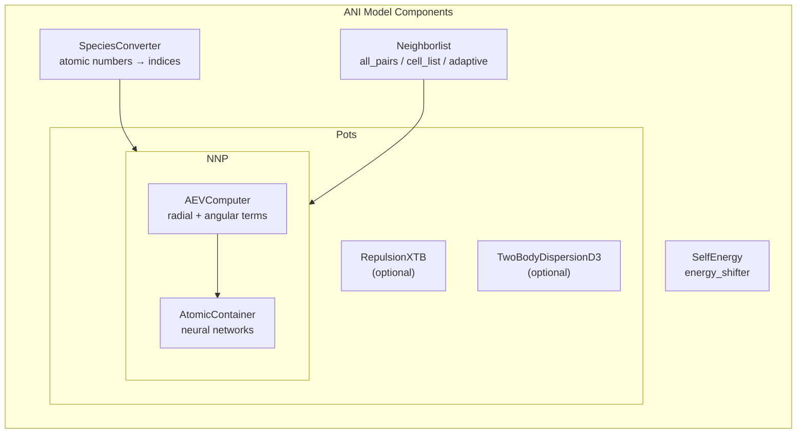
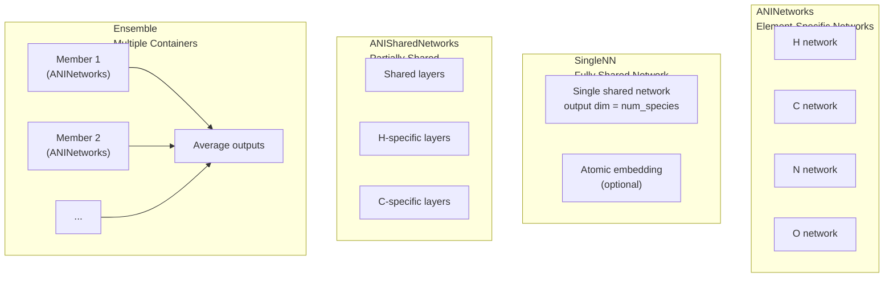
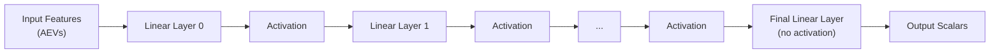
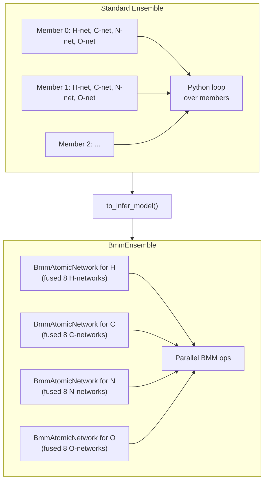
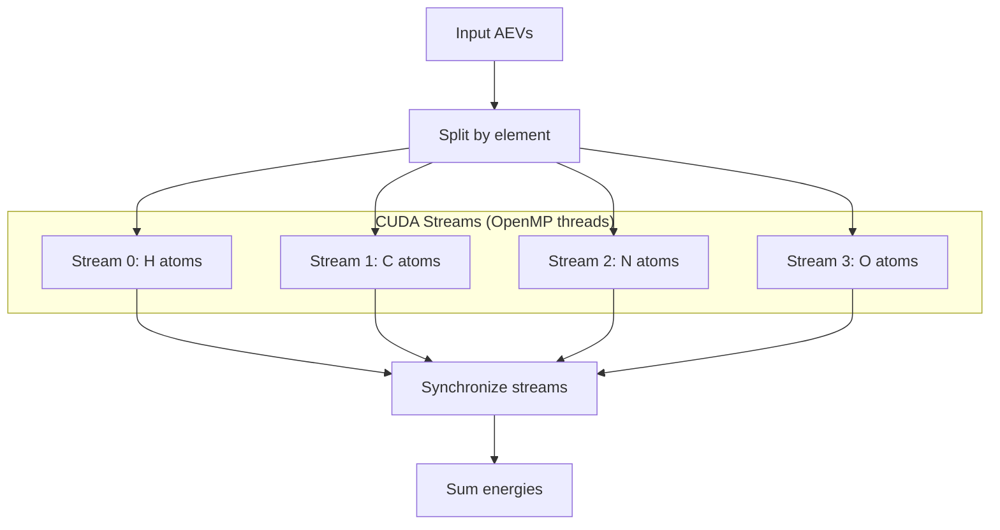
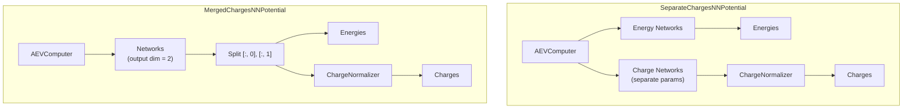

# Model Architecture

<details>
<summary>Relevant source files</summary>

The following files were used as context for generating this wiki page:

- [torchani/arch.py](torchani/arch.py)
- [torchani/electro.py](torchani/electro.py)
- [torchani/models.py](torchani/models.py)
- [torchani/nn/__init__.py](torchani/nn/__init__.py)
- [torchani/nn/_containers.py](torchani/nn/_containers.py)
- [torchani/nn/_core.py](torchani/nn/_core.py)
- [torchani/nn/_infer.py](torchani/nn/_infer.py)
- [torchani/nn/_internal.py](torchani/nn/_internal.py)
- [torchani/potentials/core.py](torchani/potentials/core.py)
- [torchani/potentials/nnp.py](torchani/potentials/nnp.py)
- [torchani/utils.py](torchani/utils.py)

</details>


This page describes the architecture of ANI-style neural network interatomic potentials implemented in TorchANI. It covers the two main model classes (`ANI` and `ANIq`), their core components, different neural network container implementations, and inference optimization strategies.

For information about training models, see [Training Workflow](#7.1). For details on using pre-built models, see [Using Pre-built Models](#5.1). For building custom models with the Assembler, see [Building Custom Models](#5.3).

---

## Model Classes

TorchANI provides two main model classes that differ in their output capabilities:

| Class | Energy Prediction | Charge Prediction | Base Class |
|-------|------------------|-------------------|------------|
| `ANI` | ✓ | ✗ | `_ANI` |
| `ANIq` | ✓ | ✓ | `_ANI` |

Both classes inherit from the internal `_ANI` base class, which provides common functionality for neighbor list management, species conversion, and potential composition.

### ANI Class

The `ANI` class predicts molecular energies by summing atomic contributions from neural networks and optional additional potentials (repulsion, dispersion). It is the standard model for energy-only predictions.

**Key Methods:**
- `forward(species_coordinates, cell, pbc, charge, atomic, ensemble_values)` - Main entrypoint returning `SpeciesEnergies`
- `compute_from_neighbors(elem_idxs, coords, neighbors, ...)` - Lower-level computation from pre-computed neighbors
- `atomic_energies(...)` - Returns per-atom energy contributions
- `energies_qbcs(...)` - Returns energies with query-by-committee uncertainty estimates

### ANIq Class

The `ANIq` class extends `ANI` to predict both energies and atomic charges. It uses separate or merged charge networks that share input features (AEVs) with the energy networks.

**Key Differences:**
- Replaces `NNPotential` with either `SeparateChargesNNPotential` or `MergedChargesNNPotential`
- Returns `SpeciesEnergiesAtomicCharges` from `forward()` instead of `SpeciesEnergies`
- Includes a `ChargeNormalizer` to ensure total molecular charge matches the specified value

**Architecture Diagram: ANI vs ANIq**

```mermaid
graph TB
    subgraph ANI["ANI Model"]
        ANI_Input["Input: species, coords"]
        ANI_NNP["NNPotential"]
        ANI_AEV["AEVComputer"]
        ANI_NN["Neural Networks"]
        ANI_Output["Output: SpeciesEnergies"]
        
        ANI_Input --> ANI_NNP
        ANI_NNP --> ANI_AEV
        ANI_AEV --> ANI_NN
        ANI_NN --> ANI_Output
    end
    
    subgraph ANIq["ANIq Model"]
        ANIq_Input["Input: species, coords"]
        ANIq_NNP["SeparateChargesNNPotential<br/>or MergedChargesNNPotential"]
        ANIq_AEV["AEVComputer"]
        ANIq_ENN["Energy Networks"]
        ANIq_CNN["Charge Networks"]
        ANIq_Norm["ChargeNormalizer"]
        ANIq_Output["Output: SpeciesEnergiesAtomicCharges"]
        
        ANIq_Input --> ANIq_NNP
        ANIq_NNP --> ANIq_AEV
        ANIq_AEV --> ANIq_ENN
        ANIq_AEV --> ANIq_CNN
        ANIq_ENN --> ANIq_Output
        ANIq_CNN --> ANIq_Norm
        ANIq_Norm --> ANIq_Output
    end
```



Sources: [torchani/arch.py:322-733](), [torchani/arch.py:92-320]()

---

## Core Components

Every ANI-style model is composed of five essential components assembled together:



Sources: [torchani/arch.py:98-133]()

### Component Descriptions

| Component | Class | Purpose | Configuration |
|-----------|-------|---------|---------------|
| Species Converter | `SpeciesConverter` | Maps atomic numbers to element indices (0, 1, 2, ...) | Created from symbols list |
| Neighborlist | See [Neighborlist Algorithms](#4.3) | Computes atom pairs within cutoff | `all_pairs`, `cell_list`, `adaptive` |
| NNPotential | `NNPotential` | Core energy prediction from AEVs + neural networks | Always present in `potentials["nnp"]` |
| AEVComputer | `AEVComputer` | Computes atomic environment vectors | Radial and angular symmetry functions |
| Neural Networks | `AtomicContainer` | Maps AEVs to atomic energies | Element-specific or shared architectures |
| Self Energy | `SelfEnergy` | Adds self-atomic energies (SAEs) | Per-element constants from `energy_shifter` |
| Additional Potentials | `Potential` subclasses | Repulsion, dispersion corrections | Optional, stored in `potentials` dict |

The `_ANI.__init__` method validates that all components support the same number of species and assembles them into a coherent model.

Sources: [torchani/arch.py:98-133](), [torchani/nn/_containers.py:30]()

---

## Neural Network Containers

The `AtomicContainer` base class defines the interface for modules that convert atomic environment vectors (AEVs) into atomic scalars (typically energies). TorchANI provides multiple implementations with different architectures and sharing strategies.

**Container Architecture Comparison**



Sources: [torchani/nn/_containers.py:20-318](), [torchani/nn/_containers.py:320-571](), [torchani/nn/_containers.py:573-642]()

### ANINetworks

`ANINetworks` is the standard container used in published ANI models (ANI-1x, ANI-2x, etc.). It maintains a separate `AtomicNetwork` for each chemical element.

**Key Characteristics:**
- Element-specific networks stored in `atomics` ModuleDict
- Each network can have different architecture (layer dimensions)
- No weight sharing between elements
- Forward pass iterates over elements, selecting AEVs by element index

**Factory Methods:**

| Method | Layer Dimensions (H/C/N/O/S/F/Cl) | Activation | Use Case |
|--------|-----------------------------------|------------|----------|
| `like_1x()` | 160-128-96 / 144-112-96 / 128-112-96 / 128-112-96 | CELU | ANI-1x models (HCNO) |
| `like_2x()` | 256-192-160 / 224-192-160 / 192-160-128 / 192-160-128 / 160-128-96 | CELU | ANI-2x models |
| `like_dr()` | 256-192-160 / ... / 160-128-96 | GELU | Modern improved models |

**Implementation Detail:** The forward pass flattens the batch and atom dimensions, iterates over elements, and uses `index_select` to gather AEVs for each element before passing them through the corresponding network.

Sources: [torchani/nn/_containers.py:320-571]()

### SingleNN

`SingleNN` uses a single shared network for all elements. The final layer outputs a vector with dimension equal to the number of species, and the appropriate scalar is selected based on each atom's element.

**Advantages:**
- Fewer parameters (single network vs. per-element networks)
- Better for elements with limited training data
- Can optionally embed atomic identity as input features

**Embedding Strategies:**

| Strategy | Description | Input Dimension Change |
|----------|-------------|------------------------|
| `"none"` | No embedding, AEVs only | `in_dim` |
| `"one-hot"` | Concatenate one-hot vector | `in_dim + num_species` |
| `"continuous"` | Concatenate learned embedding | `in_dim + embed_dims` (default 10) |

**Factory Methods:**
- `default()` - Continuous embedding with dims (256, 160, 128, 512)
- `large()` - Continuous embedding with dims (320, 256, 256, 512)
- `one_hot()` / `one_hot_large()` - One-hot embedding variants

Sources: [torchani/nn/_containers.py:20-195]()

### ANISharedNetworks

`ANISharedNetworks` provides a middle ground: initial layers are shared across all elements, with element-specific layers in later stages.

**Structure:**
- `shared`: AtomicNetwork applied to all atoms
- `atomics`: ModuleDict of element-specific networks that process shared layer output

**Use Case:** Allows learning common features while preserving element-specific behavior in deeper layers.

Sources: [torchani/nn/_containers.py:197-318]()

### Ensemble

The `Ensemble` container averages predictions from multiple `AtomicContainer` instances. All members must support the same chemical elements.

**Key Features:**
- By default, averages over all `members` in the ModuleList
- Can activate subset of members with `set_active_members(idxs)`
- When `ensemble_values=True`, returns individual member predictions instead of average
- Used for uncertainty quantification (QBC) and improved accuracy

**Active Member Selection:**
```python
# Use only members 0, 2, 4 for prediction
model.set_active_members([0, 2, 4])
energies = model(species, coords)  # Average over 3 members
```

Sources: [torchani/nn/_containers.py:573-642]()

---

## Atomic Network Details

The `AtomicNetwork` class implements a simple fully-connected multi-layer perceptron (MLP) with configurable layer dimensions, activation functions, and bias terms.

**Architecture:**



**Constructor Signature:**
```python
AtomicNetwork(
    layer_dims: Sequence[int],  # (in_dim, hidden1, hidden2, ..., out_dim)
    activation: Union[str, torch.nn.Module] = "gelu",  # "gelu", "celu", or Module
    bias: bool = False  # Whether to use bias terms in Linear layers
)
```

**Activation Functions:**

| String | Module | Description |
|--------|--------|-------------|
| `"gelu"` | `torch.nn.GELU()` | Gaussian Error Linear Unit (modern default) |
| `"celu"` | `TightCELU()` | CELU with α=0.1 (used in ANI-1x, ANI-2x) |

**Example:**
```python
# Create a network: 384 → 160 → 128 → 96 → 1
network = AtomicNetwork(
    layer_dims=(384, 160, 128, 96, 1),
    activation="celu",
    bias=True
)
```

Sources: [torchani/nn/_core.py:119-164]()

---

## Inference Optimization

For single-molecule calculations (MD, geometry optimization), TorchANI provides optimized network implementations that reduce overhead and improve performance.

### BmmEnsemble and BmmAtomicNetwork

**Problem:** Standard `Ensemble` iterates over members in Python, creating multiple kernel launches.

**Solution:** Fuse ensemble members into batched matrix multiplication (BMM) operations.

**Conversion Flow:**



**BmmLinear Layer:**
- Weights: `(ensemble_size, in_features, out_features)`
- Bias: `(ensemble_size, 1, out_features)`
- Operation: `torch.baddbmm(bias, input, weight)`
- Input: `(ensemble_size, num_atoms_of_element, in_features)`
- Output: `(ensemble_size, num_atoms_of_element, out_features)`

**Usage:**
```python
# Convert standard ensemble to BmmEnsemble
bmm_model = model.to_infer_model(use_mnp=False)

# Or directly access neural networks
bmm_networks = model.neural_networks.to_infer_model(use_mnp=False)
```

**Limitations:**
- Only supports single-conformer inputs (`batch_size=1`)
- Does not support `atomic=True` for atomic energy output

Sources: [torchani/nn/_infer.py:61-217]()

### MNPNetworks

**MNP (Multi-Net Parallel)** extends BmmEnsemble by parallelizing element-specific networks across multiple CUDA streams, leveraging OpenMP for CPU parallelism.

**Key Features:**
- Requires `use_mnp=True` and the C++ MNP extension
- Uses one CUDA stream per element
- Flattens all network parameters for efficient C++ access
- Stores `_weight_names`, `_bias_names`, `_num_layers`, `_first_layer_idxs` for indexing

**Architecture:**



**Requirements:**
- CUDA device
- `OMP_NUM_THREADS >= 2` environment variable
- MNP C++ extension installed

**Performance Note:** Python-only MNP (`use_mnp=False`) is not performant and is for testing only.

Sources: [torchani/nn/_infer.py:219-371]()

---

## Charge Prediction Models (ANIq)

The `ANIq` class predicts both energies and atomic partial charges. Charges are predicted from the same AEV features as energies, but through separate or merged networks.

### Architecture Variants

**Two Implementation Strategies:**



Sources: [torchani/potentials/nnp.py:38-103]()

### Separate Charge Networks

`SeparateChargesNNPotential` maintains two independent `AtomicContainer` instances:
- `neural_networks`: Predicts energies (output dim = 1)
- `charge_networks`: Predicts raw charges (output dim = 1)

**Advantages:**
- Full flexibility in architecture
- Can share some layers between energy and charge networks
- Used in the experimental ANImbis model

**Initialization:**
```python
SeparateChargesNNPotential(
    aev_computer=aev_computer,
    neural_networks=energy_networks,
    charge_networks=charge_networks,
    charge_normalizer=normalizer  # Optional, defaults to uniform weighting
)
```

### Merged Charge Networks

`MergedChargesNNPotential` uses a single network with 2D output:
- Output[:, 0]: Energies
- Output[:, 1]: Raw charges

**Advantages:**
- Maximum parameter sharing
- Fewer total parameters
- Simpler architecture

### Charge Normalization

The `ChargeNormalizer` ensures that predicted charges sum to the specified total molecular charge. It redistributes the excess charge across atoms using element-specific weights.

**Normalization Formula:**
```
normalized_charge[i] = raw_charge[i] + excess * weight[i]
where excess = target_charge - sum(raw_charges)
```

**Weight Strategies:**

| Strategy | Weight Formula | Use Case |
|----------|----------------|----------|
| Uniform | `weight[i] = 1 / num_atoms` | Simple, element-agnostic |
| Electronegativity | `weight[i] = (χ[elem] / η[elem])²` | Physics-informed, default |
| Charge-scaled | `weight[i] ∝ raw_charge[i]²` | Adaptive to predictions |

**Factory Method:**
```python
normalizer = ChargeNormalizer.from_electronegativity_and_hardness(
    symbols=("H", "C", "N", "O"),
    scale_weights_by_charges_squared=True
)
```

Sources: [torchani/electro.py:29-94]()

---

## Model Construction

While pre-built models (see [Using Pre-built Models](#5.1)) are available, custom models can be constructed directly or via the `Assembler` (see [Building Custom Models](#5.3)).

### Direct Construction

```python
from torchani.arch import ANI
from torchani.aev import AEVComputer
from torchani.nn import ANINetworks, Ensemble
from torchani.sae import SelfEnergy

# Create components
symbols = ("H", "C", "N", "O")
aev_computer = AEVComputer(...)
networks = ANINetworks.like_2x(symbols, in_dim=aev_computer.num_features)
ensemble = Ensemble([networks.clone() for _ in range(8)])
energy_shifter = SelfEnergy(...)

# Assemble model
model = ANI(
    symbols=symbols,
    aev_computer=aev_computer,
    neural_networks=ensemble,
    energy_shifter=energy_shifter,
    periodic_table_index=True
)
```

### Key Constraints

1. All components must support the same `symbols` (validated in `_ANI.__init__`)
2. `periodic_table_index=True` requires input species as atomic numbers (1, 6, 7, 8, ...)
3. `periodic_table_index=False` requires input species as indices (0, 1, 2, 3, ...)
4. The global cutoff is the maximum of all potential cutoffs

Sources: [torchani/arch.py:92-133]()

---

## Summary Table: Model Components

| Component | Key Classes | Input | Output | Configurable |
|-----------|-------------|-------|--------|--------------|
| Model | `ANI`, `ANIq` | species, coords | energies (+ charges) | ✓ |
| Species Converter | `SpeciesConverter` | atomic numbers | element indices | symbols list |
| Neighborlist | Various (see [4.3](#4.3)) | coords, cell, pbc | neighbor pairs | algorithm choice |
| AEV | `AEVComputer` | coords, neighbors | AEV features | radial/angular terms |
| Neural Networks | `AtomicContainer` subclasses | element indices, AEVs | atomic scalars | architecture |
| Self Energy | `SelfEnergy` | element indices | SAE corrections | per-element constants |
| Potentials | `Potential` subclasses | coords, neighbors | energy corrections | type, parameters |
| Charge Normalizer | `ChargeNormalizer` | element indices, charges | normalized charges | weights |

Sources: [torchani/arch.py:1-733](), [torchani/nn/_containers.py:1-642](), [torchani/potentials/nnp.py:1-103]()

---