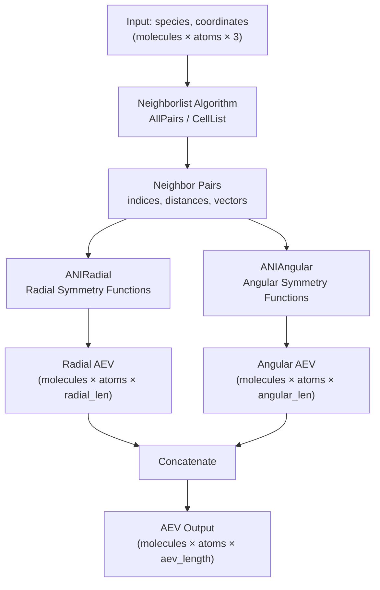
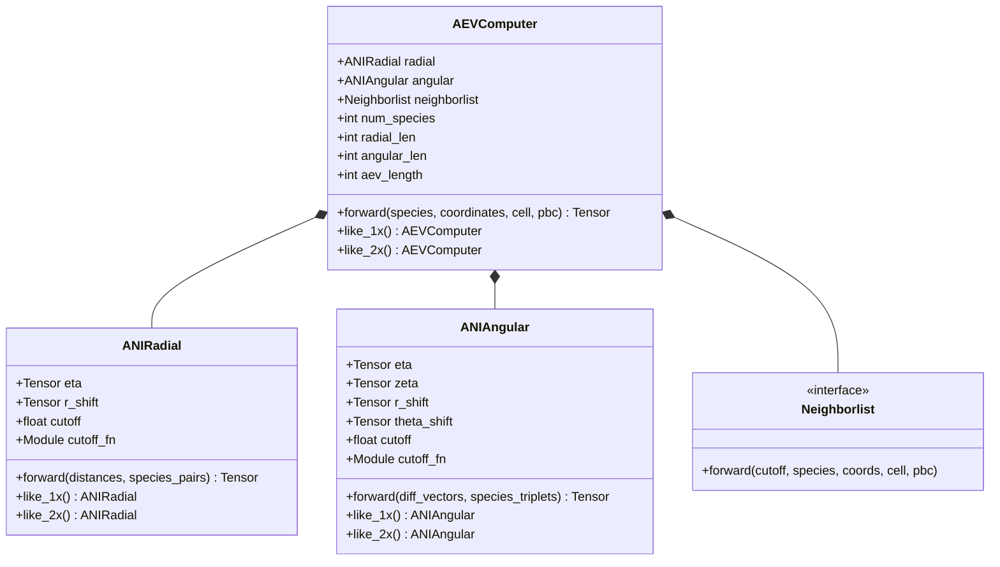
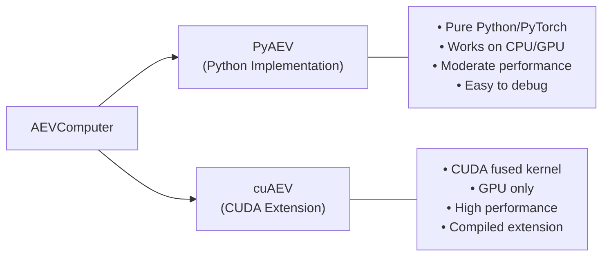
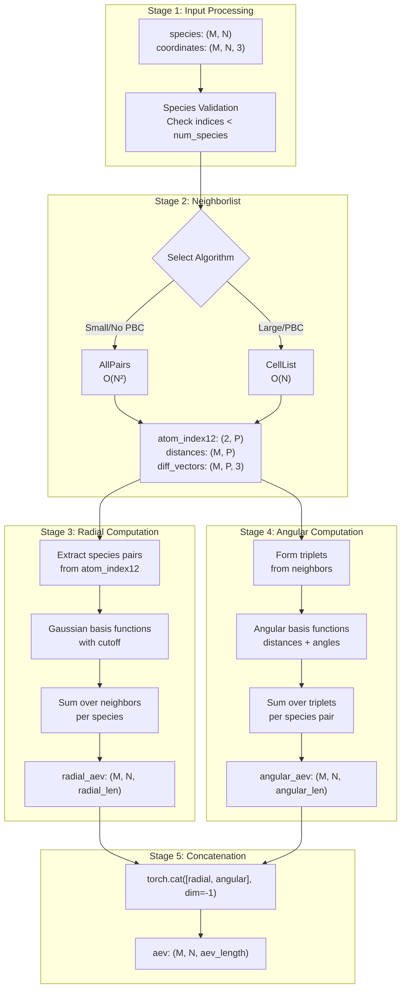

# AEV Computation

<details>
<summary>Relevant source files</summary>

The following files were used as context for generating this wiki page:

- [.gitignore](.gitignore)
- [README.md](README.md)
- [setup.py](setup.py)
- [tests/test_aev.py](tests/test_aev.py)
- [tests/test_energies.py](tests/test_energies.py)
- [tests/test_ensemble.py](tests/test_ensemble.py)
- [tests/test_forces.py](tests/test_forces.py)

</details>


This page explains Atomic Environment Vectors (AEVs), their mathematical formulation, and how they are computed in TorchANI. AEVs are the core feature representation used by ANI neural network potentials to describe the local chemical environment around each atom.

For information about how AEVs are used by neural networks to predict energies, see [Model Architecture](#4.1). For details on how neighbor pairs are identified for AEV computation, see [Neighborlist Algorithms](#4.3).

## Overview

Atomic Environment Vectors encode the local chemical environment of each atom using radial and angular symmetry functions. These invariant descriptors capture:

- **Radial information**: Pairwise distances between atoms
- **Angular information**: Triplet angles formed by neighboring atoms

The AEV representation is translationally and rotationally invariant, making it suitable for describing molecular systems. The computation pipeline involves:

1. Finding neighboring atoms within a cutoff radius
2. Computing radial symmetry functions for each pair
3. Computing angular symmetry functions for each triplet
4. Concatenating radial and angular components into a single vector per atom



**Sources:** [tests/test_aev.py:1-533]()

## AEV Components

### Radial Symmetry Functions

Radial symmetry functions (`ANIRadial`) describe pairwise interactions between atoms as a function of distance. Each radial function uses a Gaussian basis with a smooth cutoff:

**Key Parameters:**
- `eta`: Width parameter for Gaussian basis functions
- `r_shift`: Center positions for Gaussian functions
- `cutoff`: Maximum distance for neighbor interactions
- `cutoff_fn`: Smooth cutoff function (e.g., cosine)

The radial AEV component has shape `(num_species × num_radial_terms)` where each element represents a different species-specific radial basis function.

### Angular Symmetry Functions

Angular symmetry functions (`ANIAngular`) describe three-body interactions by encoding angles formed by atom triplets. These functions combine:

- Distance information from both pairs in the triplet
- Angular information between the two vectors
- Species-specific contributions

**Key Parameters:**
- `eta`: Width parameter for distance components
- `zeta`: Angular resolution parameter
- `r_shift`: Distance shift parameters
- `theta_shift`: Angular shift parameters
- `cutoff`: Maximum distance for triplet interactions
- `cutoff_fn`: Smooth cutoff function

The angular AEV component has shape `(num_species_pairs × num_angular_terms)` where each element corresponds to a specific species pair and angular basis function.

**Sources:** [tests/test_aev.py:41-58]()

## AEVComputer Class

The `AEVComputer` class is the main interface for computing AEVs. It combines radial and angular symmetry functions with a neighborlist algorithm.



**Sources:** [tests/test_aev.py:24-59]()

### Constructor and Factory Methods

The `AEVComputer` can be instantiated in two ways:

**Direct Construction:**
```python
# Create radial and angular components
radial = ANIRadial(eta, r_shift, cutoff, cutoff_fn)
angular = ANIAngular(eta, zeta, r_shift, theta_shift, cutoff, cutoff_fn)

# Combine into AEVComputer
aev_computer = AEVComputer(radial, angular, num_species)
```

**Factory Methods:**

| Method | Description | Species | Radial Terms | Angular Terms |
|--------|-------------|---------|--------------|---------------|
| `AEVComputer.like_1x()` | ANI-1x configuration | H, C, N, O (4) | 32 | 8 |
| `AEVComputer.like_2x()` | ANI-2x configuration | H, C, N, O, F, S, Cl (7) | 32 | 8 |

**Sources:** [tests/test_aev.py:40-58]()

### Forward Pass

The `AEVComputer.forward()` method computes AEVs for a batch of molecules:

**Input:**
- `species`: Atomic species indices, shape `(molecules, atoms)`
- `coordinates`: Atomic coordinates, shape `(molecules, atoms, 3)`
- `cell`: Optional unit cell vectors, shape `(3, 3)`
- `pbc`: Optional periodic boundary conditions, shape `(3,)`

**Output:**
- AEV tensor, shape `(molecules, atoms, aev_length)`
  - `aev_length = radial_len + angular_len`
  - First `radial_len` features are radial components
  - Remaining features are angular components

**Sources:** [tests/test_aev.py:87-95](), [tests/test_aev.py:181-182]()

## Implementation Strategies

TorchANI provides two implementations of AEV computation with different performance characteristics:



**Sources:** [setup.py:43-80]()

### PyAEV (Python Implementation)

The default Python implementation computes AEVs using PyTorch operations. This implementation:

- Works on both CPU and GPU devices
- Uses standard PyTorch autograd for gradients
- Suitable for debugging and small-scale calculations
- Automatically selected when CUDA extensions are not available

### cuAEV (CUDA Extension)

The CUDA-accelerated implementation provides significant speedups through kernel fusion:

**Build Configuration:**
- Source files: `torchani/csrc/cuaev.cpp`, `torchani/csrc/aev.cu`
- Requires CUDA Toolkit and compatible GPU
- Compiled with specific SM (Streaming Multiprocessor) architectures
- Optional optimization flags (`-use_fast_math`)

**Supported Architectures:**

| Architecture | SM Version | Availability |
|--------------|------------|--------------|
| Pascal | 60, 61 | CUDA 8.0+ |
| Volta | 70 | CUDA 9.0+ |
| Turing | 75 | CUDA 10.0+ |
| Ampere | 80, 86 | CUDA 11.0+ |
| Ada/Hopper | 89 | CUDA 11.1+ |
| Blackwell | 100 | CUDA 12.8+ |

**Build Flags:**
- `ext`: Auto-detect compatible GPUs
- `ext-all-sms`: Build for all supported architectures
- `ext-sm{XX}`: Build for specific SM version
- `ext-debug`: Enable debug symbols
- `ext-no-opt`: Disable fast math optimizations

**Sources:** [setup.py:43-80](), [setup.py:138-148]()

## Computation Pipeline

The AEV computation follows a multi-stage pipeline:



**Sources:** [tests/test_aev.py:134-226]()

## Periodic Boundary Conditions

AEV computation supports periodic boundary conditions for simulating bulk systems:

**PBC Handling:**
1. Minimum image convention applied to neighbor distances
2. Atoms at cell boundaries correctly interact with periodic images
3. Translation invariance preserved within the cell

**Requirements:**
- `cell`: 3×3 tensor defining unit cell vectors
- `pbc`: Boolean tensor `(3,)` indicating periodicity along each axis
- Neighborlist must support PBC (e.g., `CellList`)

**Edge Cases Handled:**
- Atoms on cell surfaces, edges, and corners
- Non-orthogonal cell geometries
- Partial periodicity (e.g., slab systems)

**Sources:** [tests/test_aev.py:234-437]()

## Special Cases and Numerical Stability

### Isolated Atoms

The AEV computation handles molecules with isolated atoms (distance > cutoff) without errors:

- Single-atom molecules produce zero AEVs
- Isolated pairs at distances beyond cutoff are handled correctly
- No `IndexError` for missing neighbors

**Sources:** [tests/test_aev.py:61-132]()

### Superimposed Atoms

When atoms are at identical coordinates (distance = 0):

- Radial and angular functions handle `r=0` without producing NaN
- Gradients remain well-defined
- Useful for testing numerical stability

**Sources:** [tests/test_aev.py:184-189]()

### Batching and Padding

AEV computation supports batched inputs with variable molecule sizes:

- Padding species with index `-1` (or values ≥ `num_species`)
- Padded atoms contribute zero to AEVs
- Gradients correctly handle padded positions

**Sources:** [tests/test_aev.py:135-163](), [tests/test_aev.py:202-225]()

## Gradient Computation

AEVs support automatic differentiation for force calculations:

- Gradients flow through neighborlist construction
- Both radial and angular components are differentiable
- Forces computed as `-∂AEV/∂coordinates` maintain accuracy

**Gradient Testing:**
- Single molecules and batched molecules produce identical gradients
- Padding does not affect non-padded gradients
- Translational invariance verified through gradient checks

**Sources:** [tests/test_aev.py:135-163]()

## Configuration Examples

### ANI-1x Configuration

```python
aev_computer = AEVComputer.like_1x()
# Species: H, C, N, O
# num_species = 4
# radial_len = 32
# angular_len = 8
# aev_length = 128
```

### ANI-2x Configuration

```python
aev_computer = AEVComputer.like_2x()
# Species: H, C, N, O, F, S, Cl
# num_species = 7
# radial_len = 32
# angular_len = 8
# aev_length = 224
```

**Sources:** [tests/test_aev.py:41-58]()

## Performance Considerations

### Neighborlist Algorithm Selection

The choice of neighborlist algorithm significantly impacts AEV computation performance:

| System Size | Boundary Conditions | Recommended Algorithm |
|-------------|---------------------|----------------------|
| Small (< 100 atoms) | No PBC | `AllPairs` |
| Large (> 100 atoms) | No PBC | `AllPairs` or `AdaptiveList` |
| Any size | With PBC | `CellList` |
| Variable workloads | Any | `AdaptiveList` (auto-select) |

**Sources:** [tests/test_aev.py:481-505]()

### CUDA Acceleration

Using the cuAEV extension provides substantial speedups:

- **Kernel Fusion**: Combines neighborlist and AEV computation
- **Memory Efficiency**: Reduces intermediate tensor allocations
- **Fast Math**: Optional aggressive optimizations
- **Architecture-Specific**: Compiled for target GPU SM version

**Compilation:**
```bash
pip install --config-settings=--global-option=ext --no-build-isolation .
```

**Sources:** [setup.py:43-80]()

### JIT Compilation

The `AEVComputer` supports TorchScript compilation for additional optimizations:

```python
aev_computer = torch.jit.script(AEVComputer.like_1x())
```

This enables:
- Operator fusion in the computation graph
- Reduced Python overhead
- Potential for deployment without Python runtime

**Sources:** [tests/test_aev.py:228-232]()

## Testing and Validation

AEV computation is extensively tested against reference implementations:

**Test Coverage:**
- **Isomer tests**: 97 organic molecules from ANI-1 dataset
- **NIST tests**: 100 reference structures
- **MD trajectory tests**: Benzene and tripeptide dynamics
- **PBC tests**: Corner, edge, and surface interactions
- **Gradient tests**: Numerical stability and correctness

**Validation Data Sources:**
- Pre-computed reference AEVs from original ANI implementation
- Pickled test data in `tests/resources/`

**Sources:** [tests/test_aev.py:1-533]()

---