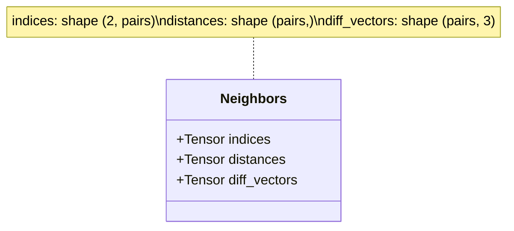
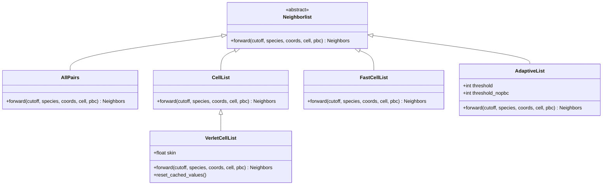
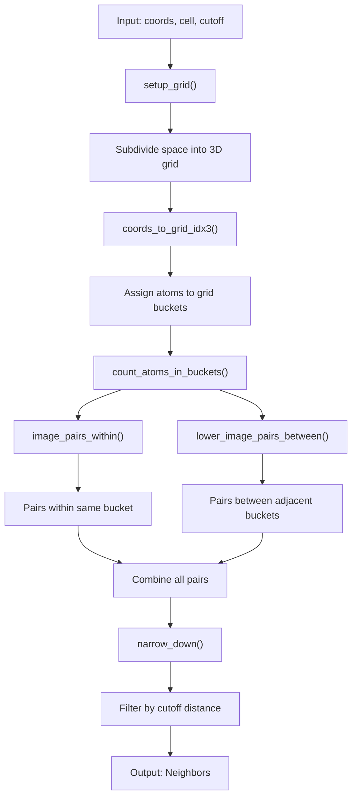
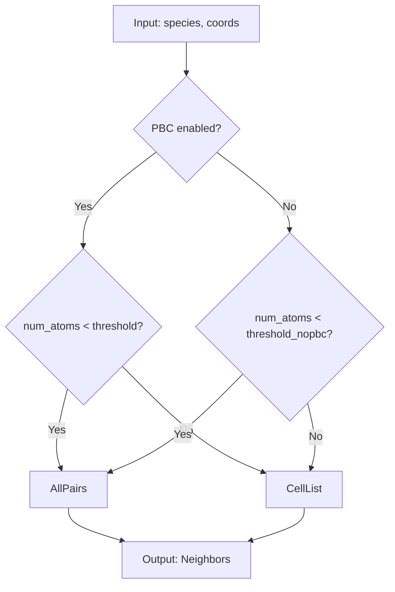
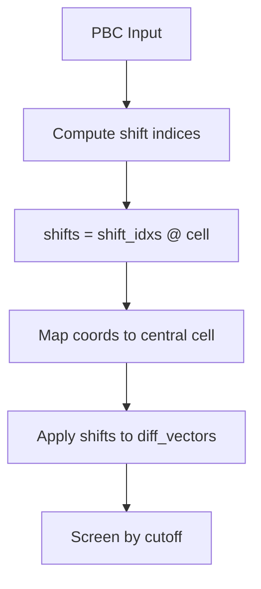

# Neighborlist Algorithms

<details>
<summary>Relevant source files</summary>

The following files were used as context for generating this wiki page:

- [tests/test_aev.py](tests/test_aev.py)
- [tests/test_energies.py](tests/test_energies.py)
- [tests/test_ensemble.py](tests/test_ensemble.py)
- [tests/test_forces.py](tests/test_forces.py)
- [tests/test_neighbors.py](tests/test_neighbors.py)
- [tools/neighborlist-benchmark.py](tools/neighborlist-benchmark.py)
- [tools/pyaev-benchmark.py](tools/pyaev-benchmark.py)
- [torchani/csrc/CMakeLists.txt](torchani/csrc/CMakeLists.txt)
- [torchani/csrc/__init__.py](torchani/csrc/__init__.py)
- [torchani/csrc/cell_list.cpp](torchani/csrc/cell_list.cpp)
- [torchani/neighbors.py](torchani/neighbors.py)

</details>


This page describes the neighborlist algorithms available in TorchANI for computing pairs of atoms within a specified cutoff distance. Neighborlists are a critical component of the AEV computation pipeline, determining which atom pairs contribute to atomic environment vectors.

For information about how neighborlists are used in AEV computation, see [AEV Computation](#4.2). For broader context on model architecture, see [Model Architecture](#4.1).

## Overview

Neighborlists identify all pairs of atoms that are within a specified cutoff distance of each other. This is essential for computing atomic environment vectors (AEVs), which only consider atoms within a cutoff radius. TorchANI provides multiple neighborlist algorithms with different computational complexities and optimizations:

| Algorithm | Complexity | Use Case | PBC Support |
|-----------|-----------|----------|-------------|
| `AllPairs` | O(N²) | Small systems (<200 atoms) | Yes |
| `CellList` | O(N) | Large systems, PBC | Yes |
| `FastCellList` | O(N) | Large systems (C++ optimized) | Yes |
| `AdaptiveList` | Adaptive | Automatic selection | Yes |
| `VerletCellList` | O(N) | MD simulations with caching | Yes |

**Sources:** [torchani/neighbors.py:1-169](), [torchani/neighbors.py:171-415]()

## Neighborlist Data Structure

### Neighbors NamedTuple

All neighborlist algorithms return a `Neighbors` object, which is a named tuple containing the computed neighbor information:



**Diagram: Neighbors data structure returned by all neighborlist algorithms**

- **indices**: Long tensor of shape `(2, pairs)` where `indices[0]` contains first atom indices and `indices[1]` contains second atom indices
- **distances**: Float tensor of shape `(pairs,)` containing the distance for each pair
- **diff_vectors**: Float tensor of shape `(pairs, 3)` containing the difference vector for each pair (used for computing angular terms)

**Sources:** [torchani/neighbors.py:13-18]()

## Algorithm Implementations

### Base Neighborlist Class

All neighborlist implementations inherit from the `Neighborlist` base class, which defines the forward interface:



**Diagram: Neighborlist class hierarchy**

**Sources:** [torchani/neighbors.py:142-168]()

### AllPairs Algorithm

The `AllPairs` neighborlist uses a naive O(N²) algorithm that computes all possible atom pairs and then filters by cutoff distance. This is implemented in the `all_pairs` function.

**Algorithm steps:**
1. Generate all upper-triangular pairs using `torch.triu_indices`
2. For PBC cases, compute all image pairs across periodic boundaries using `_all_pairs_pbc_shifts`
3. Apply cutoff screening via the `narrow_down` function
4. Remove dummy atoms (species index -1)

The PBC implementation computes shifts for all neighboring periodic images by determining how many unit cell repetitions are needed along each direction based on the cutoff distance.

**Sources:** [torchani/neighbors.py:171-277]()

### CellList Algorithm

The `CellList` neighborlist uses a cell/grid subdivision algorithm for O(N) scaling. The implementation is based on subdividing space into a 3D grid of "buckets" or cells.



**Diagram: CellList algorithm workflow**

**Key functions in the CellList algorithm:**

- `setup_grid`: Determines grid shape (GX, GY, GZ) based on cell size and cutoff
- `coords_to_fractional`: Converts coordinates to fractional cell coordinates
- `coords_to_grid_idx3`: Assigns each atom to a 3D grid index
- `flatten_idx3`: Converts 3D grid indices to flat indices
- `count_atoms_in_buckets`: Counts atoms per bucket
- `image_pairs_within`: Finds pairs within the same bucket
- `_offset_idx3`: Defines the 13 surrounding bucket offsets (half-space to avoid double counting)
- `lower_image_pairs_between`: Finds pairs between a bucket and its surrounding buckets

**Grid subdivision strategy:**
The grid is sized so that each bucket has dimensions approximately equal to the cutoff distance. This ensures that atoms only need to check their own bucket and immediately adjacent buckets (13 neighbors in half-space) to find all pairs within the cutoff.

**Sources:** [torchani/neighbors.py:300-822](), [torchani/neighbors.py:677-728]()

### FastCellList Algorithm

The `FastCellList` class provides a C++ optimized implementation of the cell list algorithm with automatic differentiation support. It uses the `torch.ops.cell_list.cell_list` operation defined in the compiled extension.

The C++ implementation in `cell_list.cpp` provides:
- Fused operations for improved performance
- Custom autograd function `CellListFunction` for gradient computation
- Optimized memory access patterns

**Sources:** [torchani/neighbors.py:280-297](), [torchani/csrc/cell_list.cpp:274-358]()

### AdaptiveList Algorithm

The `AdaptiveList` neighborlist automatically selects between `AllPairs` and `CellList` based on system size. It uses configurable thresholds:

- **threshold** (default 190): Switch point for PBC systems
- **threshold_nopbc** (default 1770): Switch point for non-PBC systems



**Diagram: AdaptiveList algorithm selection logic**

The `FastAdaptiveList` variant uses `FastCellList` instead of `CellList` when the C++ extension is available.

**Sources:** [torchani/neighbors.py:320-367](), [torchani/neighbors.py:393-414]()

### VerletCellList Algorithm

The `VerletCellList` extends `CellList` with a Verlet neighbor list caching strategy, useful for molecular dynamics simulations where atom positions change gradually.

**Key features:**
- Adds a "skin" distance to the cutoff when building the cell list
- Caches the neighbor list and reuses it until atoms move more than `skin/2`
- Reduces the frequency of expensive neighbor list rebuilds

**Cached state:**
- `_prev_neighbor_idxs`: Previously computed neighbor indices
- `_prev_shift_idxs`: Previously computed periodic shifts
- `_prev_coords`: Previous atom coordinates
- `_prev_cell`: Previous cell parameters

The `_can_use_prev_list` method checks if any atom has moved more than half the skin distance, accounting for PBC wrapping.

**Sources:** [torchani/neighbors.py:824-950]()

## Periodic Boundary Conditions

All neighborlist algorithms support periodic boundary conditions (PBC). When PBC is enabled:

1. **Shift computation**: The algorithm computes which periodic images of atoms need to be considered
2. **Image pairs**: For PBC, pairs can span across unit cell boundaries
3. **Coordinate wrapping**: Coordinates are mapped to the central cell using `map_to_central`
4. **Shift vectors**: Applied to difference vectors to account for periodic images



**Diagram: PBC handling in neighborlist computation**

The number of periodic images to consider along each direction is computed based on the cutoff distance and cell geometry in `_all_pairs_pbc_shifts` for `AllPairs` and during grid setup for `CellList`.

**Sources:** [torchani/neighbors.py:217-277](), [torchani/neighbors.py:437-466]()

## Utility Functions

### narrow_down

The `narrow_down` function is the common screening function used by all algorithms. It:
1. Removes pairs containing dummy atoms (species == -1)
2. Computes difference vectors between atom pairs
3. Applies periodic shifts if provided
4. Filters pairs by cutoff distance
5. Computes final distances

This function ensures gradients are properly computed by using the original (non-detached) coordinates for the final distance calculation.

**Sources:** [torchani/neighbors.py:66-115]()

### Helper Functions

- `discard_inter_molecule_pairs`: Removes pairs from different molecules in a batch
- `discard_outside_cutoff`: Filters neighbors beyond a cutoff
- `compute_bounding_cell`: Creates a minimal bounding box for non-PBC systems

**Sources:** [torchani/neighbors.py:31-57](), [torchani/neighbors.py:118-139]()

## Algorithm Selection Guidelines

The choice of neighborlist algorithm impacts performance:

### AllPairs
- **Best for**: Systems with fewer than 200 atoms (with PBC) or 1770 atoms (without PBC)
- **Advantages**: Simple, no overhead, good for small systems
- **Disadvantages**: O(N²) scaling makes it prohibitively expensive for large systems

### CellList
- **Best for**: Large systems (>200 atoms with PBC, >1770 atoms without)
- **Advantages**: O(N) scaling, efficient for large systems
- **Disadvantages**: Grid setup overhead for small systems

### FastCellList
- **Best for**: Large systems when C++ extension is compiled
- **Advantages**: Optimized performance, proper gradient support
- **Disadvantages**: Requires compilation, limited to single conformations

### AdaptiveList
- **Best for**: General-purpose use when system size is variable or unknown
- **Advantages**: Automatically selects optimal algorithm
- **Disadvantages**: Small overhead from threshold checking

### VerletCellList
- **Best for**: Molecular dynamics simulations with many steps
- **Advantages**: Amortizes rebuild cost over multiple steps
- **Disadvantages**: Memory overhead for cached state, requires tuning skin parameter

**Sources:** [torchani/neighbors.py:320-367](), [tools/neighborlist-benchmark.py:1-208]()

## Usage Examples

### Basic Usage

```python
from torchani.neighbors import AllPairs, CellList, AdaptiveList

# Create neighborlist instance
nl = AdaptiveList()

# Compute neighbors
neighbors = nl(
    cutoff=5.2,
    species=species,      # shape (molecules, atoms)
    coords=coords,        # shape (molecules, atoms, 3)
    cell=cell,           # shape (3, 3), optional
    pbc=pbc,             # shape (3,), optional
)

# Access results
pair_indices = neighbors.indices       # shape (2, num_pairs)
pair_distances = neighbors.distances   # shape (num_pairs,)
pair_vectors = neighbors.diff_vectors  # shape (num_pairs, 3)
```

### Integration with AEVComputer

The AEVComputer uses neighborlists internally:

```python
from torchani.aev import AEVComputer

# Create AEV computer with specific neighborlist
aev_computer = AEVComputer.like_1x(neighborlist="adaptive")

# The neighborlist is automatically used during forward pass
aevs = aev_computer(species, coords, cell=cell, pbc=pbc)
```

**Sources:** [torchani/neighbors.py:142-168](), [tests/test_aev.py:167-182]()

## Implementation Details

### Cell List Grid Setup

The grid shape for the cell list algorithm is determined by `setup_grid`, which computes:

```
bucket_length_lower_bound = spherical_factor * cutoff / buckets_per_cutoff + extra_space
grid_shape = floor(cell_lengths / bucket_length_lower_bound)
```

The `spherical_factor` accounts for non-orthogonal cells, ensuring the spherical cutoff region fits within the grid buckets.

**Sources:** [torchani/neighbors.py:677-728]()

### Image Pair Computation

For cell list algorithms, pairs are computed in two categories:
- **Within pairs**: Atoms in the same bucket (using `image_pairs_within`)
- **Between pairs**: Atoms in adjacent buckets (using `lower_image_pairs_between`)

The offset pattern `_offset_idx3` defines 13 surrounding buckets in a half-space pattern to avoid double-counting pairs.

**Sources:** [torchani/neighbors.py:561-601](), [torchani/neighbors.py:731-821]()

### Gradient Computation

The `narrow_down` function carefully manages gradient flow by:
1. Using detached coordinates for screening (no gradients wasted on rejected pairs)
2. Recomputing distances with gradient-enabled coordinates for retained pairs
3. Ensuring gradients propagate through the final `Neighbors` outputs

The `FastCellList` C++ implementation includes a custom autograd function `CellListFunction` that implements efficient backward pass computation.

**Sources:** [torchani/neighbors.py:66-115](), [torchani/csrc/cell_list.cpp:274-347]()

## Performance Characteristics

Based on benchmarking tools, the performance characteristics are:

- **AllPairs**: Efficient for <200 atoms (PBC) or <1770 atoms (no PBC)
- **CellList**: Scales linearly with system size, dominates for large systems
- **FastCellList**: Provides 2-3x speedup over Python CellList implementation
- **AdaptiveList**: Matches the performance of the optimal choice with negligible overhead

The threshold values in `AdaptiveList` (190 for PBC, 1770 for no PBC) are empirically determined crossover points where CellList becomes faster than AllPairs.

**Sources:** [torchani/neighbors.py:327-342](), [tools/neighborlist-benchmark.py:1-208]()

---