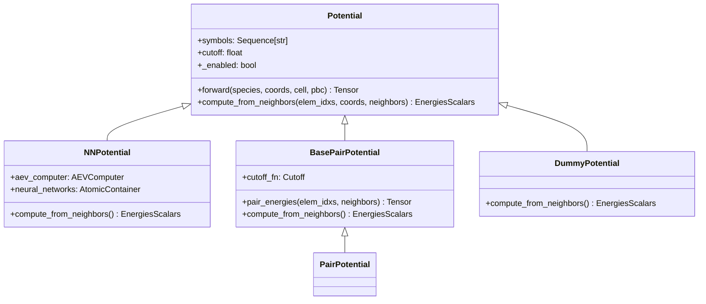
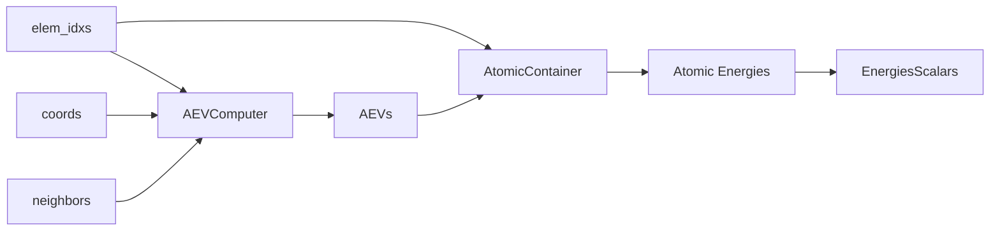
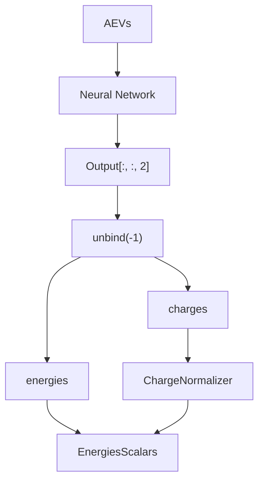
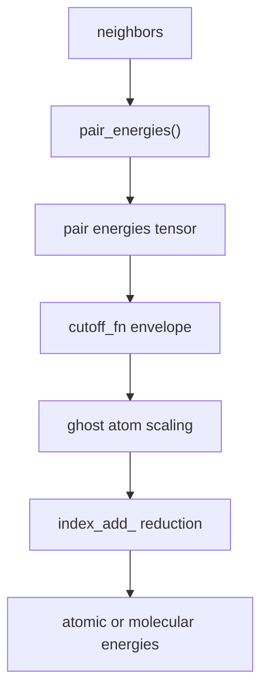
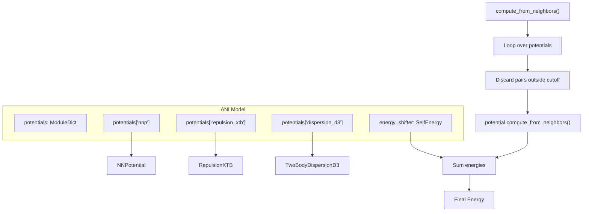
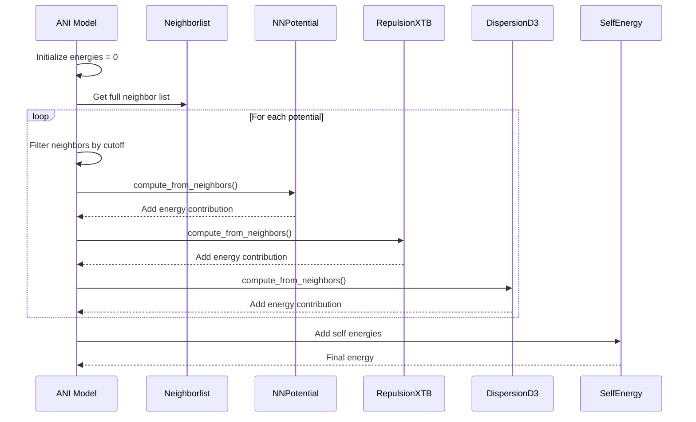
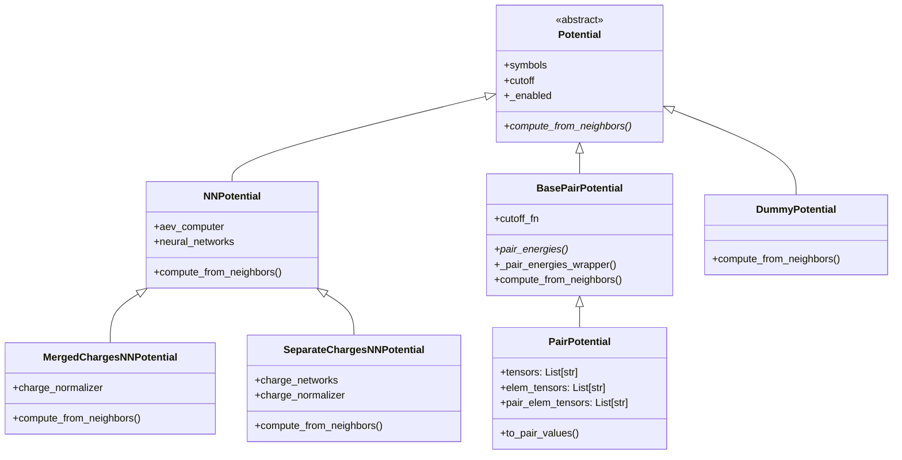

# Potentials System

<details>
<summary>Relevant source files</summary>

The following files were used as context for generating this wiki page:

- [torchani/arch.py](torchani/arch.py)
- [torchani/electro.py](torchani/electro.py)
- [torchani/nn/__init__.py](torchani/nn/__init__.py)
- [torchani/nn/_containers.py](torchani/nn/_containers.py)
- [torchani/nn/_core.py](torchani/nn/_core.py)
- [torchani/nn/_infer.py](torchani/nn/_infer.py)
- [torchani/nn/_internal.py](torchani/nn/_internal.py)
- [torchani/potentials/core.py](torchani/potentials/core.py)
- [torchani/potentials/nnp.py](torchani/potentials/nnp.py)

</details>


## Purpose and Scope

The Potentials System provides a unified abstraction for computing molecular energies from various sources. It defines a common interface (`Potential` base class) that allows different energy calculation methods—neural networks, pair potentials, repulsion corrections, dispersion corrections—to be composed together within ANI models. This modular design enables flexible model construction where multiple energy contributions can be combined and toggled independently.

For information about how potentials are assembled into complete models, see [Building Custom Models](#5.3). For details on the neural network components used within `NNPotential`, see [Model Architecture](#4.1).

**Sources:** [torchani/potentials/core.py:15-88](), [torchani/arch.py:81-88]()

---

## Potential Base Class

The `Potential` class is the abstract base class for all energy calculation methods in TorchANI. It defines the interface that all potentials must implement.

### Core Interface



**Key Attributes:**

| Attribute | Type | Description |
|-----------|------|-------------|
| `symbols` | `Sequence[str]` | Chemical elements supported by the potential |
| `cutoff` | `float` | Interaction cutoff distance in Ångströms |
| `_enabled` | `bool` | Whether the potential is active in energy calculations |

**Key Methods:**

| Method | Purpose |
|--------|---------|
| `forward()` | High-level energy computation from species and coordinates |
| `compute_from_neighbors()` | Core method that computes energies given a `Neighbors` object |

The `compute_from_neighbors()` method is the primary interface that all subclasses must implement. It receives precomputed neighbor information and returns an `EnergiesScalars` tuple containing energies and optionally other scalar quantities like charges.

**Sources:** [torchani/potentials/core.py:15-88](), [torchani/_core.py:1-30]()

---

## Neural Network Potentials

### NNPotential

`NNPotential` is the primary potential type that wraps an `AEVComputer` and an `AtomicContainer` (neural networks) to compute energies through the standard ANI workflow: compute AEVs, then pass them through element-specific neural networks.



**Constructor:**
- `aev_computer`: An `AEVComputer` instance for computing atomic environment vectors
- `neural_networks`: An `AtomicContainer` (e.g., `ANINetworks` or `Ensemble`) that predicts atomic energies from AEVs

The cutoff is inherited from the radial cutoff of the `AEVComputer`.

**Sources:** [torchani/potentials/nnp.py:14-32]()

### MergedChargesNNPotential

For ANIq-style models where neural networks output both energies and charges in a single tensor with shape `(molecules, atoms, 2)`, where `[:, :, 0]` contains energies and `[:, :, 1]` contains charges.



**Additional Component:**
- `charge_normalizer`: A `ChargeNormalizer` instance that ensures predicted charges sum to the total molecular charge

**Sources:** [torchani/potentials/nnp.py:38-72]()

### SeparateChargesNNPotential

For ANIq-style models with separate neural networks for energy and charge prediction.

**Constructor:**
- `aev_computer`: AEV computation
- `neural_networks`: Networks for energy prediction
- `charge_networks`: Separate networks for charge prediction
- `charge_normalizer`: Optional normalizer for charges

Both network containers receive the same AEVs but produce different outputs. The energy networks produce atomic energies, while charge networks produce atomic charges.

**Sources:** [torchani/potentials/nnp.py:75-102]()

---

## Pair Potentials

### BasePairPotential

Base class for all pairwise (two-body) potentials. It provides the framework for computing energies from atom pairs and handles cutoff function application automatically.



**Key Features:**

| Feature | Description |
|---------|-------------|
| `cutoff_fn` | Smooth cutoff function applied to all pair interactions |
| `pair_energies()` | Abstract method returning per-pair energies (must be implemented) |
| `_pair_energies_wrapper()` | Applies cutoff and ghost atom scaling |
| `compute_from_neighbors()` | Reduces pair energies to atomic/molecular totals |

The `compute_from_neighbors()` implementation handles the reduction from pair energies to atomic or molecular energies using `index_add_`, ensuring each pair contribution is split equally between the two atoms when `atomic=True`.

**Sources:** [torchani/potentials/core.py:106-207]()

### PairPotential

User-friendly base class for implementing custom pair potentials. Subclasses only need to:
1. Declare parameter categories as class attributes
2. Implement the `pair_energies()` method

**Parameter Categories:**

| Category | Shape | Description |
|----------|-------|-------------|
| `tensors` | Arbitrary | General tensors (vectors or scalars) |
| `elem_tensors` | `(num_species,)` | Element-specific parameters |
| `pair_elem_tensors` | `(num_species*(num_species+1)/2,)` | Pair-specific parameters (upper triangle) |

**Example Structure:**

```python
class CustomPairPotential(PairPotential):
    # Declare parameter categories
    elem_tensors = ['electronegativity']
    pair_elem_tensors = ['k', 'r_eq']
    
    def pair_energies(self, elem_idxs, neighbors):
        # Access pair-specific parameters
        k = self.to_pair_values(self.k, elem_pairs)
        # Compute energies from neighbors.distances
        return energy_tensor
```

The `PairPotential.__init__()` automatically registers parameters as either `nn.Parameter` (if trainable) or buffers, and converts pair parameters from upper-triangular format to symmetric matrices.

**Sources:** [torchani/potentials/core.py:222-304]()

---

## Integration with ANI Models

ANI models (`ANI` and `ANIq` classes) maintain a `ModuleDict` of potentials that are composed together during energy calculation.

### Potential Storage and Composition



**Key Design Points:**

1. **Required Potential:** The `"nnp"` key always contains a `NNPotential` (or variant for ANIq)
2. **Additional Potentials:** Other keys hold optional potentials (repulsion, dispersion, etc.)
3. **Global Cutoff:** The model's cutoff is `max(p.cutoff for p in potentials.values())`
4. **Enable/Disable:** Each potential has an `_enabled` flag that can be toggled via `set_enabled()`

**Sources:** [torchani/arch.py:104-131](), [torchani/arch.py:404-418]()

### Energy Computation Flow

The `ANI.compute_from_neighbors()` method orchestrates energy calculation across all potentials:



Each potential receives a potentially different neighbor list, filtered to include only pairs within that potential's cutoff. This allows different potentials to use different interaction ranges efficiently.

**Sources:** [torchani/arch.py:387-418](), [torchani/arch.py:659-695]()

---

## Custom Potential Implementation

### Creating a Pair Potential

To create a custom pair potential, subclass `PairPotential` and implement `pair_energies()`:

**Step 1: Define parameter categories**
```python
class LennardJones(PairPotential):
    pair_elem_tensors = ["epsilon", "sigma"]
```

**Step 2: Implement pair_energies()**
```python
def pair_energies(self, elem_idxs, neighbors):
    elem_pairs = elem_idxs.view(-1)[neighbors.indices]
    eps = self.to_pair_values(self.epsilon, elem_pairs)
    sig = self.to_pair_values(self.sigma, elem_pairs)
    r = neighbors.distances
    return 4 * eps * ((sig/r)**12 - (sig/r)**6)
```

**Step 3: Instantiate with parameters**
```python
# Parameters in upper-triangular order: HH, HC, HN, CC, CN, NN
epsilon = [0.044, 0.057, 0.056, 0.105, 0.073, 0.069]
sigma = [2.65, 3.03, 3.04, 3.40, 3.22, 3.26]

pot = LennardJones(
    symbols=["H", "C", "N"],
    epsilon=epsilon,
    sigma=sigma,
    cutoff=10.0,
    cutoff_fn="smooth"
)
```

**Sources:** [torchani/potentials/core.py:222-304]()

### Creating a Many-Body Potential

For potentials that are not pairwise (e.g., three-body or ML-based), subclass `Potential` directly:

```python
class CustomPotential(Potential):
    def __init__(self, symbols, cutoff=5.0):
        super().__init__(symbols, cutoff=cutoff)
        # Initialize custom components
    
    def compute_from_neighbors(
        self, elem_idxs, coords, neighbors,
        charge=0, atomic=False, ensemble_values=False,
        ghost_flags=None
    ):
        # Custom energy computation
        energies = compute_custom_energy(coords, neighbors)
        return EnergiesScalars(energies)
```

**Sources:** [torchani/potentials/core.py:15-88]()

### Adding Potentials to Models

Use the `Assembler.add_potential()` method when building models:

```python
from torchani.arch import Assembler
from torchani.potentials import RepulsionXTB

assembler = Assembler(symbols=["H", "C", "N", "O"])
assembler.set_aev_computer(...)
assembler.set_atomic_networks(...)

# Add repulsion potential
assembler.add_potential(
    cls=RepulsionXTB,
    name="repulsion_xtb",
    cutoff=5.0,
    cutoff_fn="smooth"
)

model = assembler.assemble()
```

**Sources:** [torchani/arch.py:930-945](), [torchani/arch.py:962-1004]()

---

## Potential Hierarchy Reference



**Class Locations:**

| Class | File |
|-------|------|
| `Potential` | [torchani/potentials/core.py:15-88]() |
| `NNPotential` | [torchani/potentials/nnp.py:14-32]() |
| `MergedChargesNNPotential` | [torchani/potentials/nnp.py:38-72]() |
| `SeparateChargesNNPotential` | [torchani/potentials/nnp.py:75-102]() |
| `BasePairPotential` | [torchani/potentials/core.py:106-207]() |
| `PairPotential` | [torchani/potentials/core.py:222-304]() |
| `DummyPotential` | [torchani/potentials/core.py:90-103]() |

**Sources:** [torchani/potentials/core.py:1-304](), [torchani/potentials/nnp.py:1-103]()

---