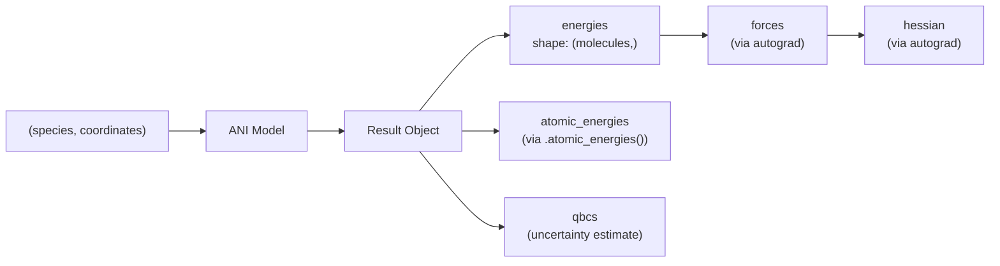
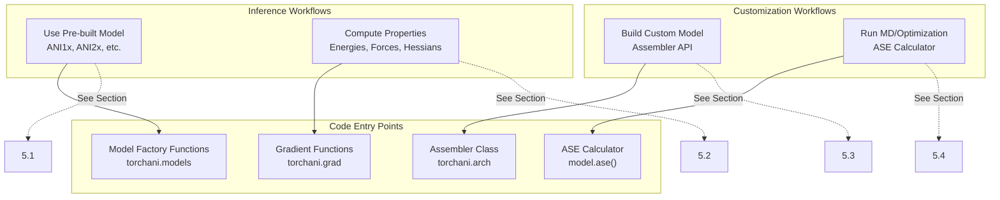
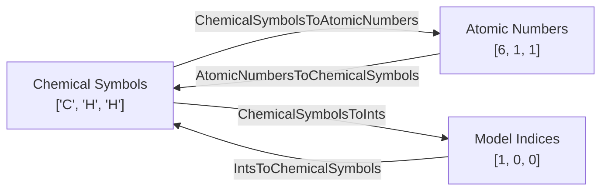
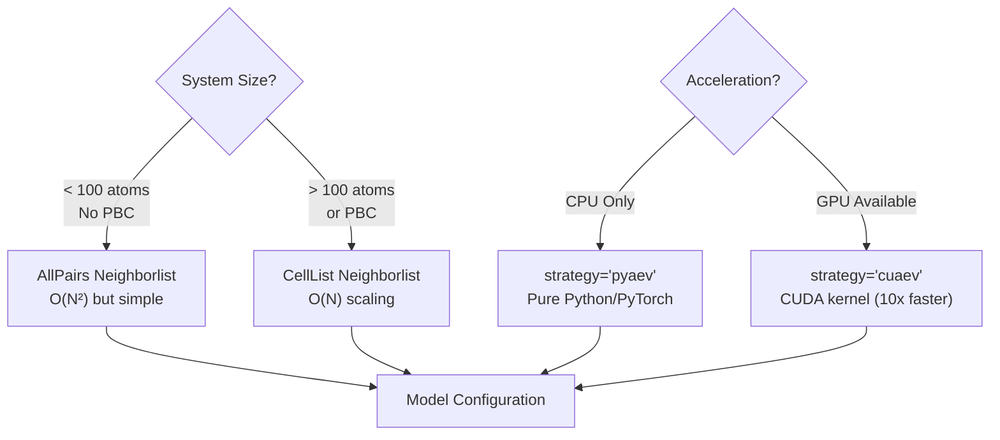

# User Guide

<details>
<summary>Relevant source files</summary>

The following files were used as context for generating this wiki page:

- [tests/test_aev.py](tests/test_aev.py)
- [tests/test_energies.py](tests/test_energies.py)
- [tests/test_ensemble.py](tests/test_ensemble.py)
- [tests/test_forces.py](tests/test_forces.py)
- [torchani/models.py](torchani/models.py)
- [torchani/utils.py](torchani/utils.py)

</details>


This document provides practical guidance for common TorchANI workflows. It covers the essential patterns for using pre-built models, computing molecular properties, building custom models, and integrating with external tools like ASE.

**Scope**: This page introduces the core usage patterns and data formats. For detailed instructions on specific tasks:
- Pre-built model usage → [Using Pre-built Models](#5.1)
- Energy/force calculations → [Energy and Force Calculations](#5.2)
- Custom model construction → [Building Custom Models](#5.3)
- Molecular dynamics and optimization → [ASE Integration](#5.4)

For training new models, see [Training](#7). For architectural details, see [Core Concepts](#4).

---

## Input Data Format

All TorchANI models expect molecular structures in a standardized format. The primary inputs are:

| Tensor | Shape | Type | Description |
|--------|-------|------|-------------|
| `species` | `(molecules, atoms)` | `torch.long` | Atomic identifiers (element indices or atomic numbers) |
| `coordinates` | `(molecules, atoms, 3)` | `torch.float` | Cartesian coordinates in Angstroms |
| `cell` (optional) | `(3, 3)` | `torch.float` | Unit cell vectors for periodic systems |
| `pbc` (optional) | `(3,)` | `torch.bool` | Periodic boundary condition flags (x, y, z) |

**Species Representation**: TorchANI supports two indexing schemes controlled by the `periodic_table_index` parameter:
- `periodic_table_index=True` (default): Species are atomic numbers (H=1, C=6, N=7, O=8, etc.)
- `periodic_table_index=False`: Species are model-specific indices (e.g., H=0, C=1, N=2, O=3 for ANI-1x)

```python
import torch
from torchani.models import ANI2x

# Example: Water molecule
species = torch.tensor([[8, 1, 1]])  # O, H, H (using atomic numbers)
coordinates = torch.tensor([[[0.0, 0.0, 0.0],
                              [0.0, 0.0, 1.0],
                              [0.0, 1.0, 0.0]]])

model = ANI2x(periodic_table_index=True)
result = model((species, coordinates))
print(f"Energy: {result.energies} Hartree")
```

**Sources**: [torchani/models.py:1-62](), [tests/test_energies.py:1-165]()

---

## Model Outputs

TorchANI models return structured output objects that provide access to various computed properties:



**Primary Output Types**:

1. **Total Energies**: `result.energies` — Molecular energies in Hartree
2. **Atomic Energies**: `model.atomic_energies((species, coords)).energies` — Per-atom contributions
3. **Ensemble Values**: `model((species, coords), ensemble_values=True).energies` — Individual network predictions (shape: `(ensemble_size, molecules)`)
4. **QBC Factors**: `model.energies_qbcs((species, coords))` — Query-by-committee uncertainty estimates for active learning

**Sources**: [torchani/models.py:23-62](), [tests/test_ensemble.py:1-42]()

---

## Common Workflows

The following diagram maps typical user goals to the relevant subsections and key code components:



**Sources**: [torchani/models.py:1-486](), [torchani/arch.py](), [torchani/grad.py]()

---

## Quick Start Examples

### Loading a Pre-built Model

```python
from torchani.models import ANI2x

# Load full ensemble (8 networks)
model = ANI2x()

# Load single network from ensemble
model_single = ANI2x(model_index=0)

# Configure neighborlist and device
model = ANI2x(
    neighborlist="cell_list",  # Efficient for large/periodic systems
    device="cuda",
    dtype=torch.float32
)
```

**Available Models**: `ANI1x`, `ANI1ccx`, `ANI2x`, `ANI2xr`, `ANI2dr`, `ANImbis`

**Sources**: [torchani/models.py:92-200]()

---

### Computing Energies

```python
import torch
from torchani.models import ANI1x

model = ANI1x(model_index=0)

# Single molecule
species = torch.tensor([[6, 1, 1, 1, 1]])  # CH4 (atomic numbers)
coords = torch.tensor([[[0.0, 0.0, 0.0],
                         [0.6, 0.6, 0.6],
                         [-0.6, -0.6, 0.6],
                         [-0.6, 0.6, -0.6],
                         [0.6, -0.6, -0.6]]])

result = model((species, coords))
energy = result.energies  # Shape: (1,) in Hartree
```

**Batch Processing**: Models handle batched inputs automatically. Use [torchani.utils.pad_atomic_properties]() to combine molecules with different atom counts.

**Sources**: [tests/test_energies.py:119-161](), [torchani/utils.py:174-221]()

---

### Computing Forces

```python
from torchani.grad import energies_and_forces

# Coordinates must require gradients for force calculation
coords = torch.tensor([[[0.0, 0.0, 0.0],
                         [0.0, 0.0, 1.0],
                         [0.0, 1.0, 0.0]]], requires_grad=True)
species = torch.tensor([[8, 1, 1]])

energies, forces = energies_and_forces(model, species, coords)
# energies: (molecules,)
# forces: (molecules, atoms, 3) in Hartree/Angstrom
```

**Alternative Manual Approach**:
```python
coords.requires_grad_(True)
energies = model((species, coords)).energies
forces = -torch.autograd.grad(energies.sum(), coords)[0]
```

**Sources**: [torchani/grad.py](), [tests/test_forces.py:1-60]()

---

### Working with Periodic Systems

```python
# Define cubic cell (10 Angstrom box)
cell = torch.eye(3) * 10.0
pbc = torch.tensor([True, True, True])  # Periodic in all directions

species = torch.tensor([[14, 14, 14, 14]])  # Si crystal
coords = torch.tensor([[[0.0, 0.0, 0.0],
                         [2.5, 2.5, 0.0],
                         [2.5, 0.0, 2.5],
                         [0.0, 2.5, 2.5]]])

result = model((species, coords), cell=cell, pbc=pbc)
```

**Cell Format**: `cell[i]` is the i-th lattice vector. Atoms are automatically wrapped into the unit cell during neighborlist construction.

**Sources**: [torchani/utils.py:238-264](), [tests/test_aev.py:234-333]()

---

## Species Conversion Utilities

TorchANI provides utilities to convert between different species representations:



**Example Usage**:

```python
from torchani.utils import ChemicalSymbolsToInts, IntsToChemicalSymbols

# Convert symbols to model-specific indices
symbols_to_ints = ChemicalSymbolsToInts(['H', 'C', 'N', 'O'])
indices = symbols_to_ints(['C', 'H', 'H', 'H', 'H'])  # [1, 0, 0, 0, 0]

# Convert back to symbols
ints_to_symbols = IntsToChemicalSymbols(['H', 'C', 'N', 'O'])
symbols = ints_to_symbols(indices)  # ['C', 'H', 'H', 'H', 'H']
```

**Sources**: [torchani/utils.py:266-412]()

---

## Error Handling

Common issues and their solutions:

| Issue | Symptom | Solution |
|-------|---------|----------|
| Unsupported element | `ValueError` when converting species | Check that all elements are in the model's supported set (e.g., HCNO for ANI-1x) |
| Shape mismatch | `AssertionError` | Ensure `species.shape[1] == coordinates.shape[1]` |
| Missing gradients | `None` from `autograd.grad` | Set `coordinates.requires_grad_(True)` before computing energies |
| Index out of bounds | `RuntimeError` in neural network | Verify species indices are within `[0, num_species)` |

**Sources**: [tests/test_energies.py:71-117]()

---

## Model State and Persistence

Models can be saved and loaded using standard PyTorch mechanisms:

```python
# Save model state
torch.save(model.state_dict(), 'model.pt')

# Load into new model instance
model_new = ANI2x(model_index=0)
model_new.load_state_dict(torch.load('model.pt', weights_only=True))
model_new.eval()
```

**Ensemble State Dicts**: Pre-built ensemble models contain weights for all networks. Individual networks can be extracted via indexing before or after loading.

**Sources**: [torchani/models.py:121-126](), [torchani/utils.py:484-516]()

---

## Performance Considerations



**Optimization Flags**:

```python
# Example: Large periodic system with GPU acceleration
model = ANI2x(
    neighborlist="cell_list",      # O(N) for large systems
    strategy="cuaev",               # CUDA-accelerated AEV
    device="cuda",
    dtype=torch.float32             # Single precision for speed
)

# For inference only (no training)
model.requires_grad_(False)
model = torch.jit.script(model)    # JIT compilation
```

For detailed performance tuning, see [Performance Optimization](#8.1).

**Sources**: [torchani/models.py:92-99](), [torchani/neighbors.py]()

---

## Next Steps

This page introduced the fundamental usage patterns. Proceed to the subsections for detailed guides:

1. **[Using Pre-built Models](#5.1)**: Comprehensive guide to all available models, their supported elements, training levels of theory, and special features
2. **[Energy and Force Calculations](#5.2)**: Advanced gradient computations including Hessians, vibrational analysis, and stress tensors
3. **[Building Custom Models](#5.3)**: Step-by-step Assembler API usage for creating custom neural network potentials
4. **[ASE Integration](#5.4)**: Molecular dynamics simulations, geometry optimizations, and property calculations via the ASE interface

For training workflows, see [Training](#7). For dataset management, see [Datasets](#6).

**Sources**: [torchani/models.py:1-486](), [torchani/arch.py](), [torchani/grad.py]()

---