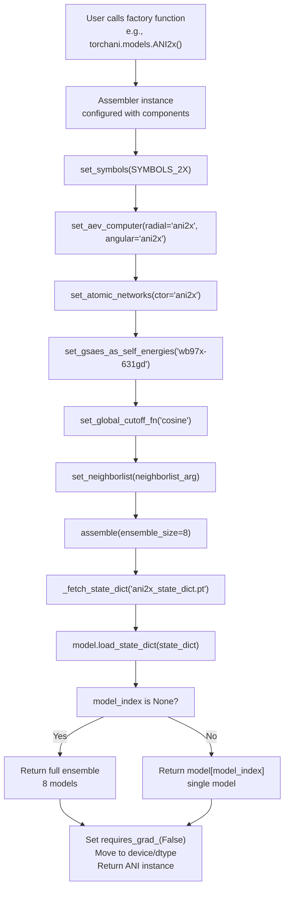
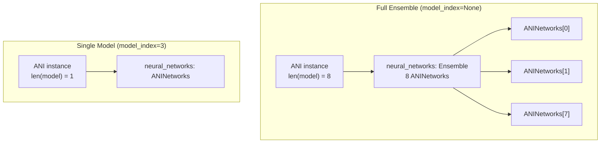
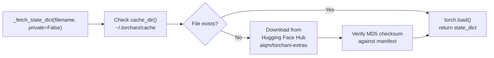
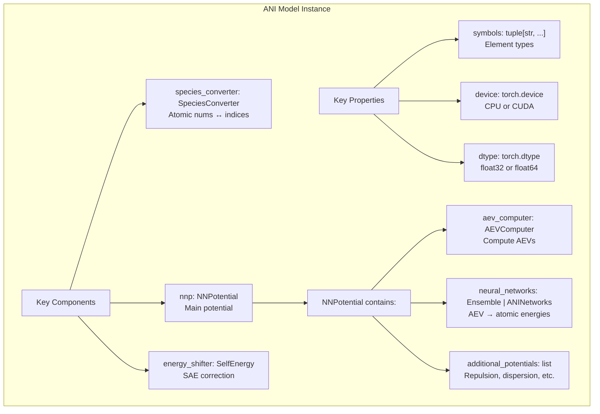

# Using Pre-built Models

<details>
<summary>Relevant source files</summary>

The following files were used as context for generating this wiki page:

- [examples/fundamentals.py](examples/fundamentals.py)
- [torchani/__init__.py](torchani/__init__.py)
- [torchani/models.py](torchani/models.py)
- [torchani/neurochem.py](torchani/neurochem.py)
- [torchani/utils.py](torchani/utils.py)

</details>


This page describes how to use TorchANI's pre-trained neural network potential models for molecular energy prediction. It covers model availability, instantiation, configuration options, and basic usage patterns.

For information about computing forces, Hessians, and other molecular properties with these models, see [Energy and Force Calculations](#5.2). For building custom models from scratch, see [Building Custom Models](#5.3). For using these models with ASE calculators, see [ASE Integration](#5.4).

## Overview

TorchANI provides factory functions in the `torchani.models` module that instantiate pre-trained ANI model variants. All models are subclasses of `torchani.arch.ANI` (or `torchani.arch.ANIq` for charge-predicting models) and are ready for inference immediately after instantiation. Model parameters are automatically downloaded and cached on first use.

**Sources:** [torchani/models.py:1-62]()

## Available Pre-built Models

The following table lists all publicly available pre-built models:

| Model | Function | Elements | Level of Theory | Ensemble Size | Notes |
|-------|----------|----------|----------------|---------------|-------|
| ANI-1x | `torchani.models.ANI1x` | H, C, N, O | wB97X/6-31G(d) | 8 | Active learning trained |
| ANI-1ccx | `torchani.models.ANI1ccx` | H, C, N, O | CCSD(T)*/CBS | 8 | Transfer learning from ANI-1x |
| ANI-2x | `torchani.models.ANI2x` | H, C, N, O, F, S, Cl | wB97X/6-31G(d) | 8 | Extended element coverage |
| ANI-2xr | `torchani.models.ANI2xr` | H, C, N, O, F, S, Cl | wB97X/6-31G(d) | 8 | Experimental: with repulsion |
| ANI-2dr | `torchani.models.ANI2dr` | H, C, N, O, F, S, Cl | B973c/def2-mTZVP | 8 | Experimental: repulsion + dispersion |
| ANImbis | `torchani.models.ANImbis` | H, C, N, O, F, S, Cl | wB97X/6-31G(d) | 8 | Experimental: predicts MBIS charges |
| SnnANI2xr | `torchani.models.SnnANI2xr` | H, C, N, O, F, S, Cl | wB97X/6-31G(d) | 8 | Experimental: single-network architecture |

Element ordering for models:
- ANI-1x/1ccx: `SYMBOLS_1X = ("H", "C", "N", "O")`
- ANI-2x variants: `SYMBOLS_2X = ("H", "C", "N", "O", "S", "F", "Cl")` (model order)
- ANI-2x variants: `SYMBOLS_2X_ZNUM_ORDER = ("H", "C", "N", "O", "F", "S", "Cl")` (atomic number order)

**Sources:** [torchani/models.py:92-468](), [torchani/utils.py:60-65]()

## Model Factory Pattern

All pre-built models follow a consistent factory pattern for instantiation:



**Sources:** [torchani/models.py:166-199](), [torchani/arch.py]() (Assembler class)

## Model Instantiation

### Basic Instantiation

```python
import torchani

# Load full ensemble (8 models)
model = torchani.models.ANI2x()

# Load single model from ensemble
model = torchani.models.ANI2x(model_index=3)
```

### Factory Function Signature

All model factory functions share the same signature:

| Parameter | Type | Default | Description |
|-----------|------|---------|-------------|
| `model_index` | `Optional[int]` | `None` | If `None`, returns full ensemble. If integer, returns that ensemble member. |
| `neighborlist` | `NeighborlistArg` | `"all_pairs"` | Neighborlist algorithm: `"all_pairs"`, `"cell_list"`, or `"adaptive"` |
| `strategy` | `str` | `"pyaev"` | AEV computation strategy: `"pyaev"`, `"cuaev"`, or `"best"` |
| `periodic_table_index` | `bool` | `True` | If `True`, species use atomic numbers. If `False`, use model-specific indexing. |
| `device` | `Device` | `None` | Target device (`"cpu"`, `"cuda"`, `torch.device`) |
| `dtype` | `DType` | `None` | Target dtype (`torch.float32`, `torch.float64`) |

**Sources:** [torchani/models.py:78-89]()

### Configuration Examples

```python
# Use CUDA and single-precision
model = torchani.models.ANI2x(device="cuda", dtype=torch.float32)

# Use cell list neighborlist for large systems
model = torchani.models.ANI2x(neighborlist="cell_list")

# Use cuAEV acceleration (requires C++ extensions)
model = torchani.models.ANI2x(strategy="cuaev", device="cuda")

# Disable periodic table indexing (use model-specific indexing)
model = torchani.models.ANI2x(periodic_table_index=False)
```

**Sources:** [torchani/models.py:92-126]()

## Ensemble vs Single Model

ANI models are ensembles of neural networks by default. The ensemble structure affects output shapes and indexing behavior:

### Ensemble Structure



### Accessing Ensemble Members

```python
# Full ensemble
model = torchani.models.ANI2x()
print(len(model))  # 8

# Index to get single member
submodel = model[3]
print(len(submodel))  # 1

# Iterate over ensemble
for i, member in enumerate(model):
    print(f"Member {i}: {member}")
```

**Sources:** [torchani/models.py:18-21](), [torchani/nn.py]() (Ensemble class)

## State Dict Loading Mechanism

Pre-built models automatically download and load trained parameters:



### State Dict Structure

State dicts contain all trainable parameters:

| Key Pattern | Description |
|-------------|-------------|
| `aev_computer.*` | AEV computation parameters (radial/angular shifts, eta, zeta) |
| `neural_networks.{i}.*` | Ensemble member `i` neural network weights and biases |
| `energy_shifter.self_energies` | Self-atomic energy values per element |
| `repulsion.*` | Repulsion potential parameters (if applicable) |
| `dispersion.*` | Dispersion potential parameters (if applicable) |

**Sources:** [torchani/arch.py]() (_fetch_state_dict function), [torchani/models.py:121-122](), [torchani/models.py:231-251]()

## Basic Inference Usage

Once instantiated, models accept batched molecular inputs:

### Input Format

```python
import torch

# Batch of 2 molecules: H2O and CH4
atomic_nums = torch.tensor([
    [8, 1, 1, -1, -1],  # Water (padded to 5 atoms)
    [6, 1, 1, 1, 1],    # Methane
])

coords = torch.tensor([
    [[0.0, 0.0, 0.0], [1.0, 0.0, 0.0], [0.0, 1.0, 0.0], [0.0, 0.0, 0.0], [0.0, 0.0, 0.0]],
    [[0.0, 0.0, 0.0], [1.0, 0.0, 0.0], [0.0, 1.0, 0.0], [0.0, 0.0, 1.0], [-1.0, 0.0, 0.0]],
])

model = torchani.models.ANI2x()

# Get energies (Hartree)
result = model((atomic_nums, coords))
energies = result.energies  # shape: (2,)
```

### Output Types

Models provide multiple entry points:

| Method | Returns | Shape | Description |
|--------|---------|-------|-------------|
| `model((species, coords))` | `SpeciesEnergies` | energies: `(molecules,)` | Ensemble-averaged energies |
| `model((species, coords), ensemble_values=True)` | `SpeciesEnergies` | energies: `(ensemble_size, molecules)` | Individual model energies |
| `model.atomic_energies((species, coords))` | `SpeciesEnergies` | energies: `(molecules, atoms)` | Ensemble-averaged atomic energies |
| `model.energies_qbcs((species, coords))` | `EnergiesQBCs` | energies: `(molecules,)`, qbcs: `(molecules,)` | Energies + QBC uncertainty |

**Sources:** [torchani/models.py:31-58](), [examples/fundamentals.py:71-92]()

## Periodic Boundary Conditions

Models support periodic boundary conditions (PBC) via optional `cell` and `pbc` parameters:

```python
# Cubic cell: 10 Å × 10 Å × 10 Å
cell = torch.eye(3) * 10.0

# Enable PBC in all dimensions
pbc = torch.tensor([True, True, True])

result = model((atomic_nums, coords), cell=cell, pbc=pbc)
```

For PBC calculations, use `neighborlist="cell_list"` or `neighborlist="adaptive"` for efficiency.

**Sources:** [torchani/models.py:25-27]()

## Element Support and Indexing

### Periodic Table Indexing (Default)

When `periodic_table_index=True` (default), species tensors use atomic numbers:

```python
# H=1, C=6, N=7, O=8, F=9, S=16, Cl=17
atomic_nums = torch.tensor([[6, 1, 1, 1, 1]])  # Methane

model = torchani.models.ANI2x(periodic_table_index=True)
```

### Model-Specific Indexing

When `periodic_table_index=False`, species tensors use model-defined indices:

```python
# For ANI2x: H=0, C=1, N=2, O=3, S=4, F=5, Cl=6
species_indices = torch.tensor([[1, 0, 0, 0, 0]])  # Methane

model = torchani.models.ANI2x(periodic_table_index=False)
```

Use `torchani.utils.SYMBOLS_1X` and `torchani.utils.SYMBOLS_2X` to determine index order:

```python
from torchani.utils import SYMBOLS_2X

print(SYMBOLS_2X)  # ('H', 'C', 'N', 'O', 'S', 'F', 'Cl')
# H is index 0, C is index 1, etc.
```

**Sources:** [torchani/models.py:85](), [torchani/utils.py:60-65]()

## Legacy NeuroChem Models

For backward compatibility, TorchANI supports loading models in the legacy NeuroChem format:

```python
from torchani.neurochem import load_model_from_name

# Load ANI-1x from NeuroChem format
model = load_model_from_name("ani1x", strategy="pyaev")

# Load from custom info file
model = load_model_from_info_file("path/to/model.info")
```

This is **not recommended** for new code. Use the factory functions in `torchani.models` instead.

**Sources:** [torchani/neurochem.py:1-10](), [torchani/neurochem.py:456-496]()

## Model Properties Summary



**Sources:** [torchani/arch.py]() (ANI class), [torchani/potentials.py]() (NNPotential class)

## Weight Management

### Cache Location

Model weights are downloaded to `~/.torchani/cache/` by default. This location can be customized:

```python
import os
from torchani.paths import cache_dir

# Check current cache directory
print(cache_dir())

# Override with environment variable
os.environ["TORCHANI_CACHE"] = "/custom/cache/path"
```

### Manual Pre-downloading

To pre-download weights before first use:

```python
# Simply instantiate the model once
model = torchani.models.ANI2x()
# Weights are now cached
```

For air-gapped environments, manually download state dicts from the [Hugging Face repository](https://huggingface.co/aiqm/torchani-extras) and place them in the cache directory.

**Sources:** [torchani/arch.py]() (_fetch_state_dict), [torchani/paths.py]() (cache_dir)

---