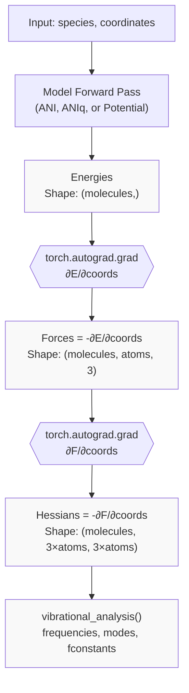
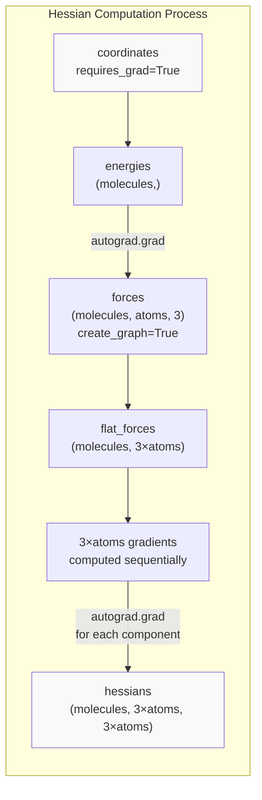
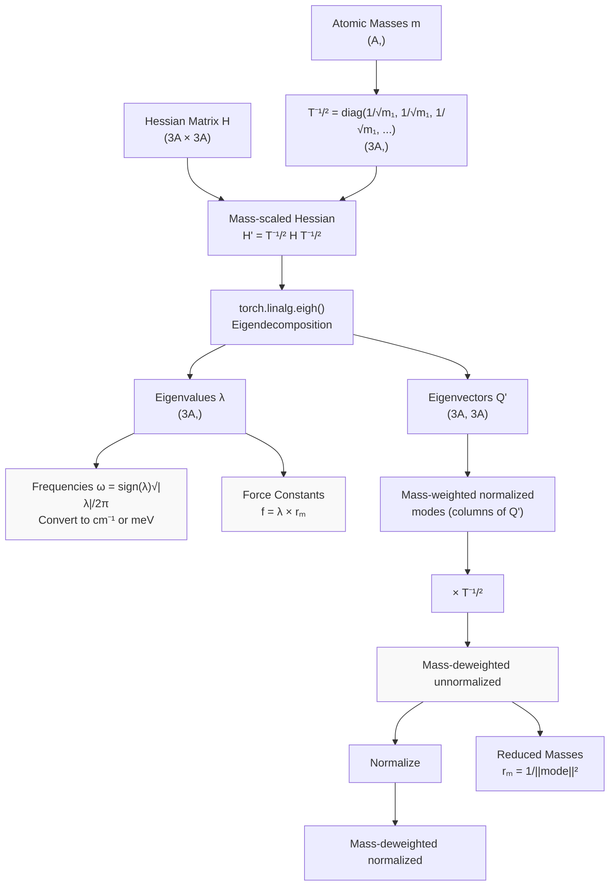
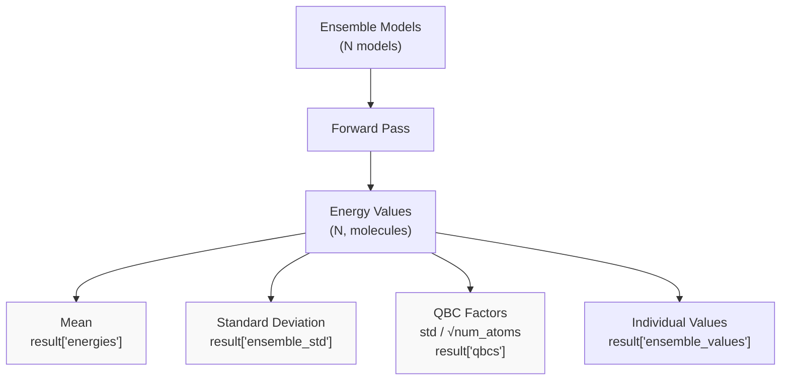
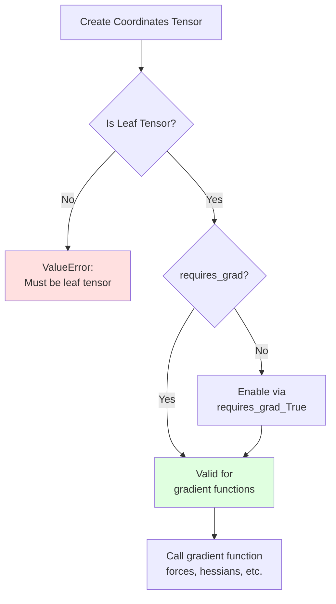

# Energy and Force Calculations

<details>
<summary>Relevant source files</summary>

The following files were used as context for generating this wiki page:

- [examples/training.py](examples/training.py)
- [tests/test_aev.py](tests/test_aev.py)
- [tests/test_energies.py](tests/test_energies.py)
- [tests/test_ensemble.py](tests/test_ensemble.py)
- [tests/test_forces.py](tests/test_forces.py)
- [torchani/grad.py](torchani/grad.py)

</details>


This page covers the computational methods for calculating molecular energies, forces (negative gradients), Hessians (second derivatives), and vibrational properties using TorchANI models. The focus is on the practical usage of gradient computation functions for inference and property calculation.

For information about loading and using pre-built models, see [Using Pre-built Models](#5.1). For training models with force matching, see [Training Workflow](#7.1). For molecular dynamics and geometry optimization, see [ASE Integration](#5.4).

## Computation Pipeline

The following diagram illustrates the flow from input coordinates to derived properties through automatic differentiation:



**Sources:** [torchani/grad.py:42-290](), [Diagram 3 from high-level architecture]()

## Basic Energy Calculation

Energy calculation is performed by calling the model directly with species and coordinates. All TorchANI models (`ANI`, `ANIq`, and `Potential` objects) return energies in Hartree units.

**Basic Usage:**
```python
import torch
from torchani.models import ANI2x

# Load model
model = ANI2x()

# Prepare inputs (atomic numbers and coordinates in Angstroms)
species = torch.tensor([[1, 6, 1, 1, 1]])  # CH4
coordinates = torch.randn(1, 5, 3)  # Random coordinates

# Compute energies
output = model((species, coordinates))
energies = output.energies  # Shape: (1,) in Hartree
```

For models inheriting from `ANI` or `ANIq`, the forward pass returns a `SpeciesEnergies` or `SpeciesEnergiesCharges` object. The energies can be accessed via the `.energies` attribute.

**Sources:** [tests/test_energies.py:14-42](), [torchani/grad.py:279-282]()

## Computing Forces

Forces are computed as the negative gradient of energy with respect to coordinates using PyTorch's automatic differentiation. TorchANI provides several convenience functions in the `torchani.grad` module.

### The `energies_and_forces` Function

The primary function for computing both energies and forces is `energies_and_forces`:

```python
from torchani.grad import energies_and_forces

# Coordinates must be a leaf tensor (not modified from another tensor)
coordinates = torch.randn(1, 5, 3, requires_grad=True)

# Compute energies and forces simultaneously
energies, forces = energies_and_forces(model, species, coordinates)
# energies: Shape (1,)
# forces: Shape (1, 5, 3)
```

This function:
1. Temporarily enables `requires_grad` on coordinates if not already enabled
2. Performs the forward pass to get energies
3. Computes gradients using `torch.autograd.grad`
4. Negates gradients to get forces
5. Restores the original `requires_grad` state

**Sources:** [torchani/grad.py:263-290](), [tests/test_forces.py:20-30]()

### Function Options

The `torchani.grad` module provides several related functions:

| Function | Purpose | Typical Use Case |
|----------|---------|------------------|
| `energies_and_forces()` | Compute energies and forces | General inference |
| `forces()` | Compute forces from energies | When energies already computed |
| `forces_for_training()` | Forces with graph retention | Training with force matching |
| `grads()` | Positive gradients (∂E/∂coords) | Custom gradient analysis |

**Graph Management:**

The `retain_graph` and `create_graph` parameters control automatic differentiation behavior:

- `retain_graph=True`: Keeps the computational graph for multiple backward passes
- `create_graph=True`: Creates a graph for the gradients themselves (needed for Hessians)

**Sources:** [torchani/grad.py:42-84]()

### Forces for Training

When training with force matching, use `forces_for_training`, which automatically sets both `retain_graph=True` and `create_graph=True`:

```python
from torchani.grad import forces_for_training

# In training loop
coordinates.requires_grad_(True)
output = model((species, coordinates))
predicted_energies = output.energies

# Compute forces for backpropagation
predicted_forces = forces_for_training(predicted_energies, coordinates)

# Both energy and force loss can now be backpropagated
energy_loss = mse_loss(predicted_energies, target_energies)
force_loss = mse_loss(predicted_forces, target_forces)
total_loss = energy_loss + force_coefficient * force_loss
total_loss.backward()
```

**Sources:** [torchani/grad.py:82-83](), [examples/training.py:169-178]()

### Important Requirements

Coordinates passed to gradient functions must satisfy two conditions:

1. **Must be a leaf tensor**: The tensor cannot be the result of operations on other tensors
2. **Must require gradients**: Either created with `requires_grad=True` or enabled via `.requires_grad_(True)`

```python
# CORRECT: Leaf tensor
coords = torch.randn(1, 5, 3, requires_grad=True)

# INCORRECT: Not a leaf (result of operation)
coords = torch.randn(1, 5, 3) + 0.0  # This creates a non-leaf tensor
coords.requires_grad_(True)  # Will raise ValueError in grad functions
```

**Sources:** [torchani/grad.py:48-56](), [torchani/grad.py:113-121]()

## Computing Hessians

Hessians (second derivatives of energy with respect to coordinates) are computed by taking gradients of forces. The shape is `(molecules, 3×atoms, 3×atoms)`, representing the full matrix of second derivatives.



**Sources:** [torchani/grad.py:108-145]()

### Using `hessians` Function

The `hessians` function takes forces as input (not energies):

```python
from torchani.grad import forces, hessians

coordinates = torch.randn(1, 5, 3, requires_grad=True)

# First compute forces with create_graph=True
forces_tensor = forces(energies, coordinates, create_graph=True, retain_graph=True)

# Then compute hessians from forces
hessians_tensor = hessians(forces_tensor, coordinates)
# Shape: (1, 15, 15) for 5 atoms (3×5 = 15 components)
```

**Sources:** [torchani/grad.py:108-145]()

### Convenience Functions

For computing multiple properties at once, use the convenience functions:

```python
from torchani.grad import (
    forces_and_hessians,
    energies_forces_and_hessians,
)

# Compute forces and hessians from energies
forces, hessians = forces_and_hessians(energies, coordinates)

# Compute everything at once
energies, forces, hessians = energies_forces_and_hessians(
    model, species, coordinates
)
```

**Sources:** [torchani/grad.py:86-105](), [torchani/grad.py:239-260]()

### Implementation Details

The Hessian computation iterates over each component of the flattened force vector:

1. Forces are reshaped from `(molecules, atoms, 3)` to `(molecules, 3×atoms)`
2. Each of the `3×atoms` components is processed sequentially
3. For each component, `torch.autograd.grad` computes derivatives w.r.t. all coordinates
4. Results are concatenated to form the full Hessian matrix
5. The final result is negated (since forces are negative gradients)

**Sources:** [torchani/grad.py:122-142]()

## Vibrational Analysis

The `vibrational_analysis` function computes vibrational frequencies and normal modes from the Hessian matrix. This is useful for characterizing stationary points and computing thermodynamic properties.

### Basic Usage

```python
from torchani.grad import vibrational_analysis

# masses: Shape (1, atoms) in atomic mass units (AMU)
masses = torch.tensor([[1.008, 12.011, 1.008, 1.008, 1.008]])  # CH4

# hessian: Shape (1, 3×atoms, 3×atoms) 
# Compute from energies_forces_and_hessians as shown above

# Perform vibrational analysis
vib_result = vibrational_analysis(
    masses=masses,
    hessian=hessian,
    mode_kind="mdu",  # Mass-deweighted unnormalized
    unit="cm^-1"      # Wavenumbers in cm⁻¹
)

# Access results
frequencies = vib_result.frequencies  # Shape: (3×atoms,) in cm⁻¹
modes = vib_result.modes              # Shape: (3×atoms, atoms, 3)
fconstants = vib_result.fconstants    # Force constants in mDyne/Å
rmasses = vib_result.rmasses          # Reduced masses in AMU
```

**Sources:** [torchani/grad.py:152-236]()

### Normal Mode Types

The `mode_kind` parameter controls the normalization and mass-weighting of normal modes:

| Mode Kind | Description | Properties | Typical Use |
|-----------|-------------|------------|-------------|
| `"mwn"` | Mass-weighted normalized | Orthonormal in mass-weighted coords | Theoretical analysis |
| `"mdu"` | Mass-deweighted unnormalized | Not orthogonal, not normalized | ASE compatibility |
| `"mdn"` | Mass-deweighted normalized | Not orthogonal, normalized | Gaussian/ORCA compatibility |

**Coordinate Systems:**
- Mass-weighted coordinates: `x' = √m × x`
- Mass-deweighted coordinates: Standard Cartesian coordinates

**Sources:** [torchani/grad.py:156-174]()

### Frequency Units

Two unit systems are supported via the `unit` parameter:

- `"cm^-1"`: Wavenumbers in inverse centimeters (default, most common in spectroscopy)
- `"meV"`: Millielectron volts (common in condensed matter physics)

**Imaginary Frequencies:**

Imaginary frequencies (indicating saddle points or transition states) are output as negative numbers. Very small positive or negative frequencies typically correspond to translational and rotational modes.

**Sources:** [torchani/grad.py:176-186]()

### Computational Method

The vibrational analysis uses Löwdin diagonalization to solve the mass-weighted eigenvalue problem:



**Algorithm Steps:**
1. Construct mass-weighted Hessian: `H' = T^(-1/2) H T^(-1/2)` where `T = diag(m₁, m₁, m₁, m₂, ...)`
2. Solve eigenvalue problem: `H' q' = λ q'`
3. Convert mass-weighted modes to desired normalization
4. Compute frequencies from eigenvalues: `ω = √|λ|` with sign preservation
5. Calculate reduced masses and force constants

**Sources:** [torchani/grad.py:188-230]()

## The Single Point Interface

The `single_point` function provides a unified interface for computing multiple properties in one call. It is the recommended high-level interface for comprehensive calculations.

### Function Signature and Options

```python
from torchani.grad import single_point

result = single_point(
    model,                    # ANI or ANIq model
    species,                  # Atomic numbers
    coordinates,              # Atomic coordinates
    cell=None,                # Unit cell for PBC
    pbc=None,                 # Periodic boundary conditions
    charge=0,                 # Molecular charge (only 0 supported)
    forces=True,              # Compute forces
    hessians=False,           # Compute Hessians
    atomic_energies=False,    # Atomic decomposition
    atomic_charges=False,     # Compute atomic charges (ANIq only)
    atomic_charges_grad=False,# Gradients of charges (ANIq only)
    ensemble_values=False,    # Differentiate ensemble members
    keep_vars=False,          # Keep computation graph
)
```

**Sources:** [torchani/grad.py:293-399]()

### Return Value Structure

The function returns a dictionary with the following possible keys:

| Key | Shape | Condition | Description |
|-----|-------|-----------|-------------|
| `"energies"` | `(molecules,)` | Always | Total molecular energies |
| `"forces"` | `(molecules, atoms, 3)` | `forces=True` | Negative gradients |
| `"hessians"` | `(molecules, 3×atoms, 3×atoms)` | `hessians=True` | Second derivatives |
| `"atomic_energies"` | `(molecules, atoms)` | `atomic_energies=True` | Per-atom contributions |
| `"atomic_charges"` | `(molecules, atoms)` | `atomic_charges=True` | Atomic charges (ANIq) |
| `"atomic_charges_grad"` | `(molecules, atoms, 3)` | `atomic_charges_grad=True` | Charge gradients |
| `"ensemble_values"` | `(models, molecules)` | `ensemble_values=True` | Per-model energies |
| `"ensemble_std"` | `(molecules,)` | `ensemble_values=True` | Standard deviation |
| `"qbcs"` | `(molecules,)` | `ensemble_values=True` | QBC uncertainty factors |

**Sources:** [torchani/grad.py:332-399]()

### Example: Complete Single Point Calculation

```python
from torchani.models import ANI2x
from torchani.grad import single_point
import torch

# Load ensemble model
model = ANI2x()  # Contains 8 models

species = torch.tensor([[1, 6, 1, 1, 1]])
coordinates = torch.randn(1, 5, 3)

# Comprehensive calculation
result = single_point(
    model,
    species,
    coordinates,
    forces=True,
    hessians=True,
    atomic_energies=True,
    ensemble_values=True,
)

print(f"Energy: {result['energies']}")
print(f"Forces shape: {result['forces'].shape}")
print(f"Hessian shape: {result['hessians'].shape}")
print(f"Ensemble std: {result['ensemble_std']}")
print(f"QBC factor: {result['qbcs']}")
```

**Sources:** [torchani/grad.py:293-399]()

### Ensemble Statistics

When `ensemble_values=True`, the function computes ensemble statistics across multiple models:



**QBC (Query-by-Committee) Factors:**

QBC factors provide a normalized uncertainty metric by dividing the ensemble standard deviation by the square root of the number of atoms:

```
qbc = std(ensemble_energies) / √(num_atoms)
```

This normalization makes uncertainties comparable across molecules of different sizes.

**Sources:** [torchani/grad.py:358-382]()

## Gradient Computation Requirements

### Coordinate Tensor Requirements

All gradient functions in `torchani.grad` impose strict requirements on the coordinate tensor:



**Sources:** [torchani/grad.py:48-56](), [torchani/grad.py:113-121](), [torchani/grad.py:273-278]()

### Common Errors and Solutions

**Error: "coordinates must be a leaf Tensor"**

```python
# INCORRECT: Non-leaf tensor
base = torch.randn(1, 5, 3)
coords = base + 0.0  # Creates non-leaf
coords.requires_grad_(True)
# This will raise ValueError

# CORRECT: Create as leaf
coords = torch.randn(1, 5, 3, requires_grad=True)
```

**Error: "coordinates must require grad"**

```python
# INCORRECT: No gradients enabled
coords = torch.randn(1, 5, 3)
forces(energies, coords)  # ValueError

# CORRECT: Enable gradients
coords = torch.randn(1, 5, 3, requires_grad=True)
# OR
coords.requires_grad_(True)
```

**Sources:** [torchani/grad.py:48-56]()

## Function Reference Summary

The following table summarizes all gradient computation functions in `torchani.grad`:

| Function | Input | Output | Primary Use |
|----------|-------|--------|-------------|
| `forces(energies, coords, ...)` | Energies tensor | Forces | From pre-computed energies |
| `grads(scalars, coords, ...)` | Any scalars | Positive gradients | Custom derivative analysis |
| `hessians(forces, coords, ...)` | Forces tensor | Hessian matrix | From pre-computed forces |
| `forces_for_training(energies, coords)` | Energies | Forces | Training with backprop |
| `energies_and_forces(model, species, coords, ...)` | Model inputs | Energies, forces | Standard inference |
| `forces_and_hessians(energies, coords, ...)` | Energies | Forces, Hessians | Multi-property from energies |
| `energies_forces_and_hessians(model, species, coords, ...)` | Model inputs | All three | Complete properties |
| `vibrational_analysis(masses, hessian, ...)` | Masses, Hessian | Frequencies, modes | Spectroscopy |
| `single_point(model, species, coords, ...)` | Model inputs + flags | Dictionary | Unified interface |

**Aliases:**
- `calc_forces` = `forces`
- `calc_grads` = `grads`
- `calc_hessians` = `hessians`
- `calc_forces_and_hessians` = `forces_and_hessians`

**Sources:** [torchani/grad.py:22-37](), [torchani/grad.py:42-399]()

## Performance Considerations

### Computational Cost

The computational cost of gradient calculations scales as follows:

| Property | Forward Passes | Backward Passes | Scaling |
|----------|----------------|-----------------|---------|
| Energy | 1 | 0 | O(N) |
| Forces | 1 | 1 | O(N) |
| Hessians | 1 | 1 + 3A | O(A²) |

Where N is the total computational cost of AEV + neural network, and A is the number of atoms.

**Hessian Cost:** Computing the Hessian requires 3A separate gradient computations (one for each force component), making it significantly more expensive than force calculations.

**Sources:** [torchani/grad.py:122-142]()

### Memory Management

The `retain_graph` parameter controls whether the computational graph is kept in memory:

- `retain_graph=False` (default): Graph is freed after first backward pass
- `retain_graph=True`: Graph is kept for multiple backward passes (required for Hessians)

For training with force matching, use `forces_for_training` which automatically handles graph retention.

**Sources:** [torchani/grad.py:82-83]()

### Batching

All gradient functions support batched inputs (multiple molecules). Gradient computations are performed efficiently across the batch dimension:

```python
# Multiple molecules in one batch
species = torch.tensor([[1, 1], [6, 1, 1, 1, 1], [-1, -1, -1, -1, -1]])  # Padded
coordinates = torch.randn(3, 5, 3, requires_grad=True)

energies, forces = energies_and_forces(model, species, coordinates)
# energies: (3,)
# forces: (3, 5, 3)
```

**Sources:** [tests/test_forces.py:32-55](), [tests/test_energies.py:138-160]()

---