# Building Custom Models

<details>
<summary>Relevant source files</summary>

The following files were used as context for generating this wiki page:

- [torchani/arch.py](torchani/arch.py)
- [torchani/electro.py](torchani/electro.py)
- [torchani/nn/__init__.py](torchani/nn/__init__.py)
- [torchani/nn/_containers.py](torchani/nn/_containers.py)
- [torchani/nn/_core.py](torchani/nn/_core.py)
- [torchani/nn/_infer.py](torchani/nn/_infer.py)
- [torchani/nn/_internal.py](torchani/nn/_internal.py)
- [torchani/potentials/core.py](torchani/potentials/core.py)
- [torchani/potentials/nnp.py](torchani/potentials/nnp.py)

</details>


## Purpose and Scope

This page explains how to build custom ANI-style neural network potential models using the `Assembler` class. Custom model building allows you to specify all architectural components, including element types, atomic environment vector (AEV) parameters, neural network architectures, self-energies, and additional potentials.

For using pre-trained models with fixed architectures, see [Using Pre-built Models](#5.1). For training custom models after assembly, see [Training](#7).

## Overview of the Assembler Pattern

The `Assembler` class provides a builder pattern for constructing `ANI` or `ANIq` models by configuring components step-by-step. Unlike pre-built models that load fixed architectures and weights, the Assembler creates new models from scratch with user-specified components.

**Model Assembly Workflow**

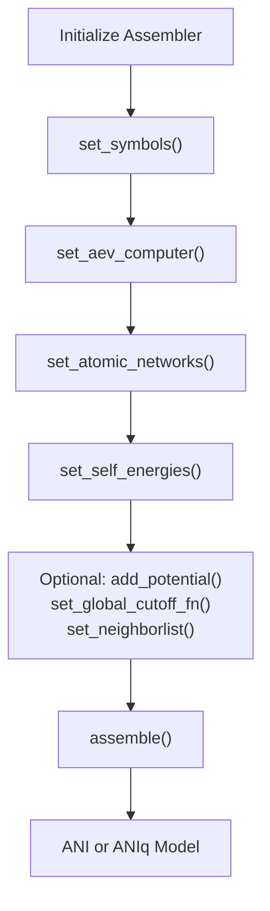

Sources: [torchani/arch.py:782-1185]()

## The Assembler Class

The `Assembler` class is defined in [torchani/arch.py:782-811]() and manages the construction of ANI-style models. It validates component compatibility and ensures all required pieces are configured before assembly.

**Key Initialization Parameters**

| Parameter | Type | Default | Description |
|-----------|------|---------|-------------|
| `symbols` | `Sequence[str]` | `()` | Element symbols (e.g., `['H', 'C', 'N', 'O']`) |
| `cls` | `ModelCls` | `ANI` | Model class to build (`ANI` or `ANIq`) |
| `neighborlist` | `NeighborlistArg` | `"all_pairs"` | Neighborlist algorithm |
| `periodic_table_index` | `bool` | `True` | Whether inputs use atomic numbers (deprecated) |

**Component Relationships**

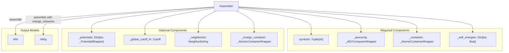

Sources: [torchani/arch.py:782-811](), [torchani/arch.py:947-1008]()

## Essential Components

### Setting Symbols

Element symbols define which atomic species the model supports. Symbols must be set before configuring other components.

**Methods:**

- `set_symbols(symbols: Sequence[str])` - Set element types [torchani/arch.py:816-817]()
- `symbols` property - Access current symbols [torchani/arch.py:813-814]()

Element order determines the internal indexing scheme used throughout the model. All subsequent component configurations must use the same element set.

Sources: [torchani/arch.py:813-817]()

### Configuring the AEV Computer

The AEV computer calculates atomic environment vectors from neighbor information. Configuration requires specifying radial and angular symmetry function parameters.

**Configuration Method**

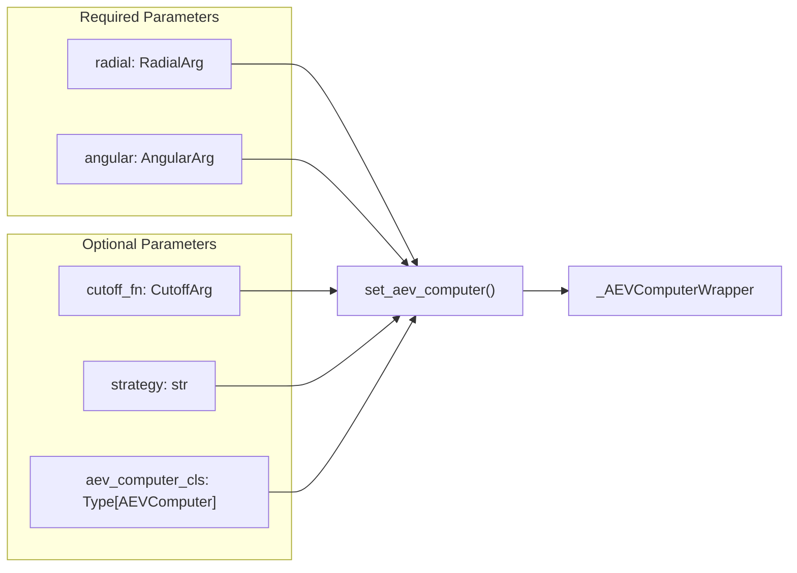

**Method Signature:** [torchani/arch.py:902-916]()

| Parameter | Type | Default | Description |
|-----------|------|---------|-------------|
| `angular` | `AngularArg` | Required | Angular symmetry function parameters |
| `radial` | `RadialArg` | Required | Radial symmetry function parameters |
| `cutoff_fn` | `CutoffArg` | `"global"` | Cutoff function (uses global if `"global"`) |
| `strategy` | `str` | `"pyaev"` | Implementation strategy (`"pyaev"` or `"cuaev"`) |
| `aev_computer_cls` | `AEVComputerCls` | `AEVComputer` | AEV computer class |

**Radial and Angular Parameters:**

Radial and angular arguments can be:
- A tuple of `(cutoff, num_basis)` for default parameters
- An `ANIRadial` or `ANIAngular` object for full control
- Parsed via `_parse_radial_term()` and `_parse_angular_term()` [torchani/aev/_terms.py]()

The angular cutoff must be ≤ radial cutoff [torchani/arch.py:756-759]().

Sources: [torchani/arch.py:743-761](), [torchani/arch.py:902-916]()

### Setting Neural Networks

Neural networks map AEV vectors to atomic energies. The Assembler wraps network configuration in `_AtomicContainerWrapper` objects.

**Configuration Method**

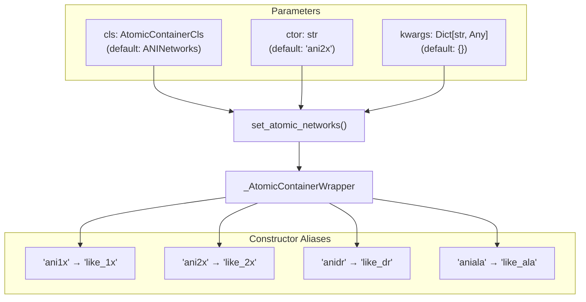

**Method Signature:** [torchani/arch.py:864-876]()

| Parameter | Type | Default | Description |
|-----------|------|---------|-------------|
| `cls` | `AtomicContainerCls` | `ANINetworks` | Container class (e.g., `ANINetworks`, `Ensemble`) |
| `ctor` | `str` | `"ani2x"` | Constructor method name or alias |
| `kwargs` | `Dict[str, Any]` | `{}` | Additional arguments passed to constructor |

**Available Container Classes:**

- `ANINetworks` - Element-specific networks [torchani/nn/_containers.py:320-571]()
- `ANISharedNetworks` - Networks with shared layers [torchani/nn/_containers.py:197-318]()
- `SingleNN` - Fully shared network [torchani/nn/_containers.py:20-195]()
- `Ensemble` - Ensemble of network containers [torchani/nn/_containers.py:573-662]()

**Network Architecture Presets:**

The `ctor` parameter accepts standard architecture names that map to class methods:

| Alias | Method | Hidden Layer Sizes (H/C/N/O/S/F/Cl) | Activation |
|-------|--------|--------------------------------------|------------|
| `"ani1x"` | `like_1x` | 160,128,96 / 144,112,96 / ... | CELU |
| `"ani2x"` | `like_2x` | 256,192,160 / 224,192,160 / ... | CELU |
| `"anidr"` | `like_dr` | 256,192,160 / 256,192,160 / ... | GELU |
| `"aniala"` | `like_ala` | 256,192,160 / 224,196,160 / ... | CELU |

Sources: [torchani/arch.py:864-882](), [torchani/nn/_containers.py:320-571]()

### Configuring Self-Energies

Self-energies (self-atomic energies, SAE) represent the energy of isolated atoms and are subtracted from atomic predictions. Three configuration methods are available:

**Self-Energy Configuration Methods**

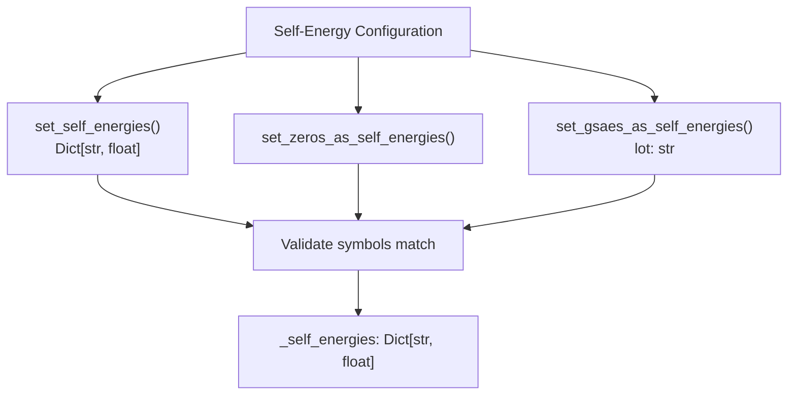

**Method Signatures:**

1. **Manual Configuration** [torchani/arch.py:825-827]():
   ```python
   set_self_energies(value: Mapping[str, float])
   ```

2. **Zero Initialization** [torchani/arch.py:829-831]():
   ```python
   set_zeros_as_self_energies()
   ```

3. **Ground State Atomic Energies (GSAES)** [torchani/arch.py:833-851]():
   ```python
   set_gsaes_as_self_energies(
       lot: str = "",
       functional: str = "",
       basis_set: str = ""
   )
   ```

The GSAES method loads pre-computed self-energies from [torchani/constants.py]() for common quantum chemistry levels of theory (e.g., `"wb97x-6-31g*"`, `"ccsd(t)-cbs"`).

Sources: [torchani/arch.py:825-851](), [torchani/constants.py]()

## Additional Components

### Adding Potentials

Additional potentials beyond the neural network can be incorporated, such as repulsion or dispersion corrections.

**Adding Potential Method**

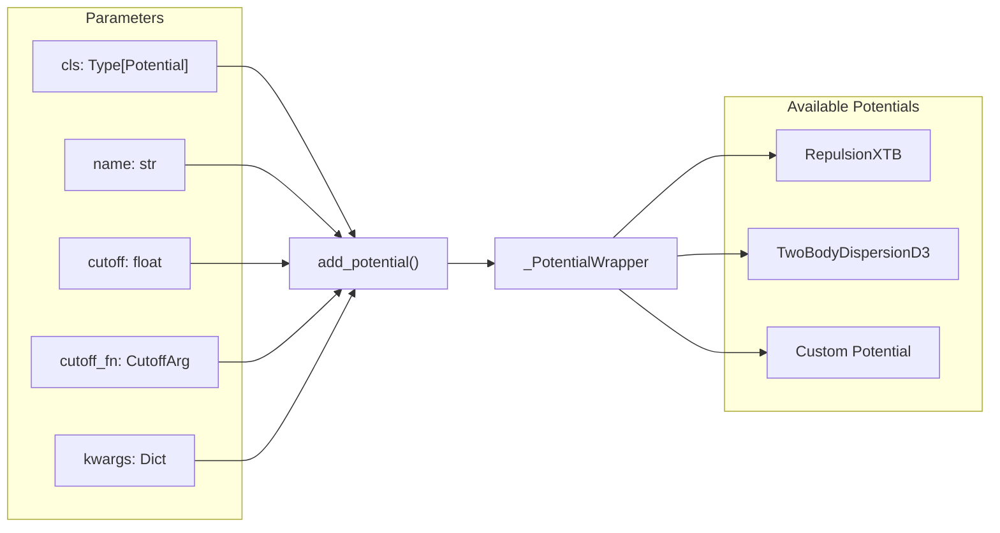

**Method Signature:** [torchani/arch.py:930-945]()

| Parameter | Type | Default | Description |
|-----------|------|---------|-------------|
| `cls` | `PotentialCls` | Required | Potential class type |
| `name` | `str` | Required | Unique identifier for this potential |
| `cutoff` | `float` | `math.inf` | Cutoff distance for potential |
| `cutoff_fn` | `CutoffArg` | `"global"` | Cutoff function to use |
| `kwargs` | `Dict[str, Any]` | `None` | Arguments passed to potential constructor |

**Available Potential Classes:**

- `RepulsionXTB` - XTB repulsion correction [torchani/potentials/repulsion.py]()
- `TwoBodyDispersionD3` - D3 dispersion correction [torchani/potentials/dispersion.py]()
- Custom subclasses of `Potential` [torchani/potentials/core.py:15-88]()

Potential names must be unique within a model [torchani/arch.py:938-939]().

Sources: [torchani/arch.py:930-945](), [torchani/potentials/core.py:15-88]()

### Setting Cutoff Functions

The global cutoff function modulates interactions at the cutoff boundary. It can be overridden per-component.

**Method Signature:** [torchani/arch.py:924-928]()

```python
set_global_cutoff_fn(cutoff_fn: CutoffArg)
```

**Available Cutoff Functions:**

| Value | Class | Description |
|-------|-------|-------------|
| `"smooth"` | `CutoffSmooth` | Smooth polynomial cutoff |
| `"cosine"` | `CutoffCosine` | Cosine cutoff |
| `(str, int)` | `CutoffSmooth` | Smooth cutoff with specified exponent |
| `Cutoff` object | - | Custom cutoff instance |

The default is `CutoffSmooth(2)` [torchani/arch.py:792]().

Sources: [torchani/arch.py:792](), [torchani/arch.py:924-928](), [torchani/cutoffs.py]()

### Configuring Neighborlist

The neighborlist algorithm determines how atomic neighbors are found. The choice affects performance for different system sizes and boundary conditions.

**Method Signature:** [torchani/arch.py:918-922]()

```python
set_neighborlist(neighborlist: NeighborlistArg)
```

**Neighborlist Options:**

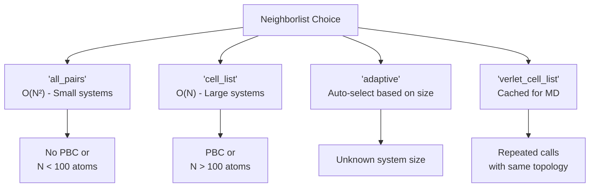

For more details on neighborlist algorithms, see [Neighborlist Algorithms](#4.3).

Sources: [torchani/arch.py:918-922](), [torchani/neighbors/__init__.py]()

## Assembling the Model

### Creating ANI Models

The `assemble()` method constructs the final model after all components are configured.

**Assembly Process**

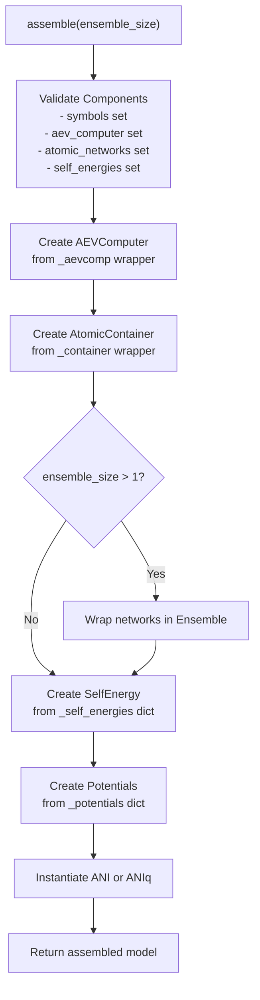

**Method Signature:** [torchani/arch.py:947-1008]()

```python
def assemble(ensemble_size: int = 1) -> Union[ANI, ANIq]
```

| Parameter | Type | Default | Description |
|-----------|------|---------|-------------|
| `ensemble_size` | `int` | `1` | Number of network instances in ensemble |

**Validation Checks:**

The method validates that all required components are configured [torchani/arch.py:955-968]():
- Symbols must be set
- AEV computer must be configured
- Atomic networks must be set
- Self-energies must be configured

**Ensemble Creation:**

When `ensemble_size > 1`, multiple independent network instances are created and wrapped in an `Ensemble` container [torchani/arch.py:970-981]().

Sources: [torchani/arch.py:947-1008]()

### Creating ANIq Models

ANIq models predict both energies and atomic charges. They require charge network configuration in addition to standard components.

**Charge Network Configuration**

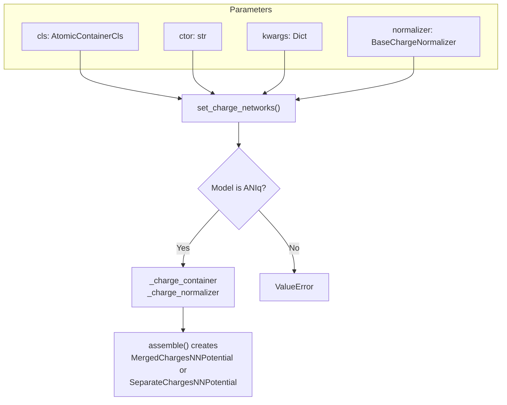

**Method Signature:** [torchani/arch.py:884-900]()

| Parameter | Type | Default | Description |
|-----------|------|---------|-------------|
| `cls` | `AtomicContainerCls` | `ANINetworks` | Charge network container class |
| `ctor` | `str` | `"ani2x"` | Constructor method name |
| `kwargs` | `Dict[str, Any]` | `{}` | Constructor arguments |
| `normalizer` | `BaseChargeNormalizer` | `None` | Charge normalization strategy |

**Charge Network Architectures:**

If charge networks are not set, the model assumes energy and charge predictions share the same network with 2 output neurons per atom (`MergedChargesNNPotential`) [torchani/arch.py:648-654]().

If charge networks are set separately, the model uses distinct networks for energy and charges (`SeparateChargesNNPotential`) [torchani/arch.py:651-654]().

**Charge Normalization:**

The `ChargeNormalizer` ensures predicted atomic charges sum to the specified total charge [torchani/electro.py:29-94]().

Sources: [torchani/arch.py:884-900](), [torchani/arch.py:626-732](), [torchani/potentials/nnp.py:38-103](), [torchani/electro.py:29-94]()

## Complete Examples

### Basic Custom Model

**Component Selection and Assembly**

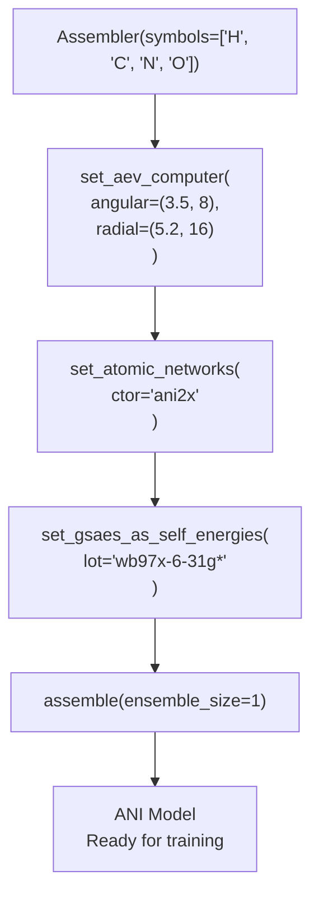

This creates a basic ANI model with ANI2x-style networks, standard AEV parameters, and ground-state self-energies. The model is ready for training on custom datasets.

Sources: [torchani/arch.py:782-1008]()

### Model with Additional Potentials

**Multi-Component Model Assembly**

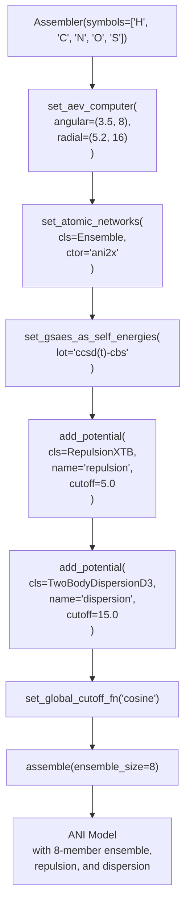

This creates an ensemble model with 8 members, incorporating both XTB repulsion and D3 dispersion corrections, with cosine cutoff functions.

Sources: [torchani/arch.py:782-1008](), [torchani/potentials/repulsion.py](), [torchani/potentials/dispersion.py]()

## Model Architecture Output

After assembly, the resulting `ANI` or `ANIq` model contains the following structure:

**ANI Model Internal Structure**

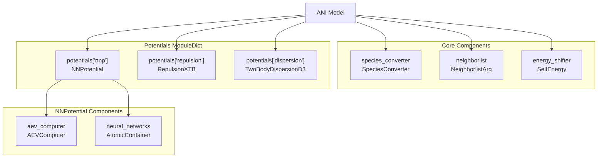

The assembled model is a PyTorch `nn.Module` ready for training, inference, or JIT compilation. All components are accessible as attributes for inspection or modification.

Sources: [torchani/arch.py:92-320](), [torchani/arch.py:947-1008](), [torchani/potentials/nnp.py:14-33]()

---