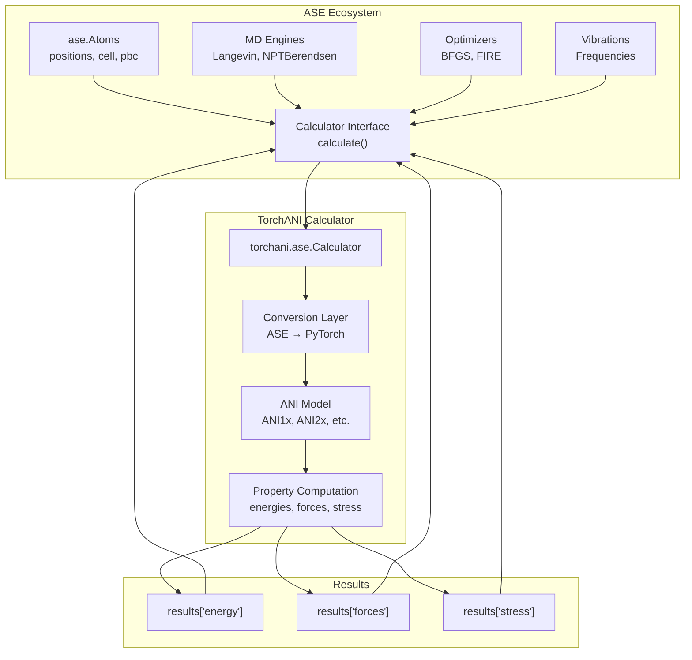
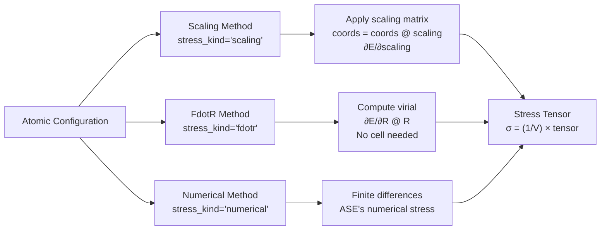
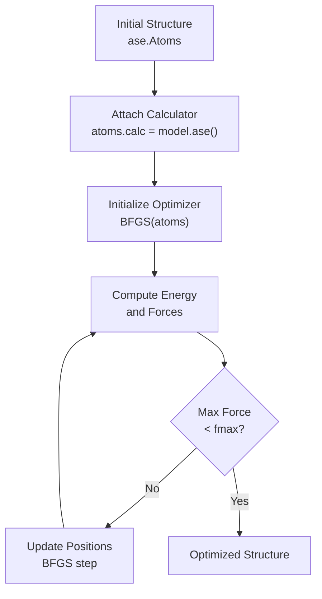
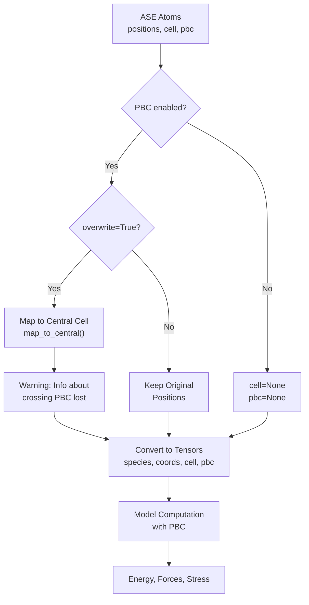
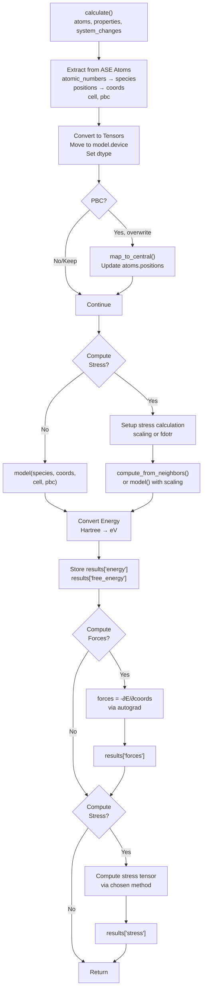

# ASE Integration

<details>
<summary>Relevant source files</summary>

The following files were used as context for generating this wiki page:

- [tests/test_aev.py](tests/test_aev.py)
- [tests/test_ase.py](tests/test_ase.py)
- [tests/test_cuaev.py](tests/test_cuaev.py)
- [tests/test_energies.py](tests/test_energies.py)
- [tests/test_ensemble.py](tests/test_ensemble.py)
- [tests/test_forces.py](tests/test_forces.py)
- [torchani/ase.py](torchani/ase.py)

</details>


This page explains how to use TorchANI models with the Atomic Simulation Environment (ASE) library for molecular dynamics, geometry optimization, vibrational analysis, and other property calculations. The integration is provided through the `Calculator` class in [torchani/ase.py]().

For information about computing energies and forces directly using TorchANI (without ASE), see [Energy and Force Calculations](#5.2). For details about building custom models, see [Building Custom Models](#5.3).

## Overview

TorchANI models implement the ASE `Calculator` interface, allowing them to be used with ASE's extensive ecosystem of tools for atomistic simulations. The integration supports:

- **Property calculations**: Energy, forces, stress tensors
- **Molecular dynamics**: NVE, NVT (Langevin), NPT (Berendsen) ensembles
- **Geometry optimization**: BFGS, FIRE, and other ASE optimizers
- **Vibrational analysis**: Frequencies and normal modes
- **Periodic boundary conditions**: Full support for periodic systems

The `Calculator` class wraps a TorchANI model and translates between ASE's data structures (`Atoms` objects) and PyTorch tensors.

**Sources**: [torchani/ase.py:1-31]()

## ASE Calculator Architecture

The following diagram shows how the `Calculator` class integrates TorchANI models with ASE:



**Sources**: [torchani/ase.py:32-74](), [tests/test_ase.py:68-136]()

## Creating an ASE Calculator

Every TorchANI model can be converted to an ASE calculator using the `.ase()` method:

```python
import torchani

# Load a pre-trained model
model = torchani.models.ANI1x()

# Convert to ASE calculator
calculator = model.ase()
```

The calculator can then be attached to an ASE `Atoms` object:

```python
from ase import Atoms

atoms = Atoms('CH4', positions=[...])
atoms.calc = calculator

# Compute properties
energy = atoms.get_potential_energy()
forces = atoms.get_forces()
```

### Calculator Parameters

The `Calculator` constructor accepts the following parameters:

| Parameter | Type | Default | Description |
|-----------|------|---------|-------------|
| `model` | `torchani.arch.ANI` | Required | The neural network potential model |
| `overwrite` | `bool` | `False` | Whether to replace atom positions with wrapped positions after PBC mapping |
| `stress_kind` | `str` | `"scaling"` | Strategy for stress calculation: `"fdotr"`, `"scaling"`, or `"numerical"` |

**Note**: Models must have `periodic_table_index=True` to be used with ASE (this is the default for pre-built models).

**Sources**: [torchani/ase.py:58-74](), [torchani/ase.py:32-54]()

## Property Calculations

The `Calculator` class implements the following properties:

```python
# Implemented properties
implemented_properties = ["energy", "free_energy", "forces", "stress"]
```

### Energy and Forces

Energy is automatically converted from Hartree (TorchANI's native units) to eV (ASE's native units):

```python
atoms.calc = calculator

# Energy in eV
energy = atoms.get_potential_energy()

# Forces in eV/Angstrom
forces = atoms.get_forces()
```

Forces are computed via automatic differentiation:

```
forces = -∂E/∂coords
```

**Sources**: [torchani/ase.py:75-162](), [torchani/ase.py:159-162]()

### Stress Tensor

The stress tensor can be computed using three different strategies:



#### Stress Calculation Methods

| Method | Description | Use Case | Cell Required |
|--------|-------------|----------|---------------|
| `"scaling"` | Uses uniform scaling of coordinates and cell | General purpose | Yes |
| `"fdotr"` | Force dot product method (virial) | Multi-GPU, no cell info needed | No |
| `"numerical"` | Finite difference approximation | Debugging, validation | Yes |

Example with different stress methods:

```python
# Scaling method (default)
calc_scaling = model.ase(stress_kind="scaling")

# FdotR method (useful for multi-GPU)
calc_fdotr = model.ase(stress_kind="fdotr")

# Numerical method
calc_numerical = model.ase(stress_kind="numerical")

atoms.calc = calc_scaling
stress = atoms.get_stress()  # Returns 6-component Voigt notation
```

**Sources**: [torchani/ase.py:111-157](), [torchani/ase.py:164-173](), [tests/test_ase.py:138-196]()

## Molecular Dynamics

TorchANI calculators can be used with any ASE molecular dynamics engine. Common examples:

### Langevin Thermostat (NVT)

```python
from ase.md.langevin import Langevin
from ase import units
import numpy as np

atoms = ...  # Your atomic structure
atoms.calc = model.ase()

# Initialize Langevin dynamics
dyn = Langevin(
    atoms,
    timestep=0.5 * units.fs,
    temperature_K=300,
    friction=0.002,
    rng=np.random.RandomState(seed=123)
)

# Run dynamics
dyn.run(1000)  # 1000 steps
```

### NPT Ensemble (Berendsen)

```python
from ase.md.nptberendsen import NPTBerendsen
from ase import units

atoms = ...  # Periodic system
atoms.calc = model.ase()

# Initialize NPT dynamics
dyn = NPTBerendsen(
    atoms,
    timestep=0.1 * units.fs,
    temperature_K=300,
    taut=0.1 * 1000 * units.fs,
    pressure_au=1.0 * units.bar,
    taup=1.0 * 1000 * units.fs,
    compressibility_au=4.57e-5 / units.bar
)

dyn.run(10000)
```

**Sources**: [tests/test_ase.py:114-136](), [tests/test_ase.py:179-195]()

## Geometry Optimization

TorchANI calculators work with ASE's optimization algorithms:

```python
from ase.optimize import BFGS

atoms = ...  # Initial structure
atoms.calc = model.ase()

# Initialize optimizer
opt = BFGS(atoms)

# Run optimization
opt.run(fmax=0.01)  # Optimize until max force < 0.01 eV/Å

# Get optimized structure
optimized_positions = atoms.get_positions()
```

The following diagram shows the optimization workflow:



**Sources**: [tests/test_ase.py:237-258]()

## Vibrational Analysis

ASE's `Vibrations` class can compute vibrational frequencies and normal modes:

```python
from ase.vibrations import Vibrations
import numpy as np

# Optimize structure first
atoms = ...
atoms.calc = model.ase()

# Compute vibrational frequencies
vib = Vibrations(atoms)
vib.run()

# Get frequencies (in cm^-1)
frequencies = vib.get_frequencies()

# Get normal modes
for i in range(len(frequencies)):
    mode = vib.get_mode(i)
    
# Clean up temporary files
vib.clean()
```

The vibrational analysis computes the Hessian matrix via numerical differentiation of forces:

```
H_ij = ∂²E/∂x_i∂x_j ≈ (F_i(x+δ) - F_i(x-δ))/(2δ)
```

**Sources**: [tests/test_ase.py:199-234]()

## Periodic Boundary Conditions

The calculator fully supports periodic boundary conditions (PBC). The workflow is:



### PBC Example

```python
from ase.lattice.cubic import Diamond

# Create periodic structure
atoms = Diamond(symbol='C', pbc=True, size=(2, 2, 2))

# Use calculator with PBC support
calc = model.ase()
atoms.calc = calc

# Automatic PBC handling
energy = atoms.get_potential_energy()
forces = atoms.get_forces()
```

### Overwrite Parameter

The `overwrite` parameter controls whether atom positions are replaced with their PBC-wrapped equivalents:

```python
# Keep original positions (default)
calc = model.ase(overwrite=False)

# Replace with wrapped positions
calc = model.ase(overwrite=True)
# Warning: Info about crossing PBC will be lost
```

**Sources**: [torchani/ase.py:91-109](), [tests/test_ase.py:70-112]()

## Stress Calculation Details

The three stress calculation methods have different implementations and trade-offs:

### Scaling Method

The scaling method applies a uniform scaling transformation:

```python
# scaling matrix (3x3 identity, requires_grad=True)
scaling = torch.eye(3, requires_grad=True)

# Scale coordinates and cell
coords_scaled = coords @ scaling
cell_scaled = cell @ scaling

# Compute energy with scaled system
energy = model(species, coords_scaled, cell_scaled, pbc)

# Compute stress via chain rule
stress = (1/volume) * ∂E/∂scaling
```

**Implementation**: [torchani/ase.py:111-116](), [torchani/ase.py:170-173]()

### FdotR Method (Virial)

The force-distance product method computes the virial stress:

```python
# Requires gradient w.r.t. difference vectors
diff_vectors.requires_grad_(True)

# Compute energy
energy = model.compute_from_neighbors(...)

# Compute virial
dE_dR = ∂E/∂diff_vectors
virial = dE_dR.T @ diff_vectors
stress = virial / volume
```

This method is particularly useful when:
- Cell information is not available
- Running on multiple GPUs with different domains
- Computing stress without cell deformation

**Implementation**: [torchani/ase.py:125-131](), [torchani/ase.py:164-168]()

### Numerical Method

Uses ASE's built-in numerical stress calculation via finite differences:

```python
stress = calculator.calculate_numerical_stress(atoms)
```

This is mainly used for validation and debugging.

**Implementation**: [torchani/ase.py:152-153]()

**Sources**: [torchani/ase.py:111-173](), [tests/test_ase.py:138-196]()

## Data Flow in Calculator

The `calculate()` method orchestrates the entire computation:



Key steps:

1. **Extraction**: [torchani/ase.py:80-100]() - Convert ASE `Atoms` to PyTorch tensors
2. **PBC Handling**: [torchani/ase.py:102-109]() - Optional wrapping to central cell
3. **Stress Setup**: [torchani/ase.py:111-131]() - Apply scaling or prepare for fdotr
4. **Model Computation**: [torchani/ase.py:132-136]() - Energy calculation
5. **Unit Conversion**: [torchani/ase.py:136-142]() - Hartree to eV
6. **Force Computation**: [torchani/ase.py:144]() - Automatic differentiation
7. **Stress Computation**: [torchani/ase.py:146-157]() - Via chosen method

**Sources**: [torchani/ase.py:75-157]()

## Working with Multiple Models

ASE calculators work with both single models and ensembles:

```python
# Single model from ensemble
model = torchani.models.ANI1x(model_index=0)
calc = model.ase()

# Full ensemble (averages over all models)
ensemble = torchani.models.ANI1x()
calc_ensemble = ensemble.ase()

# Custom model with additional potentials
from torchani.models import ANI1x
from torchani.arch import ANI

base_model = ANI1x(model_index=0)
custom_model = ANI(
    aev_computer=base_model.aev_computer,
    neural_networks=base_model.neural_networks,
    energy_shifter=base_model.energy_shifter,
    symbols=base_model.symbols,
    potentials={...}  # Add custom potentials
)
calc_custom = custom_model.ase()
```

**Sources**: [tests/test_ase.py:80-104]()

## Compatibility Notes

### Device and Dtype

The calculator automatically uses the model's device and dtype:

```python
# Model on GPU, double precision
model = torchani.models.ANI1x().cuda().double()
calc = model.ase()

# All computations happen on GPU with float64
```

The calculator extracts device and dtype from model parameters:

```python
param = next(self.model.parameters())
self.device = param.device
self.dtype = param.dtype
```

**Sources**: [torchani/ase.py:66-68]()

### Neighborlist Selection

Different neighborlist algorithms can be specified when creating models:

```python
# All-pairs (default for small systems)
model_allpairs = torchani.models.ANI1x()

# Cell list (better for large systems)
model_cell = torchani.models.ANI1x(neighborlist="cell_list")

# Calculators inherit neighborlist from model
calc = model_cell.ase()
```

**Sources**: [tests/test_ase.py:70-78](), [tests/test_ase.py:110-112]()

## Testing and Validation

The test suite validates several aspects of ASE integration:

| Test | Purpose | File |
|------|---------|------|
| Numerical forces | Validates analytical forces via finite differences | [tests/test_ase.py:106-136]() |
| Analytical stress | Compares analytical stress to numerical | [tests/test_ase.py:138-196]() |
| PBC consistency | Ensures forces are consistent across neighborlists | [tests/test_ase.py:70-78]() |
| Vibrational modes | Validates Hessian via normal mode analysis | [tests/test_ase.py:199-234]() |
| Geometry optimization | Tests convergence to known structures | [tests/test_ase.py:237-258]() |

**Sources**: [tests/test_ase.py:1-262]()

---