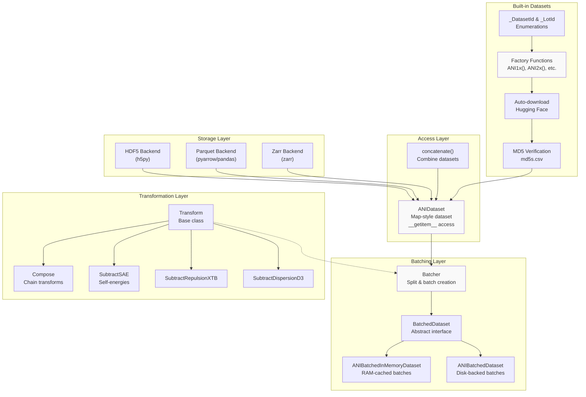
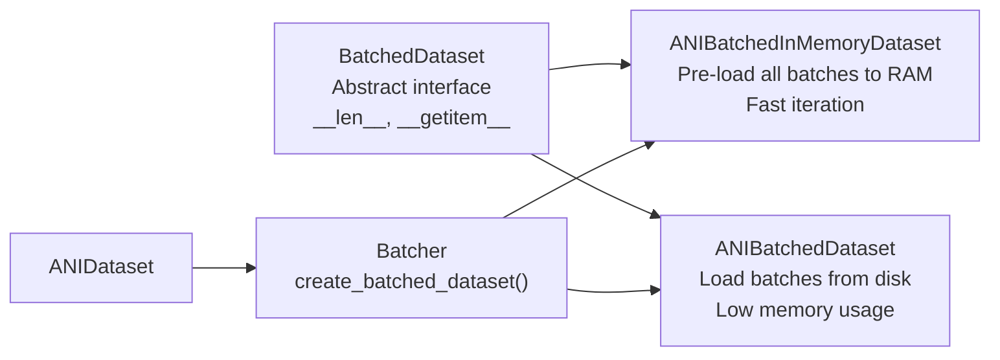
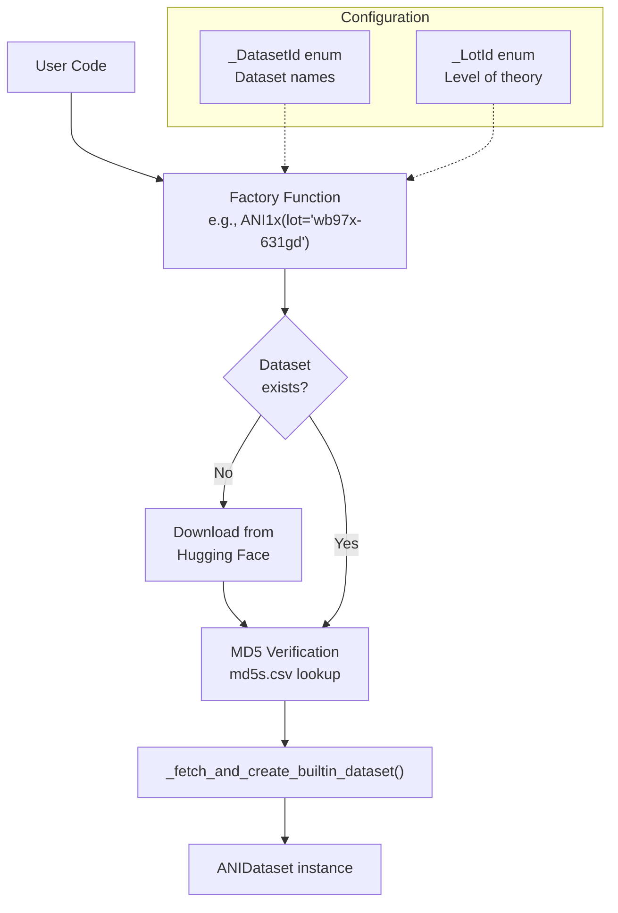
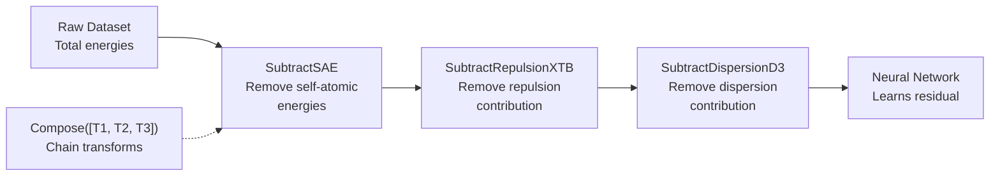
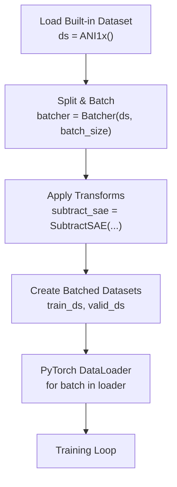

# Datasets

<details>
<summary>Relevant source files</summary>

The following files were used as context for generating this wiki page:

- [torchani/datasets/__init__.py](torchani/datasets/__init__.py)
- [torchani/datasets/builtin.py](torchani/datasets/builtin.py)
- [torchani/datasets/md5s.csv](torchani/datasets/md5s.csv)

</details>


## Purpose and Scope

This document provides an overview of TorchANI's dataset management system, which handles molecular conformer data for training and inference. The system supports multiple storage backends (HDF5, Parquet, Zarr), provides built-in datasets with automatic downloading and verification, and offers flexible batching and transformation pipelines.

For details on specific built-in datasets and their properties, see [Built-in Datasets](#6.1). For information on loading data and creating batches for training, see [Data Loading and Batching](#6.2). For preprocessing data with transformations, see [Data Transforms](#6.3).

For the actual training workflow that uses these datasets, see [Training](#7).

**Sources:** [torchani/datasets/__init__.py:1-18]()

## Dataset Architecture Overview

TorchANI's dataset system is organized into three main layers: **storage and access**, **batching and iteration**, and **transformation**. The architecture balances flexibility (supporting multiple backends and custom workflows) with convenience (pre-configured datasets with automatic downloads).



**Diagram: Dataset System Architecture**

**Sources:** [torchani/datasets/__init__.py:1-80](), [torchani/datasets/builtin.py:1-48]()

## Core Dataset Classes

### ANIDataset

`ANIDataset` is the primary map-style dataset class that provides indexed access to individual molecular conformers. It supports three storage backends and automatically handles format differences:

| Backend | Library | Best For |
|---------|---------|----------|
| HDF5 | `h5py` | Default, balanced performance |
| Parquet | `pyarrow`/`pandas` | Columnar access, compression |
| Zarr | `zarr` | Cloud storage, chunked access |

Each conformer accessed via `dataset[i]` returns a dictionary with keys such as:
- `species`: Atomic numbers
- `coordinates`: Atom positions (Å)
- `energies`: Reference energy (Hartree)
- `forces`: Reference forces (Hartree/Å, if available)
- Additional properties depending on dataset

**Sources:** [torchani/datasets/__init__.py:21](), [torchani/datasets/anidataset.py]()

### Batched Dataset Classes

The batching layer provides two implementations of the `BatchedDataset` interface:



**Diagram: Batched Dataset Classes**

**Key differences:**
- **ANIBatchedInMemoryDataset**: Loads all batches into memory at initialization. Faster iteration but requires sufficient RAM.
- **ANIBatchedDataset**: Loads batches on-demand from disk. Lower memory footprint but slower iteration.

**Sources:** [torchani/datasets/__init__.py:22-29](), [torchani/datasets/batching.py]()

## Built-in Dataset System

TorchANI provides factory functions for pre-configured datasets that automatically handle downloading, verification, and instantiation:



**Diagram: Built-in Dataset Loading Flow**

### Available Built-in Datasets

The following table summarizes major built-in datasets (for complete list, see [Built-in Datasets](#6.1)):

| Dataset | Purpose | Default LoT | Key Properties |
|---------|---------|-------------|----------------|
| `ANI1x` | General training | wb97x-631gd | ~5M conformers, H,C,N,O |
| `ANI2x` | Extended training | wb97x-631gd | Superset of ANI1x + heavy atoms |
| `ANI1ccx` | Transfer learning | ccsd(t)star-cbs | High-accuracy coupled-cluster |
| `ANI1q` | Charge training | wb97x-631gd | Subset with CM5 charges |
| `COMP6v2` | Testing | wb97x-631gd | Test set, not for training |
| `ANI1e` | Equilibrium structures | wb97x-631gd | Thermodynamic properties |

**Sources:** [torchani/datasets/builtin.py:28-372](), [torchani/datasets/__init__.py:30-48]()

### Level of Theory (LoT) Support

Many datasets are available with multiple levels of theory. The `_LotId` enum defines supported LoT values:

- `wb97x-631gd`: Default, ωB97X/6-31G(d)
- `wb97x-def2tzvpp`: ωB97X/def2-TZVPP
- `b973c-def2mtzvp`: B97-3c/def2-mTZVP
- `wb97md3bj-def2tzvpp`: ωB97M-D3BJ/def2-TZVPP
- `wb97mv-def2tzvpp`: ωB97M-V/def2-TZVPP
- `ccsd(t)star-cbs`: CCSD(T)*/CBS extrapolation

**Sources:** [torchani/datasets/builtin.py:391-400]()

## Data Verification

All built-in datasets undergo MD5 checksum verification to ensure integrity:

```python
# Excerpt from md5s.csv structure
# filename,md5_hash
# ANI-1x-wB97X-631Gd.h5,0530b7877f301c741a4d4f2616547ee6
# ANI-2x_heavy_and_dimers-wB97X-631Gd.h5,c8bc40c274683eaf3182edd2d21f222a
```

The verification process:
1. Download checks if file exists locally
2. Computes MD5 hash of downloaded file
3. Compares against expected hash in `md5s.csv`
4. Raises error if mismatch detected

**Sources:** [torchani/datasets/md5s.csv:1-97](), [torchani/datasets/_utils.py]()

## Data Transformation Pipeline

Transformations preprocess data before training, typically to isolate learned contributions:



**Diagram: Transformation Pipeline Example**

Common transforms:
- **SubtractSAE**: Subtract self-atomic energies (GSAES)
- **SubtractRepulsionXTB**: Subtract XTB repulsion potential
- **SubtractDispersionD3**: Subtract D3 dispersion correction
- **Compose**: Chain multiple transforms sequentially

For detailed transform usage, see [Data Transforms](#6.3).

**Sources:** [torchani/datasets/__init__.py:19-20](), [torchani/datasets/transforms.py]()

## Usage Pattern

A typical workflow for using datasets in TorchANI:



**Diagram: Typical Dataset Usage Workflow**

**Example code pattern:**
```python
# Load dataset
dataset = torchani.datasets.ANI1x(lot='wb97x-631gd')

# Create batcher
batcher = torchani.datasets.Batcher(
    dataset, 
    batch_size=1024,
    train_ratio=0.8
)

# Apply transforms
transform = torchani.datasets.SubtractSAE(species_to_sae)

# Get batched datasets
train_batched = batcher.train_dataset(transform=transform)
valid_batched = batcher.valid_dataset(transform=transform)

# Use with PyTorch DataLoader
train_loader = torch.utils.data.DataLoader(
    train_batched, 
    batch_size=None  # Already batched
)
```

**Sources:** [torchani/datasets/__init__.py:1-80]()

## Data Storage Location

Built-in datasets are cached locally after first download. The default location is determined by `datasets_dir()`:

- Respects `TORCHANI_DATASETS_DIR` environment variable if set
- Falls back to platform-specific cache directory
- Typical locations: `~/.cache/torchani/datasets/` (Linux), `~/Library/Caches/torchani/datasets/` (macOS)

**Sources:** [torchani/paths.py](), [torchani/datasets/builtin.py:23]()

## Module Organization

The datasets subsystem is organized into several modules:

| Module | Purpose | Key Exports |
|--------|---------|-------------|
| `datasets.builtin` | Factory functions for built-in datasets | `ANI1x()`, `ANI2x()`, `TestData()`, etc. |
| `datasets.anidataset` | Core dataset class | `ANIDataset`, `concatenate()` |
| `datasets.batching` | Batching utilities | `Batcher`, `BatchedDataset`, `create_batched_dataset()` |
| `datasets.transforms` | Data transformations | `Transform`, `SubtractSAE`, etc. |
| `datasets._utils` | Internal utilities | `_fetch_and_create_builtin_dataset()` |
| `datasets.filters` | Dataset filtering utilities | Various filter functions |

All public APIs are re-exported from `torchani.datasets` for convenience.

**Sources:** [torchani/datasets/__init__.py:19-80]()

## Dataset Properties and Metadata

Datasets may contain various properties beyond basic molecular data:

**Standard Properties:**
- `species`: Atomic numbers (integer array)
- `coordinates`: Cartesian coordinates in Ångströms (float array)
- `energies`: Total energies in Hartree (float)

**Optional Properties (dataset-dependent):**
- `forces`: Atomic forces in Hartree/Ångström (float array)
- `dipoles`: Dipole moments in Debye (float array)
- `charges`: Atomic partial charges (float array)
- `cell`: Unit cell vectors for periodic systems (float array)
- `pbc`: Periodic boundary conditions flags (boolean array)

Properties available in a specific dataset are documented in that dataset's docstring (see [Built-in Datasets](#6.1)).

**Sources:** [torchani/datasets/builtin.py:4-19](), [torchani/datasets/anidataset.py]()

---