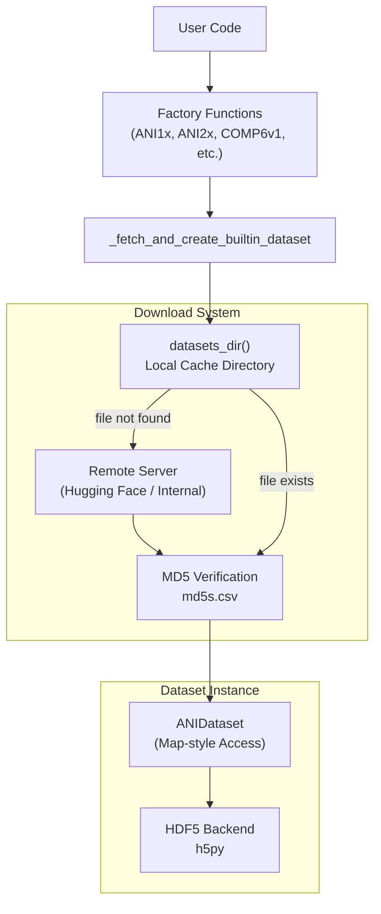
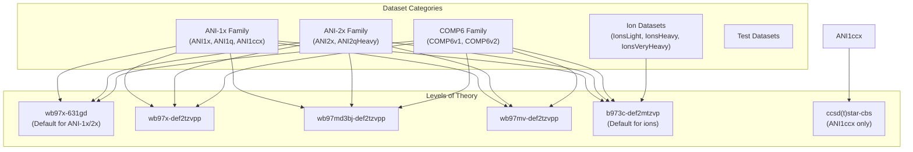
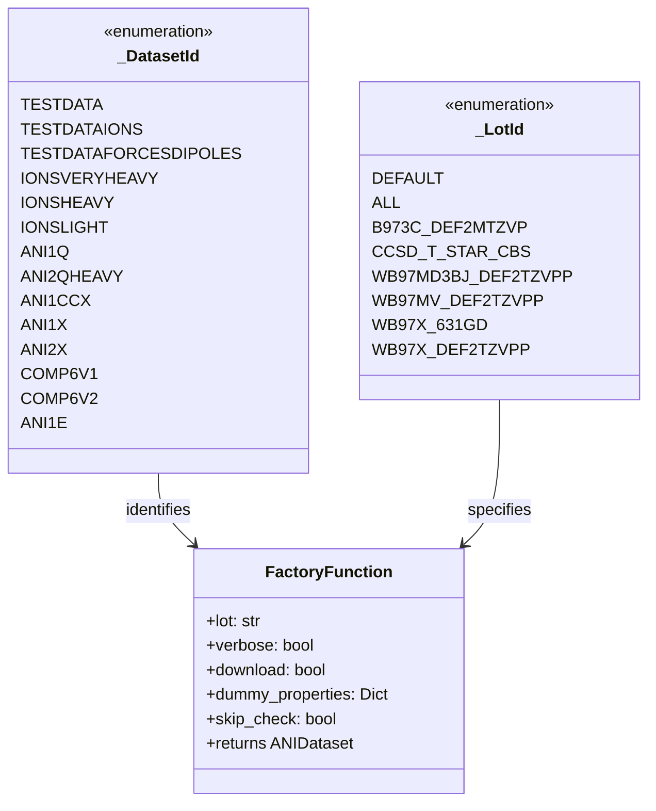

# Built-in Datasets

<details>
<summary>Relevant source files</summary>

The following files were used as context for generating this wiki page:

- [torchani/datasets/__init__.py](torchani/datasets/__init__.py)
- [torchani/datasets/builtin.py](torchani/datasets/builtin.py)
- [torchani/datasets/md5s.csv](torchani/datasets/md5s.csv)

</details>


TorchANI provides a comprehensive collection of pre-configured quantum chemistry datasets that can be automatically downloaded and used for training and evaluation. This page catalogs all available built-in datasets, their properties, level of theory (LoT) support, and access mechanisms. For information about loading and batching datasets, see [Data Loading and Batching](#6.2). For applying preprocessing transforms to datasets, see [Data Transforms](#6.3).

## Overview

Built-in datasets are accessed through factory functions in [torchani/datasets/builtin.py]() that handle automatic downloading, MD5 verification, and instantiation of `ANIDataset` objects. All datasets are stored in HDF5 format and include molecular structures with computed energies, and in many cases, forces, charges, and other molecular properties.

The built-in dataset system provides:
- **Automatic downloading** from remote servers on first access
- **Integrity verification** using MD5 checksums
- **Multiple LoT support** for some datasets (e.g., different functionals or basis sets)
- **Consistent API** across all datasets via standardized factory functions
- **Provenance tracking** with DOI references in docstrings

Sources: [torchani/datasets/builtin.py:1-19](), [torchani/datasets/__init__.py:1-18]()

## Dataset Access Architecture



**Dataset Access Flow**: Users call factory functions which invoke the internal `_fetch_and_create_builtin_dataset` function. This checks the local cache directory, downloads from remote servers if necessary, verifies integrity with MD5 checksums, and returns an `ANIDataset` instance backed by HDF5 storage.

Sources: [torchani/datasets/builtin.py:20-47](), [torchani/datasets/_utils.py]()

## Factory Function Signature

All built-in dataset factory functions share a common signature:

| Parameter | Type | Default | Description |
|-----------|------|---------|-------------|
| `lot` | `str` | varies | Level of theory (functional/basis or method/basis) |
| `verbose` | `bool` | `True` | Print download and verification messages |
| `download` | `bool` | `True` | Automatically download if not cached |
| `dummy_properties` | `Optional[Dict]` | `None` | Mock properties for testing without download |
| `skip_check` | `bool` | `False` | Skip MD5 verification (not recommended) |

**Return**: `ANIDataset` instance providing map-style access to molecular conformers.

Example invocation pattern:
```python
# Load ANI-1x dataset with default LoT (wb97x-631gd)
dataset = torchani.datasets.ANI1x()

# Load with different LoT
dataset = torchani.datasets.ANI1x(lot="wb97x-def2tzvpp")

# Load without auto-download (will raise error if not cached)
dataset = torchani.datasets.ANI2x(download=False)
```

Sources: [torchani/datasets/builtin.py:28-47]()

## Dataset Catalog

### Training Datasets

These datasets are intended for training neural network potentials:

| Dataset | Default LoT | Elements | Properties | DOI/Reference |
|---------|-------------|----------|------------|---------------|
| `ANI1x` | `wb97x-631gd` | H, C, N, O | Energy, Forces | 10.1038/s41597-020-0473-z |
| `ANI2x` | `wb97x-631gd` | H, C, N, O, F, S, Cl | Energy, Forces | TODO |
| `ANI1ccx` | `ccsd(t)star-cbs` | H, C, N, O | Energy, HF, RI-MP2, DPLNO-CCSD(T) | 10.1038/s41597-020-0473-z |

**ANI1x** [torchani/datasets/builtin.py:240-261](): The foundational ANI-1x dataset containing ~5 million conformers with DFT energies and forces. Supports multiple LoT including `wb97x-631gd`, `wb97x-def2tzvpp`, `wb97md3bj-def2tzvpp`, `wb97mv-def2tzvpp`, and `b973c-def2mtzvp`.

**ANI2x** [torchani/datasets/builtin.py:264-287](): Extended dataset that is a superset of ANI1x, adding heavier elements (F, S, Cl). Note: The v2/2x datasets are supersets of v1/1x, with some exceptions for certain LoT.

**ANI1ccx** [torchani/datasets/builtin.py:214-237](): High-accuracy coupled-cluster dataset primarily used for transfer learning rather than direct training. Contains CCSD(T)/CBS energies plus RI-MP2 forces and various DPLNO-CCSD(T) properties.

Sources: [torchani/datasets/builtin.py:240-287]()

### Test/Validation Datasets

These datasets are designed for model evaluation, not direct training:

| Dataset | Default LoT | Purpose | Notes |
|---------|-------------|---------|-------|
| `COMP6v1` | `wb97x-631gd` | Comprehensive test set | Subset of COMP6v2 |
| `COMP6v2` | `wb97x-631gd` | Comprehensive test set | Includes ANI-BenchMD, S66x8, GDB subsets |

**COMP6v1** [torchani/datasets/builtin.py:290-316](): Test set not meant for direct training. Subset of v1/1x datasets contained in v2/2x. Important: ANI-BenchMD, S66x8, and 13-heavy-atom GDB molecules were recalculated with ORCA 5.0 instead of 4.2.

**COMP6v2** [torchani/datasets/builtin.py:319-342](): Extended comprehensive test set containing the same recalculated molecules as v1 plus additional structures.

Sources: [torchani/datasets/builtin.py:290-342]()

### Specialized Datasets

| Dataset | Default LoT | Specialization | Additional Properties |
|---------|-------------|----------------|----------------------|
| `ANI1q` | `wb97x-631gd` | Charge prediction | Atomic CM5 charges |
| `ANI2qHeavy` | `wb97x-631gd` | Charge prediction (heavy) | Atomic CM5 charges |
| `ANI1e` | `wb97x-631gd` | Equilibrium structures | Rotational constants, dipole, polarizability, HOMO/LUMO, ZPVE, thermal properties |

**ANI1q** [torchani/datasets/builtin.py:165-187](): Limited subset of ANI-1x with atomic CM5 charges available. Not meant for standalone training, but for charge prediction models.

**ANI2qHeavy** [torchani/datasets/builtin.py:190-211](): Subset of ANI-2x heavy dataset with atomic CM5 charges. Used for training charge-aware models on heavier elements.

**ANI1e** [torchani/datasets/builtin.py:345-371](): Equilibrium structures from ANI-1x SMILES, embedded in 3D and optimized with PM7. Includes extensive molecular properties: rotational constants (GHz), dipole and polarizability magnitudes, HOMO/LUMO energies and gap, spatial extent, ZPVE, and thermal quantities at 298.15 K.

Sources: [torchani/datasets/builtin.py:165-211](), [torchani/datasets/builtin.py:345-371]()

### Ion Datasets

These datasets contain charged species and are not meant for standalone training:

| Dataset | Default LoT | Elements | Warning |
|---------|-------------|----------|---------|
| `IonsLight` | `b973c-def2mtzvp` | H, C, N, O | May have incorrect energies/forces |
| `IonsHeavy` | `b973c-def2mtzvp` | H, C, N, O + F, S, Cl | May have incorrect energies/forces |
| `IonsVeryHeavy` | `b973c-def2mtzvp` | HCNOFS,Cl + Si, As, Br, Se, P, B, I | Disjoint from other ion sets |

**Warning**: `IonsLight` and `IonsHeavy` datasets may have incorrect energies and/or forces [torchani/datasets/builtin.py:142-157](). Use with caution.

**IonsVeryHeavy** [torchani/datasets/builtin.py:94-115](): Contains very heavy elements (Si, As, Br, Se, P, B, I) that are disjoint from other ion datasets.

Sources: [torchani/datasets/builtin.py:94-163]()

### Debug/Test Datasets

Small datasets for code testing and debugging:

| Dataset | Default LoT | Contents |
|---------|-------------|----------|
| `TestData` | `wb97x-631gd` | GDB subset |
| `TestDataIons` | `b973c-def2mtzvp` | Includes forces, dipoles, charges |
| `TestDataForcesDipoles` | `b973c-def2mtzvp` | Includes forces and dipoles |

Sources: [torchani/datasets/builtin.py:28-91]()

## Level of Theory Support



**LoT Enumeration**: The `_LotId` enum [torchani/datasets/builtin.py:391-400]() defines supported levels of theory:
- `wb97x-631gd`: Default for most ANI datasets
- `wb97x-def2tzvpp`: Larger basis set variant
- `wb97md3bj-def2tzvpp`: Minnesota functional with D3(BJ) dispersion
- `wb97mv-def2tzvpp`: Minnesota functional with VV10 dispersion
- `b973c-def2mtzvp`: B97-3c composite method (default for ions)
- `ccsd(t)star-cbs`: Coupled-cluster CBS extrapolation (ANI1ccx)

Sources: [torchani/datasets/builtin.py:391-400]()

## Dataset Identification System



The enums `_DatasetId` and `_LotId` [torchani/datasets/builtin.py:374-400]() provide type-safe identifiers for internal use in dataset management and testing.

Sources: [torchani/datasets/builtin.py:374-400]()

## MD5 Verification System

All downloaded datasets are verified against MD5 checksums stored in [torchani/datasets/md5s.csv](). This file contains 96 entries mapping filenames to their expected MD5 hashes.

| Filename Pattern | Example | Hash |
|------------------|---------|------|
| `<Dataset>-<LoT>.h5` | `ANI-1x-wB97X-631Gd.h5` | `0530b7877f301c741a4d4f2616547ee6` |
| `<Dataset>-<LoT>.h5` | `ANI-2x_heavy-wB97X-631Gd.h5` | `c8bc40c274683eaf3182edd2d21f222a` |
| `<Dataset>-<LoT>.h5` | `COMP6-v1_full-wB97X-631Gd.h5` | (various) |

The verification process:
1. Download file from remote server
2. Calculate MD5 hash of downloaded file
3. Compare against expected hash from `md5s.csv`
4. Raise error if mismatch detected (unless `skip_check=True`)

This ensures data integrity and prevents corrupted downloads from being used.

Sources: [torchani/datasets/md5s.csv:1-97]()

## External Dataset Support

In addition to the ANI-family datasets, TorchANI's MD5 registry [torchani/datasets/md5s.csv]() includes support for external datasets reformatted for TorchANI compatibility:

**QM9 Variants**:
- `QM9Clean`: B3LYP/6-31G(2df,p) on cleaned GDB-17
- `QM9C7O2H10`: G4MP2 on C7O2H10 subset
- `QM9Dirty`: Failed calculations from GDB-17

**ISO17**:
- `Iso17Equilibrium`: PBE+TS equilibrium structures
- `Iso17Test`: Test set for ISO17 benchmark
- `Iso17Train`: Training set with FHI-aims calculations

**SPICE Dataset** (8 subsets):
- DES370K, DES monomers, dipeptides, ion pairs, PubChem sets 1-6, solvated amino acids
- All computed at ωB97M-D3(BJ)/def2-TZVPPD

**Other Specialized Sets**:
- `SN2`: SN2 reactions with H, C, F, Cl, Br, I at DSD-BLYP-D3(BJ)/def2-TZVP
- `SolvatedProteinFragments`: revPBE-D3(BJ)/def2-TZVP
- `Train3BPA300K`, `Train3BPAMixedT`: 3BPA training sets
- Various test sets (dihedral scans, temperature variations)

Sources: [torchani/datasets/md5s.csv:54-96]()

## Usage Patterns

### Basic Dataset Loading
```python
import torchani

# Load with default level of theory
ani1x = torchani.datasets.ANI1x()

# Access individual conformers (map-style)
conformer = ani1x[0]  # Returns dict with species, coordinates, energies, etc.

# Check dataset size
num_conformers = len(ani1x)
```

### Loading with Alternative LoT
```python
# Load ANI-1x with larger basis set
ani1x_tzvpp = torchani.datasets.ANI1x(lot="wb97x-def2tzvpp")

# Load with Minnesota functional
ani1x_md3bj = torchani.datasets.ANI1x(lot="wb97md3bj-def2tzvpp")
```

### Offline Usage
```python
# Disable auto-download (requires prior caching)
try:
    dataset = torchani.datasets.ANI2x(download=False)
except FileNotFoundError:
    print("Dataset not cached locally")
```

### Testing/Development
```python
# Use small test dataset for rapid iteration
test_data = torchani.datasets.TestData()

# Mock properties without downloading
dummy = torchani.datasets.ANI1x(
    dummy_properties={"energy": 0.0},
    skip_check=True
)
```

Note: The actual implementation of these usage patterns relies on the `ANIDataset` class and batching utilities documented in [Data Loading and Batching](#6.2).

Sources: [torchani/datasets/builtin.py:28-371](), [torchani/datasets/__init__.py:21-29]()

## Dataset Properties Summary

Different datasets include different molecular properties beyond just energies:

| Property | ANI1x | ANI2x | ANI1ccx | ANI1q | ANI1e | IonsLight |
|----------|-------|-------|---------|-------|-------|-----------|
| Energy | ✓ | ✓ | ✓ | ✓ | ✓ | ✓ |
| Forces | ✓ | ✓ | Partial | ✓ | ✗ | ✓ |
| Charges | ✗ | ✗ | ✗ | ✓ (CM5) | ✗ | ✓ |
| Dipoles | ✗ | ✗ | ✗ | ✗ | ✓ | ✓ |
| HF/MP2 | ✗ | ✗ | ✓ | ✗ | ✗ | ✗ |
| CCSD(T) | ✗ | ✗ | ✓ | ✗ | ✗ | ✗ |
| Polarizability | ✗ | ✗ | ✗ | ✗ | ✓ | ✗ |
| HOMO/LUMO | ✗ | ✗ | ✗ | ✗ | ✓ | ✗ |
| Thermal | ✗ | ✗ | ✗ | ✗ | ✓ (298K) | ✗ |

Sources: [torchani/datasets/builtin.py:165-371]()

## File Generation Note

The [torchani/datasets/builtin.py]() file is automatically generated by `tools/builtin-datasets-codegen.py` using the Jinja template engine [torchani/datasets/builtin.py:1-3](). This ensures consistency across all dataset factory functions and simplifies maintenance. Modifications should be made to the generator and template, not the generated file directly.

Sources: [torchani/datasets/builtin.py:1-3]()

---