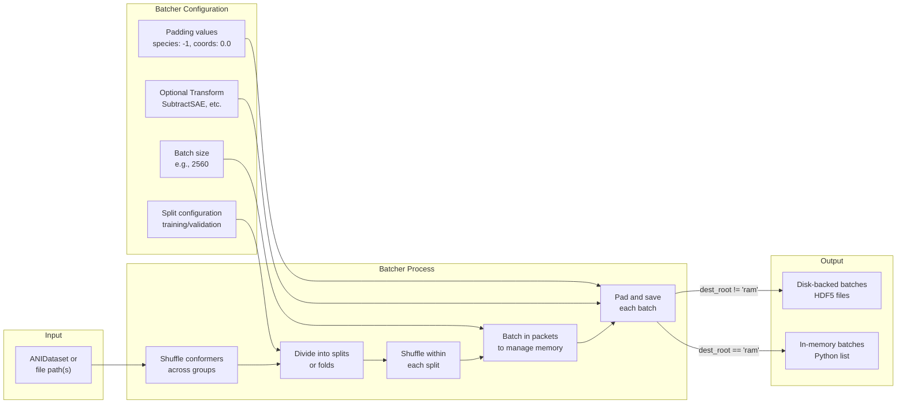
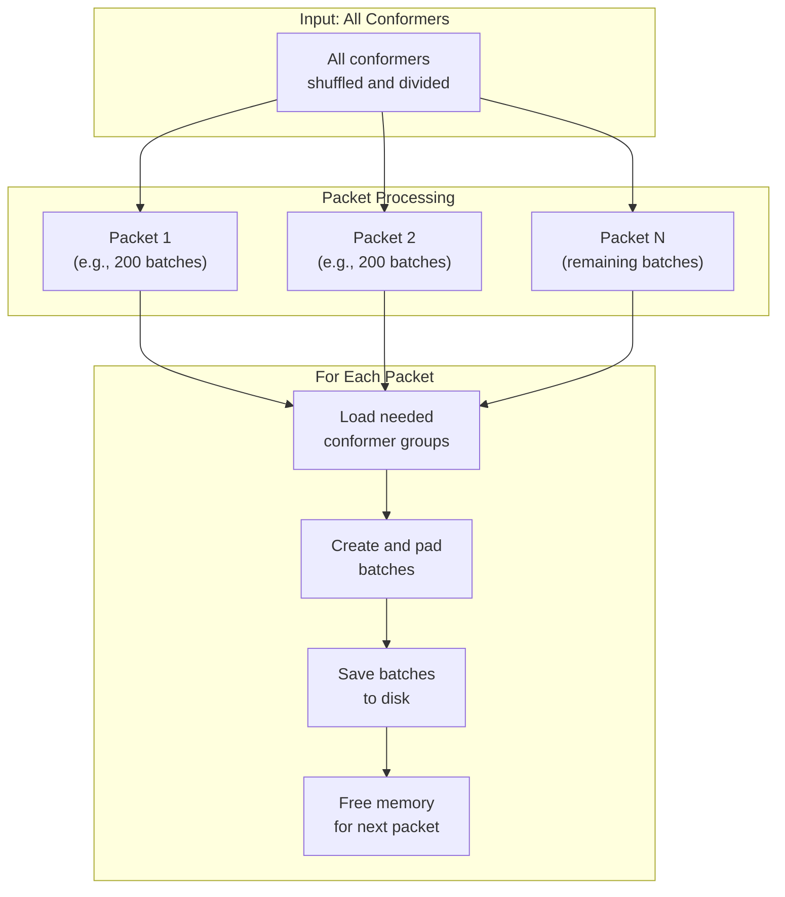

# Data Loading and Batching

<details>
<summary>Relevant source files</summary>

The following files were used as context for generating this wiki page:

- [tests/test_datasets.py](tests/test_datasets.py)
- [tests/test_datasets_batching.py](tests/test_datasets_batching.py)
- [tests/test_legacy_data.py](tests/test_legacy_data.py)
- [tests/test_sae.py](tests/test_sae.py)
- [torchani/datasets/__init__.py](torchani/datasets/__init__.py)
- [torchani/datasets/batching.py](torchani/datasets/batching.py)
- [torchani/legacy_data/__init__.py](torchani/legacy_data/__init__.py)
- [torchani/legacy_data/_pyanitools.py](torchani/legacy_data/_pyanitools.py)
- [torchani/sae.py](torchani/sae.py)
- [torchani/transforms.py](torchani/transforms.py)

</details>


## Purpose and Scope

This page describes how to load molecular datasets and create batched datasets for training in TorchANI. It covers the use of `ANIDataset` for map-style dataset access, the `Batcher` class for creating efficient batched datasets, and the `BatchedDataset` classes for iterating over pre-batched data. For information about built-in datasets and their properties, see [Built-in Datasets](#6.1). For information about preprocessing data with transforms, see [Data Transforms](#6.3).

---

## Dataset Architecture Overview

TorchANI provides two main dataset abstractions: **map-style datasets** for random access to individual conformers, and **batched datasets** for efficient iteration over pre-batched data.

```mermaid
graph TB
    subgraph "Storage Backends"
        HDF5["HDF5 Files<br/>.h5"]
        Parquet["Parquet Files<br/>.pqdir"]
        Zarr["Zarr Files<br/>.zarr"]
    end
    
    subgraph "Map-Style Access"
        ANIDataset["ANIDataset<br/>Random access to conformers"]
    end
    
    subgraph "Batching Layer"
        Batcher["Batcher<br/>divide_and_batch()"]
    end
    
    subgraph "Batched Datasets"
        ANIBatchedDataset["ANIBatchedDataset<br/>Disk-backed batches"]
        ANIBatchedInMemory["ANIBatchedInMemoryDataset<br/>RAM-cached batches"]
    end
    
    subgraph "Training Integration"
        DataLoader["PyTorch DataLoader<br/>Shuffling, multiprocessing"]
    end
    
    HDF5 --> ANIDataset
    Parquet --> ANIDataset
    Zarr --> ANIDataset
    
    ANIDataset --> Batcher
    
    Batcher -->|store_on_disk=True| ANIBatchedDataset
    Batcher -->|store_on_disk=False| ANIBatchedInMemory
    
    ANIBatchedDataset -->|cache()| ANIBatchedInMemory
    
    ANIBatchedDataset --> DataLoader
    ANIBatchedInMemory --> DataLoader
```

**Sources:** [torchani/datasets/batching.py:25-229](), [torchani/datasets/__init__.py:1-80]()

---

## Map-Style Dataset Loading

The `ANIDataset` class provides map-style access to molecular conformers stored in HDF5, Parquet, or Zarr formats. This class is useful for exploring datasets and for creating custom batching strategies.

### Basic Usage

```python
from torchani.datasets import ANIDataset

# Load a dataset from one or more files
dataset = ANIDataset("/path/to/dataset.h5")

# Access dataset properties
print(f"Number of conformer groups: {dataset.num_conformer_groups}")
print(f"Total conformers: {dataset.num_conformers}")
print(f"Available properties: {dataset.properties}")
print(f"Atomic symbols: {dataset.symbols}")

# Iterate over conformer groups
for group_name, conformers in dataset.items():
    species = conformers["species"]        # Shape: (num_conformers, num_atoms)
    coords = conformers["coordinates"]     # Shape: (num_conformers, num_atoms, 3)
    energies = conformers["energies"]      # Shape: (num_conformers,)
```

### Retrieving Specific Conformers

The `get_conformers` method allows selective retrieval:

```python
# Get all conformers from a group
all_conformers = dataset.get_conformers("group_name")

# Get specific conformers by index
conformers = dataset.get_conformers("group_name", [0, 5, 10])

# Get only specific properties
energies_only = dataset.get_conformers(
    "group_name", 
    [0, 1, 2], 
    properties="energies"
)
```

**Sources:** [torchani/datasets/anidataset.py]() (class definition), [tests/test_datasets.py:284-340]()

---

## Creating Batched Datasets with Batcher

The `Batcher` class efficiently converts map-style datasets into batched datasets with train/validation splits or cross-validation folds. It handles shuffling, padding, and optional transformations.

### Batcher Workflow



**Sources:** [torchani/datasets/batching.py:238-393]()

### Basic Batching with Splits

```python
from torchani.datasets import Batcher

# Create a batcher instance
batcher = Batcher(
    dest_root="default",  # Uses datasets_dir() by default
    max_batches_per_packet=200,  # Controls memory usage
    verbose=True
)

# Create train/validation splits
datasets = batcher.divide_and_batch(
    src="/path/to/dataset.h5",
    dest_dir="my_batched_dataset",
    splits={"training": 0.8, "validation": 0.2},
    batch_size=2560,
    divs_seed=42,      # For reproducible splits
    batch_seed=123     # For reproducible batch shuffling
)

# Returns a dictionary of BatchedDataset objects
train_dataset = datasets["training"]
valid_dataset = datasets["validation"]
```

### Cross-Validation Folds

For ensemble training or cross-validation, use folds instead of splits:

```python
datasets = batcher.divide_and_batch(
    src="/path/to/dataset.h5",
    dest_dir="cv_batches",
    folds=5,  # Creates 5 training/validation pairs
    batch_size=2560
)

# Access individual folds
fold0_train = datasets["training0"]
fold0_valid = datasets["validation0"]
fold1_train = datasets["training1"]
fold1_valid = datasets["validation1"]
# ... up to fold4
```

**Sources:** [torchani/datasets/batching.py:267-393](), [tests/test_datasets_batching.py:204-224]()

### In-Memory Batching

For smaller datasets that fit in RAM, batching directly to memory is faster:

```python
# Method 1: Using Batcher.in_ram()
batcher = Batcher.in_ram(verbose=True)
datasets = batcher.divide_and_batch(
    src="/path/to/dataset.h5",
    splits={"training": 0.8, "validation": 0.2},
    batch_size=2560
)

# Method 2: Using convenience function
from torchani.datasets import batch_all_in_ram

dataset = batch_all_in_ram(
    src="/path/to/dataset.h5",
    batch_size=2560,
    divs_seed=42,
    batch_seed=123
)
```

**Sources:** [torchani/datasets/batching.py:264-265](), [torchani/datasets/batching.py:678-699]()

---

## Batched Dataset Classes

### ANIBatchedDataset (Disk-Backed)

`ANIBatchedDataset` loads batches from disk on-demand, minimizing memory usage for large datasets. Each batch is stored as a separate HDF5 file.

```python
from torchani.datasets import ANIBatchedDataset

# Load a batched dataset from disk
train = ANIBatchedDataset(
    store_dir="/path/to/my_batched_dataset",
    split="training",
    limit=1.0,  # Use full dataset (or fraction like 0.5)
    drop_last=False  # Keep incomplete last batch
)

# Access batches
print(f"Number of batches: {len(train)}")

# Iterate over batches
for batch in train:
    species = batch["species"]       # Shape: (batch_size, max_atoms)
    coords = batch["coordinates"]    # Shape: (batch_size, max_atoms, 3)
    energies = batch["energies"]     # Shape: (batch_size,)
```

**Sources:** [torchani/datasets/batching.py:144-228]()

### ANIBatchedInMemoryDataset (RAM-Cached)

`ANIBatchedInMemoryDataset` stores all batches in memory for faster iteration. It can be created by caching a disk-backed dataset:

```python
# Cache a disk-backed dataset
train_cached = train.cache(
    verbose=True,
    pin_memory=True  # Pin memory for faster GPU transfer
)

# Or create directly from batches
from torchani.datasets import ANIBatchedInMemoryDataset

batches = [batch1, batch2, batch3]  # List of conformer dictionaries
in_memory_ds = ANIBatchedInMemoryDataset(
    batches=batches,
    split="training"
)
```

**Key Differences:**

| Feature | ANIBatchedDataset | ANIBatchedInMemoryDataset |
|---------|-------------------|---------------------------|
| Storage | Disk (HDF5 files) | RAM |
| Memory Usage | Low | High |
| Speed | Moderate | Fast |
| Multiprocessing | Supported | Not supported |
| Pin Memory | Via DataLoader | Direct method |

**Sources:** [torchani/datasets/batching.py:83-139](), [torchani/datasets/batching.py:189-211]()

---

## DataLoader Integration

Both batched dataset types integrate seamlessly with PyTorch's `DataLoader` for shuffling and parallel data loading.

### Using as_dataloader()

The simplest way to create a DataLoader is using the `as_dataloader()` helper method:

```python
# For disk-backed datasets (supports multiprocessing)
train_loader = train.as_dataloader(
    num_workers=4,           # Parallel data loading
    pin_memory=True,         # Faster GPU transfer
    prefetch_factor=2,       # Batches per worker
    shuffle=True             # Shuffle batch order
)

# For in-memory datasets (no multiprocessing)
train_cached_loader = train_cached.as_dataloader(
    shuffle=True  # Only shuffle parameter is used
)

# Iterate over batches
for batch in train_loader:
    species = batch["species"].cuda()
    coords = batch["coordinates"].cuda()
    energies = batch["energies"].cuda()
    # ... training code
```

### Manual DataLoader Creation

For more control, create a DataLoader directly:

```python
import torch

loader = torch.utils.data.DataLoader(
    train,
    num_workers=4,
    pin_memory=True,
    shuffle=True,
    batch_size=None  # Important: batches already formed
)
```

**Important:** Always set `batch_size=None` when using `BatchedDataset` objects with `DataLoader`, since the batches are already formed. The DataLoader is used only for shuffling and parallel loading.

**Sources:** [torchani/datasets/batching.py:46-64](), [torchani/datasets/batching.py:111-130](), [tests/test_datasets_batching.py:117-126]()

---

## Advanced Batching Options

### Custom Padding Values

Control how molecular properties are padded to create uniform batches:

```python
from torchani.utils import PADDING

# Default padding
# PADDING = {"species": -1, "coordinates": 0.0, "forces": 0.0, "energies": 0.0}

# Custom padding
custom_padding = {
    "species": -1,
    "coordinates": 0.0,
    "forces": 0.0,
    "energies": 0.0,
    "charges": 0,
    "dipoles": 0.0
}

datasets = batcher.divide_and_batch(
    src="/path/to/dataset.h5",
    dest_dir="custom_padding",
    splits={"training": 0.8, "validation": 0.2},
    batch_size=2560,
    padding=custom_padding
)
```

### Selective Property Loading

Reduce memory usage by loading only required properties:

```python
# Create batches with only specific properties
datasets = batcher.divide_and_batch(
    src="/path/to/dataset.h5",
    dest_dir="minimal_batches",
    splits={"training": 0.8, "validation": 0.2},
    batch_size=2560,
    properties=("species", "coordinates", "energies")
)

# Load only specific properties from existing batches
train = ANIBatchedDataset(
    store_dir="/path/to/batches",
    split="training",
    properties=("species", "coordinates", "energies")
)
```

### Applying Transforms During Batching

Transforms can be applied when creating batches or when loading them:

```python
from torchani.transforms import SubtractSAE, Compose

# Apply transform during batch creation
transform = SubtractSAE(
    symbols=("H", "C", "N", "O"),
    self_energies=[-0.6, -38.0, -54.7, -75.2]
)

datasets = batcher.divide_and_batch(
    src="/path/to/dataset.h5",
    dest_dir="transformed",
    splits={"training": 0.8, "validation": 0.2},
    batch_size=2560,
    transform=transform
)

# Or apply transform when loading batches
train = ANIBatchedDataset(
    store_dir="/path/to/batches",
    split="training",
    transform=transform
)
```

**Sources:** [torchani/datasets/batching.py:267-393](), [tests/test_datasets.py:163-190]()

### Limiting Dataset Size

Use the `limit` parameter to work with a subset of batches:

```python
# Use only 50% of batches (useful for testing)
train_subset = ANIBatchedDataset(
    store_dir="/path/to/batches",
    split="training",
    limit=0.5  # Use first 50% of batches
)

# Or use a fixed number of batches
train_fixed = ANIBatchedDataset(
    store_dir="/path/to/batches",
    split="training",
    limit=10  # Use first 10 batches
)
```

**Sources:** [torchani/datasets/batching.py:69-80]()

---

## Batching Memory Management

The `Batcher` class uses a **packet-based** approach to manage memory efficiently when creating large batched datasets.



The `max_batches_per_packet` parameter controls this tradeoff:
- **Smaller values** (e.g., 50): Lower memory usage, slower batching
- **Larger values** (e.g., 500): Higher memory usage, faster batching
- **Default (200)**: Balanced for most datasets

```python
# For very large datasets, reduce packet size
batcher = Batcher(
    dest_root="default",
    max_batches_per_packet=50,  # Process 50 batches at a time
    verbose=True
)

# For small datasets with lots of RAM, increase packet size
batcher = Batcher(
    dest_root="default",
    max_batches_per_packet=1000,  # Process 1000 batches at a time
    verbose=True
)
```

**Sources:** [torchani/datasets/batching.py:454-579]()

---

## Batching Metadata and Reproducibility

When creating disk-backed batched datasets, a `creation_log.json` file is automatically generated to record batching parameters:

```json
{
    "datetime_created": "2024-01-15 10:30:45.123456",
    "split_names": ["training", "validation"],
    "split_fractions": [0.8, 0.2],
    "folds": null,
    "divs_seed": 42,
    "batch_seed": 123,
    "batch_size": 2560,
    "padded_properties": ["coordinates", "forces"],
    "padded_values": [0.0, 0.0],
    "symbols": ["H", "C", "N", "O"],
    "properties": ["species", "coordinates", "energies", "forces"],
    "store_locations": ["/path/to/dataset1.h5", "/path/to/dataset2.h5"],
    "num_conformers": 1234567
}
```

This metadata enables:
- **Reproducibility**: Exact recreation of batched datasets using the same seeds
- **Validation**: Verification that batched datasets match source data
- **Documentation**: Clear record of how the dataset was prepared

**Sources:** [torchani/datasets/batching.py:581-617]()

---

## Complete Training Example

Here's a complete example showing the typical workflow from raw data to training:

```python
from torchani.datasets import Batcher, ANIBatchedDataset
from torchani.transforms import SubtractSAE, Compose
import torch

# 1. Create batched datasets with splits
batcher = Batcher(
    dest_root="/data/batched",
    max_batches_per_packet=200,
    verbose=True
)

# Define transforms
sae = SubtractSAE(
    symbols=("H", "C", "N", "O"),
    self_energies=[-0.6, -38.0, -54.7, -75.2]
)

# Create batches
datasets = batcher.divide_and_batch(
    src=["/data/ani1x.h5", "/data/ani2x.h5"],
    dest_dir="ani_combined",
    splits={"training": 0.8, "validation": 0.1, "test": 0.1},
    batch_size=2560,
    transform=sae,
    properties=("species", "coordinates", "energies", "forces"),
    divs_seed=42,
    batch_seed=123
)

# 2. Load batched datasets
train = datasets["training"]
valid = datasets["validation"]

# 3. Cache validation set in memory (it's smaller)
valid_cached = valid.cache(pin_memory=True)

# 4. Create data loaders
train_loader = train.as_dataloader(
    num_workers=4,
    pin_memory=True,
    shuffle=True
)

valid_loader = valid_cached.as_dataloader(
    shuffle=False
)

# 5. Training loop
for epoch in range(num_epochs):
    # Training
    for batch in train_loader:
        species = batch["species"].cuda()
        coords = batch["coordinates"].cuda()
        energies = batch["energies"].cuda()
        forces = batch["forces"].cuda()
        
        # ... model forward pass and optimization
    
    # Validation
    with torch.no_grad():
        for batch in valid_loader:
            species = batch["species"].cuda()
            coords = batch["coordinates"].cuda()
            energies = batch["energies"].cuda()
            
            # ... validation
```

**Sources:** [torchani/datasets/batching.py:238-393](), [tests/test_datasets_batching.py:117-140]()

---