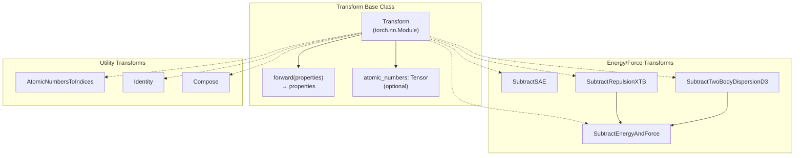
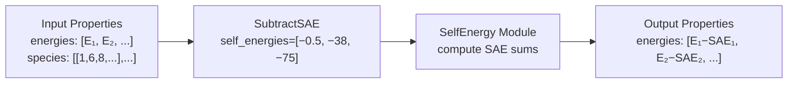
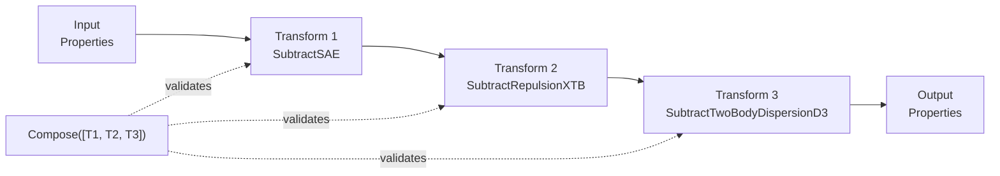
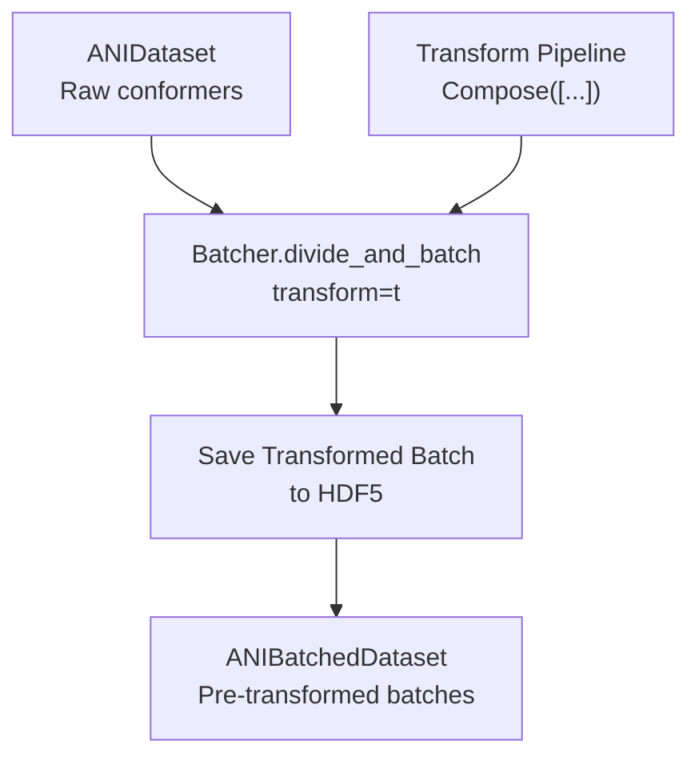
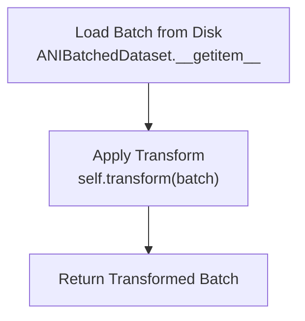
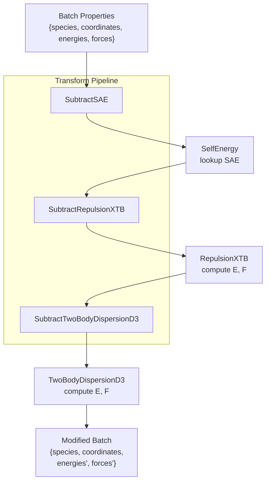

# Data Transforms

<details>
<summary>Relevant source files</summary>

The following files were used as context for generating this wiki page:

- [tests/test_datasets.py](tests/test_datasets.py)
- [tests/test_datasets_batching.py](tests/test_datasets_batching.py)
- [tests/test_legacy_data.py](tests/test_legacy_data.py)
- [tests/test_sae.py](tests/test_sae.py)
- [torchani/datasets/__init__.py](torchani/datasets/__init__.py)
- [torchani/datasets/batching.py](torchani/datasets/batching.py)
- [torchani/legacy_data/__init__.py](torchani/legacy_data/__init__.py)
- [torchani/legacy_data/_pyanitools.py](torchani/legacy_data/_pyanitools.py)
- [torchani/sae.py](torchani/sae.py)
- [torchani/transforms.py](torchani/transforms.py)

</details>


## Purpose

This page documents the data transformation system in TorchANI, which provides composable functions to preprocess molecular property data during dataset batching and loading. Transforms modify property dictionaries (containing species, coordinates, energies, forces, etc.) by operations such as subtracting self-atomic energies, repulsion corrections, or dispersion corrections.

For information about loading and batching datasets, see [Data Loading and Batching](#6.2). For information about the datasets themselves, see [Built-in Datasets](#6.1).

## Transform System Overview

The transform system is modeled after PyTorch's `torchvision.transforms` API and provides a consistent interface for preprocessing molecular data. All transforms inherit from the `Transform` base class and implement a `forward` method that accepts and returns a dictionary of molecular properties.

**Sources:** [torchani/transforms.py:1-25](), [torchani/transforms.py:43-64]()



**Sources:** [torchani/transforms.py:43-231]()

## Transform Base Class

The `Transform` class serves as the abstract base for all transformation operations. It inherits from `torch.nn.Module`, allowing transforms to maintain learnable parameters if needed and participate in PyTorch's module system.

### Key Properties

| Property | Type | Description |
|----------|------|-------------|
| `atomic_numbers` | `Optional[Tensor]` | Tensor of atomic numbers this transform supports (in order), or `None` if element-agnostic |
| `forward` | Method | Transforms a batch of properties (must be implemented by subclasses) |

The `atomic_numbers` property indicates which chemical elements a transform supports and in what order. This is used for validation when composing multiple transforms.

**Sources:** [torchani/transforms.py:43-64]()

## Available Transforms

### SubtractSAE

Subtracts self-atomic energies (SAEs) from molecular energies. Self-atomic energies represent the ground-state energy of isolated atoms and are typically subtracted from total molecular energies during training to improve model convergence.

```python
SubtractSAE(
    symbols: Sequence[str],
    self_energies: Sequence[float]
)
```

**Parameters:**
- `symbols`: Element symbols in order (e.g., `("H", "C", "N", "O")`)
- `self_energies`: Self-energy values corresponding to each symbol

The transform modifies the `energies` property by subtracting the sum of self-energies for all atoms in each molecule.

**Sources:** [torchani/transforms.py:154-169]()



**Sources:** [torchani/transforms.py:154-169](), [torchani/sae.py:16-65]()

### SubtractRepulsionXTB

Subtracts repulsion energies computed using the xTB repulsion potential. This is commonly used when training models that learn only the electronic contribution to molecular energies, with repulsion added separately during inference.

```python
SubtractRepulsionXTB(
    *args,
    subtract_force: bool = True,
    **kwargs
)
```

**Parameters:**
- Takes the same arguments as `torchani.potentials.RepulsionXTB`
- `subtract_force`: Whether to also subtract force contributions (default: `True`)

When `subtract_force=True`, both energies and forces in the property dictionary are modified.

**Sources:** [torchani/transforms.py:109-129]()

### SubtractTwoBodyDispersionD3

Subtracts two-body DFT-D3 dispersion corrections from molecular energies. This allows training models on energies with dispersion pre-subtracted, which can improve accuracy for the learned electronic energy component.

```python
SubtractTwoBodyDispersionD3(
    *args,
    subtract_force: bool = True,
    **kwargs
)
```

**Parameters:**
- Takes the same arguments as `torchani.potentials.TwoBodyDispersionD3.from_functional`
- `subtract_force`: Whether to also subtract force contributions (default: `True`)

**Sources:** [torchani/transforms.py:131-152]()

### SubtractEnergyAndForce

A general-purpose transform that subtracts energies and forces from any `Potential` object. This is the underlying implementation used by `SubtractRepulsionXTB` and `SubtractTwoBodyDispersionD3`.

```python
SubtractEnergyAndForce(
    potential: Potential,
    subtract_force: bool = True
)
```

**Note:** This transform does not support JIT scripting.

**Sources:** [torchani/transforms.py:81-107]()

### AtomicNumbersToIndices

Converts atomic numbers (periodic table indices) to model-specific element indices. This is required when training models that expect element indices rather than atomic numbers.

```python
AtomicNumbersToIndices(symbols: Sequence[str])
```

**Note:** This transform should generally be the **last** transform in a pipeline, as it changes the `species` representation from atomic numbers to indices.

**Sources:** [torchani/transforms.py:171-191]()

### Identity

A pass-through transform that returns properties unchanged. Useful as a placeholder or default value.

```python
identity = Identity()
```

**Sources:** [torchani/transforms.py:67-78]()

## Composing Transforms

The `Compose` class chains multiple transforms into a single pipeline. Transforms are applied sequentially in the order provided.

```python
Compose(transforms: Sequence[Transform])
```

### Validation

When composing transforms, the `Compose` class validates that all transforms with non-`None` `atomic_numbers` support the same set of elements in the same order. This prevents composition errors where transforms expect different element orderings.

**Sources:** [torchani/transforms.py:194-223]()



**Sources:** [torchani/transforms.py:194-231]()

## Integration with Dataset Loading

Transforms can be applied at two stages in the data pipeline:

1. **During batching**: Applied once when creating batched datasets
2. **During iteration**: Applied every time a batch is loaded

### During Batching

The `Batcher.divide_and_batch` method accepts a `transform` parameter that applies the transformation when creating batch files on disk.



**Sources:** [torchani/datasets/batching.py:266-393](), [torchani/datasets/batching.py:553-565]()

### During Iteration

The `BatchedDataset` and `ANIBatchedInMemoryDataset` classes accept a `transform` parameter that applies transformations each time a batch is retrieved.



**Sources:** [torchani/datasets/batching.py:132-135](), [torchani/datasets/batching.py:222-225]()

## Usage Examples

### Example 1: Basic SAE Subtraction

```python
from torchani.transforms import SubtractSAE
from torchani.datasets import ANIBatchedDataset

# Define transform
symbols = ("H", "N", "O")
sae = SubtractSAE(symbols=symbols, self_energies=(-0.5, -54.6, -75))

# Apply during dataset iteration
train = ANIBatchedDataset(
    '/dataset/path/', 
    transform=sae, 
    split='training'
)
```

**Sources:** [torchani/transforms.py:6-24]()

### Example 2: Composing Multiple Transforms

```python
from torchani.transforms import (
    Compose,
    SubtractSAE,
    SubtractRepulsionXTB,
    SubtractTwoBodyDispersionD3,
)

symbols = ("H", "N", "O")
sae = SubtractSAE(symbols=symbols, self_energies=(-0.5, -54.6, -75))
rep = SubtractRepulsionXTB(symbols=symbols)
disp = SubtractTwoBodyDispersionD3(symbols=symbols, functional='wB97X')

# Chain transforms
t = Compose([sae, rep, disp])

# Use in dataset
train = ANIBatchedDataset('/dataset/path/', transform=t, split='training')
```

**Sources:** [torchani/transforms.py:6-24]()

### Example 3: Transform During Batching

```python
from torchani.datasets import Batcher
from torchani.transforms import Compose, SubtractSAE

symbols = ("H", "C", "N", "O")
sae = SubtractSAE(symbols, [-0.5, -38, -54.6, -75])

batcher = Batcher(dest_root="./batched_data")
datasets = batcher.divide_and_batch(
    src="path/to/dataset.h5",
    splits={"training": 0.8, "validation": 0.2},
    batch_size=2560,
    transform=sae  # Applied once during batching
)
```

**Sources:** [torchani/datasets/batching.py:266-393]()

## Property Modification Details

### Energy Properties

Transforms that subtract energies modify the `energies` key in the property dictionary:

```python
properties["energies"] -= computed_energy_contribution
```

### Force Properties

When `subtract_force=True`, transforms also modify the `forces` key:

```python
properties["forces"] -= computed_force_contribution
```

Forces are computed via automatic differentiation through the potential energy function.

**Sources:** [torchani/transforms.py:95-106]()

### Property Dictionary Structure

Transforms operate on dictionaries with the following typical structure:

| Key | Shape | Type | Description |
|-----|-------|------|-------------|
| `species` | `(molecules, atoms)` | `long` | Atomic numbers or element indices |
| `coordinates` | `(molecules, atoms, 3)` | `float` | Atomic coordinates in Angstroms |
| `energies` | `(molecules,)` | `float` | Total molecular energies |
| `forces` | `(molecules, atoms, 3)` | `float` | Atomic forces (optional) |

**Sources:** [torchani/datasets/batching.py:213-220]()

## Transform Pipeline Execution

The following diagram shows how a typical transform pipeline processes a batch:



**Sources:** [torchani/transforms.py:219-222]()

## Implementation Considerations

### JIT Compilation

Most transforms support PyTorch JIT scripting, with the notable exception of `SubtractEnergyAndForce`, which raises a runtime error when JIT compilation is attempted. This is because the gradient computation through potentials is not compatible with JIT tracing.

**Sources:** [torchani/transforms.py:96-97]()

### In-Place vs. Copy Operations

Transforms modify the property dictionary in-place. If you need to preserve the original properties, create a copy before applying transforms:

```python
original_batch = load_batch()
transformed_batch = transform(original_batch.copy())
```

### Memory Efficiency

Applying transforms during batching (writing pre-transformed batches to disk) trades disk space for runtime computation. Applying transforms during iteration saves disk space but requires recomputation each epoch.

**Sources:** [torchani/datasets/batching.py:553-565]()

### Element Ordering Consistency

When using multiple transforms, ensure all transforms use the same element ordering (i.e., the same `symbols` sequence). The `Compose` class validates this automatically.

**Sources:** [torchani/transforms.py:204-215]()

---