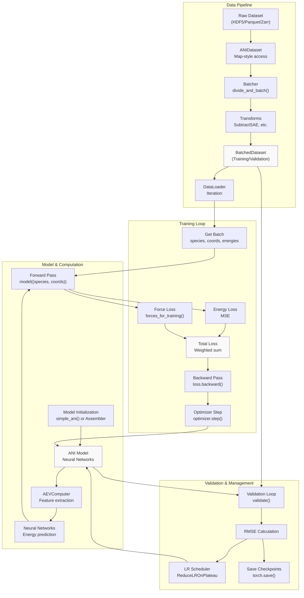
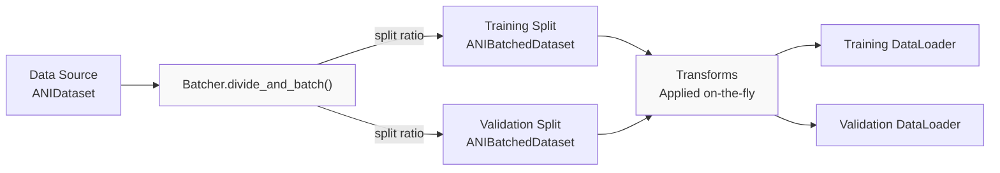
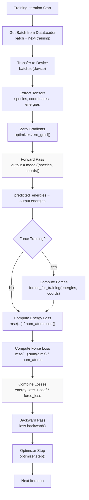

# Training

<details>
<summary>Relevant source files</summary>

The following files were used as context for generating this wiki page:

- [examples/training.py](examples/training.py)
- [tests/test_datasets.py](tests/test_datasets.py)
- [tests/test_datasets_batching.py](tests/test_datasets_batching.py)
- [tests/test_legacy_data.py](tests/test_legacy_data.py)
- [tests/test_sae.py](tests/test_sae.py)
- [torchani/datasets/batching.py](torchani/datasets/batching.py)
- [torchani/grad.py](torchani/grad.py)
- [torchani/legacy_data/__init__.py](torchani/legacy_data/__init__.py)
- [torchani/legacy_data/_pyanitools.py](torchani/legacy_data/_pyanitools.py)
- [torchani/sae.py](torchani/sae.py)
- [torchani/transforms.py](torchani/transforms.py)

</details>


## Purpose and Scope

This page provides an overview of training neural network potentials in TorchANI. Training involves optimizing the parameters of ANI models to predict molecular energies and forces from atomic coordinates. This page covers the high-level architecture, core components, and data flow involved in the training process.

For detailed information on specific aspects of training:
- See [Training Workflow](#7.1) for a complete walkthrough of the training loop implementation
- See [Data Preparation for Training](#7.2) for batching strategies and data transforms
- See [Force Training](#7.3) for force matching considerations
- See [Using Pre-built Models](#5.1) for loading pre-trained models instead of training from scratch
- See [Building Custom Models](#5.3) for creating custom model architectures to train

---

## Training Architecture Overview

The training process in TorchANI consists of several interconnected components that work together to optimize neural network potentials.



**Sources:** [examples/training.py:1-212](), [torchani/datasets/batching.py:1-700](), [torchani/grad.py:1-400]()

---

## Core Training Components

### Model Initialization

Models for training can be created using either the `simple_ani()` function or the `Assembler` class. The model typically consists of:

| Component | Class/Module | Purpose |
|-----------|-------------|---------|
| AEV Computer | `AEVComputer` | Computes atomic environment vectors from coordinates |
| Neural Networks | `ANINetworks` or `Ensemble` | Predicts atomic energies from AEVs |
| Self Energies | `SelfEnergy` | Adds ground-state atomic energies |
| Additional Potentials | `RepulsionXTB`, etc. | Optional repulsion/dispersion corrections |

The neural network parameters are what get optimized during training. Self energies and additional potentials typically remain fixed.

**Sources:** [examples/training.py:73-73](), [torchani/arch.py]()

### Data Pipeline

The data pipeline prepares molecular conformations for training through several stages:



Key classes and methods:

- **`ANIDataset`**: Map-style dataset providing access to individual conformers
- **`Batcher`**: Splits data into training/validation and creates batches
  - `divide_and_batch()`: Main method that performs splitting and batching
- **`ANIBatchedDataset`**: Pre-batched dataset for efficient iteration
- **`ANIBatchedInMemoryDataset`**: Cached version stored in RAM
- **`Transform`**: Base class for data preprocessing operations
- **`SubtractSAE`**: Subtracts self-atomic energies from total energies

**Sources:** [torchani/datasets/batching.py:238-676](), [torchani/transforms.py:1-231](), [examples/training.py:23-53]()

### Data Transforms

Transforms preprocess the data before training. Common transforms include:

| Transform | Purpose | Applied to |
|-----------|---------|------------|
| `SubtractSAE` | Subtract self-atomic energies | Energies |
| `SubtractRepulsionXTB` | Subtract xTB repulsion | Energies, Forces |
| `SubtractTwoBodyDispersionD3` | Subtract D3 dispersion | Energies, Forces |
| `Compose` | Chain multiple transforms | All properties |

Transforms can be applied:
1. During batching (permanent, stored in batched dataset)
2. On-the-fly during iteration (via `transform` parameter)
3. Directly on batches in the training loop

**Sources:** [torchani/transforms.py:43-231](), [examples/training.py:55-69]()

### Loss Functions

Training typically involves two types of losses:

#### Energy Loss

The energy loss compares predicted molecular energies to target energies. The standard formulation uses MSE normalized by the square root of the number of atoms:

```python
energy_loss = (mse(predicted_energies, target_energies) / num_atoms.sqrt()).mean()
```

This normalization helps ensure that molecules of different sizes contribute equally to the loss.

**Sources:** [examples/training.py:172-174]()

#### Force Loss

Force loss is computed by taking gradients of predicted energies with respect to coordinates, then comparing to target forces. The `forces_for_training()` helper function computes forces with the appropriate gradient graph configuration:

```python
predicted_forces = forces_for_training(predicted_energies, coordinates)
force_loss = (mse(predicted_forces, target_forces).sum(dim=(1, 2)) / num_atoms).mean()
```

Forces are normalized by the number of atoms to maintain balanced contributions across molecules of different sizes.

**Sources:** [examples/training.py:169-177](), [torchani/grad.py:82-83]()

#### Combined Loss

The total loss combines energy and force components with a weighting coefficient:

```python
loss = energy_loss + force_coefficient * force_loss
```

The `force_coefficient` (typically 0.1) balances the relative importance of energy and force matching.

**Sources:** [examples/training.py:148-180]()

### Optimization

Training uses standard PyTorch optimizers. Common choices include:

| Optimizer | Typical Use | Key Parameters |
|-----------|-------------|----------------|
| `AdamW` | General purpose | `lr=0.5e-3`, `weight_decay=1e-6` |
| `Adam` | Alternative to AdamW | `lr=1e-3` |

Learning rate scheduling is typically handled by `ReduceLROnPlateau`, which reduces the learning rate when validation error plateaus:

```python
scheduler = torch.optim.lr_scheduler.ReduceLROnPlateau(
    optimizer,
    factor=0.5,
    patience=100,
    threshold=0,
)
```

**Sources:** [examples/training.py:76-86]()

### Validation and Checkpointing

Validation runs after each epoch to assess model performance on held-out data. The validation process:

1. Sets model to evaluation mode (`model.train(False)`)
2. Disables gradients (`with torch.no_grad()`)
3. Computes predictions on validation batches
4. Calculates RMSE in kcal/mol units
5. Steps the learning rate scheduler
6. Saves checkpoints if performance improves

Two types of checkpoints are typically maintained:
- **Latest checkpoint**: Contains model, optimizer, and scheduler state for resuming training
- **Best model checkpoint**: Contains only the best model state by validation RMSE

**Sources:** [examples/training.py:104-145](), [examples/training.py:186-211]()

---

## Training Data Flow

This diagram shows how data flows through a single training iteration:



**Key Methods and Classes:**

| Code Entity | Location | Purpose |
|-------------|----------|---------|
| `BatchedDataset.as_dataloader()` | [torchani/datasets/batching.py:46-64]() | Creates PyTorch DataLoader |
| `model((species, coordinates))` | Model forward method | Computes energies from inputs |
| `forces_for_training()` | [torchani/grad.py:82-83]() | Computes forces with gradient graph |
| `optimizer.zero_grad()` | PyTorch | Clears accumulated gradients |
| `loss.backward()` | PyTorch | Computes parameter gradients |
| `optimizer.step()` | PyTorch | Updates model parameters |

**Sources:** [examples/training.py:156-184](), [torchani/grad.py:82-83]()

---

## Quick Start Training Example

The complete training example can be found in [examples/training.py:1-212](). Here's the structure:

### Setup Phase

```python
# Device selection
device = torch.device("cuda" if torch.cuda.is_available() else "cpu")

# Create batched datasets
batched_dataset_path = Path("./batched_dataset").resolve()
if not batched_dataset_path.exists():
    torchani.datasets.create_batched_dataset(
        ds,
        dest_path=batched_dataset_path,
        batch_size=2560,
        splits={"training": 0.8, "validation": 0.2},
    )

# Load datasets
train_ds = ANIBatchedDataset(batched_dataset_path, split="training")
valid_ds = ANIBatchedDataset(batched_dataset_path, split="validation")

# Optional: Cache in memory
train_ds = train_ds.cache()
valid_ds = valid_ds.cache()

# Create model
model = simple_ani(("H", "C", "N", "O"), lot="wb97x-631gd", repulsion=True)
model.to(device)
```

**Sources:** [examples/training.py:22-98]()

### Training Loop

```python
for epoch in range(scheduler.last_epoch, max_epochs + 1):
    for batch in training:
        batch = {k: v.to(device, non_blocking=True) for k, v in batch.items()}
        
        # Forward pass
        output = model((batch["species"], batch["coordinates"].float()))
        predicted_energies = output.energies
        
        # Compute loss
        if force_training:
            predicted_forces = forces_for_training(predicted_energies, coordinates)
            energy_loss = (mse(predicted_energies, target_energies) / num_atoms.sqrt()).mean()
            force_loss = (mse(predicted_forces, target_forces).sum(dim=(1, 2)) / num_atoms).mean()
            loss = energy_loss + force_coefficient * force_loss
        else:
            loss = (mse(predicted_energies, target_energies) / num_atoms.sqrt()).mean()
        
        # Backward pass
        optimizer.zero_grad()
        loss.backward()
        optimizer.step()
    
    # Validation and checkpointing
    rmse = validate(model, validation)
    if scheduler.is_better(rmse, scheduler.best):
        torch.save(model.state_dict(), best_model_state_checkpoint_path)
    scheduler.step(rmse)
```

**Sources:** [examples/training.py:151-211]()

---

## Batching Strategies

The `Batcher` class provides flexible data splitting and batching:

### Splits

Divide data into named splits with specified fractions:

```python
splits = {"training": 0.8, "validation": 0.2}
```

The splits are created by shuffling all conformers and dividing according to the specified fractions.

### Folds

For cross-validation or ensemble training, use folds instead of splits:

```python
folds = 5  # Creates training0/validation0, training1/validation1, etc.
```

Each fold uses a different subset as validation, enabling k-fold cross-validation.

### Batch Size and Padding

Batches are padded to accommodate molecules of different sizes. Padding values are specified in the `padding` parameter:

| Property | Default Padding | Purpose |
|----------|----------------|---------|
| `species` | -1 | Marks padded atoms |
| `coordinates` | 0.0 | Zero coordinates for padding |
| `energies` | 0.0 | Zero energy for padding |
| `forces` | 0.0 | Zero forces for padding |

**Sources:** [torchani/datasets/batching.py:238-393](), [torchani/utils.py]()

---

## Performance Considerations

### Memory Management

**In-Memory Caching:**
- Call `.cache()` on `ANIBatchedDataset` to load all batches into RAM
- Significantly faster iteration but requires substantial memory
- Automatically pins memory if CUDA is available

**Disk-Backed Datasets:**
- Use `ANIBatchedDataset` without caching for large datasets
- Supports multiprocessing via DataLoader's `num_workers`
- Slower but memory-efficient

**Sources:** [torchani/datasets/batching.py:189-211](), [examples/training.py:48-53]()

### Batch Size Selection

Typical batch sizes:
- **Small models/GPUs**: 1024-2560 conformers
- **Large models/GPUs**: 5120+ conformers
- **CPU training**: 256-1024 conformers

Larger batches provide more stable gradients but require more memory.

### Multi-GPU Training

TorchANI models are compatible with PyTorch's `DataParallel` and `DistributedDataParallel` for multi-GPU training, though specific examples are not provided in the basic training script.

**Sources:** [examples/training.py:32-32]()

---

## Related Resources

For more detailed information on specific training topics:

- **[Training Workflow](#7.1)**: Step-by-step guide through the complete training loop
- **[Data Preparation for Training](#7.2)**: Detailed batching and transform usage
- **[Force Training](#7.3)**: Force matching implementation details
- **[Building Custom Models](#5.3)**: Creating custom architectures for training
- **[Datasets](#6)**: Overview of dataset management
- **[Data Transforms](#6.3)**: Complete transform API reference

For using trained models:
- **[Using Pre-built Models](#5.1)**: Loading and using pre-trained models
- **[Energy and Force Calculations](#5.2)**: Inference with trained models

---