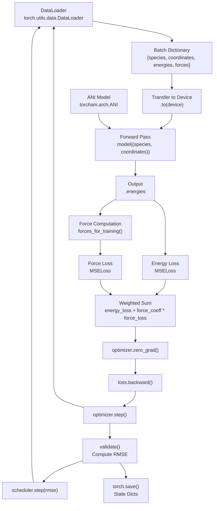
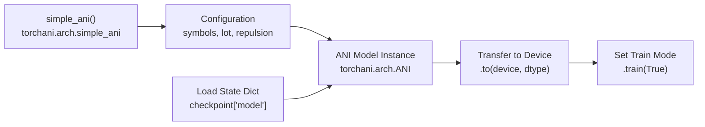
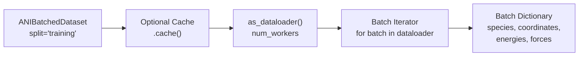
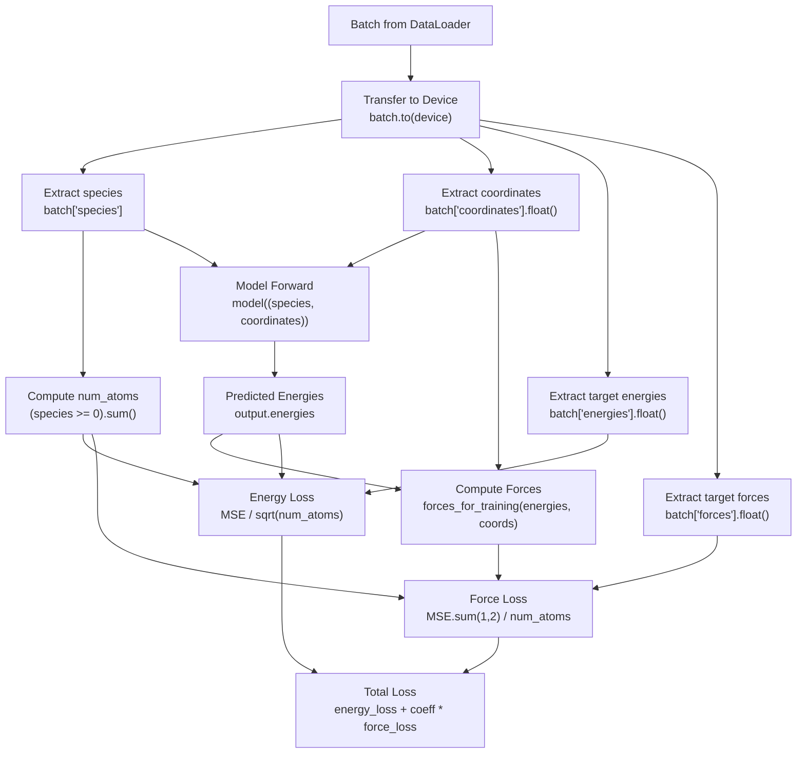
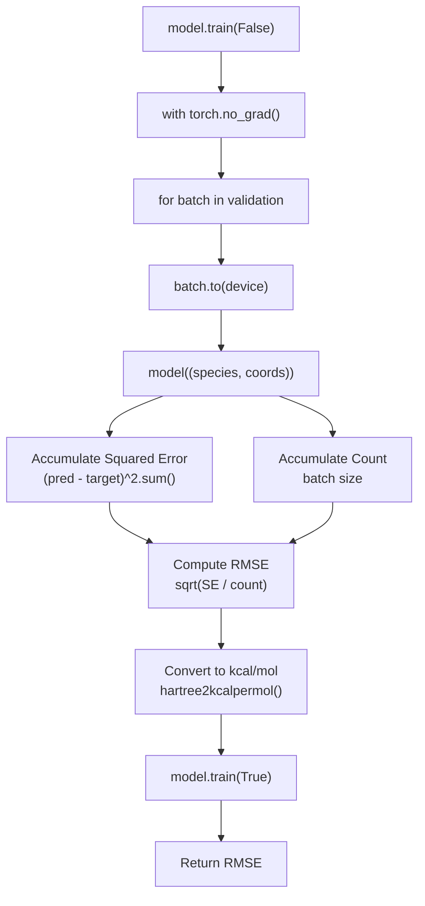
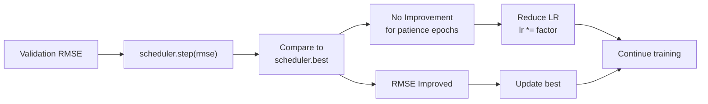
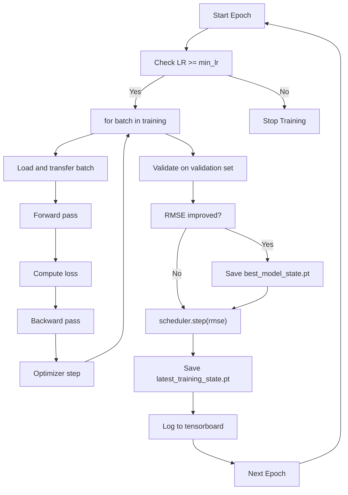

# Training Workflow

<details>
<summary>Relevant source files</summary>

The following files were used as context for generating this wiki page:

- [examples/training.py](examples/training.py)
- [tests/test_aev.py](tests/test_aev.py)
- [tests/test_energies.py](tests/test_energies.py)
- [tests/test_ensemble.py](tests/test_ensemble.py)
- [tests/test_forces.py](tests/test_forces.py)
- [torchani/grad.py](torchani/grad.py)

</details>


This page describes the complete training workflow for ANI neural network potentials in TorchANI. It covers the training loop structure, loss computation (energy and force matching), validation procedures, checkpointing mechanisms, and learning rate scheduling. For information about preparing datasets before training, see [Data Preparation for Training](#7.2). For specific details about force training with gradient computation, see [Force Training](#7.3).

## Overview

The training workflow in TorchANI follows standard PyTorch deep learning patterns with specialized loss functions for molecular property prediction. The process involves iterating over batched molecular conformations, computing energy and optionally force predictions, calculating losses, and updating neural network parameters via backpropagation.

Sources: [examples/training.py:1-212]()

## Training Loop Architecture

The training workflow consists of several interconnected components that execute in a specific order within each epoch:



Sources: [examples/training.py:151-211]()

## Model Initialization

Before training begins, a model must be instantiated and configured. TorchANI provides factory functions for quick setup or custom assembly for full control:



The typical initialization sequence involves:

1. **Create model** using `simple_ani()` or `Assembler` pattern
2. **Load checkpoint** if resuming training
3. **Transfer to device** and set appropriate dtype
4. **Enable training mode**

Sources: [examples/training.py:73-98]()

## Optimizer and Scheduler Setup

Training requires configuring an optimizer and learning rate scheduler:

| Component | Class | Key Parameters |
|-----------|-------|----------------|
| Optimizer | `torch.optim.AdamW` | `lr`, `weight_decay`, `params` |
| LR Scheduler | `torch.optim.lr_scheduler.ReduceLROnPlateau` | `factor`, `patience`, `threshold` |

The optimizer operates only on the neural network parameters:

```python
optimizer = torch.optim.AdamW(
    params=model.neural_networks.parameters(),
    lr=0.5e-3,
    weight_decay=1e-6,
)
```

The learning rate scheduler monitors validation RMSE and reduces learning rate when progress plateaus:

```python
scheduler = torch.optim.lr_scheduler.ReduceLROnPlateau(
    optimizer,
    factor=0.5,
    patience=100,
    threshold=0,
)
```

Sources: [examples/training.py:76-86]()

## Data Loading for Training

The training loop consumes data through PyTorch's `DataLoader` interface. TorchANI's `BatchedDataset` provides efficient pre-batched data access:



Key considerations:

- **Caching**: Call `.cache()` to load entire dataset into memory for faster iteration
- **Multiprocessing**: Set `num_workers` for parallel data loading (use 0 when cached)
- **Pin Memory**: Automatically handled by `ANIBatchedDataset` when cached

Sources: [examples/training.py:36-53]()

## Forward Pass and Loss Computation

Each training iteration performs a forward pass through the model and computes losses:



### Energy-Only Loss

For energy-only training (common in early training phases):

```python
num_atoms = (species >= 0).sum(dim=1, dtype=target_energies.dtype)
loss = (mse(predicted_energies, target_energies) / num_atoms.sqrt()).mean()
```

The division by `sqrt(num_atoms)` normalizes the loss across molecules of different sizes.

### Combined Energy and Force Loss

When `force_training=True`:

```python
predicted_forces = forces_for_training(predicted_energies, coordinates)
energy_loss = (mse(predicted_energies, target_energies) / num_atoms.sqrt()).mean()
force_loss = (mse(predicted_forces, target_forces).sum(dim=(1, 2)) / num_atoms).mean()
loss = energy_loss + force_coefficient * force_loss
```

The `forces_for_training()` function computes forces via automatic differentiation with `retain_graph=True` and `create_graph=True` to enable backpropagation through the force computation.

Sources: [examples/training.py:148-180](), [torchani/grad.py:82-83]()

## Backward Pass and Optimization

After loss computation, the backward pass and parameter update follow standard PyTorch patterns:

| Step | Operation | Purpose |
|------|-----------|---------|
| 1 | `optimizer.zero_grad()` | Clear previous gradients |
| 2 | `loss.backward()` | Compute gradients via backpropagation |
| 3 | `optimizer.step()` | Update model parameters |

```python
optimizer.zero_grad()
loss.backward()
optimizer.step()
```

This sequence is repeated for each batch in the training dataset.

Sources: [examples/training.py:182-184]()

## Validation

At the end of each epoch, validation is performed to monitor training progress and guide learning rate scheduling:



The validation function computes RMSE across the entire validation set:

```python
def validate(model: ANI, validation: torch.utils.data.DataLoader) -> float:
    squared_error = 0.0
    count = 0
    model.train(False)
    with torch.no_grad():
        for properties in validation:
            properties = {k: v.to(device, non_blocking=True) for k, v in properties.items()}
            species = properties["species"]
            coordinates = properties["coordinates"].float()
            target_energies = properties["energies"].float()
            output = model((species, coordinates))
            predicted_energies = output.energies
            squared_error += (predicted_energies - target_energies).pow(2).sum().item()
            count += predicted_energies.shape[0]
    model.train(True)
    rmse = math.sqrt(squared_error / count)
    return hartree2kcalpermol(rmse)
```

Key aspects:
- **Evaluation mode**: `model.train(False)` disables dropout and batch normalization training behavior
- **No gradients**: `torch.no_grad()` reduces memory usage and speeds computation
- **RMSE metric**: Root mean squared error provides interpretable error magnitude
- **Unit conversion**: Convert from Hartree to kcal/mol for interpretability

Sources: [examples/training.py:104-122]()

## Checkpointing and State Management

TorchANI training workflows maintain two types of checkpoints:

| Checkpoint | File | Contents | When Saved |
|------------|------|----------|------------|
| Training State | `latest_training_state.pt` | Model, optimizer, scheduler state dicts | Every epoch |
| Best Model | `best_model_state.pt` | Model state dict only | When validation RMSE improves |

### Training State Checkpoint

Saves complete training state for resumption:

```python
torch.save(
    {
        "model": model.state_dict(),
        "optimizer": optimizer.state_dict(),
        "scheduler": scheduler.state_dict(),
    },
    latest_training_state_checkpoint_path,
)
```

### Best Model Checkpoint

Saves only the model when validation improves:

```python
if scheduler.is_better(rmse, scheduler.best):
    torch.save(model.state_dict(), best_model_state_checkpoint_path)
```

### Checkpoint Loading

At training start, load existing checkpoint if available:

```python
if latest_training_state_checkpoint_path.exists():
    checkpoint = torch.load(latest_training_state_checkpoint_path, weights_only=True)
    model.load_state_dict(checkpoint["model"])
    scheduler.load_state_dict(checkpoint["scheduler"])
    optimizer.load_state_dict(checkpoint["optimizer"])
```

Sources: [examples/training.py:88-96](), [examples/training.py:138-205]()

## Learning Rate Scheduling

The `ReduceLROnPlateau` scheduler adjusts learning rate based on validation performance:



Key parameters:
- **factor**: Learning rate multiplier when reducing (e.g., 0.5 halves the LR)
- **patience**: Number of epochs without improvement before reducing
- **threshold**: Minimum improvement to be considered progress

The scheduler tracks the best validation RMSE and reduces learning rate when the metric plateaus:

```python
scheduler.step(rmse)
```

Training terminates when learning rate falls below a minimum threshold:

```python
if optimizer.param_groups[0]["lr"] < min_learning_rate:
    break
```

Sources: [examples/training.py:81-86](), [examples/training.py:152-154](), [examples/training.py:195]()

## Complete Training Loop Structure

The complete epoch loop integrates all components:



This structure ensures:
- Proper gradient computation and parameter updates
- Regular validation and checkpointing
- Adaptive learning rate adjustment
- Training termination when learning stagnates

Sources: [examples/training.py:151-211]()

## Training Metrics and Logging

TensorBoard integration enables monitoring of training progress:

```python
tensorboard = torch.utils.tensorboard.SummaryWriter()
tensorboard.add_scalar("validation_rmse_kcalpermol", rmse, epoch)
tensorboard.add_scalar("best_validation_rmse_kcalpermol", scheduler.best, epoch)
tensorboard.add_scalar("learning_rate", optimizer.param_groups[0]["lr"], epoch)
tensorboard.add_scalar("epoch_loss_square_ha", loss, epoch)
```

Tracked metrics include:
- Current validation RMSE
- Best validation RMSE achieved
- Current learning rate
- Last batch loss value

Sources: [examples/training.py:127](), [examples/training.py:207-211]()

---