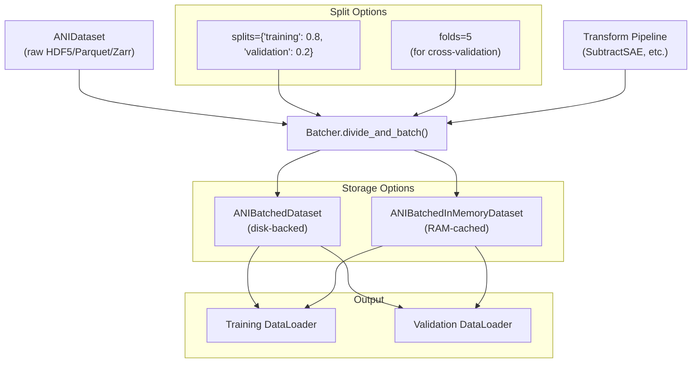
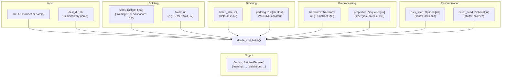
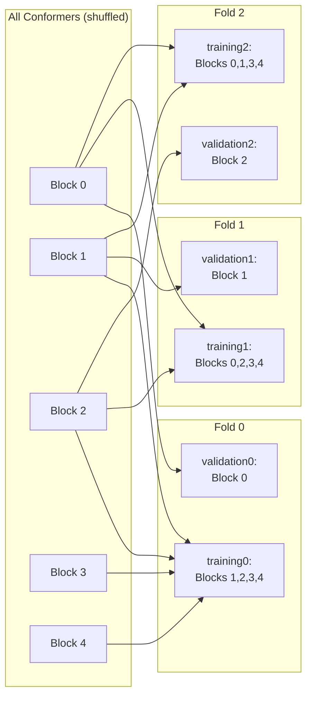
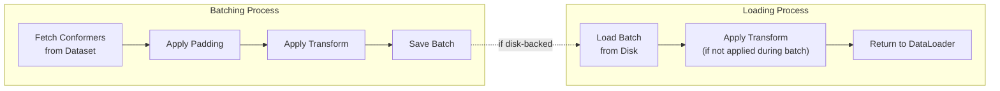
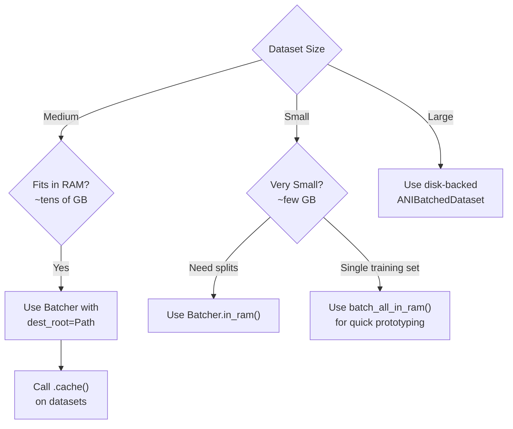
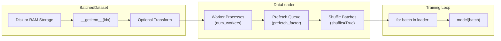

# Data Preparation for Training

<details>
<summary>Relevant source files</summary>

The following files were used as context for generating this wiki page:

- [tests/test_datasets.py](tests/test_datasets.py)
- [tests/test_datasets_batching.py](tests/test_datasets_batching.py)
- [tests/test_legacy_data.py](tests/test_legacy_data.py)
- [tests/test_sae.py](tests/test_sae.py)
- [torchani/datasets/__init__.py](torchani/datasets/__init__.py)
- [torchani/datasets/batching.py](torchani/datasets/batching.py)
- [torchani/legacy_data/__init__.py](torchani/legacy_data/__init__.py)
- [torchani/legacy_data/_pyanitools.py](torchani/legacy_data/_pyanitools.py)
- [torchani/sae.py](torchani/sae.py)
- [torchani/transforms.py](torchani/transforms.py)

</details>


This page describes how to prepare molecular datasets for training neural network potentials in TorchANI. It covers batching strategies, train/validation splitting, applying transforms to normalize data, and memory management options.

**Scope**: This page focuses on the data preparation steps that occur *after* loading raw datasets and *before* entering the training loop. For information about loading built-in datasets, see [Built-in Datasets](#6.1). For the complete training workflow including loss computation and optimization, see [Training Workflow](#7.1).

---

## Overview

Data preparation for training involves three main steps:

1. **Splitting**: Divide conformers into training and validation sets (or k-folds for cross-validation)
2. **Batching**: Group conformers into batches with padding to handle variable molecule sizes
3. **Transforming**: Apply preprocessing operations like subtracting self-atomic energies

The `Batcher` class orchestrates these steps and can save results to disk or keep them in RAM depending on dataset size and available memory.

**Workflow Diagram: From Raw Dataset to Training-Ready Batches**



Sources: [torchani/datasets/batching.py:238-393]()

---

## The Batcher Class

The `Batcher` class is the primary interface for preparing datasets. It handles shuffling, splitting, batching, padding, and optional transformation of conformers.

### Basic Usage

```python
from torchani.datasets import Batcher, ANIDataset

# Load raw dataset
dataset = ANIDataset('/path/to/dataset.h5')

# Create batcher
batcher = Batcher(
    dest_root='default',  # or Path to custom directory
    max_batches_per_packet=200,  # memory vs speed tradeoff
    verbose=True
)

# Prepare batched datasets
batched_datasets = batcher.divide_and_batch(
    src=dataset,
    dest_dir='my_batched_dataset',
    splits={'training': 0.8, 'validation': 0.2},
    batch_size=2560,
    divs_seed=12345,  # for reproducibility
    batch_seed=67890
)

train = batched_datasets['training']
valid = batched_datasets['validation']
```

Sources: [torchani/datasets/batching.py:238-266](), [torchani/datasets/batching.py:267-393]()

### Key Parameters

| Parameter | Type | Default | Description |
|-----------|------|---------|-------------|
| `dest_root` | `Path` or `'default'` or `'ram'` | `'default'` | Where to save batched data. `'default'` uses `datasets_dir()`, `'ram'` keeps in memory |
| `max_batches_per_packet` | `int` | `200` | Number of batches to process at once. Higher = faster but more RAM |
| `verbose` | `bool` | `False` | Print progress information |

Sources: [torchani/datasets/batching.py:238-262]()

### The divide_and_batch Method

**Method Signature and Core Arguments**



Sources: [torchani/datasets/batching.py:267-393]()

### Important Parameters

| Parameter | Type | Description |
|-----------|------|-------------|
| `splits` | `Optional[Dict[str, float]]` | Division fractions (must sum to 1.0). Example: `{'training': 0.8, 'validation': 0.2}` |
| `folds` | `Optional[int]` | Number of folds for cross-validation. Creates `training0`, `validation0`, `training1`, etc. |
| `batch_size` | `int` | Number of conformers per batch (default: 2560) |
| `padding` | `Optional[Dict[str, float]]` | Custom padding values. Default uses `PADDING` constant |
| `transform` | `Transform` | Transform to apply during batching (default: `identity`) |
| `properties` | `Iterable[str]` | Which properties to include. Empty means all tensor properties |
| `divs_seed` | `Optional[int]` | Random seed for division shuffling (for reproducibility) |
| `batch_seed` | `Optional[int]` | Random seed for batch shuffling (for reproducibility) |

Sources: [torchani/datasets/batching.py:267-320]()

---

## Train/Validation Splits

### Standard Split

The most common approach divides data into training and validation sets:

```python
batched_datasets = batcher.divide_and_batch(
    src=dataset,
    splits={'training': 0.8, 'validation': 0.2},
    batch_size=2560,
    divs_seed=42  # ensures reproducible splits
)

train = batched_datasets['training']
valid = batched_datasets['validation']
```

The `divs_seed` parameter controls the random shuffling before splitting. Setting it ensures the same conformers end up in training vs validation across runs.

Sources: [torchani/datasets/batching.py:343-346](), [torchani/datasets/batching.py:395-425]()

### K-Fold Cross-Validation

For ensemble training or hyperparameter tuning, use k-fold cross-validation:

```python
batched_datasets = batcher.divide_and_batch(
    src=dataset,
    folds=5,  # creates 5 training/validation pairs
    batch_size=2560,
    divs_seed=42
)

# Iterate over folds
for i in range(5):
    train = batched_datasets[f'training{i}']
    valid = batched_datasets[f'validation{i}']
    # Train model on fold i
```

This creates 10 datasets total: `training0`, `validation0`, `training1`, `validation1`, etc. Each validation set is disjoint from its corresponding training set and from all other validation sets.

**K-Fold Division Strategy**



Sources: [torchani/datasets/batching.py:427-452]()

---

## Applying Transforms

Transforms preprocess data during batching. The most common is subtracting self-atomic energies (SAE), which shifts the energy zero-point to improve training stability.

### Available Transforms

| Transform | Purpose | Common Use |
|-----------|---------|------------|
| `SubtractSAE` | Subtract constant atomic energies | Always recommended for training |
| `SubtractRepulsionXTB` | Subtract xTB repulsion energy | When training on top of repulsion baseline |
| `SubtractTwoBodyDispersionD3` | Subtract DFT-D3 dispersion | When training on top of dispersion baseline |
| `AtomicNumbersToIndices` | Convert atomic numbers to indices | Legacy compatibility (usually not needed) |
| `Compose` | Chain multiple transforms | Combine SAE + repulsion + dispersion |

Sources: [torchani/transforms.py:43-231]()

### Using SubtractSAE

```python
from torchani.transforms import SubtractSAE

# Define self-atomic energies for H, C, N, O (in Hartree)
sae_transform = SubtractSAE(
    symbols=('H', 'C', 'N', 'O'),
    self_energies=[-0.5, -37.8, -54.6, -75.1]
)

batched_datasets = batcher.divide_and_batch(
    src=dataset,
    splits={'training': 0.8, 'validation': 0.2},
    batch_size=2560,
    transform=sae_transform  # Applied during batching
)
```

**Note**: When using `SubtractSAE` during batching, the same transform is automatically applied when loading batches, so energies are already shifted.

Sources: [torchani/transforms.py:154-169](), [tests/test_datasets.py:144-149]()

### Composing Multiple Transforms

For complex preprocessing, chain transforms together:

```python
from torchani.transforms import (
    Compose,
    SubtractSAE,
    SubtractRepulsionXTB,
    SubtractTwoBodyDispersionD3
)

symbols = ('H', 'C', 'N', 'O')

transform_pipeline = Compose([
    SubtractSAE(symbols, [-0.5, -37.8, -54.6, -75.1]),
    SubtractRepulsionXTB(symbols=symbols),
    SubtractTwoBodyDispersionD3(symbols=symbols, functional='wB97X')
])

batched_datasets = batcher.divide_and_batch(
    src=dataset,
    splits={'training': 0.8, 'validation': 0.2},
    transform=transform_pipeline,
    batch_size=2560
)
```

Sources: [torchani/transforms.py:194-223](), [torchani/transforms.py:109-129](), [torchani/transforms.py:131-152]()

### Transform Application Timing

**Transform Pipeline During Batching**



Transforms can be applied either:
1. **During batching** (more common): Transform is baked into saved batches
2. **During loading**: Transform applied on-the-fly when iterating batches

Sources: [torchani/datasets/batching.py:549-565](), [torchani/datasets/batching.py:222-225]()

---

## Memory Management Strategies

TorchANI provides three storage strategies for batched datasets, each with different memory/speed tradeoffs.

### Disk-Backed Storage (ANIBatchedDataset)

**Default for large datasets.** Batches are saved as HDF5 files and loaded on-demand.

```python
batcher = Batcher(dest_root='/path/to/storage')

batched_datasets = batcher.divide_and_batch(
    src=dataset,
    dest_dir='my_dataset',
    splits={'training': 0.8, 'validation': 0.2},
    batch_size=2560
)

# Returns ANIBatchedDataset instances
train = batched_datasets['training']  # Loads from disk on iteration
```

**Advantages:**
- Minimal memory footprint
- Can handle arbitrarily large datasets
- Batches stored at `{dest_root}/{dest_dir}/{split}/NNNNN_batch.h5`

**Disadvantages:**
- Slower iteration due to disk I/O
- Requires disk space

Sources: [torchani/datasets/batching.py:144-229](), [torchani/datasets/batching.py:567-570]()

### RAM-Cached Storage (ANIBatchedInMemoryDataset)

**Recommended for datasets that fit in memory.** All batches loaded into RAM for fast iteration.

```python
# Option 1: Cache after disk-backed creation
train_cached = train.cache(verbose=True, pin_memory=True)

# Option 2: Create directly in RAM
batcher = Batcher.in_ram(verbose=True)
batched_datasets = batcher.divide_and_batch(
    src=dataset,
    splits={'training': 0.8, 'validation': 0.2},
    batch_size=2560
)
# Returns ANIBatchedInMemoryDataset instances
```

**Advantages:**
- Fast iteration (no disk I/O)
- Can pin memory for faster GPU transfer

**Disadvantages:**
- Requires significant RAM
- Initial caching can be slow

Sources: [torchani/datasets/batching.py:83-139](), [torchani/datasets/batching.py:189-211]()

### Convenience Function: batch_all_in_ram

For small datasets, skip disk entirely:

```python
from torchani.datasets import batch_all_in_ram

# Creates single in-memory training dataset
train = batch_all_in_ram(
    src='/path/to/dataset.h5',
    batch_size=2560,
    transform=sae_transform,
    divs_seed=42,
    batch_seed=123
)
```

This function uses `splits={'training': 1.0}` internally and returns only the training set.

Sources: [torchani/datasets/batching.py:678-699]()

### Memory Management Decision Tree



Sources: [torchani/datasets/batching.py:238-266](), [torchani/datasets/batching.py:678-699]()

---

## Batch Padding

TorchANI batches conformers with different numbers of atoms by padding smaller molecules with dummy atoms. The `PADDING` constant defines default padding values:

```python
PADDING = {
    'species': -1,        # Padding atoms have species = -1
    'coordinates': 0.0,   # Padded coordinates are zeros
    'forces': 0.0,        # Padded forces are zeros
    'energies': 0.0       # Unused (energies are scalar per molecule)
}
```

Padding is automatically applied during batching and removed where possible to minimize memory.

Sources: [torchani/utils.py]() (PADDING constant), [torchani/datasets/batching.py:532-534](), [torchani/datasets/batching.py:553]()

### Custom Padding

Override defaults if needed:

```python
custom_padding = {
    'species': -1,
    'coordinates': 0.0,
    'forces': 0.0,
    'charges': 0,  # Add custom property padding
}

batched_datasets = batcher.divide_and_batch(
    src=dataset,
    splits={'training': 0.8, 'validation': 0.2},
    padding=custom_padding,
    batch_size=2560
)
```

Sources: [torchani/datasets/batching.py:282]()

---

## Using Batched Datasets

Once created, batched datasets integrate with PyTorch's `DataLoader`:

```python
train_loader = train.as_dataloader(
    num_workers=4,
    pin_memory=True,
    prefetch_factor=2,
    shuffle=True
)

for batch in train_loader:
    species = batch['species']       # (batch_size, max_atoms)
    coordinates = batch['coordinates'] # (batch_size, max_atoms, 3)
    energies = batch['energies']     # (batch_size,)
    
    # Training code here
```

**DataLoader Integration**



Sources: [torchani/datasets/batching.py:46-64](), [torchani/datasets/batching.py:111-130]()

### Important DataLoader Parameters

| Parameter | Recommended | Notes |
|-----------|-------------|-------|
| `num_workers` | `0` for in-memory, `4+` for disk | In-memory datasets don't support multiprocessing |
| `pin_memory` | `True` if using GPU | Faster CPU→GPU transfer |
| `prefetch_factor` | `2` | Only used if `num_workers > 0` |
| `shuffle` | `True` for training | Batches are already internally shuffled |
| `batch_size` | `None` | Must be `None` (batches are pre-formed) |

Sources: [torchani/datasets/batching.py:46-64](), [torchani/datasets/batching.py:111-130]()

---

## Complete Example: Preparing ANI-1x for Training

```python
from torchani.datasets import Batcher, ANI1x
from torchani.transforms import SubtractSAE
from torchani.sae import SelfEnergy

# 1. Load built-in dataset
dataset = ANI1x()

# 2. Create transform with GSAES
sae_transform = SelfEnergy.with_gsaes(
    symbols=('H', 'C', 'N', 'O'),
    functional='wB97X',
    basis_set='631Gd'
)
transform = SubtractSAE(
    symbols=('H', 'C', 'N', 'O'),
    self_energies=sae_transform.self_energies.tolist()
)

# 3. Create batcher
batcher = Batcher(
    dest_root='./training_data',
    max_batches_per_packet=200,
    verbose=True
)

# 4. Divide and batch
batched_datasets = batcher.divide_and_batch(
    src=dataset,
    dest_dir='ani1x_batched',
    splits={'training': 0.8, 'validation': 0.2},
    batch_size=2560,
    transform=transform,
    properties=('species', 'coordinates', 'energies', 'forces'),
    divs_seed=42,
    batch_seed=123
)

# 5. Cache for fast iteration (if enough RAM)
train = batched_datasets['training'].cache(pin_memory=True)
valid = batched_datasets['validation'].cache(pin_memory=True)

# 6. Create data loaders
train_loader = train.as_dataloader(shuffle=True)
valid_loader = valid.as_dataloader(shuffle=False)

# 7. Ready for training
for batch in train_loader:
    # Training code here
    pass
```

Sources: [torchani/datasets/batching.py:238-393](), [torchani/transforms.py:154-169](), [torchani/sae.py:48-50]()

---

## Legacy API: create_batched_dataset

For backward compatibility, TorchANI provides `create_batched_dataset`, a functional wrapper around `Batcher`:

```python
from torchani.datasets import create_batched_dataset

batched_datasets = create_batched_dataset(
    src='/path/to/dataset.h5',
    dest_path='/path/to/output',
    splits={'training': 0.8, 'validation': 0.2},
    batch_size=2560,
    transform=sae_transform,
    divs_seed=42,
    batch_seed=123,
    direct_cache=False,  # If True, creates in-memory datasets
    max_batches_per_packet=200,
    verbose=True
)
```

**Note**: New code should prefer the `Batcher` class for better clarity and control.

Sources: [torchani/datasets/batching.py:620-675]()

---

## Best Practices

1. **Always set random seeds** (`divs_seed`, `batch_seed`) for reproducible experiments
2. **Use SubtractSAE** to improve training stability and convergence
3. **Choose batch size** based on GPU memory: 1024-2560 typical for modern GPUs
4. **Cache in RAM** if dataset fits in memory for 10-100x faster iteration
5. **Use disk-backed** for large datasets to avoid memory issues
6. **Include 'forces'** in properties if training with force matching
7. **Verify splits** by checking `len(train)` and `len(valid)` after creation
8. **Monitor memory** usage during batching with `verbose=True`

Sources: [torchani/datasets/batching.py:267-393](), [torchani/transforms.py:154-169]()

---