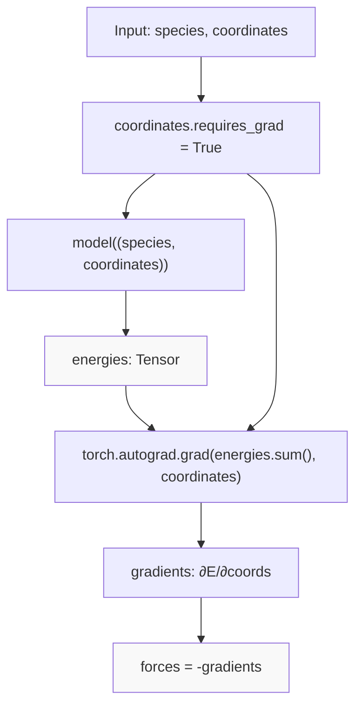
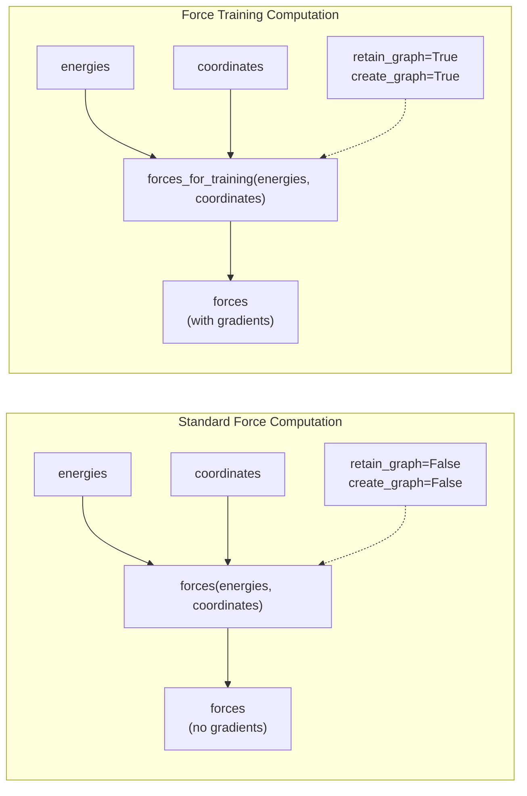
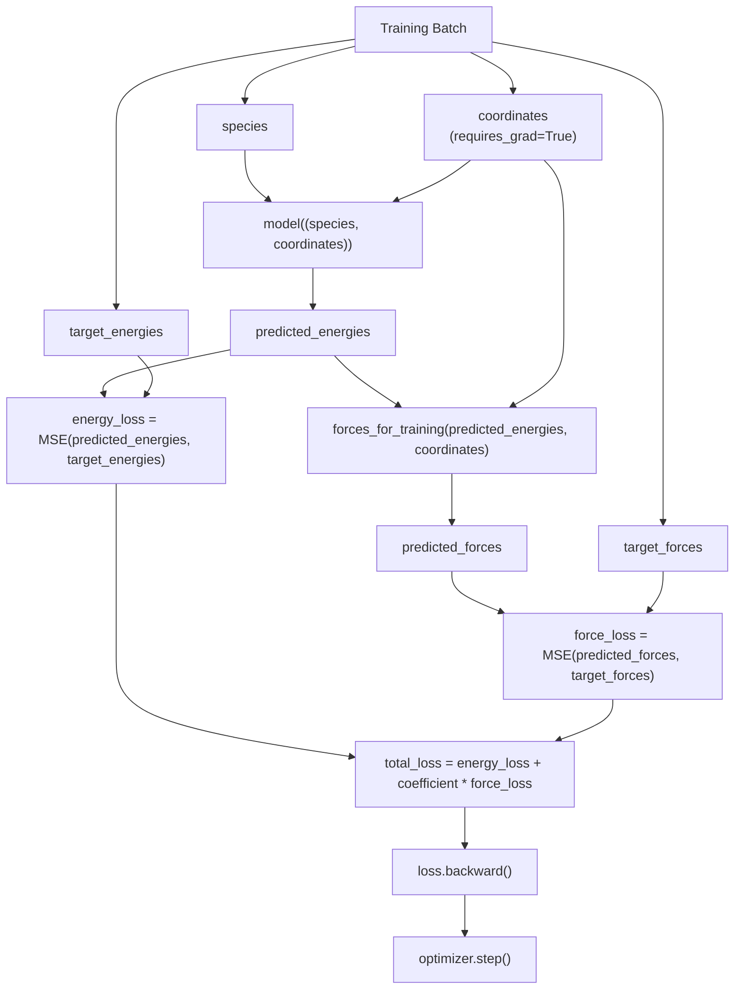
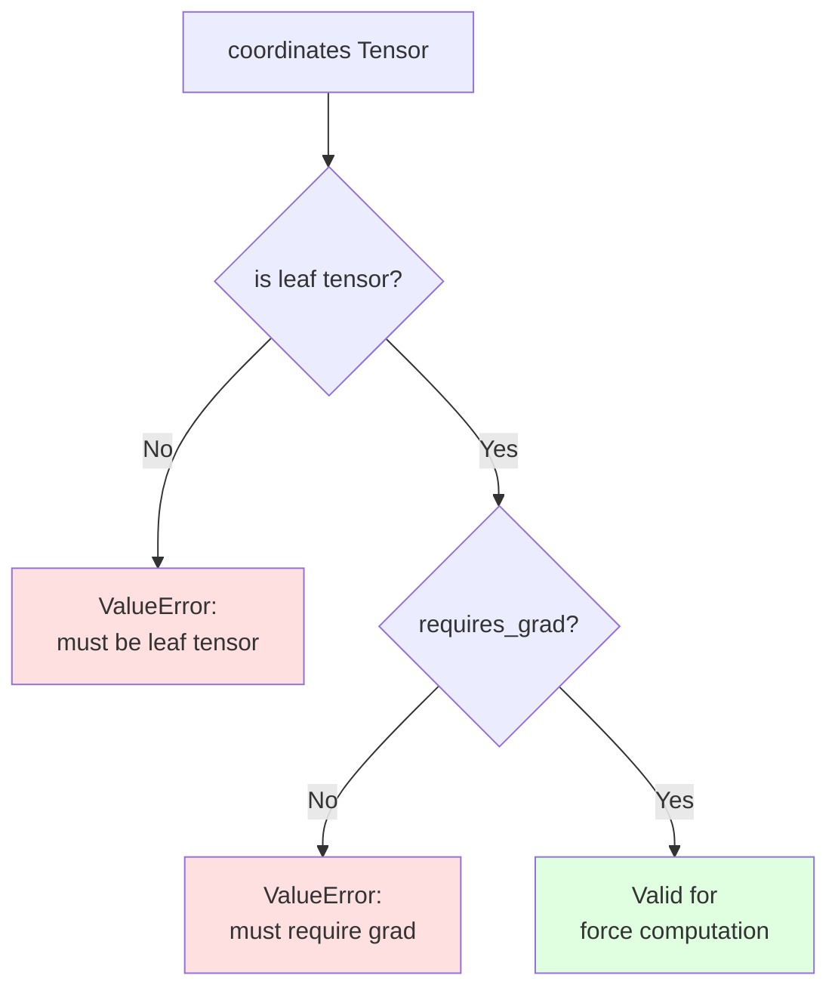
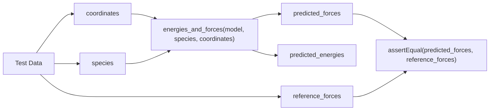

# Force Training

<details>
<summary>Relevant source files</summary>

The following files were used as context for generating this wiki page:

- [examples/training.py](examples/training.py)
- [tests/test_aev.py](tests/test_aev.py)
- [tests/test_energies.py](tests/test_energies.py)
- [tests/test_ensemble.py](tests/test_ensemble.py)
- [tests/test_forces.py](tests/test_forces.py)
- [torchani/grad.py](torchani/grad.py)

</details>


Force training refers to the practice of training neural network potentials using both energy and force data as training targets. This approach leverages the fact that atomic forces are the negative gradients of potential energy with respect to atomic positions, enabling models to learn from both scalar energies and vector forces simultaneously. This page covers the special considerations required for implementing force training in TorchANI.

For information about the overall training workflow, see [Training Workflow](#7.1). For data preparation including force data handling, see [Data Preparation for Training](#7.2).

## Background: Forces as Energy Gradients

In molecular systems, the force on each atom is the negative gradient of the total potential energy with respect to that atom's coordinates:

```
F = -∇E = -∂E/∂r
```

This relationship means that if we have a differentiable energy function (our neural network potential), we can compute forces through automatic differentiation. Conversely, when training with force data, we must enable gradient computation through the force calculation itself, requiring double backpropagation.

**Sources:** [torchani/grad.py:42-64]()

## Force Computation Architecture

The following diagram shows how forces are computed from energies using PyTorch's autograd system:



**Sources:** [torchani/grad.py:42-64]()

## The `forces_for_training` Function

TorchANI provides a specialized function for computing forces during training that enables gradient computation through the force calculation:



The `forces_for_training` function is a convenience wrapper that sets the appropriate autograd flags:

| Function | `retain_graph` | `create_graph` | Use Case |
|----------|----------------|----------------|----------|
| `forces()` | `False` | `False` | Inference, validation |
| `forces_for_training()` | `True` | `True` | Training with force loss |

**Key Implementation:**
- [torchani/grad.py:82-83]() defines `forces_for_training`
- [torchani/grad.py:42-64]() defines the underlying `forces` function
- The `create_graph=True` flag enables gradient computation through forces
- The `retain_graph=True` flag preserves the computation graph for subsequent loss backpropagation

**Sources:** [torchani/grad.py:82-83](), [torchani/grad.py:42-64]()

## Implementing Force Training

The following diagram shows the complete data flow for force training:



**Example Implementation from Training Script:**

The training example demonstrates force training at [examples/training.py:149-184]():

```python
# Enable force training
force_training = True
force_coefficient = 0.1

# Training loop
for batch in training:
    species = batch["species"]
    coordinates = batch["coordinates"].float()
    target_energies = batch["energies"].float()
    
    # Forward pass
    output = model((species, coordinates))
    predicted_energies = output.energies
    
    if force_training:
        target_forces = batch["forces"].float()
        # Compute forces with gradient tracking
        predicted_forces = forces_for_training(predicted_energies, coordinates)
        
        # Energy loss (normalized by sqrt of number of atoms)
        energy_loss = (mse(predicted_energies, target_energies) / num_atoms.sqrt()).mean()
        
        # Force loss (normalized by number of atoms)
        force_loss = (mse(predicted_forces, target_forces).sum(dim=(1, 2)) / num_atoms).mean()
        
        # Combined loss
        loss = energy_loss + force_coefficient * force_loss
    else:
        loss = (mse(predicted_energies, target_energies) / num_atoms.sqrt()).mean()
    
    optimizer.zero_grad()
    loss.backward()
    optimizer.step()
```

**Sources:** [examples/training.py:149-184](), [torchani/grad.py:82-83]()

## Loss Function Construction

### Energy Loss Normalization

Energy losses are typically normalized by the square root of the number of atoms to account for system size:

```
L_energy = MSE(E_pred, E_target) / sqrt(N_atoms)
```

This is implemented at [examples/training.py:172-174]().

### Force Loss Normalization

Force losses are normalized by the number of atoms:

```
L_force = MSE(F_pred, F_target).sum(atoms, xyz) / N_atoms
```

Since forces are per-atom 3D vectors, the MSE is summed over both atom and coordinate dimensions before normalization, as shown at [examples/training.py:175-177]().

### Combined Loss

The total loss combines energy and force terms with a weighting coefficient:

```
L_total = L_energy + λ * L_force
```

Common coefficient values:
- `λ = 0.1` - typical starting point
- `λ = 0.01 to 1.0` - range used in practice depending on dataset

**Loss Function Comparison Table:**

| Loss Component | Shape Before Reduction | Normalization | Typical Weight |
|----------------|------------------------|---------------|----------------|
| Energy Loss | `(molecules,)` | `/ sqrt(num_atoms)` | 1.0 |
| Force Loss | `(molecules, atoms, 3)` | `/ num_atoms` | 0.1 |

**Sources:** [examples/training.py:172-178]()

## Requirements for Force Training

### Coordinate Tensor Requirements

The coordinate tensor must satisfy specific requirements for force computation:



**Validation Logic:**

The `forces` function validates coordinate tensors at [torchani/grad.py:48-56]():

1. **Must require gradients:** `coordinates.requires_grad` must be `True`
2. **Must be a leaf tensor:** `coordinates.is_leaf` must be `True` (not derived from other operations)

These requirements ensure that gradients can be computed and backpropagated correctly.

**Sources:** [torchani/grad.py:48-56]()

## Computational Considerations

### Memory Requirements

Force training requires additional memory for:

1. **Computation graph storage:** `create_graph=True` builds a graph for second-order gradients
2. **Intermediate gradients:** Force vectors for all atoms must be retained
3. **Backward pass through forces:** Additional graph nodes for force loss backpropagation

**Memory scaling:**
- Energy-only training: `O(N_atoms)`
- Force training: `O(N_atoms × 3)` for forces + graph overhead

### Computational Cost

Force computation adds overhead to the training loop:

| Operation | Relative Cost | Notes |
|-----------|---------------|-------|
| Forward pass (energy) | 1× | Base cost |
| Force computation | ~1× | Backward through energy |
| Energy loss backward | 1× | Standard backprop |
| Force loss backward | ~2-3× | Backward through backward |
| **Total with forces** | **~5-6×** | Approximate total overhead |

Despite the increased cost, force training typically:
- Improves model accuracy on forces
- Enhances transferability to new configurations
- Reduces the number of epochs needed for convergence

**Sources:** [torchani/grad.py:82-83](), [examples/training.py:169-184]()

## Testing and Validation

### Force Accuracy Testing

The test suite validates force predictions against reference data:



**Test Implementation:**

- [tests/test_forces.py:20-30]() tests force accuracy on individual conformers
- [tests/test_forces.py:32-55]() tests force accuracy on padded batches
- [torchani/grad.py:263-291]() implements `energies_and_forces` for validation

**Sources:** [tests/test_forces.py:20-55](), [torchani/grad.py:263-291]()

## Best Practices

### 1. Start with Energy-Only Training

Begin training with energy-only loss to establish baseline convergence, then enable force training:

```python
# Phase 1: Energy-only (epochs 0-50)
force_training = False

# Phase 2: Energy + forces (epochs 50+)
force_training = True
force_coefficient = 0.1
```

### 2. Tune Force Coefficient

The force coefficient balances energy and force contributions:

- **Too low (< 0.01):** Forces under-weighted, poor force accuracy
- **Too high (> 1.0):** Forces dominate, potential energy surface distortion
- **Recommended:** Start with 0.1 and adjust based on validation metrics

### 3. Monitor Both Metrics

Track separate RMSE values for energies and forces during validation:

```python
energy_rmse = sqrt(mean((E_pred - E_target)²))
force_rmse = sqrt(mean((F_pred - F_target)²))
```

### 4. Validate Gradient Computation

Use gradient checking to ensure force implementation is correct:

[tests/test_aev.py:135-163]() demonstrates gradient validation using finite differences vs. autograd.

### 5. Memory Management

For large systems or batches:
- Use gradient checkpointing if available
- Reduce batch size when enabling force training
- Consider mixed precision training (float16 energies, float32 forces)

**Sources:** [examples/training.py:149-184](), [tests/test_aev.py:135-163]()

## Common Implementation Patterns

### Pattern 1: Conditional Force Training

Toggle force training based on epoch or convergence:

```python
if epoch >= force_training_start_epoch:
    predicted_forces = forces_for_training(predicted_energies, coordinates)
    force_loss = compute_force_loss(predicted_forces, target_forces)
    loss = energy_loss + force_coefficient * force_loss
else:
    loss = energy_loss
```

### Pattern 2: Adaptive Force Coefficient

Adjust the force coefficient during training:

```python
# Gradually increase force weight
force_coefficient = min(0.1 * (epoch / 50), 0.5)
```

### Pattern 3: Per-Atom Normalization

Normalize losses by atom count for size-independent training:

```python
num_atoms = (species >= 0).sum(dim=1, dtype=energies.dtype)
energy_loss = mse(pred_energies, target_energies) / num_atoms.sqrt()
force_loss = mse(pred_forces, target_forces).sum(dim=(1,2)) / num_atoms
```

**Sources:** [examples/training.py:166-178]()

## Integration with TorchANI Components

### With ANI Models

Force training works seamlessly with all ANI model variants:

- `ANI1x` - [torchani/models.py]()
- `ANI2x` - [torchani/models.py]()
- `ANI2dr` - [torchani/models.py]()
- Custom models from `Assembler` - see [Building Custom Models](#5.3)

### With Ensemble Models

For ensemble models, forces are computed for the mean energy:

```python
ensemble_output = ensemble_model((species, coordinates))
mean_energy = ensemble_output.energies.mean(dim=0)  # Average over ensemble
forces = forces_for_training(mean_energy, coordinates)
```

**Sources:** [tests/test_ensemble.py:26-37](), [torchani/grad.py:82-83]()

## Summary

Force training in TorchANI requires:

1. **Proper tensor setup:** Coordinates must be leaf tensors with `requires_grad=True`
2. **Specialized computation:** Use `forces_for_training` with `create_graph=True` for double backpropagation
3. **Combined loss:** Weight energy and force losses appropriately
4. **Normalization:** Scale losses by atom count for size-independent training
5. **Validation:** Test both energy and force accuracy

The additional computational cost is offset by improved model quality, better transferability, and enhanced physical accuracy of the learned potential energy surface.

**Sources:** [examples/training.py:149-184](), [torchani/grad.py:42-83](), [tests/test_forces.py:1-59]()

---