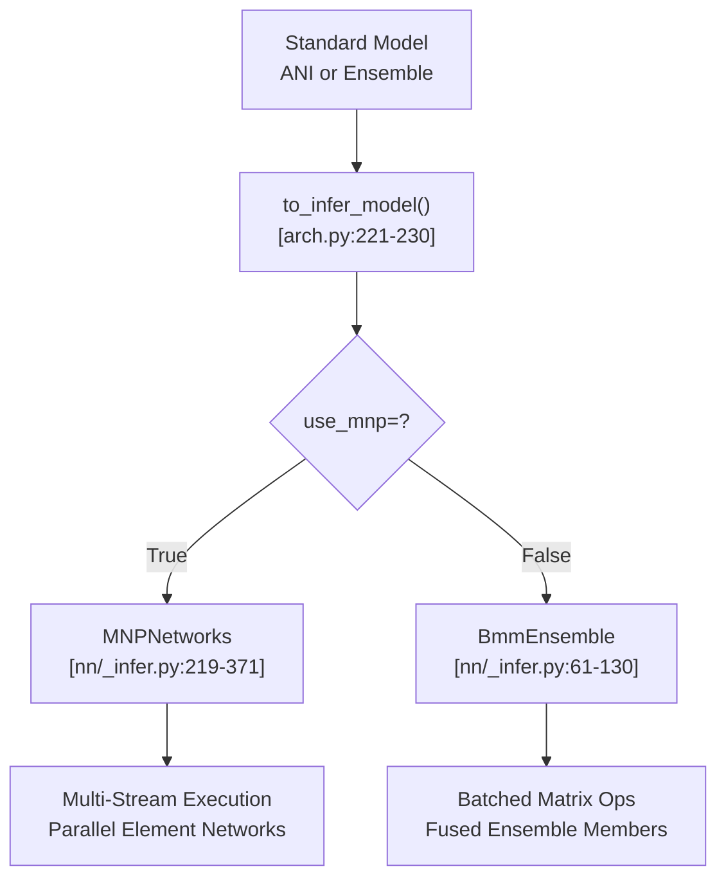
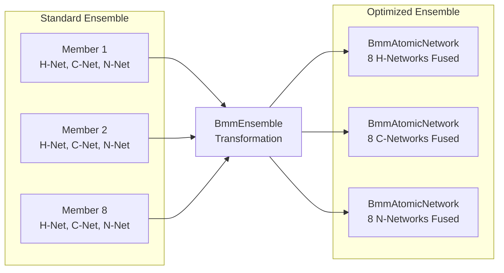
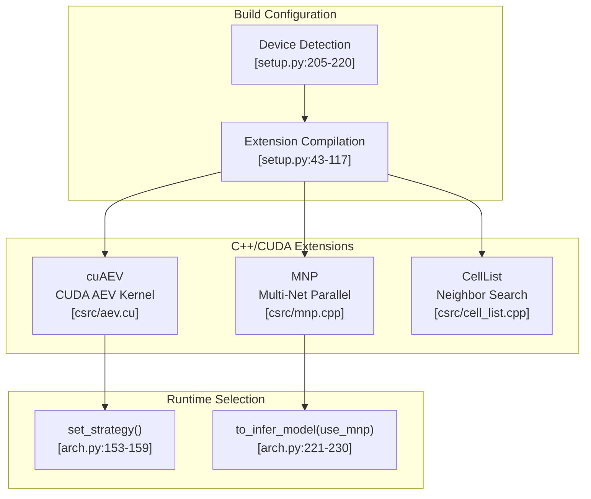
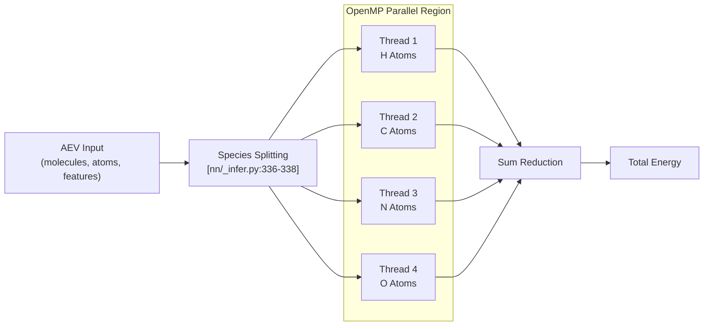
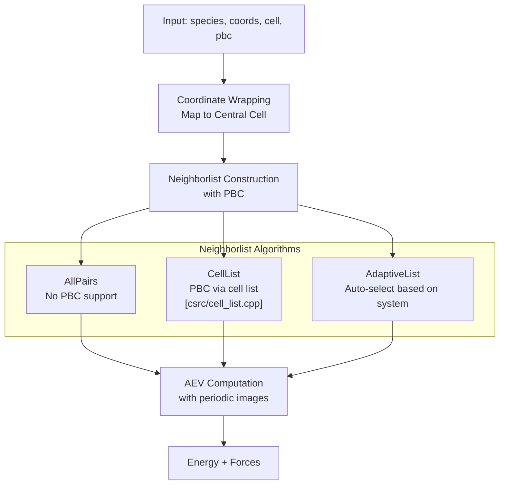

# Advanced Topics

<details>
<summary>Relevant source files</summary>

The following files were used as context for generating this wiki page:

- [.gitignore](.gitignore)
- [README.md](README.md)
- [setup.py](setup.py)
- [torchani/arch.py](torchani/arch.py)
- [torchani/nn/__init__.py](torchani/nn/__init__.py)
- [torchani/nn/_containers.py](torchani/nn/_containers.py)
- [torchani/nn/_core.py](torchani/nn/_core.py)
- [torchani/nn/_infer.py](torchani/nn/_infer.py)
- [torchani/nn/_internal.py](torchani/nn/_internal.py)

</details>


This section covers advanced features, optimizations, and techniques for expert users of TorchANI. The material here assumes familiarity with the core concepts and basic usage patterns described in earlier sections. Topics include performance optimization strategies, compiled extensions, benchmarking tools, and handling of periodic boundary conditions.

For basic model usage and energy calculations, see [User Guide](#5). For training workflows, see [Training](#7).

## Overview

TorchANI provides several advanced capabilities designed for production deployments, high-throughput screening, and specialized research applications:

1. **Performance Optimization** - Techniques to accelerate inference through JIT compilation and inference-optimized model representations
2. **C++ and CUDA Extensions** - Optional compiled extensions that significantly improve computational performance
3. **Benchmarking Tools** - Utilities to measure and compare performance across different configurations
4. **Periodic Boundary Conditions** - Support for crystalline and condensed-phase systems

These features enable TorchANI to scale from exploratory research to production molecular dynamics simulations.

## Performance Optimization Strategies

TorchANI provides multiple optimization paths that can dramatically improve inference speed, particularly for molecular dynamics and high-throughput applications.

### Inference Model Conversion

The standard model architecture prioritizes flexibility and training efficiency. For inference-only applications, models can be converted to optimized representations that reduce Python overhead and improve GPU utilization.



**Optimization Approaches:**

| Strategy | Class | Use Case | Performance Gain |
|----------|-------|----------|------------------|
| Batched Matrix Multiplication | `BmmEnsemble` | Ensemble models, single conformer | 2-4x speedup |
| Multi-Net Parallel (Python) | `MNPNetworks` (use_mnp=False) | Testing/debugging | Minimal |
| Multi-Net Parallel (C++) | `MNPNetworks` (use_mnp=True) | Production MD, requires extension | 3-6x speedup |

The `to_infer_model()` method, available on ANI models at [arch.py:221-230](), automatically selects the appropriate optimization strategy:

```python
model = torchani.models.ANI2x()
# Convert to inference-optimized version
infer_model = model.to_infer_model(use_mnp=False)  # BmmEnsemble
# or
infer_model = model.to_infer_model(use_mnp=True)   # MNPNetworks (requires extension)
```

Sources: [torchani/arch.py:221-230](), [torchani/nn/_infer.py:61-371]()

### JIT Compilation

PyTorch's TorchScript JIT compiler can further optimize models by eliminating Python interpreter overhead:

```python
model = torchani.models.ANI2x()
scripted_model = torch.jit.script(model)
```

JIT compilation works with both standard and inference-optimized models. For ASE integration, the `ase()` method accepts a `jit=True` parameter at [arch.py:232-254]().

Sources: [torchani/arch.py:232-254]()

### Network Architecture Optimizations

The inference-optimized classes make specific architectural transformations:



The `BmmAtomicNetwork` class at [nn/_infer.py:132-168]() fuses ensemble members for the same element into a single module using batched matrix multiplication. The `BmmLinear` layer at [nn/_infer.py:170-217]() replaces standard linear layers with batched equivalents:

- Standard: Multiple forward passes with shape `(atoms, features)`
- Optimized: Single batched forward pass with shape `(ensemble_size, atoms, features)`

Sources: [torchani/nn/_infer.py:61-217]()

## Extension System Architecture

TorchANI includes three optional C++/CUDA extensions that provide significant performance improvements:



**Extension Details:**

| Extension | Language | Functionality | Target |
|-----------|----------|---------------|--------|
| cuAEV | CUDA | Fused AEV computation kernel | GPU |
| MNP | C++ (OpenMP) | Parallel network evaluation | CPU multi-core |
| CellList | C++ (OpenMP) | Spatial hashing neighborlist | CPU multi-core |

The build system at [setup.py:43-289]() automatically detects available CUDA devices and compiles extensions with appropriate compute capabilities. Extensions can be selectively enabled during installation:

```bash
# No extensions
pip install --no-deps -v .

# All extensions (auto-detect GPU)
pip install --config-settings=--global-option=ext --no-build-isolation --no-deps -v .

# All extensions (all GPU architectures)
pip install --config-settings=--global-option=ext-all-sms --no-build-isolation --no-deps -v .
```

Sources: [setup.py:1-289](), [README.md:74-84]()

### Runtime Strategy Selection

Models can switch between Python and CUDA implementations at runtime without reloading:

```python
model = torchani.models.ANI2x()

# Use Python implementation
model.set_strategy("pyaev")

# Use CUDA implementation (if compiled)
model.set_strategy("cuaev")
```

The `set_strategy()` method at [arch.py:153-159]() modifies the AEV computer's computation path. The cuAEV extension can bypass the neighborlist entirely when no additional potentials are present, as seen in the optimized branch at [arch.py:340-362]().

Sources: [torchani/arch.py:153-159](), [torchani/arch.py:340-362]()

### MNP Architecture

The Multi-Net Parallel extension parallelizes network evaluation across element types using OpenMP threads:



The `MNPNetworks` class at [nn/_infer.py:219-371]() provides both a Python reference implementation (`PythonMNP` at [nn/_infer.py:381-469]()) and integration with the C++ extension via `torch.ops.mnp.run()` at [nn/_infer.py:359-370]().

MNP requires `OMP_NUM_THREADS >= 2` for optimal performance. The implementation checks this environment variable at [nn/_infer.py:23-36]().

Sources: [torchani/nn/_infer.py:219-469]()

## Benchmarking Capabilities

TorchANI includes benchmarking infrastructure to measure and compare performance across different configurations. While the specific benchmark scripts are not in the provided files, the architecture supports performance measurement through:

1. **NVTX Annotations** - CUDA profiling markers at [nn/_infer.py:120-125]() for identifying bottlenecks
2. **Gradient Computation Testing** - Verification that optimizations preserve correctness
3. **Active Member Selection** - Testing ensemble subsets via `set_active_members()` at [arch.py:137-143]()

The inference-optimized classes include caching mechanisms to avoid redundant computation when processing similar molecular configurations, as seen in the species comparison logic at [nn/_infer.py:112-114]().

Sources: [torchani/nn/_infer.py:112-125](), [torchani/arch.py:137-143]()

## Periodic Boundary Conditions

TorchANI supports periodic boundary conditions for simulating bulk materials, surfaces, and solution-phase systems. PBC handling is integrated throughout the computation pipeline:



The `forward()` method signature accepts `cell` and `pbc` arguments at [arch.py:325-382](), which are passed through the computation chain. The neighborlist algorithms handle periodic images differently:

| Algorithm | PBC Support | Use Case |
|-----------|-------------|----------|
| AllPairs | No | Small molecules, gas phase |
| CellList | Yes | Large periodic systems |
| AdaptiveList | Yes | Automatic selection |

The ASE calculator integration provides additional PBC utilities:
- Coordinate wrapping to central cell
- Optional position overwriting via `overwrite` parameter at [arch.py:232-254]()
- Multiple stress calculation strategies via `stress_kind` parameter

For external neighborlists (e.g., from MD engines), the `compute_from_external_neighbors()` method at [arch.py:183-219]() handles PBC neighbors with proper screening via `narrow_down()` at [arch.py:205]() to enforce the model's cutoff radius.

Sources: [torchani/arch.py:183-219](), [torchani/arch.py:325-382](), [torchani/arch.py:232-254]()

## Memory and Computational Considerations

Advanced usage often involves trade-offs between memory consumption and computational speed:

**Ensemble Models:**
- Standard `Ensemble`: Lower memory, Python iteration overhead
- `BmmEnsemble`: Higher GPU memory (batched weights), faster execution
- `MNPNetworks`: Similar memory to standard, CPU parallelism overhead

**Single-Conformer Optimization:**
The inference-optimized classes require single-conformer inputs (batch size = 1) as enforced at [nn/_infer.py:109]() and [nn/_infer.py:332](). This constraint enables species-specific caching at [nn/_infer.py:96-98]() and [nn/_infer.py:254-256]().

**Active Member Selection:**
For ensemble models, the `set_active_members()` method at [arch.py:137-143]() allows reducing computational cost by evaluating only a subset of ensemble members without reloading the model.

Sources: [torchani/nn/_infer.py:96-114](), [torchani/nn/_infer.py:254-256](), [torchani/nn/_infer.py:332](), [torchani/arch.py:137-143]()

---

The following subsections provide detailed documentation for each advanced topic:
- [Performance Optimization](#8.1) - In-depth guide to optimization techniques
- [C++ and CUDA Extensions](#8.2) - Extension architecture and compilation
- [Benchmarking](#8.3) - Performance measurement tools
- [Periodic Boundary Conditions](#8.4) - PBC handling and best practices

---