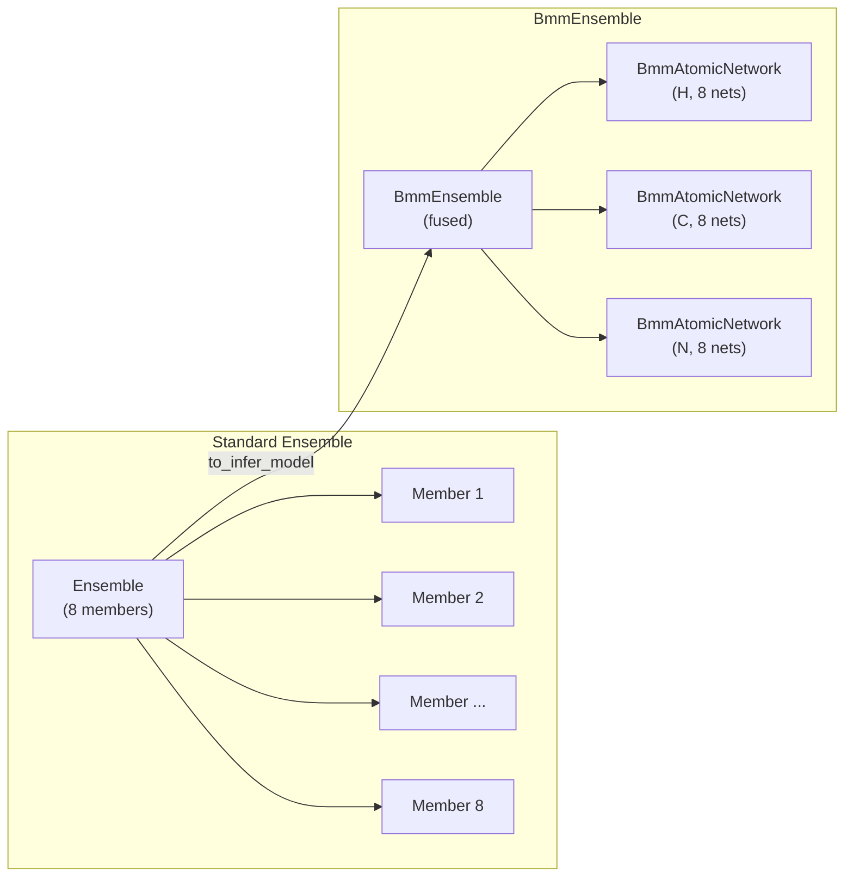
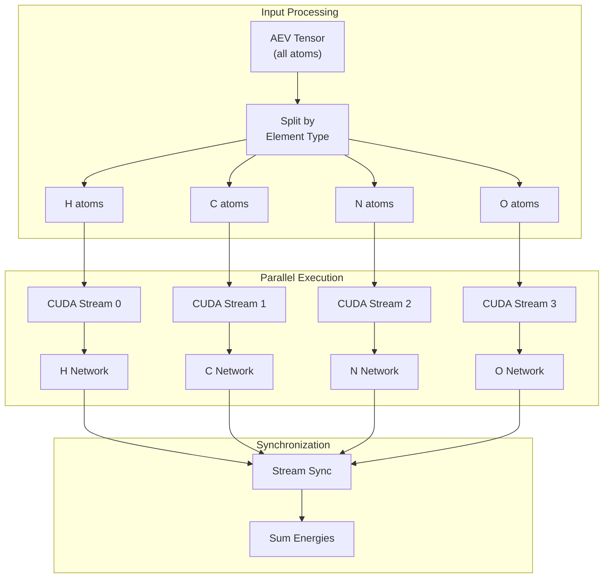
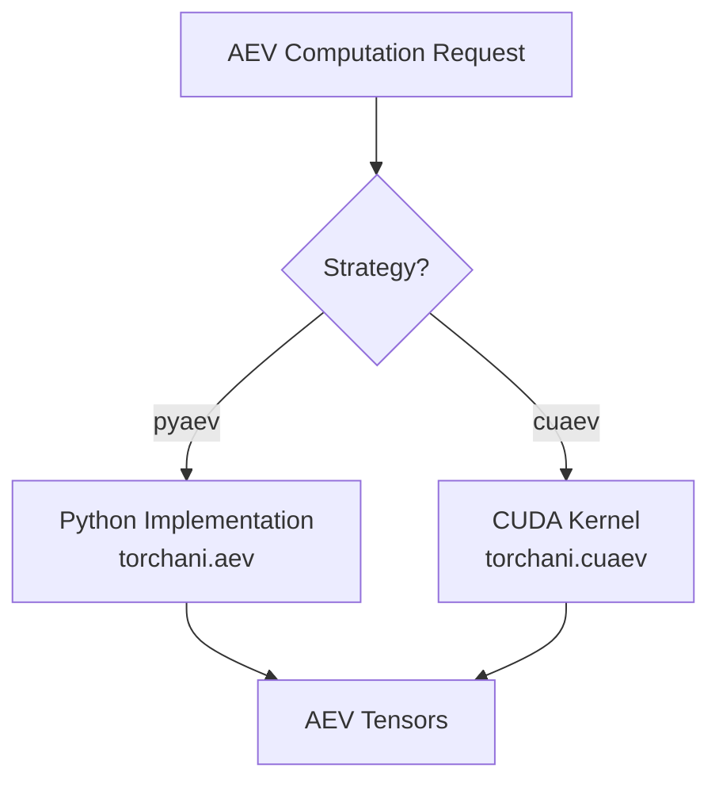
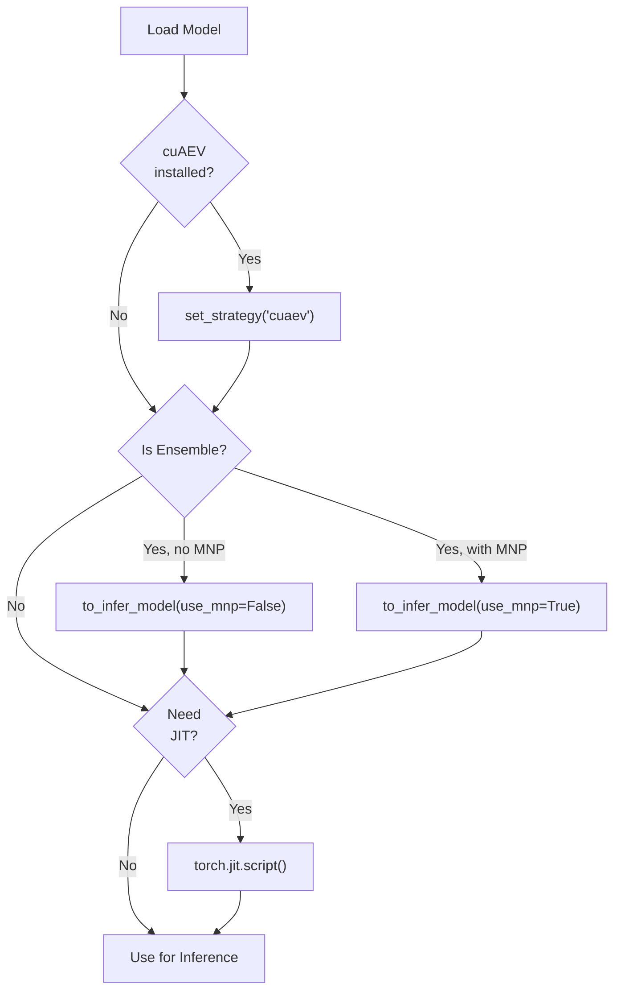

# Performance Optimization

<details>
<summary>Relevant source files</summary>

The following files were used as context for generating this wiki page:

- [.gitignore](.gitignore)
- [README.md](README.md)
- [setup.py](setup.py)
- [torchani/arch.py](torchani/arch.py)
- [torchani/nn/__init__.py](torchani/nn/__init__.py)
- [torchani/nn/_containers.py](torchani/nn/_containers.py)
- [torchani/nn/_core.py](torchani/nn/_core.py)
- [torchani/nn/_infer.py](torchani/nn/_infer.py)
- [torchani/nn/_internal.py](torchani/nn/_internal.py)

</details>


This page describes techniques for optimizing the inference speed of TorchANI models. The primary optimization strategies include converting models to inference-optimized versions, using compiled C++/CUDA extensions, JIT compilation, and selecting appropriate AEV computation strategies.

For information about building and installing the C++/CUDA extensions themselves, see [Building Extensions](#2.2). For benchmarking tools to measure performance improvements, see [Benchmarking](#8.3).

---

## Overview of Optimization Strategies

TorchANI provides multiple complementary approaches to improve inference performance:

| Strategy | Speedup | Use Case | Requirements |
|----------|---------|----------|--------------|
| Inference Models (`to_infer_model()`) | 2-3x | Single-molecule inference, MD | None |
| cuAEV Extension | 3-5x | AEV computation | CUDA GPU |
| MNP Extension | 1.5-2x | Multi-network parallelization | CUDA GPU, OpenMP |
| JIT Compilation | 1.2-1.5x | Production inference | None |
| Strategy Selection (`cuaev` vs `pyaev`) | 3-5x | AEV computation | CUDA GPU |

These optimizations can be combined for maximum performance. The most significant gains come from using cuAEV for AEV computation and converting ensembles to `BmmEnsemble` for neural network evaluation.

Sources: [README.md:142-154](), [torchani/arch.py:221-230](), [torchani/nn/_infer.py:1-470]()

---

## Inference Model Conversion

### BmmEnsemble: Batched Matrix Multiplication for Ensembles

The `BmmEnsemble` class converts ensemble models to use batched matrix multiplication (BMM), which significantly reduces Python overhead and CUDA kernel calls.



**Optimization Mechanics:**

The conversion from `Ensemble` to `BmmEnsemble` fuses all networks for each element into a single `BmmAtomicNetwork`. Each `BmmAtomicNetwork` contains `BmmLinear` layers that perform batched operations:

```
Input:  (ensemble_size x num_atoms x features)
Weight: (ensemble_size x features x output)
Bias:   (ensemble_size x 1 x output)
Output: (ensemble_size x num_atoms x output)
```

**Usage:**

```python
# Load ensemble model
model = torchani.models.ANI2x()

# Convert to inference model
infer_model = model.to_infer_model(use_mnp=False)

# Now use for inference
energies = infer_model((species, coords))
```

**Implementation Details:**

- [torchani/nn/_containers.py:657-662]() - `Ensemble.to_infer_model()` method
- [torchani/nn/_infer.py:61-130]() - `BmmEnsemble` implementation
- [torchani/nn/_infer.py:132-168]() - `BmmAtomicNetwork` implementation
- [torchani/nn/_infer.py:170-217]() - `BmmLinear` layer using `torch.baddbmm`

**Performance Characteristics:**

The `BmmEnsemble` caches element indices to avoid redundant computations when the same molecular structure is evaluated repeatedly (common in MD simulations):

- [torchani/nn/_infer.py:94-98]() - Index list caching
- [torchani/nn/_infer.py:112-114]() - Same tensor check and index list reuse

Sources: [torchani/nn/_infer.py:61-217](), [torchani/nn/_containers.py:657-662](), [torchani/arch.py:221-230]()

---

### MNPNetworks: Multi-Network Parallel Execution

`MNPNetworks` is an experimental optimization that parallelizes neural network evaluation across multiple CUDA streams and (optionally) uses OpenMP for CPU-side parallelization.



**Usage with C++ Extension:**

```python
# Requires MNP extension to be compiled
model = torchani.models.ANI2x()
infer_model = model.to_infer_model(use_mnp=True)

# Set OpenMP threads for best performance
import os
os.environ['OMP_NUM_THREADS'] = '4'

energies = infer_model((species, coords))
```

**Requirements and Limitations:**

- Requires CUDA GPU ([torchani/nn/_infer.py:222-223]())
- Only supports single-conformation inputs ([torchani/nn/_infer.py:332]())
- Does not support atomic energies output ([torchani/nn/_infer.py:333]())
- Requires `OMP_NUM_THREADS` environment variable ([torchani/nn/_infer.py:23-36]())
- Experimental and subject to change ([torchani/nn/_infer.py:226-232]())

**Implementation:**

The C++ implementation uses:
- Multiple CUDA streams for parallel GPU execution ([torchani/nn/_infer.py:259]())
- Flattened weight/bias tensors passed to `torch.ops.mnp.run` ([torchani/nn/_infer.py:351-370]())
- OpenMP for CPU-side parallelization (C++ code in `torchani/csrc/mnp.cpp`)

A Python fallback implementation exists for testing but is not performant ([torchani/nn/_infer.py:381-469]()).

Sources: [torchani/nn/_infer.py:219-371](), [setup.py:83-98](), [README.md:150-153]()

---

## C++/CUDA Extensions

### cuAEV: CUDA-Accelerated AEV Computation

The cuAEV extension provides a fused CUDA kernel for computing Atomic Environment Vectors, which is typically the most computationally expensive part of ANI inference.

**Building cuAEV:**

The extension is built with specific CUDA compute capabilities (SM versions):

```bash
# Build for detected GPUs
pip install --config-settings=--global-option=ext --no-build-isolation --no-deps -v .

# Build for all supported architectures
pip install --config-settings=--global-option=ext-all-sms --no-build-isolation --no-deps -v .

# Build for specific SM (e.g., SM 80 for Ampere)
pip install --config-settings=--global-option=ext-sm80 --no-build-isolation --no-deps -v .
```

**Supported Compute Capabilities:**

| SM Version | Architecture | Generation |
|------------|--------------|------------|
| 60, 61 | Pascal | - |
| 70 | Volta | 1st gen TensorCore |
| 75 | Turing | 2nd gen TensorCore |
| 80, 86 | Ampere | 3rd gen TensorCore |
| 89 | Ada Lovelace, Hopper | 4th gen TensorCore |
| 100 | Blackwell | 5th gen TensorCore |

**Compilation Flags:**

- [setup.py:51-69]() - NVCC compiler arguments including:
  - `--expt-extended-lambda` for lambda support
  - CUB namespace definitions for safety
  - `-DTORCHANI_OPT` and `-use_fast_math` for optimization
  - Architecture-specific `-gencode` flags

**CUB Library:**

For CUDA versions < 12.8, the CUB library is required and automatically downloaded if not found ([setup.py:11-40]()).

**Strategy Selection:**

To use cuAEV, set the strategy:

```python
model.set_strategy('cuaev')  # Use CUDA kernel
model.set_strategy('pyaev')  # Use Python implementation
```

The strategy can be set via the `Assembler` during model construction or changed dynamically at runtime ([torchani/arch.py:153-159]()).

Sources: [setup.py:43-80](), [setup.py:138-147](), [README.md:148-153]()

---

### MNP: Multi-Network Parallel Extension

The MNP (Multi-Net Parallel) extension uses OpenMP to parallelize neural network evaluation across element types.

**Building MNP:**

```bash
pip install --config-settings=--global-option=ext --no-build-isolation --no-deps -v .
```

**Compilation:**

- [setup.py:83-98]() - C++ compiler arguments:
  - `-std=c++17` for C++17 support
  - `-fopenmp` for OpenMP parallelization
  - `-DTORCHANI_DEBUG` (optional debug flag)

**Environment Configuration:**

```bash
export OMP_NUM_THREADS=4  # Or use SLURM_CPUS_PER_TASK
```

The number of OpenMP threads should be ≥ 2 for best performance ([torchani/nn/_infer.py:27-29]()).

Sources: [setup.py:83-98](), [torchani/nn/_infer.py:23-36]()

---

### CellList: Optimized Neighborlist

The CellList extension provides an optimized C++ implementation of cell-list based neighbor searching, particularly beneficial for large systems with periodic boundary conditions.

**Building CellList:**

Built automatically with the other extensions:

```bash
pip install --config-settings=--global-option=ext --no-build-isolation --no-deps -v .
```

**Compilation:**

- [setup.py:101-116]() - Same compiler flags as MNP
  - `-std=c++17`
  - `-fopenmp`
  - `-DTORCHANI_DEBUG` (optional)

For more details on neighborlist algorithms and when to use CellList, see [Neighborlist Algorithms](#4.3).

Sources: [setup.py:101-116]()

---

## JIT Compilation

TorchANI models can be JIT-compiled using `torch.jit.script()` for additional performance gains, particularly when integrating with ASE:

```python
import torch
import torchani

# Load and optimize model
model = torchani.models.ANI2x()
infer_model = model.to_infer_model()

# JIT compile
jit_model = torch.jit.script(infer_model)

# Use with ASE
calculator = jit_model.ase(jit=False)  # Already JIT-compiled
```

Alternatively, use the `jit=True` flag in the `ase()` method:

```python
calculator = model.ase(jit=True)
```

**JIT Compilation Flow:**


**Benefits:**

- Removes Python interpreter overhead
- Enables graph optimizations
- Reduces memory allocations
- Typical speedup: 1.2-1.5x

**Limitations:**

- Some dynamic Python features not supported
- First call may be slower due to compilation
- Debugging is more difficult

Sources: [torchani/arch.py:232-254]()

---

## Strategy Selection for AEV Computation

The AEV computation strategy has the largest impact on performance. TorchANI supports two strategies:

| Strategy | Implementation | Device | Typical Speedup |
|----------|---------------|--------|-----------------|
| `pyaev` | Python/PyTorch | CPU/GPU | Baseline |
| `cuaev` | Fused CUDA kernel | GPU only | 3-5x |

**Setting Strategy:**

```python
# During model construction
from torchani.arch import Assembler

assembler = Assembler(symbols=('H', 'C', 'N', 'O'))
assembler.set_aev_computer(
    radial=...,
    angular=...,
    strategy='cuaev'  # or 'pyaev'
)
model = assembler.assemble()

# Or dynamically after construction
model.set_strategy('cuaev')
```

**Strategy Dispatch:**

The strategy determines which code path is used:



**Performance Considerations:**

- `cuaev` requires a CUDA GPU and the cuAEV extension to be built
- `cuaev` is always faster on GPU for typical molecular systems
- `pyaev` is the only option for CPU-only systems
- `cuaev` uses fused kernels, reducing memory bandwidth requirements

The strategy is set on the `AEVComputer` instance and can be changed at runtime via `model.set_strategy()` ([torchani/arch.py:153-159]()).

Sources: [torchani/arch.py:750-760]()

---

## Optimization Best Practices

### Recommended Optimization Pipeline

For maximum performance, apply optimizations in this order:



### Performance Checklist

**For Single-Molecule Inference (MD, Optimization):**

1. ✅ Use `to_infer_model()` if model is an ensemble
2. ✅ Set `strategy='cuaev'` if CUDA GPU available
3. ✅ Consider JIT compilation with `torch.jit.script()`
4. ✅ Use single-conformation inputs (batch size = 1)

**For Batch Inference (Dataset Evaluation):**

1. ✅ Set `strategy='cuaev'` if CUDA GPU available
2. ✅ Keep `to_infer_model()` disabled (or use carefully)
3. ✅ Use larger batch sizes (16-64 conformations)
4. ✅ Consider JIT compilation for very large datasets

**For Ensemble Models:**

1. ✅ Always use `to_infer_model()` → converts to `BmmEnsemble`
2. ✅ Avoid `use_mnp=True` unless benchmarked benefits
3. ✅ Ensure single-conformation inputs for MNP

**For Production Deployment:**

1. ✅ Build all C++/CUDA extensions during installation
2. ✅ Set `OMP_NUM_THREADS` appropriately if using MNP
3. ✅ JIT compile models and save scripted versions
4. ✅ Profile and benchmark specific workloads

Sources: [torchani/nn/_infer.py:1-470](), [torchani/arch.py:221-254](), [README.md:142-154]()

---

## Common Performance Issues

### Issue: Slow Inference Despite GPU Availability

**Symptoms:** Model runs on GPU but performance is poor.

**Causes and Solutions:**

1. **Not using cuAEV:** Check strategy with `model.aev_computer.strategy` and set to `'cuaev'`
2. **Not converted to inference model:** Call `model.to_infer_model()` for ensembles
3. **Large batch sizes with inference model:** `BmmEnsemble` and `MNPNetworks` only support single conformations

### Issue: MNP Performance Worse Than Standard

**Symptoms:** `use_mnp=True` is slower than standard inference.

**Causes and Solutions:**

1. **OMP_NUM_THREADS not set:** Export the environment variable before running
2. **Too few atoms per element:** MNP overhead dominates for small molecules
3. **Using Python MNP fallback:** Ensure C++ extension is installed

### Issue: Out of Memory on GPU

**Symptoms:** CUDA out of memory errors during inference.

**Causes and Solutions:**

1. **Inference model with large batches:** Reduce batch size or don't use inference model
2. **Multiple CUDA streams (MNP):** Each stream requires separate memory allocation
3. **Accumulated gradients:** Use `torch.no_grad()` context for inference

Sources: [torchani/nn/_infer.py:23-36](), [torchani/nn/_infer.py:332-333](), [torchani/arch.py:153-159]()

---