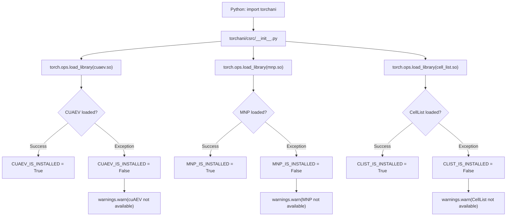
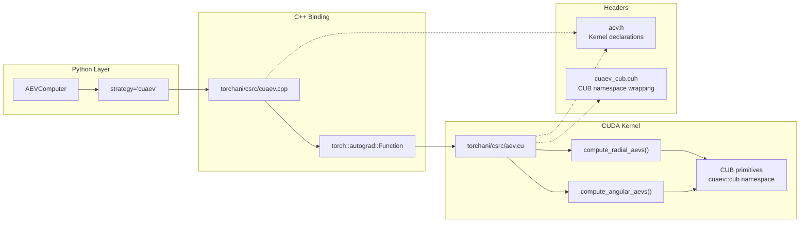
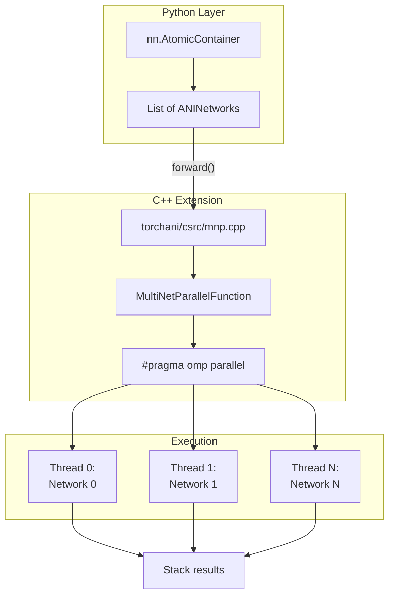
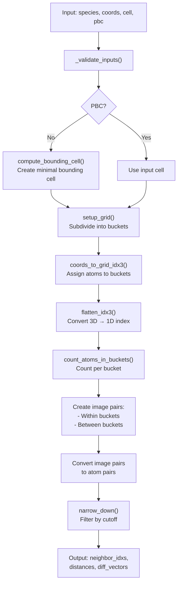
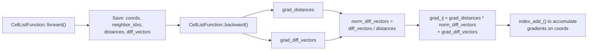
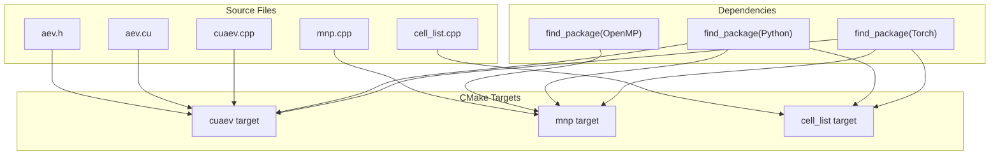

# C++ and CUDA Extensions

<details>
<summary>Relevant source files</summary>

The following files were used as context for generating this wiki page:

- [.gitignore](.gitignore)
- [README.md](README.md)
- [setup.py](setup.py)
- [tests/test_neighbors.py](tests/test_neighbors.py)
- [tools/neighborlist-benchmark.py](tools/neighborlist-benchmark.py)
- [tools/pyaev-benchmark.py](tools/pyaev-benchmark.py)
- [torchani/csrc/CMakeLists.txt](torchani/csrc/CMakeLists.txt)
- [torchani/csrc/__init__.py](torchani/csrc/__init__.py)
- [torchani/csrc/cell_list.cpp](torchani/csrc/cell_list.cpp)
- [torchani/neighbors.py](torchani/neighbors.py)

</details>


This page provides a detailed technical overview of TorchANI's compiled C++ and CUDA extensions, their architecture, build system, and performance characteristics. These extensions are optional but provide significant speedups for production workloads.

For general performance optimization strategies, see [Performance Optimization](#8.1). For benchmarking tools and results, see [Benchmarking](#8.3).

---

## Overview

TorchANI includes three optional compiled extensions that provide substantial performance improvements:

| Extension | Language | Purpose | Typical Speedup |
|-----------|----------|---------|----------------|
| **cuAEV** | CUDA | Fused AEV computation on GPU | 2-5x vs PyTorch |
| **MNP** | C++ (OpenMP) | Parallel neural network evaluation | 2-4x for ensembles |
| **CellList** | C++ | Fast O(N) neighbor list computation | 10-100x for large systems |

All extensions are optional. TorchANI falls back to pure PyTorch implementations when extensions are not available. Extensions are compiled against PyTorch's LibTorch C++ API and registered as custom operators.

**Sources:** [README.md:148-154](), [torchani/csrc/__init__.py:1-60]()

---

## Extension Loading and Detection

Extensions are compiled as shared libraries (`.so` files on Linux) and loaded dynamically at runtime using PyTorch's operator loading mechanism.



Runtime detection flags are exported as module-level constants:

- `torchani.csrc.CUAEV_IS_INSTALLED`
- `torchani.csrc.MNP_IS_INSTALLED`
- `torchani.csrc.CLIST_IS_INSTALLED`

Warnings can be suppressed by setting the environment variable `TORCHANI_NO_WARN_EXTENSIONS=1`. Extensions can be manually disabled for testing with `TORCHANI_DISABLE_EXTENSIONS=1`.

**Sources:** [torchani/csrc/__init__.py:1-60]()

---

## cuAEV Extension

### Purpose

The `cuAEV` extension implements a fused CUDA kernel for Atomic Environment Vector (AEV) computation. It replaces the pure PyTorch implementation with a highly optimized GPU kernel that computes radial and angular symmetry functions in a single pass.

### Architecture



The extension uses custom autograd support to compute gradients efficiently. Unlike the PyTorch implementation which requires gradients through neighbor distances and difference vectors, cuAEV computes gradients directly from coordinates.

### Key Implementation Details

**CUB Library Integration:**
cuAEV requires NVIDIA's CUB library for device-wide reductions and scans. To avoid namespace conflicts with PyTorch's bundled CUB, the extension wraps CUB in a custom namespace:

```cpp
// Namespace definitions from setup.py
-DCUB_NS_QUALIFIER=::cuaev::cub
-DCUB_NS_PREFIX=namespace cuaev {
-DCUB_NS_POSTFIX=}
```

For CUDA 12.8+, CUB is included with CUDA Toolkit and doesn't need separate download. For earlier versions, `setup.py` automatically downloads CUB from GitHub.

**Optimization Flags:**
- `-use_fast_math`: Enables aggressive math optimizations
- `-DTORCHANI_OPT`: Enables intrinsic math functions
- `--expt-extended-lambda`: Required for device lambda functions

**Sources:** [setup.py:11-81](), [torchani/csrc/CMakeLists.txt:36-60]()

### Compute Capability Support

cuAEV supports multiple NVIDIA GPU architectures through the `-gencode` compiler flag. Supported compute capabilities (SMs):

| SM | Architecture | Tensor Cores | Example GPUs |
|----|--------------|--------------|--------------|
| 60, 61 | Pascal | No | GTX 1080, P100 |
| 70 | Volta | 1st gen | V100 |
| 75 | Turing | 2nd gen | RTX 2080, T4 |
| 80, 86 | Ampere | 3rd gen | A100, RTX 3090 |
| 89 | Ada/Hopper | 4th gen | H100, RTX 4090 |
| 100 | Blackwell | 5th gen | Future GPUs |

By default, `setup.py` auto-detects compatible GPUs and compiles only for those architectures. Use `ext-all-sms` flag to compile for all supported architectures (increases compile time significantly).

**Sources:** [setup.py:138-203]()

---

## MNP Extension

### Purpose

MNP (Multi-Net Parallel) is a C++ extension using OpenMP to parallelize neural network evaluations across ensemble members. When using ensemble models (e.g., ANI-2x with 8 networks), MNP evaluates networks in parallel instead of sequentially.

### Architecture



MNP is particularly effective for:
- Ensemble models with 4+ networks
- CPU inference (where parallelism is more beneficial)
- Production deployments where latency matters

On GPU, MNP provides less benefit since GPU parallelism is already efficient for sequential network evaluation.

### Build Configuration

MNP requires:
- C++17 compiler
- OpenMP support (usually available with GCC/Clang)
- PyTorch C++ API (LibTorch)

Compiler flags:
- `-std=c++17`: C++17 standard
- `-fopenmp`: Enable OpenMP
- `-DTORCHANI_DEBUG`: Optional debug symbols

**Sources:** [setup.py:83-98](), [torchani/csrc/CMakeLists.txt:63-73]()

---

## CellList Extension

### Purpose

The CellList extension implements a fast O(N) neighbor list algorithm in C++ with full autograd support. It subdivides space into a 3D grid of "buckets" and only checks pairs within and between neighboring buckets.

### Algorithm Overview



### Grid Subdivision

The grid is set up with approximately one bucket per cutoff distance in each dimension:

```
bucket_length_lower_bound = (spherical_factor * cutoff) + extra_space
grid_shape = floor_divide(cell_lengths, bucket_length_lower_bound)
```

The `spherical_factor` accounts for non-orthogonal cells, ensuring that a sphere of radius `cutoff` fits within bucket neighborhoods.

### Autograd Support

The extension implements custom backward pass for gradient computation:



Gradients are accumulated using `index_add_` for neighbor pairs (i,j):
- `grad_coords[i] += grad_ij`
- `grad_coords[j] -= grad_ij`

**Sources:** [torchani/csrc/cell_list.cpp:274-348](), [torchani/neighbors.py:417-467]()

### FastCellList vs CellList

Two implementations exist:

| Implementation | File | Forward | Backward | Usage |
|---------------|------|---------|----------|-------|
| `CellList` | `neighbors.py` | Pure Python | PyTorch autograd | Default |
| `FastCellList` | `cell_list.cpp` | C++ | Custom C++ | Experimental |

The C++ `FastCellList` uses the same algorithm but implements both forward and backward passes in C++, avoiding Python overhead. It requires the compiled extension.

**Sources:** [torchani/neighbors.py:280-298](), [torchani/csrc/cell_list.cpp:1-372](), [tests/test_neighbors.py:26-64]()

---

## Build System

TorchANI supports two build approaches: pip-based (using `setup.py`) and CMake-based (using `CMakeLists.txt`).

### pip/setuptools Build

The `setup.py` script provides a high-level interface with custom flags:

```bash
# Auto-detect compatible GPUs and build extensions
pip install --config-settings=--global-option=ext --no-build-isolation --no-deps -v .

# Build for all supported GPUs (slower)
pip install --config-settings=--global-option=ext-all-sms --no-build-isolation --no-deps -v .

# Build for specific GPU architecture (e.g., SM 80 for A100)
pip install --config-settings=--global-option=ext-sm80 --no-build-isolation --no-deps -v .

# Build with debug symbols
pip install --config-settings=--global-option=ext --config-settings=--global-option=ext-debug --no-build-isolation --no-deps -v .

# Build without math optimizations
pip install --config-settings=--global-option=ext --config-settings=--global-option=ext-no-opt --no-build-isolation --no-deps -v .
```

#### Build Flags

| Flag | Purpose |
|------|---------|
| `ext` | Build extensions, auto-detect GPU architectures |
| `ext-all-sms` | Build for all supported GPU architectures |
| `ext-sm{XX}` | Build for specific architecture (e.g., `ext-sm80`) |
| `ext-debug` | Enable debug symbols (`-DTORCHANI_DEBUG`) |
| `ext-no-opt` | Disable math optimizations |

#### Requirements

Building extensions requires:
- PyTorch with CUDA support (for cuAEV)
- Compatible CUDA Toolkit (version matching PyTorch)
- C++17 compiler (GCC/Clang)
- OpenMP (for MNP)
- CMake 3.22+ (indirect dependency)

The `--no-build-isolation` flag is **required** because the build needs access to the installed PyTorch and CUDA libraries. The `--no-deps` flag prevents reinstalling PyTorch.

**Sources:** [setup.py:1-289](), [README.md:73-90]()

### CMake Build

For direct CMake builds:

```bash
mkdir build && cd build
cmake .. -DCMAKE_BUILD_TYPE=Release
cmake --build . --config Release
cmake --install .
```

The CMake build:
1. Auto-detects installed PyTorch location
2. Finds CUDA Toolkit (if available)
3. Configures OpenMP (for MNP)
4. Builds all three extensions
5. Installs to `torchani/` directory

#### CMake Targets



Key CMake configuration:
- Extensions built as shared libraries (`.so`)
- `PREFIX` set to empty string (removes `lib` prefix)
- C++17 standard required
- CUDA compilation with `-use_fast_math` and custom CUB namespace

**Sources:** [torchani/csrc/CMakeLists.txt:1-113]()

### Conda Build

The conda recipe in `recipe/meta.yaml` uses the system CUDA Toolkit and builds extensions by default. It assumes CUDA Toolkit is available at `/usr/local/cuda`.

**Sources:** [README.md:206-242]()

---

## Performance Characteristics

### cuAEV Performance

Typical speedups over PyTorch AEV implementation:
- **Forward pass**: 2-3x faster
- **Backward pass**: 3-5x faster
- **Combined**: 2.5-4x faster

Performance scales with:
- Number of atoms (better for 100+ atoms)
- GPU compute capability (better on newer GPUs)
- Neighbor list density (better for denser systems)

### MNP Performance

Speedups depend on:
- Number of ensemble members (linear scaling expected)
- CPU core count
- Network size
- CPU vs GPU device

Typical speedups for 8-network ensemble on CPU:
- **4 cores**: ~2-3x
- **8 cores**: ~3-4x
- **16+ cores**: ~4-5x

On GPU, MNP provides minimal benefit (<1.2x) since GPU already parallelizes well.

### CellList Performance

Asymptotic complexity:
- **AllPairs**: O(N²)
- **CellList**: O(N)

Crossover point (where CellList becomes faster):
- **With PBC**: ~190 atoms
- **Without PBC**: ~1770 atoms

For very large systems (1000+ atoms), CellList can be 10-100x faster than AllPairs.

**Sources:** [torchani/neighbors.py:327-343](), [tools/neighborlist-benchmark.py:1-209](), [tools/pyaev-benchmark.py:1-231]()

---

## Validation and Testing

All extensions are tested against their pure PyTorch equivalents to ensure numerical accuracy:

### Gradient Verification

The test suite verifies that gradients computed by extensions match PyTorch's autograd:

```python
# From test_neighbors.py
def testGradEqualDistances(self):
    coordsc = self.mc.coords.requires_grad_(True)
    coordsf = self.mf.coords.requires_grad_(True)
    self.clist(..., coordsc).distances.sum().backward()
    self.flist(..., coordsf).distances.sum().backward()
    self.assertEqual(coordsc.grad, coordsf.grad)
```

Tests verify:
- Distance gradients match
- Difference vector gradients match
- Combined gradients match (requires double precision)
- Energy gradients match
- Force gradients match

### Numerical Accuracy

Tests compare:
- AEV values (cuAEV vs PyAEV)
- Neighbor lists (CellList vs AllPairs)
- Energy predictions
- Force predictions

Tolerance is typically:
- `rtol=1e-7, atol=1e-7` for double precision
- `rtol=1e-4, atol=1e-4` for single precision

Float32 has slightly looser tolerances due to non-deterministic operation ordering in CUDA.

**Sources:** [tests/test_neighbors.py:26-482]()

---

## Troubleshooting

### Extension Not Loading

Check the installation flags:
```python
import torchani.csrc
print(f"cuAEV: {torchani.csrc.CUAEV_IS_INSTALLED}")
print(f"MNP: {torchani.csrc.MNP_IS_INSTALLED}")
print(f"CellList: {torchani.csrc.CLIST_IS_INSTALLED}")
```

Common issues:
1. **CUDA version mismatch**: PyTorch CUDA version must match CUDA Toolkit version used for compilation
2. **Missing dependencies**: Ensure CUDA Toolkit dev libraries are installed
3. **Incompatible compiler**: GCC version must support C++17 and be compatible with CUDA

### Build Failures

**CUB not found** (CUDA < 12.8):
- Automatic download should work
- Manual: Download from https://github.com/NVIDIA/cub and place in `include/cub/`

**NVCC version mismatch**:
- Pin `nvcc` version in conda environment to match PyTorch's CUDA version
- See `environment.yaml` for version constraints

**LibTorch not found**:
- Ensure PyTorch is installed before building
- Use `--no-build-isolation` with pip

### Runtime Errors

**Cell too small for PBC**:
- CellList requires cell dimensions > cutoff
- Use AllPairs for small cells with PBC

**SM not supported**:
- Rebuild with correct SM flags for your GPU
- Use `ext-all-sms` to support all GPUs

**Sources:** [torchani/csrc/__init__.py:29-57](), [README.md:184-204]()

---