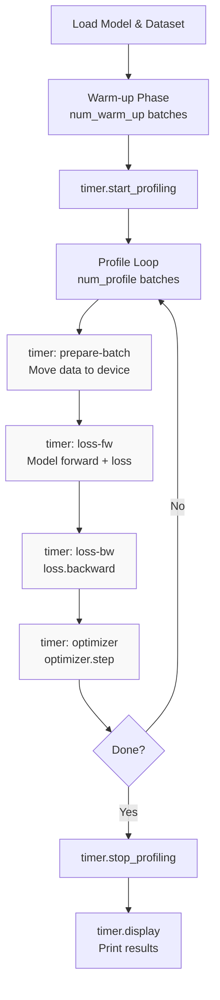
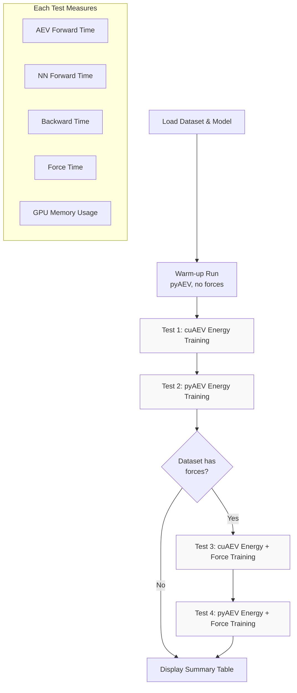
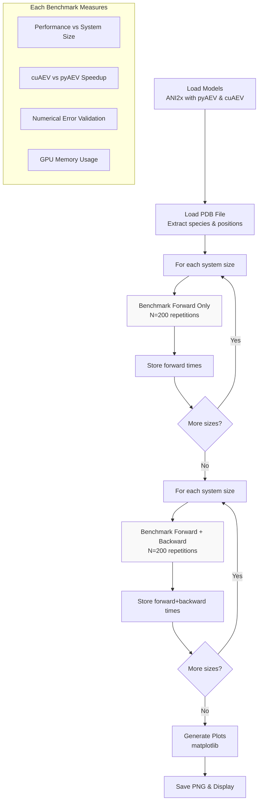
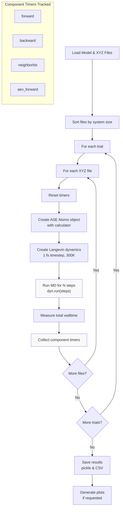

# Benchmarking

<details>
<summary>Relevant source files</summary>

The following files were used as context for generating this wiki page:

- [.gitignore](.gitignore)
- [README.md](README.md)
- [setup.py](setup.py)
- [tools/scaling-aev-benchmark.py](tools/scaling-aev-benchmark.py)
- [tools/scaling-md-benchmark.py](tools/scaling-md-benchmark.py)
- [tools/training-aev-benchmark.py](tools/training-aev-benchmark.py)
- [tools/training-benchmark.py](tools/training-benchmark.py)

</details>


## Purpose and Scope

This page documents the benchmarking tools provided in TorchANI for measuring performance and scaling characteristics of different components. These tools enable systematic performance analysis for training workflows, AEV computation, neural network inference, and molecular dynamics simulations. For optimization techniques based on benchmark results, see [Performance Optimization](#8.1). For details on the C++ and CUDA extensions that affect performance, see [C++ and CUDA Extensions](#8.2).

**Sources:** [tools/training-benchmark.py:1-203](), [tools/training-aev-benchmark.py:1-311](), [tools/scaling-aev-benchmark.py:1-608](), [tools/scaling-md-benchmark.py:1-351]()

## Overview of Benchmark Tools

TorchANI provides four specialized benchmarking scripts in the `tools/` directory, each targeting different performance aspects:

| Script | Purpose | Key Metrics |
|--------|---------|-------------|
| `training-benchmark.py` | Training loop performance | Forward/backward pass timing, component-level profiling |
| `training-aev-benchmark.py` | AEV computation during training | cuAEV vs pyAEV comparison, memory usage |
| `scaling-aev-benchmark.py` | AEV scaling with system size | Performance vs molecule size, speedup analysis |
| `scaling-md-benchmark.py` | MD simulation scaling | Walltime per ns, neighborlist performance |

**Sources:** [tools/training-benchmark.py:1-10](), [tools/training-aev-benchmark.py:1-20](), [tools/scaling-aev-benchmark.py:1-20](), [tools/scaling-md-benchmark.py:1-20]()

## Benchmark Tool Architecture

```mermaid
graph TB
    subgraph "Benchmark Tools"
        TrainingBench["training-benchmark.py<br/>Training Loop Profiling"]
        AEVTrainBench["training-aev-benchmark.py<br/>AEV Training Comparison"]
        AEVScaleBench["scaling-aev-benchmark.py<br/>AEV Scaling Analysis"]
        MDScaleBench["scaling-md-benchmark.py<br/>MD Scaling Analysis"]
    end
    
    subgraph "Components Measured"
        Model["Model.forward"]
        AEVComp["AEVComputer.forward"]
        NNets["NeuralNetworks.forward"]
        Neighborlist["Neighborlist.forward"]
        Forces["Force Computation"]
        EnergyShift["EnergyShifter.forward"]
    end
    
    subgraph "Profiling Utilities"
        Timer["Timer<br/>Custom timing wrapper"]
        NVTX["NVTX Markers<br/>Nsight Systems"]
        CUDASync["torch.cuda.synchronize<br/>Accurate timing"]
        GPUMem["GPU Memory Tracking<br/>pynvml"]
    end
    
    subgraph "Output Formats"
        Console["Console Tables<br/>rich, tqdm"]
        Plots["Performance Plots<br/>matplotlib"]
        Files["Data Files<br/>pickle, CSV"]
    end
    
    TrainingBench --> Model
    TrainingBench --> AEVComp
    TrainingBench --> NNets
    
    AEVTrainBench --> AEVComp
    AEVTrainBench --> Forces
    
    AEVScaleBench --> AEVComp
    AEVScaleBench --> NNets
    
    MDScaleBench --> Neighborlist
    MDScaleBench --> Model
    
    TrainingBench --> Timer
    AEVTrainBench --> GPUMem
    AEVScaleBench --> GPUMem
    
    TrainingBench --> NVTX
    AEVTrainBench --> NVTX
    AEVScaleBench --> NVTX
    
    All[All Tools] --> CUDASync
    All --> Console
    AEVScaleBench --> Plots
    MDScaleBench --> Plots
    MDScaleBench --> Files
    
    style TrainingBench fill:#f9f9f9
    style AEVTrainBench fill:#f9f9f9
    style AEVScaleBench fill:#f9f9f9
    style MDScaleBench fill:#f9f9f9
```



**Sources:** [tools/training-benchmark.py:48-64](), [tools/training-aev-benchmark.py:71-218](), [tools/scaling-aev-benchmark.py:132-260](), [tools/scaling-md-benchmark.py:253-279]()

## Training Benchmark

The training benchmark (`training-benchmark.py`) profiles the complete training loop including data loading, forward pass, loss computation, and backward pass. It supports both regular and JIT-compiled models.

### Usage

```bash
# Basic training benchmark with default TestData dataset
python tools/training-benchmark.py

# Benchmark on specific dataset with detailed component profiling
python tools/training-benchmark.py ANI1x --detail --batch-size 2560

# Profile with NVIDIA Nsight Systems
python tools/training-benchmark.py --nvtx --num-warm-up 50 --num-profile 20

# CPU benchmarking (not recommended for performance)
python tools/training-benchmark.py --device cpu
```

### Command-Line Arguments

| Argument | Type | Default | Description |
|----------|------|---------|-------------|
| `dataset` | str | `TestData` | Name of built-in dataset to train on |
| `-d, --device` | str | `cuda`/`cpu` | Device for computation |
| `-w, --num-warm-up` | int | `100` | Number of warm-up batches before profiling |
| `-e, --num-profile` | int | `10` | Number of batches to profile |
| `-b, --batch-size` | int | `2560` | Conformations per batch |
| `--nvtx` | flag | `False` | Emit NVTX markers for Nsight Systems |
| `--no-sync` | flag | `False` | Disable CUDA synchronization |
| `--detail` | flag | `False` | Include component-level timing breakdown |
| `--no-tqdm` | flag | `False` | Disable progress bar |

**Sources:** [tools/training-benchmark.py:108-177]()

### Benchmark Workflow



**Sources:** [tools/training-benchmark.py:17-105]()

### Component-Level Profiling

When the `--detail` flag is enabled, the benchmark profiles individual components:

- `model.forward` - Complete model forward pass
- `aev_computer.forward` - AEV computation
- `aev_computer.neighborlist.forward` - Neighborlist construction
- `aev_computer.radial.forward` - Radial symmetry functions
- `aev_computer.angular.forward` - Angular symmetry functions
- `neural_networks.forward` - Neural network inference
- `energy_shifter.forward` - Self-energy addition

**Sources:** [tools/training-benchmark.py:49-58]()

### Example Output

```
Profiling with optimization=NONE, on device: CUDA
NVTX DISABLED
CUDA sync ENABLED

Warm up: 100 batches
Profiling: 10 batches

Timer Results:
  prepare-batch: 12.3 ms
  loss-fw: 45.6 ms
  loss-bw: 78.9 ms
  optimizer: 5.2 ms
  
  model.forward: 38.4 ms
  aev_computer.forward: 25.1 ms
  neural_networks.forward: 10.2 ms
```

**Sources:** [tools/training-benchmark.py:29-32]()

## AEV Training Benchmark

The AEV training benchmark (`training-aev-benchmark.py`) specifically compares `cuAEV` (CUDA extension) and `pyAEV` (PyTorch implementation) performance during training workflows.

### Usage

```bash
# Compare cuAEV vs pyAEV for energy-only training
python tools/training-aev-benchmark.py ANI1x --batch_size 2560 --num_epochs 1

# Include force training benchmark
python tools/training-aev-benchmark.py TestDataForcesDipoles

# Profile with Nsight Systems
python tools/training-aev-benchmark.py --nsight
```

### Command-Line Arguments

| Argument | Type | Default | Description |
|----------|------|---------|-------------|
| `dataset` | str | `ANI1x` | Dataset name (ANI1x or TestDataForcesDipoles) |
| `-d, --device` | str | `cuda`/`cpu` | Device for computation |
| `-b, --batch_size` | int | `2560` | Conformations per batch |
| `-p, --pickle` | flag | `False` | Dataset is pickled |
| `--nsight` | flag | `False` | Enable Nsight profiling |
| `-n, --num_epochs` | int | `1` | Number of epochs to run |

**Sources:** [tools/training-aev-benchmark.py:220-247]()

### Benchmark Execution Flow



**Sources:** [tools/training-aev-benchmark.py:266-310]()

### Benchmark Implementation

The benchmark function measures separate timing for each component:

```python
# From tools/training-aev-benchmark.py:71-218
# Key timing points:
# 1. AEV forward: aev = aev_computer(species, coordinates)
# 2. NN forward: _, predicted_energies = nn((species, aev))
# 3. Force computation: forces = -torch.autograd.grad(...)
# 4. Backward: loss.backward()
```

**Sources:** [tools/training-aev-benchmark.py:92-168]()

### GPU Memory Tracking

The benchmark uses `pynvml` (NVIDIA Management Library) to track actual GPU memory usage:

**Sources:** [tools/training-aev-benchmark.py:19-43]()

### Example Output

```
=> Test 1: cu Energy train
Epoch: 1/1
rmse: 1.234

=> More detail about benchmark PER EPOCH
   AEV forward - 15.2 ms
   NN forward - 8.3 ms
   Backward - 45.6 ms
   Force - 0.0 ms
   Others - 2.1 ms
   Epoch time - 71.2 ms
   GPU Memory Used: 2345.6MB

RUN                        Total AEV    NN Forward   Backward     Force        Others       Epoch time   GPU         
1 cu Energy train          15.2 ms      8.3 ms       45.6 ms      0.0 ms       2.1 ms       71.2 ms      2345.6MB    
2 py Energy train          42.8 ms      8.5 ms       46.1 ms      0.0 ms       1.9 ms       99.3 ms      2378.1MB    
3 cu Energy + Force train  15.4 ms      8.4 ms       87.3 ms      12.1 ms      2.3 ms       125.5 ms     2456.2MB    
4 py Energy + Force train  43.1 ms      8.6 ms       88.2 ms      12.3 ms      2.0 ms       154.2 ms     2489.7MB    
```

**Sources:** [tools/training-aev-benchmark.py:178-217]()

## AEV Scaling Benchmark

The AEV scaling benchmark (`scaling-aev-benchmark.py`) analyzes how AEV computation performance scales with molecular system size. It generates plots showing performance vs. number of atoms.

### Usage

```bash
# Generate scaling plots for AEV computation only
python tools/scaling-aev-benchmark.py --plot -N 200

# Include neural network inference
python tools/scaling-aev-benchmark.py --plot --run_energy

# Include inference model optimization
python tools/scaling-aev-benchmark.py --plot --run_energy --infer_model

# Include MNP (Multi Net Parallel) extension
python tools/scaling-aev-benchmark.py --plot --run_energy --infer_model --mnp

# Benchmark single neural network instead of ensemble
python tools/scaling-aev-benchmark.py --plot --run_energy --single_nn

# Use cell list for reference pyAEV implementation
python tools/scaling-aev-benchmark.py --plot --use-cell-list

# Profile with Nsight Systems
python tools/scaling-aev-benchmark.py --nsight
```

### Command-Line Arguments

| Argument | Type | Default | Description |
|----------|------|---------|-------------|
| `-s, --nsight` | flag | `False` | Use Nsight profiling |
| `-p, --plot` | flag | `False` | Generate benchmark plots |
| `-e, --run_energy` | flag | `False` | Run NN to predict energy |
| `--single_nn` | flag | `False` | Use single NN instead of ensemble |
| `--infer_model` | flag | `False` | Use inference model optimization |
| `--mnp` | flag | `False` | Use MNP extension |
| `-n, --N` | int | `200` | Number of repetitions |
| `--use-cell-list` | flag | `False` | Use cell list for pyAEV |
| `--ref-strategy` | str | `pyaev` | Reference strategy (pyaev or cuaev) |

**Sources:** [tools/scaling-aev-benchmark.py:492-547]()

### Benchmark Workflow for Plotting



**Sources:** [tools/scaling-aev-benchmark.py:468-488]()

### Benchmark Function

The core benchmark function measures performance for a single system size:

**Sources:** [tools/scaling-aev-benchmark.py:132-260]()

### Error Validation

The benchmark validates correctness by comparing cuAEV and pyAEV outputs:

**Sources:** [tools/scaling-aev-benchmark.py:262-284]()

### Plot Generation

The benchmark generates publication-quality plots showing:

1. **Performance curves**: Time (ms) vs. system size (atoms) for both forward and forward+backward passes
2. **Annotations**: Numerical values displayed on each data point
3. **Comparison**: pyAEV vs cuAEV for both AEV-only and AEV+NN configurations
4. **GPU information**: Title includes GPU name and configuration details

**Sources:** [tools/scaling-aev-benchmark.py:355-466]()

### Example Output

```
File: 6ZDH.pdb, Molecule size: 10000 / 15234, Species: [1, 6, 7, 8, 16]

Original TorchANI:
  Duration: 3.45 s
  Speed: 17.25 ms/it
  GPU Memory Cached: 3456.7MB / 12288.0MB
  GPU Memory Used: 4123.5MB / 12288.0MB
  aev_error: 2.34e-05
  force_error: 8.91e-05
  Speed up: 3.42 X

RUN                 PDB          Size         forward      backward     Others       Total        Total(200)   Speedup      GPU         
01 py aev fd        6ZDH.pdb     10000        42.8 ms      0.0 ms       1.2 ms       44.0 ms      8.80 sec     -            4123.5MB    
02 cu aev fd        6ZDH.pdb     10000        12.1 ms      0.0 ms       0.8 ms       12.9 ms      2.58 sec     3.42         3987.2MB    
```

**Sources:** [tools/scaling-aev-benchmark.py:84-130]()

## MD Scaling Benchmark

The MD scaling benchmark (`scaling-md-benchmark.py`) measures molecular dynamics performance scaling with system size using ASE's Langevin dynamics.

### Usage

```bash
# Basic MD scaling benchmark
python tools/scaling-md-benchmark.py -x /path/to/xyz/files -s 100

# Test cell list performance
python tools/scaling-md-benchmark.py -x /path/to/xyz/files --cell-list

# Test Verlet cell list (reuse neighborlist)
python tools/scaling-md-benchmark.py -x /path/to/xyz/files --verlet-cell-list

# Use different model
python tools/scaling-md-benchmark.py -x /path/to/xyz/files -m ani2x

# JIT compilation
python tools/scaling-md-benchmark.py -x /path/to/xyz/files -j

# Generate plots from saved data
python tools/scaling-md-benchmark.py --plot -f ani1x_clist.pkl

# Plot multiple results
python tools/scaling-md-benchmark.py --path-to-files ./tools/plots/
```

### Command-Line Arguments

| Argument | Type | Default | Description |
|----------|------|---------|-------------|
| `-j, --jit` | flag | `False` | Use JIT compilation |
| `-m, --model` | str | `ani1x` | Model name (ani1x, ani2x, ani1ccx) |
| `-d, --device` | str | `cuda` | Device for computation |
| `-s, --steps` | int | `100` | MD timesteps to run |
| `--no-pbc` | flag | `False` | Disable periodic boundary conditions |
| `--model-index` | int | `None` | Specific model index |
| `-x, --xyz` | str | Required | Path to directory with xyz files |
| `-t, --trials` | int | `1` | Number of trials for std dev |
| `-b, --box-repeats` | int | `15` | Box replications in all directions |
| `--cell-list` | flag | `False` | Use cell list neighborlist |
| `--verlet-cell-list` | flag | `False` | Reuse cell list (Verlet) |
| `-p, --plot` | flag | `False` | Generate plots |
| `-f, --file-name` | str | Auto | Output file name |
| `-F, --path-to-files` | str | `None` | Path to multiple result files |

**Sources:** [tools/scaling-md-benchmark.py:158-204]()

### Benchmark Workflow



**Sources:** [tools/scaling-md-benchmark.py:234-350]()

### Timer Injection

The benchmark injects timing wrappers into model methods to track individual components:

**Sources:** [tools/scaling-md-benchmark.py:253-279]()

### Output Files

The benchmark generates two types of output files:

1. **Pickle files** (`.pkl`): Complete timing data including all trials, raw times, and component timers
2. **CSV files** (`.csv`): Formatted data with headers for easy analysis

**Sources:** [tools/scaling-md-benchmark.py:328-350]()

### Plot Generation

The benchmark generates plots showing:

1. **Walltime per ns**: Total time to simulate 1 nanosecond vs. system size
2. **Performance**: ns/day (inverse of walltime) vs. system size
3. **Component breakdown**: Separate plots for forward, backward, neighborlist, and AEV times
4. **Error bars**: Standard deviation across multiple trials
5. **Comparison**: Different configurations (cell list vs. all pairs, etc.)

**Sources:** [tools/scaling-md-benchmark.py:21-134]()

## Common Benchmarking Utilities

### CUDA Synchronization

For accurate GPU timing, benchmarks use `torch.cuda.synchronize()` to ensure kernel completion before measuring time:

**Sources:** [tools/training-aev-benchmark.py:50-52](), [tools/scaling-aev-benchmark.py:36-38](), [tools/scaling-md-benchmark.py:262-267]()

### NVTX Markers

NVTX (NVIDIA Tools Extension) markers enable detailed profiling with NVIDIA Nsight Systems:

```python
# Enable NVTX profiling
torch.cuda.profiler.start()

# Mark regions of interest
torch.cuda.nvtx.range_push("region_name")
# ... code to profile ...
torch.cuda.nvtx.range_pop()

torch.cuda.profiler.stop()
```

**Sources:** [tools/training-aev-benchmark.py:75-76](), [tools/scaling-aev-benchmark.py:305-344](), [tools/scaling-md-benchmark.py:567-607]()

### GPU Memory Tracking

Benchmarks track GPU memory usage using two methods:

1. **PyTorch memory tracking**: `torch.cuda.memory_reserved()` and `torch.cuda.get_device_properties()`
2. **NVIDIA Management Library**: `pynvml` for actual device memory usage

**Sources:** [tools/training-aev-benchmark.py:19-43](), [tools/scaling-aev-benchmark.py:23-65]()

### Timer Utility

The `Timer` class (from `tool_utils`) provides:
- Hierarchical timing of code regions
- NVTX integration for Nsight profiling
- Optional CUDA synchronization
- Automatic result display

**Sources:** [tools/training-benchmark.py:12](), [tools/training-benchmark.py:48-64]()

## Performance Analysis Guidelines

### Interpreting Results

When analyzing benchmark results, consider:

1. **Warm-up phase**: First iterations may be slower due to kernel compilation and memory allocation
2. **CUDA synchronization**: Always enable for accurate timing (disable only for Nsight profiling)
3. **Batch size effects**: Larger batches improve GPU utilization but require more memory
4. **Component breakdown**: Identify bottlenecks by examining individual component timings
5. **Speedup ratios**: Compare cuAEV vs pyAEV to quantify CUDA extension benefits

### Common Benchmarking Patterns

**Energy-only vs. Force training:**
- Force training requires backpropagation through the AEV computation
- Expected overhead: 2-3x for force training vs. energy-only training

**System size scaling:**
- AEV computation: O(N²) for all pairs, O(N) for cell list
- Should show linear scaling with cell list for large systems
- Superlinear scaling indicates memory bandwidth issues

**cuAEV speedup:**
- Typical speedup: 3-5x for forward pass
- Higher speedup for larger systems (better GPU utilization)
- Diminishing returns for very small systems (<1000 atoms)

**Sources:** [tools/training-aev-benchmark.py:71-218](), [tools/scaling-aev-benchmark.py:262-284]()

### Profiling Best Practices

1. **Use sufficient warm-up**: At least 50-100 iterations to stabilize performance
2. **Run multiple trials**: Calculate mean and standard deviation across trials
3. **Control for system load**: Close other GPU applications during benchmarking
4. **Match production settings**: Use realistic batch sizes and model configurations
5. **Enable detailed profiling**: Use `--detail` or NVTX markers to identify bottlenecks
6. **Validate correctness**: Always verify numerical accuracy when comparing implementations

**Sources:** [tools/training-benchmark.py:65-102](), [tools/scaling-aev-benchmark.py:132-284](), [tools/scaling-md-benchmark.py:253-327]()

---