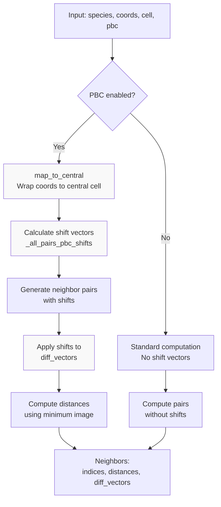
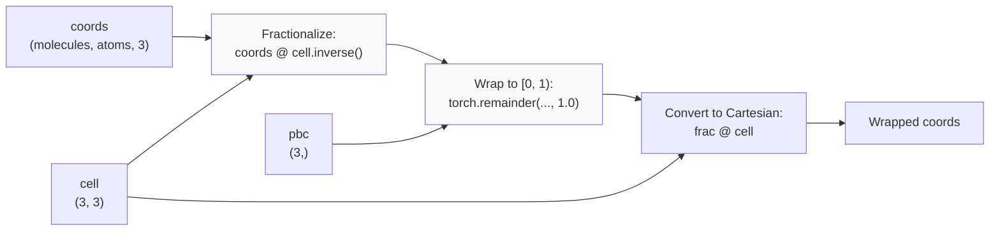
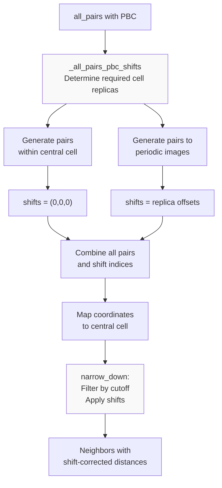
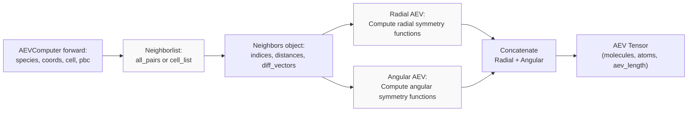

# Periodic Boundary Conditions

<details>
<summary>Relevant source files</summary>

The following files were used as context for generating this wiki page:

- [tests/test_aev.py](tests/test_aev.py)
- [tests/test_energies.py](tests/test_energies.py)
- [tests/test_ensemble.py](tests/test_ensemble.py)
- [tests/test_forces.py](tests/test_forces.py)
- [tests/test_neighbors.py](tests/test_neighbors.py)
- [tools/neighborlist-benchmark.py](tools/neighborlist-benchmark.py)
- [tools/pyaev-benchmark.py](tools/pyaev-benchmark.py)
- [torchani/csrc/CMakeLists.txt](torchani/csrc/CMakeLists.txt)
- [torchani/csrc/__init__.py](torchani/csrc/__init__.py)
- [torchani/csrc/cell_list.cpp](torchani/csrc/cell_list.cpp)
- [torchani/neighbors.py](torchani/neighbors.py)

</details>


## Purpose and Scope

This page describes how TorchANI handles periodic boundary conditions (PBC) for simulating bulk systems and crystals. PBC allows modeling infinite systems by replicating a finite unit cell in three dimensions. The implementation ensures that atoms near cell boundaries can interact with periodic images of atoms on opposite boundaries.

For information about neighborlist algorithms in general, see [Neighborlist Algorithms](#4.3). For AEV computation details, see [AEV Computation](#4.2).

## Concepts and Representation

### Periodic Boundary Conditions

Periodic boundary conditions simulate an infinite system by treating the simulation cell as if it were surrounded by identical copies of itself in all directions. When an atom moves out of one side of the cell, its periodic image enters from the opposite side. This is essential for modeling bulk materials, liquids, and crystals without surface effects.

### Cell and PBC Tensors

TorchANI represents periodic systems using two key tensors:

| Parameter | Type | Shape | Description |
|-----------|------|-------|-------------|
| `cell` | `Tensor` (float) | `(3, 3)` | Unit cell vectors as rows. Each row is a cell basis vector. |
| `pbc` | `Tensor` (bool) | `(3,)` | Whether PBC is enabled along each cell vector direction. |

The `cell` tensor defines the parallelepiped unit cell. For orthogonal cells, it is diagonal. For non-orthogonal cells (triclinic, monoclinic), it contains off-diagonal elements. The `pbc` tensor allows selective application of PBC along different dimensions.

**Sources:** [torchani/neighbors.py:148-165]()

### Minimum Image Convention

TorchANI uses the minimum image convention: when computing distances between atoms, it considers all periodic images and uses the shortest distance. This is implemented through shift vectors that represent which periodic image to use.

## Implementation Architecture



**PBC Processing Flow**

When PBC is enabled, coordinates are first mapped to the central cell, shift vectors are calculated to account for periodic images, and distances are computed using the minimum image convention.

**Sources:** [torchani/neighbors.py:189-214](), [torchani/neighbors.py:217-244]()

## Coordinate Mapping to Central Cell

### map_to_central Function

The `map_to_central` function ensures all atomic coordinates lie within the central unit cell. This is critical for PBC calculations to work correctly.



**Coordinate Wrapping Process**

The mapping converts coordinates to fractional coordinates (relative to cell vectors), wraps them to the range [0, 1), then converts back to Cartesian coordinates.

**Sources:** [torchani/neighbors.py:10](), [torchani/csrc/cell_list.cpp:9-14]()

The function handles edge cases where coordinates have very small negative values or values slightly greater than 1.0 due to floating-point precision. The C++ implementation includes explicit corrections for these cases:

[torchani/csrc/cell_list.cpp:122-125]()

## Neighborlist Algorithms with PBC

### AllPairs with PBC

The `AllPairs` neighborlist supports PBC by considering all relevant periodic images of the unit cell. The algorithm:

1. Determines which periodic images are needed based on the cutoff radius
2. Generates all atom pairs within the central cell
3. Generates pairs between central cell atoms and periodic images
4. Applies shift vectors to account for periodic translations



**AllPairs PBC Algorithm**

The algorithm considers the central cell plus necessary periodic replicas, generating both within-cell pairs and cross-cell pairs with appropriate shift vectors.

**Sources:** [torchani/neighbors.py:189-214](), [torchani/neighbors.py:217-244]()

### Shift Vector Calculation

The `_all_pairs_pbc_shifts` function determines which periodic images must be considered:

[torchani/neighbors.py:252-277]()

The function:
- Computes the inverse cell (reciprocal lattice)
- Calculates how many cell replicas are needed in each direction based on cutoff
- Generates shift vectors for all required periodic images
- Excludes the central cell and symmetric images to avoid double counting

The shift vectors are integer triplets `(nx, ny, nz)` indicating multiples of cell vectors to add to coordinates when computing distances.

**Sources:** [torchani/neighbors.py:247-277]()

### CellList with PBC

The `CellList` algorithm also supports PBC. When PBC is enabled:

[torchani/neighbors.py:437-466]()

Key differences with PBC:
- Coordinates are **not** displaced (they remain in their input positions)
- The provided `cell` is used directly instead of computing a bounding cell
- Grid buckets can wrap around cell boundaries
- Shift indices track which periodic image each pair belongs to

The grid setup validates that the cell is large enough for the bucket size:

[torchani/neighbors.py:452-454]()

**Sources:** [torchani/neighbors.py:417-466](), [torchani/csrc/cell_list.cpp:282-316]()

## AEV Computation with PBC

### AEVComputer PBC Support

The `AEVComputer` class accepts `cell` and `pbc` parameters and passes them to the neighborlist:



**AEV Computation with PBC**

The neighborlist handles all PBC complexity. Once neighbors are computed with correct shift-adjusted distances and difference vectors, the AEV computation proceeds identically to the non-PBC case.

**Sources:** [tests/test_aev.py:239-254](), [tests/test_aev.py:481-505]()

### Translational Invariance

A key property of AEVs with PBC is translational invariance: shifting all atoms by the same vector (including across cell boundaries) produces identical AEVs after wrapping:

[tests/test_aev.py:239-254]()

This test verifies that random translations produce identical AEVs, confirming correct PBC implementation.

**Sources:** [tests/test_aev.py:239-254]()

### Handling Cell Boundaries

Special care is taken for atoms at cell boundaries. The `TestAEVOnBoundary` test class verifies that atoms on corners, edges, and faces of the cell produce correct AEVs:

[tests/test_aev.py:335-388]()

The test places molecules at various positions (corners, edges, surfaces) relative to the cell, verifies they are correctly mapped to the central cell, and confirms AEVs are identical regardless of which image is used.

**Sources:** [tests/test_aev.py:335-388]()

## Key Classes and Functions

### Core PBC Functions

| Function | Location | Purpose |
|----------|----------|---------|
| `map_to_central` | [torchani/utils.py]() | Wrap coordinates into central unit cell |
| `_all_pairs_pbc` | [torchani/neighbors.py:217-244]() | Generate all pairs with PBC |
| `_all_pairs_pbc_shifts` | [torchani/neighbors.py:247-277]() | Calculate required shift vectors |
| `coords_to_fractional` | [torchani/neighbors.py:612-624]() | Convert Cartesian to fractional coordinates |
| `narrow_down` | [torchani/neighbors.py:66-115]() | Filter pairs by cutoff, apply shifts |

### Neighborlist Classes with PBC Support

| Class | Location | PBC Support |
|-------|----------|-------------|
| `AllPairs` | [torchani/neighbors.py:171-186]() | Full PBC support |
| `CellList` | [torchani/neighbors.py:300-317]() | Full PBC support |
| `FastCellList` | [torchani/neighbors.py:280-297]() | Full PBC support (C++ extension) |
| `AdaptiveList` | [torchani/neighbors.py:320-342]() | Full PBC support |
| `VerletCellList` | [torchani/neighbors.py:825-951]() | Full PBC support |

**Sources:** [torchani/neighbors.py:142-169](), [torchani/neighbors.py:171-343]()

## Usage Examples

### Basic PBC Calculation

```python
import torch
from torchani.aev import AEVComputer
from torchani.nn import SpeciesConverter

# Define cubic unit cell (10 Angstrom sides)
cell = torch.eye(3) * 10.0

# Enable PBC in all directions
pbc = torch.tensor([True, True, True])

# Atomic numbers and coordinates
species = torch.tensor([[1, 1, 8]])  # H, H, O
coords = torch.tensor([
    [[0.5, 0.5, 0.5],
     [9.8, 0.5, 0.5],  # Near boundary
     [5.0, 5.0, 5.0]]
])

# Convert to species indices
converter = SpeciesConverter(['H', 'C', 'N', 'O'])
species_idx = converter(species)

# Compute AEVs with PBC
aev_computer = AEVComputer.like_1x()
aevs = aev_computer(species_idx, coords, cell=cell, pbc=pbc)
```

**Sources:** [tests/test_aev.py:239-254]()

### Non-Orthogonal Cell

For non-orthogonal cells (e.g., monoclinic, triclinic):

```python
# Non-orthogonal cell
cell = torch.tensor([
    [10.0, 0.0, 0.0],   # a vector
    [0.0, 10.0, 0.0],   # b vector  
    [10.0, 0.0, 10.0]   # c vector (tilted)
])

pbc = torch.tensor([True, True, True])

# Atoms near boundary still interact correctly
coords = torch.tensor([[[0.1, 0.1, 0.05],
                         [10.0, 0.1, 0.1]]])
```

The cell list algorithm accounts for non-orthogonal cells via a spherical factor correction:

[torchani/neighbors.py:707-716]()

**Sources:** [tests/test_aev.py:316-332](), [torchani/neighbors.py:677-728]()

### Selective PBC

Enable PBC only in specific directions (e.g., slab geometry with PBC in xy-plane only):

```python
# PBC only in x and y directions (slab geometry)
pbc = torch.tensor([True, True, False])

cell = torch.eye(3) * 20.0

# Surface slab coordinates
coords = torch.tensor([[[...], [...], [...]]])
aevs = aev_computer(species_idx, coords, cell=cell, pbc=pbc)
```

Note: The current implementation requires PBC to be enabled in all directions or none. Selective PBC raises an error:

[torchani/csrc/cell_list.cpp:54-56]()

**Sources:** [torchani/csrc/cell_list.cpp:33-61]()

### Verifying PBC Correctness

Test that atoms at cell boundaries interact:

```python
import torch
from torchani.neighbors import AllPairs

cell = torch.eye(3) * 10.0
pbc = torch.tensor([True, True, True])
cutoff = 1.0

# Place atoms near opposite boundaries
species = torch.tensor([[0, 0]])
coords = torch.tensor([[[0.1, 0.1, 0.1],
                         [9.9, 0.0, 0.0]]])

# Should find neighbors due to PBC
neighborlist = AllPairs()
neighbors = neighborlist(cutoff, species, coords, cell, pbc)

# neighbors.indices should contain [0, 1] pair
print(neighbors.indices)  # [[0], [1]]
print(neighbors.distances)  # ~0.2 (wrapped distance)
```

**Sources:** [tests/test_aev.py:256-277]()

## Performance Considerations

### Computational Cost

PBC calculations are more expensive than non-PBC:

- `AllPairs`: Must consider multiple periodic images, increasing pair count
- `CellList`: Grid wrapping adds overhead, but remains O(N) scaling

The number of periodic images scales with `(cutoff / cell_size)³`. For small cells relative to cutoff, many images are needed.

### Cell Size Requirements

For `CellList` with PBC, the cell must be large enough to accommodate at least one bucket per dimension:

[torchani/neighbors.py:452-454]()

Minimum cell size ≈ cutoff × spherical_factor. For orthogonal cells, spherical_factor = 1. For highly non-orthogonal cells, it can be much larger.

**Sources:** [torchani/neighbors.py:437-466](), [torchani/neighbors.py:677-728]()

### Adaptive Selection

The `AdaptiveList` neighborlist automatically selects the optimal algorithm based on system size, including for PBC systems:

[torchani/neighbors.py:320-342]()

It uses different thresholds for PBC (`threshold=190`) vs non-PBC (`threshold_nopbc=1770`) cases.

**Sources:** [torchani/neighbors.py:320-342](), [torchani/neighbors.py:393-414]()

## Testing and Validation

TorchANI includes comprehensive PBC tests:

| Test Class | Purpose | Location |
|------------|---------|----------|
| `TestPBCSeeEachOther` | Verify atoms at boundaries interact | [tests/test_aev.py:234-333]() |
| `TestAEVOnBoundary` | Test AEVs at cell corners/edges/faces | [tests/test_aev.py:335-388]() |
| `TestAEVOnBenzenePBC` | Test repeated cells produce consistent AEVs | [tests/test_aev.py:390-437]() |
| `TestCellListComparison` | Verify CellList matches AllPairs with PBC | [tests/test_neighbors.py:173-261]() |

The tests verify:
- Translational invariance under cell wrapping
- Correct neighbor detection at boundaries
- Consistency between neighborlist algorithms
- Proper handling of non-orthogonal cells

**Sources:** [tests/test_aev.py:234-437](), [tests/test_neighbors.py:66-261]()

---