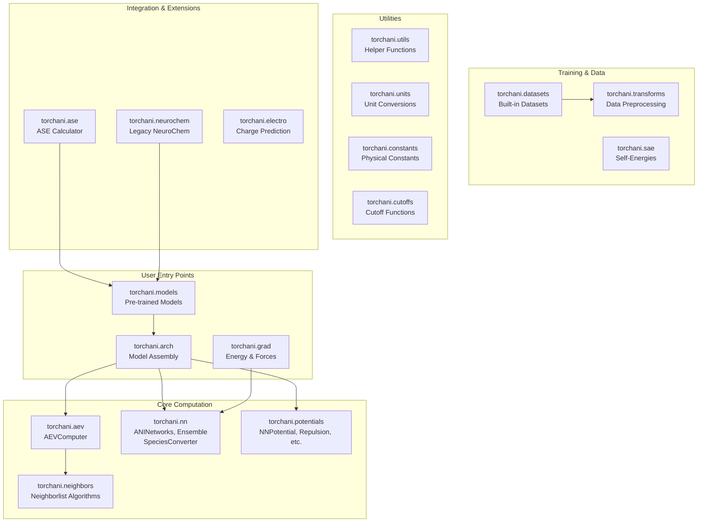
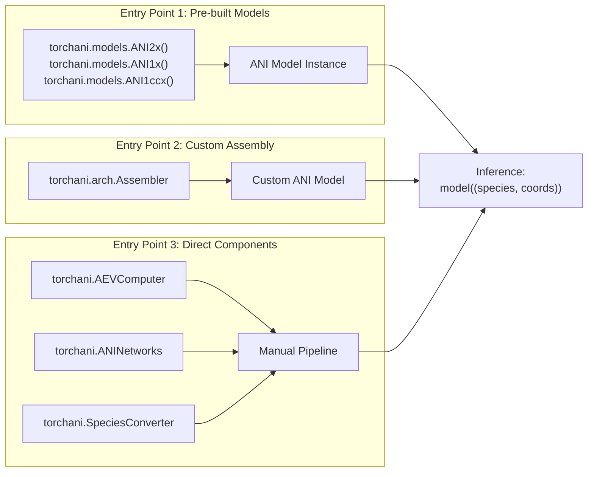
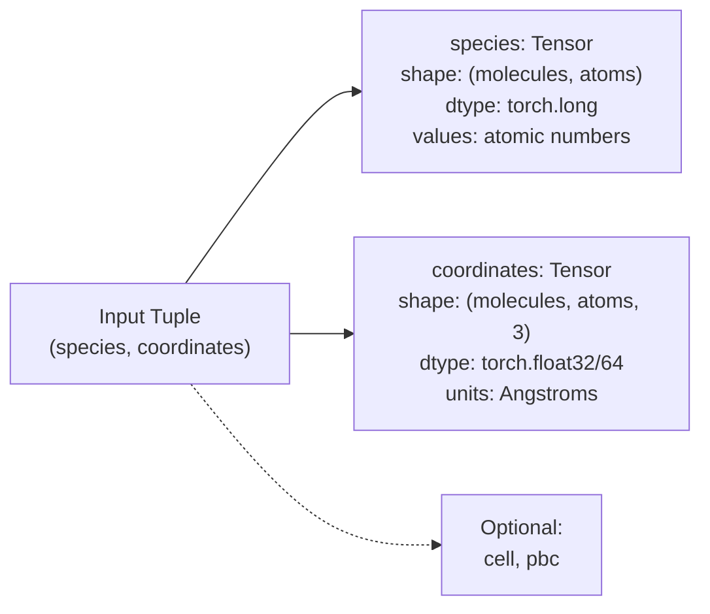
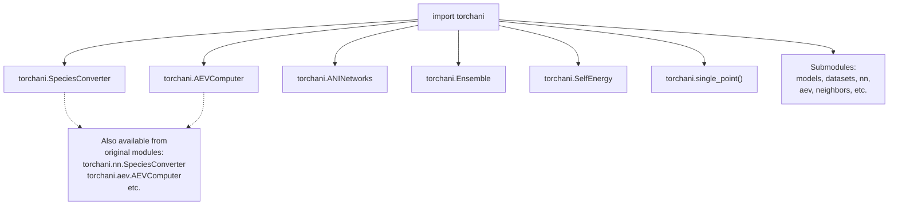

# API Reference

<details>
<summary>Relevant source files</summary>

The following files were used as context for generating this wiki page:

- [examples/fundamentals.py](examples/fundamentals.py)
- [torchani/__init__.py](torchani/__init__.py)
- [torchani/models.py](torchani/models.py)
- [torchani/neurochem.py](torchani/neurochem.py)
- [torchani/utils.py](torchani/utils.py)

</details>


This page provides a comprehensive overview of the TorchANI public API. It documents all public classes, functions, and modules available for users building applications with TorchANI or training custom neural network potentials.

For practical usage examples and tutorials, see the [User Guide](#5). For detailed explanations of underlying concepts, see [Core Concepts](#4).

## Scope and Organization

The TorchANI API is organized into five major sections, each documented in detail in the following subsections:

- **[Core API](#9.1)**: Fundamental classes for computing energies, including `AEVComputer`, `ANINetworks`, `Ensemble`, `SpeciesConverter`, and gradient computation functions
- **[Model Factories](#9.2)**: Pre-trained model instantiation functions like `ANI1x()`, `ANI2x()`, `ANI1ccx()`, and `ANI2dr()`
- **[Datasets API](#9.3)**: Dataset loading, batching, and transformation utilities for training workflows
- **[ASE Calculator API](#9.4)**: Integration layer for using TorchANI models with the Atomic Simulation Environment
- **[Legacy NeuroChem API](#9.5)**: Backward-compatible interface for loading models in the original NeuroChem format

## Module Structure

TorchANI's API is organized into specialized modules, each handling a specific aspect of neural network potential computation:



**Sources**: [torchani/__init__.py:1-123]()

## Primary API Entry Points

Users typically interact with TorchANI through three main entry points:



**Sources**: [torchani/models.py:1-486](), [torchani/arch.py]() (referenced), [torchani/__init__.py:47-52]()

## Core Classes Overview

The following table summarizes the primary classes users interact with:

| Class | Module | Purpose | Documented In |
|-------|--------|---------|---------------|
| `ANI` | `torchani.arch` | Complete ANI model for energy prediction | [Core API](#9.1) |
| `ANIq` | `torchani.arch` | ANI model with charge prediction | [Core API](#9.1) |
| `AEVComputer` | `torchani.aev` | Computes atomic environment vectors | [Core API](#9.1) |
| `ANINetworks` | `torchani.nn` | Atomic neural networks for single element types | [Core API](#9.1) |
| `Ensemble` | `torchani.nn` | Container for ensemble of neural networks | [Core API](#9.1) |
| `SpeciesConverter` | `torchani.nn` | Converts atomic numbers to element indices | [Core API](#9.1) |
| `SelfEnergy` | `torchani.sae` | Self-atomic energy calculator | [Core API](#9.1) |
| `Assembler` | `torchani.arch` | Builder for constructing custom models | [Core API](#9.1) |
| `ANIDataset` | `torchani.datasets` | Dataset loader for HDF5/Parquet/Zarr | [Datasets API](#9.3) |
| `Batcher` | `torchani.datasets` | Splits data into train/validation batches | [Datasets API](#9.3) |
| `Calculator` | `torchani.ase` | ASE calculator interface | [ASE Calculator API](#9.4) |

**Sources**: [torchani/__init__.py:47-52](), [torchani/models.py:1-62]()

## API Conventions

### Input Format

All TorchANI models and computational components expect inputs in a consistent format:



**Sources**: [examples/fundamentals.py:33-44](), [torchani/models.py:25-30]()

### Output Format

Model outputs are returned as structured tuples with named fields:

| Method | Return Type | Fields | Units |
|--------|-------------|--------|-------|
| `model((species, coords))` | `SpeciesEnergies` | `species`, `energies` | Hartrees |
| `model.atomic_energies(...)` | `SpeciesAtomicEnergies` | `species`, `energies` | Hartrees |
| `model.energies_qbcs(...)` | `SpeciesEnergiesQBCs` | `species`, `energies`, `qbcs` | Hartrees (energies) |
| `energies_and_forces(...)` | `tuple` | `(energies, forces)` | Hartrees, Hartree/Å |

**Sources**: [torchani/models.py:40-58]()

### Device and Dtype Management

All components support explicit device and dtype specification:

```python
# Example API pattern (not executable)
model = torchani.models.ANI2x(device='cuda', dtype=torch.float32)
aev_computer = torchani.AEVComputer(..., device='cpu', dtype=torch.float64)
```

**Sources**: [torchani/models.py:86-89](), [examples/fundamentals.py:61-67]()

## Namespace Organization

TorchANI provides convenient access to frequently-used classes directly from the top-level namespace:



**Sources**: [torchani/__init__.py:47-94]()

## Versioning and Imports

To check the installed version:

```python
import torchani
print(torchani.__version__)
```

The version is obtained from package metadata at runtime.

**Sources**: [torchani/__init__.py:55-58]()

## Common Utilities

The `torchani.utils` module provides helper classes and functions used throughout the API:

| Utility | Purpose |
|---------|---------|
| `ChemicalSymbolsToInts` | Convert element symbols to integer indices |
| `IntsToChemicalSymbols` | Convert integer indices to element symbols |
| `AtomicNumbersToChemicalSymbols` | Convert atomic numbers to element symbols |
| `ChemicalSymbolsToAtomicNumbers` | Convert element symbols to atomic numbers |
| `AtomicNumbersToMasses` | Convert atomic numbers to atomic masses |
| `pad_atomic_properties()` | Pad molecular properties to uniform size |
| `strip_redundant_padding()` | Remove excess padding from tensors |

**Sources**: [torchani/utils.py:23-40](), [torchani/utils.py:285-468]()

## Constants and Physical Data

Standard physical constants and atomic data are available in dedicated modules:

- **`torchani.constants`**: Physical constants and periodic table data
- **`torchani.units`**: Unit conversion utilities (Hartree, eV, kcal/mol, etc.)
- **`torchani.utils.PERIODIC_TABLE`**: Element symbols indexed by atomic number
- **`torchani.utils.ATOMIC_NUMBER`**: Atomic numbers indexed by symbol
- **`torchani.utils.MASS`**: Atomic masses

Predefined element sets for specific models:

- **`torchani.utils.SYMBOLS_1X`**: `("H", "C", "N", "O")` - ANI-1x/ANI-1ccx models
- **`torchani.utils.SYMBOLS_2X`**: `("H", "C", "N", "O", "S", "F", "Cl")` - ANI-2x models

**Sources**: [torchani/utils.py:19-65](), [torchani/__init__.py:19-41]()

## Navigation

Detailed documentation for each API section:

- **[Core API](#9.1)**: `AEVComputer`, `ANINetworks`, `Ensemble`, `SpeciesConverter`, `SelfEnergy`, gradient functions
- **[Model Factories](#9.2)**: `ANI1x()`, `ANI2x()`, `ANI1ccx()`, `ANI2xr()`, `ANI2dr()`, `ANImbis()`, custom model loading
- **[Datasets API](#9.3)**: `ANIDataset`, `Batcher`, `BatchedDataset`, transforms, built-in dataset catalog
- **[ASE Calculator API](#9.4)**: `Calculator` class, ASE integration methods
- **[Legacy NeuroChem API](#9.5)**: NeuroChem file format loaders, backward-compatible model instantiation

For practical usage patterns, see the [User Guide](#5). For conceptual explanations of the architecture, see [Core Concepts](#4).

**Sources**: [torchani/__init__.py:1-123](), [torchani/models.py:1-62](), [torchani/neurochem.py:1-511]()

---