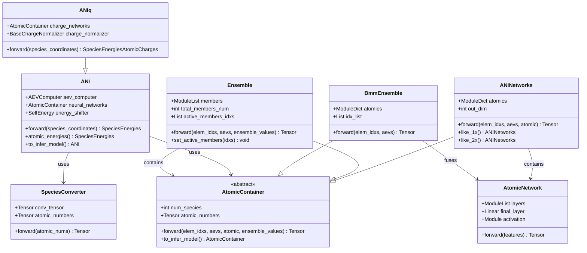
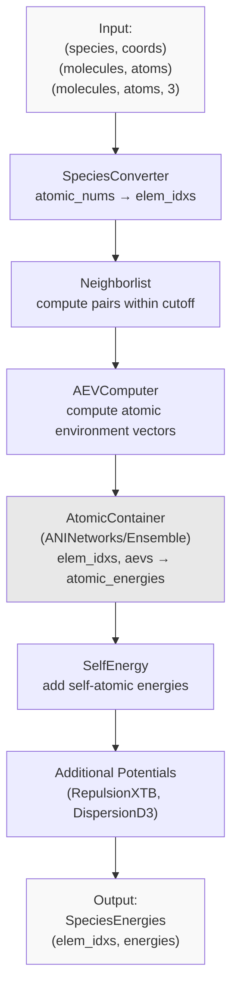
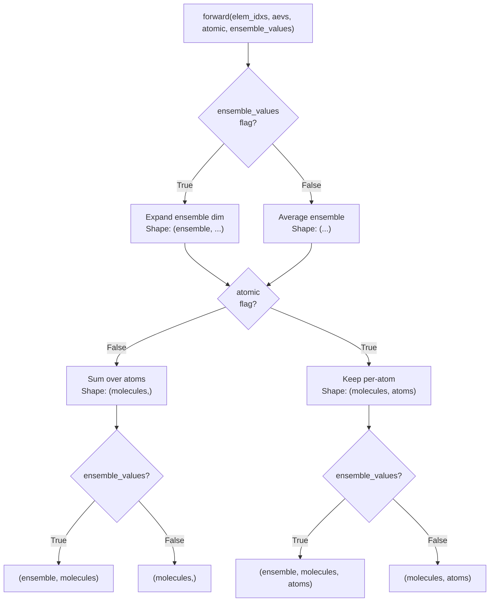
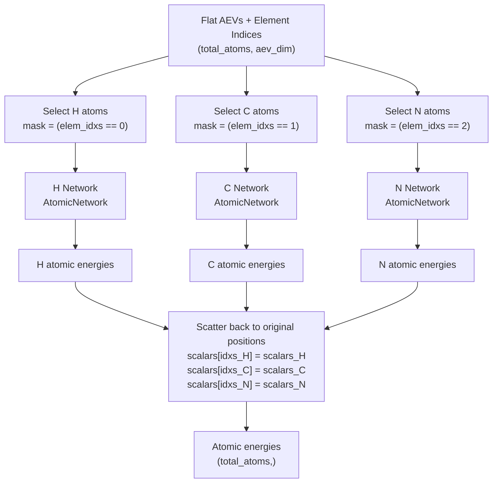

# Core API

<details>
<summary>Relevant source files</summary>

The following files were used as context for generating this wiki page:

- [examples/fundamentals.py](examples/fundamentals.py)
- [torchani/__init__.py](torchani/__init__.py)
- [torchani/arch.py](torchani/arch.py)
- [torchani/neurochem.py](torchani/neurochem.py)
- [torchani/nn/__init__.py](torchani/nn/__init__.py)
- [torchani/nn/_containers.py](torchani/nn/_containers.py)
- [torchani/nn/_core.py](torchani/nn/_core.py)
- [torchani/nn/_infer.py](torchani/nn/_infer.py)
- [torchani/nn/_internal.py](torchani/nn/_internal.py)

</details>


This page documents the core classes and functions that form the foundation of TorchANI's public API. These are the primary building blocks for creating, configuring, and using neural network potentials.

For information about pre-built model factories, see [Model Factories](#9.2). For dataset-related classes, see [Datasets API](#9.3). For ASE integration, see [ASE Calculator API](#9.4).

## Overview

The Core API consists of several layers of abstractions:

| Layer | Key Classes | Purpose |
|-------|-------------|---------|
| **Model Architecture** | `ANI`, `ANIq` | Top-level models that combine all components and provide inference interface |
| **Network Containers** | `ANINetworks`, `Ensemble`, `SingleNN`, `ANISharedNetworks` | Organize and execute element-specific neural networks |
| **Atomic Networks** | `AtomicNetwork`, `AtomicContainer` | Individual neural networks that process atomic features |
| **Utilities** | `SpeciesConverter`, `AEVComputer`, `SelfEnergy` | Helper classes for data conversion and energy computation |
| **Inference Optimization** | `BmmEnsemble`, `BmmAtomicNetwork`, `MNPNetworks` | Performance-optimized versions for production use |

Sources: [torchani/__init__.py:48-51](), [torchani/arch.py:92-733](), [torchani/nn/_containers.py:1-736]()

## Core API Class Hierarchy



Sources: [torchani/arch.py:92-733](), [torchani/nn/_containers.py:320-662](), [torchani/nn/_core.py:68-180](), [torchani/nn/_infer.py:61-130]()

## Model Architecture Classes

### ANI

The `ANI` class is the primary model architecture for energy prediction. It combines an AEV computer, neural networks, self energies, and optional additional potentials (repulsion, dispersion) into a single callable module.

**Key Components:**
- **AEV Computer**: Computes atomic environment vectors from coordinates
- **Neural Networks**: Element-specific networks that predict atomic energies from AEVs
- **Energy Shifter**: Adds self-atomic energies
- **Potentials**: Optional additional energy terms (repulsion, dispersion)

**Primary Methods:**

| Method | Signature | Purpose |
|--------|-----------|---------|
| `forward` | `(species, coords, cell?, pbc?, charge?, atomic?, ensemble_values?) → SpeciesEnergies` | Main inference entrypoint |
| `compute_from_neighbors` | `(elem_idxs, coords, neighbors, charge?, atomic?, ensemble_values?) → EnergiesScalars` | Lower-level inference from pre-computed neighbors |
| `atomic_energies` | `(species_coordinates, cell?, pbc?, charge?, ensemble_values?) → SpeciesEnergies` | Returns per-atom energies |
| `to_infer_model` | `(use_mnp?) → ANI` | Converts to inference-optimized version |
| `ase` | `(overwrite?, stress_kind?, jit?) → Calculator` | Returns ASE Calculator wrapper |

**Shape Conventions:**
- Input `species`: `(molecules, atoms)` with dtype `torch.long`
- Input `coords`: `(molecules, atoms, 3)` with dtype `torch.float`
- Output energies (molecular): `(molecules,)` 
- Output energies (atomic): `(molecules, atoms)`
- Output energies (ensemble): `(ensemble_size, molecules)` or `(ensemble_size, molecules, atoms)`

Sources: [torchani/arch.py:322-614]()

### ANIq

The `ANIq` class extends `ANI` to predict both energies and atomic partial charges. It includes separate (or shared) charge networks and optional charge normalization.

**Additional Components:**
- **Charge Networks**: Optional separate networks for charge prediction, or shared with energy networks
- **Charge Normalizer**: Ensures predicted charges sum to the molecular charge

**Primary Methods:**

| Method | Signature | Purpose |
|--------|-----------|---------|
| `forward` | `(species_coordinates, ...) → SpeciesEnergiesAtomicCharges` | Returns both energies and charges |

The charge prediction can use either:
1. **Separate networks** (`SeparateChargesNNPotential`): Independent networks for charges
2. **Merged networks** (`MergedChargesNNPotential`): Charge prediction shares weights with energy networks

Sources: [torchani/arch.py:616-733]()

## Data Flow Through ANI Model



Sources: [torchani/arch.py:322-419]()

## Network Container Classes

Network containers organize collections of element-specific atomic networks and handle batched evaluation across different element types.

### ANINetworks

`ANINetworks` is the standard container that holds one `AtomicNetwork` per element type. It iterates over element-specific networks and sums their outputs.

**Structure:**
```python
atomics: ModuleDict[str, AtomicNetwork]  # e.g., {"H": network_H, "C": network_C, ...}
num_species: int
out_dim: int  # Output dimension of atomic networks
```

**Factory Methods:**

| Method | Default Symbols | AEV Dim | Network Architecture | Use Case |
|--------|-----------------|---------|---------------------|----------|
| `like_1x` | H, C, N, O | 384 | Variable per element (160-128-96 for H) | ANI-1x style models |
| `like_2x` | H, C, N, O, S, F, Cl | 1008 | Variable per element (256-192-160 for H) | ANI-2x style models |
| `like_dr` | H, C, N, O, S, F, Cl | 1008 | Variable per element, no bias, GELU | ANI-dr style models |
| `like_ala` | H, C, N, O, S, F, Cl | 1008 | Variable per element (256-192-160 for H) | ANI-ala style models |
| `build` | Custom | Custom | Fully customizable | Custom architectures |

**Forward Signature:**
```python
forward(elem_idxs: Tensor, aevs: Tensor, atomic: bool = False, 
        ensemble_values: bool = False) -> Tensor
```

Sources: [torchani/nn/_containers.py:320-571]()

### Ensemble

`Ensemble` wraps multiple network containers (typically multiple `ANINetworks`) and averages their predictions. This provides uncertainty quantification and improved accuracy.

**Structure:**
```python
members: ModuleList[AtomicContainer]  # List of network containers
total_members_num: int
active_members_idxs: List[int]  # Subset of members to use
```

**Key Features:**
- **Active member selection**: Can activate/deactivate specific ensemble members via `set_active_members()`
- **Ensemble outputs**: With `ensemble_values=True`, returns individual predictions from each member
- **Automatic averaging**: By default, averages predictions across active members

**Example Usage Pattern:**
```python
# Average over all 8 members
energies = ensemble(elem_idxs, aevs, atomic=False, ensemble_values=False)  
# Shape: (molecules,)

# Get individual member predictions
energies = ensemble(elem_idxs, aevs, atomic=False, ensemble_values=True)
# Shape: (8, molecules,)

# Use only subset of members
ensemble.set_active_members([0, 2, 4])  # Use members 0, 2, 4
energies = ensemble(elem_idxs, aevs)  # Averages over 3 members
```

Sources: [torchani/nn/_containers.py:573-662]()

### SingleNN

`SingleNN` uses a single shared network across all elements, with optional element embeddings. The network's final layer outputs one value per element type.

**Architecture:**
- Input: AEVs (optionally concatenated with element embeddings)
- Network: Single `AtomicNetwork` shared across all elements
- Output layer: Dimension equals number of supported elements

**Embedding Options:**

| Embedding Kind | Description | Additional Input Dimension |
|----------------|-------------|---------------------------|
| `"continuous"` | Learnable continuous embeddings (default 10D) | `embed_dims` parameter |
| `"one-hot"` | One-hot encoding of element type | `num_species` |
| `"none"` | No embedding, AEVs only | 0 |

Sources: [torchani/nn/_containers.py:20-195]()

### ANISharedNetworks

`ANISharedNetworks` provides partial weight sharing between elements. It has:
- A shared trunk network common to all elements
- Element-specific head networks that process the shared representation

This architecture balances parameter efficiency with element-specific expressiveness.

Sources: [torchani/nn/_containers.py:197-318]()

## Atomic Network Classes

### AtomicNetwork

`AtomicNetwork` is a simple multi-layer perceptron (MLP) that processes atomic features.

**Architecture:**
```python
layers: ModuleList[Linear]      # Hidden layers
final_layer: Linear             # Output layer
activation: Module              # Activation function (e.g., CELU, GELU)
```

**Constructor:**
```python
AtomicNetwork(
    layer_dims: Sequence[int],     # E.g., (384, 160, 128, 96, 1)
    activation: Union[str, Module] = "gelu",
    bias: bool = False
)
```

**Common Activations:**
- `"gelu"`: Gaussian Error Linear Unit
- `"celu"`: Continuously Differentiable Exponential Linear Unit (α=0.1)
- Custom `torch.nn.Module`

Sources: [torchani/nn/_core.py:119-164]()

### AtomicContainer

`AtomicContainer` is the abstract base class for all network containers. It defines the interface that all containers must implement:

**Required Attributes:**
```python
num_species: int              # Number of supported element types
atomic_numbers: Tensor        # Atomic numbers of supported elements
total_members_num: int        # Total ensemble members (1 for non-ensembles)
active_members_idxs: List[int]  # Active member indices
```

**Required Methods:**
```python
forward(elem_idxs, aevs, atomic=False, ensemble_values=False) -> Tensor
to_infer_model(use_mnp=False) -> AtomicContainer  # Optional optimization
```

Sources: [torchani/nn/_core.py:68-117]()

## Container Forward Method Behavior



Sources: [torchani/nn/_containers.py:379-423](), [torchani/nn/_containers.py:609-652]()

## Utility Classes

### SpeciesConverter

Converts atomic numbers to internal element indices used by the model.

**Example:**
```python
converter = SpeciesConverter(["H", "C", "N", "O"])
atomic_nums = torch.tensor([[1, 6, 7, 1, 8]])  # H, C, N, H, O
elem_idxs = converter(atomic_nums)
# Result: tensor([[0, 1, 2, 0, 3]])
```

**Key Attributes:**
```python
conv_tensor: Tensor       # Lookup table: atomic_number → element_index
atomic_numbers: Tensor    # Atomic numbers of supported elements
```

**Constructor:**
```python
SpeciesConverter(symbols: Sequence[str])
# Example: SpeciesConverter(["H", "C", "N", "O"])
```

Sources: [torchani/nn/_containers.py:664-736]()

### AEVComputer

Computes Atomic Environment Vectors (AEVs) from atomic coordinates and neighbor information. This class is documented in detail in the [AEV Computation](#4.2) section.

**Key Methods:**
- `forward(elem_idxs, coords, cell?, pbc?)` - Computes AEVs
- `from_constants(...)` - Creates from legacy NeuroChem constants

Sources: Referenced in [torchani/__init__.py:48]()

### SelfEnergy

Provides element-specific self-atomic energies that are added to predicted energies.

**Constructor:**
```python
SelfEnergy(symbols: Sequence[str], energies: Sequence[float])
# Example: SelfEnergy(["H", "C"], [-0.5, -37.8])
```

**Key Method:**
```python
forward(elem_idxs: Tensor, atomic: bool = False) -> Tensor
```

Sources: Referenced in [torchani/__init__.py:50]()

## Inference Optimization Classes

These classes provide performance-optimized versions of standard containers for production use, particularly for single-molecule calculations, molecular dynamics, and geometry optimizations.

### BmmEnsemble

Inference-optimized version of `Ensemble` that uses batched matrix multiplication (BMM) to fuse ensemble member computations.

**Optimization Strategy:**
- Combines all networks for the same element across ensemble members into single `BmmAtomicNetwork` instances
- Reduces Python iteration overhead
- Reduces CUDA kernel launch overhead

**Restrictions:**
- Only supports single-conformer inputs: `coords.shape[0] == 1`
- Does not support `ensemble_values=True`

**Conversion:**
```python
ensemble = Ensemble([...])  # Standard ensemble
bmm_ensemble = ensemble.to_infer_model()  # Convert to BMM version
```

Sources: [torchani/nn/_infer.py:61-130]()

### BmmAtomicNetwork

Inference-optimized atomic network that processes all ensemble members simultaneously using BMM operations.

**Architecture:**
```python
layers: ModuleList[BmmLinear]  # Batched linear layers
final_layer: BmmLinear
activation: Module
```

Each `BmmLinear` layer has weights with shape `(ensemble_size, in_features, out_features)` and performs:
```
output = torch.baddbmm(bias, input, weight)
# input:  (ensemble_size, num_atoms, in_features)
# weight: (ensemble_size, in_features, out_features)
# output: (ensemble_size, num_atoms, out_features)
```

Sources: [torchani/nn/_infer.py:132-168]()

### MNPNetworks

Multi-Network Parallel (MNP) optimization using CUDA streams and optional C++ extensions.

**Features:**
- Parallelizes different element-specific networks across CUDA streams
- Optional C++ extension (`use_mnp=True`) for additional speedups with OpenMP
- Caches element-to-atom index mappings to avoid recomputation

**Restrictions:**
- Requires CUDA device
- Only supports single-conformer inputs
- Does not support `atomic=True`
- Requires `TightCELU` activation function

**Environment Setup:**
For best performance with C++ extension, set:
```bash
export OMP_NUM_THREADS=4  # Or number of CPU cores
```

**Conversion:**
```python
networks = ANINetworks(...)
mnp_networks = networks.to_infer_model(use_mnp=True)  # With C++ extension
mnp_networks = networks.to_infer_model(use_mnp=False) # Pure Python version
```

Sources: [torchani/nn/_infer.py:219-371]()

## Element-Specific Network Execution



Sources: [torchani/nn/_containers.py:409-423]()

## Key Functions

### single_point

A convenience function for computing energies and related properties in a single call.

**Module:** `torchani.grad`

**Purpose:** Provides a unified interface for computing energies, forces, Hessians, and uncertainty metrics.

Sources: Referenced in [torchani/__init__.py:51]()

## Activation Functions

TorchANI provides several activation functions used in atomic networks:

| Function | Class | Description | Alpha Parameter |
|----------|-------|-------------|----------------|
| `"gelu"` | `torch.nn.GELU` | Gaussian Error Linear Unit | N/A |
| `"celu"` | `TightCELU` | Continuously Differentiable ELU | 0.1 |
| Custom | User-provided `torch.nn.Module` | Any custom activation | User-defined |

The `TightCELU` activation is specifically:
```python
output = torch.nn.functional.celu(input, alpha=0.1)
```

This is the standard activation used in published ANI models (ANI-1x, ANI-2x, ANI-1ccx).

Sources: [torchani/nn/_core.py:166-180]()

## Component Initialization Summary

| Component | Primary Construction Method | Alternative Methods |
|-----------|----------------------------|-------------------|
| `ANI` | `ANI(symbols, aev_computer, neural_networks, energy_shifter, potentials?)` | `Assembler.assemble()` |
| `ANIq` | `ANIq(symbols, aev_computer, neural_networks, energy_shifter, ..., charge_networks?, charge_normalizer?)` | `Assembler.assemble()` with `cls=ANIq` |
| `ANINetworks` | `ANINetworks(modules: Dict[str, AtomicNetwork])` | `.like_1x()`, `.like_2x()`, `.like_dr()`, `.build()` |
| `Ensemble` | `Ensemble(modules: Iterable[AtomicContainer])` | N/A |
| `AtomicNetwork` | `AtomicNetwork(layer_dims, activation?, bias?)` | N/A |
| `SpeciesConverter` | `SpeciesConverter(symbols)` | N/A |
| `SelfEnergy` | `SelfEnergy(symbols, energies)` | From NeuroChem file via `neurochem.load_sae()` |

Sources: [torchani/arch.py:98-106](), [torchani/arch.py:626-655](), [torchani/nn/_containers.py:360-446]()

## Type Annotations and Return Types

The Core API uses specialized named tuples for return values:

| Named Tuple | Fields | Usage |
|-------------|--------|-------|
| `SpeciesEnergies` | `elem_idxs: Tensor, energies: Tensor` | Standard energy prediction |
| `SpeciesEnergiesAtomicCharges` | `elem_idxs: Tensor, energies: Tensor, charges: Tensor` | ANIq predictions |
| `SpeciesEnergiesQBC` | `elem_idxs: Tensor, energies: Tensor, qbc_factors: Tensor` | Query-by-committee metrics |
| `AtomicStdev` | `elem_idxs: Tensor, energies: Tensor, stdev: Tensor` | Ensemble uncertainty |
| `SpeciesForces` | `elem_idxs: Tensor, energies: Tensor, forces: Tensor` | Energy and force predictions |

These are defined in `torchani.tuples` and provide typed, self-documenting return values.

Sources: [torchani/arch.py:40-49]()

---