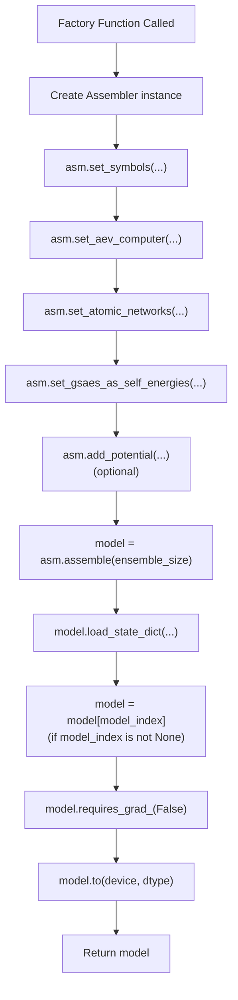
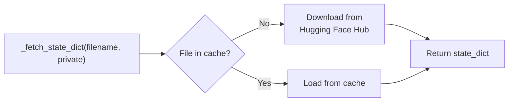
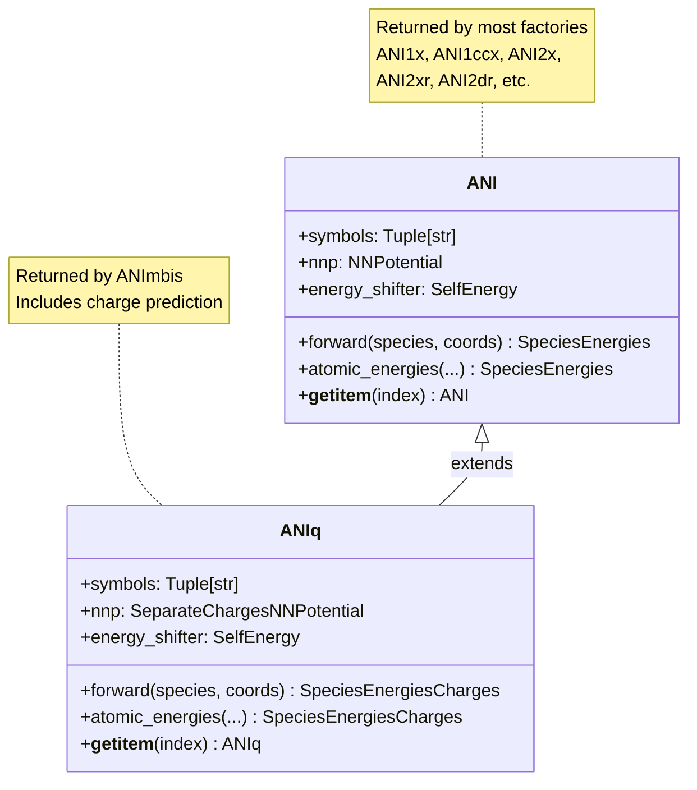

# Model Factories

<details>
<summary>Relevant source files</summary>

The following files were used as context for generating this wiki page:

- [examples/fundamentals.py](examples/fundamentals.py)
- [torchani/__init__.py](torchani/__init__.py)
- [torchani/models.py](torchani/models.py)
- [torchani/neurochem.py](torchani/neurochem.py)
- [torchani/utils.py](torchani/utils.py)

</details>


## Purpose and Scope

This page provides reference documentation for TorchANI's pre-built model factory functions. These functions instantiate ready-to-use `ANI` or `ANIq` models with pre-trained parameters. Each factory function configures an `Assembler`, loads pre-trained weights, and returns a fully initialized model.

For practical guides on using these models, see [Using Pre-built Models](#5.1). For information on building custom models from scratch, see [Building Custom Models](#5.3). For the legacy NeuroChem loading interface, see [Legacy NeuroChem API](#9.5).

---

## Overview

Model factory functions are convenience wrappers that combine three operations:

1. **Model assembly** - Configure an `Assembler` with appropriate hyperparameters
2. **Parameter loading** - Fetch and load pre-trained state dictionaries
3. **Finalization** - Prepare the model for inference (disable gradients, set device/dtype)

All factory functions are located in `torchani.models` and follow a consistent calling convention defined by the `_ModelFactory` protocol.

**Sources:** [torchani/models.py:1-90]()

---

## Factory Function Signature

All model factories share a common signature with the following parameters:

| Parameter | Type | Default | Description |
|-----------|------|---------|-------------|
| `model_index` | `Optional[int]` | `None` | If specified, returns only the ensemble member at this index. Otherwise returns the full ensemble. |
| `neighborlist` | `NeighborlistArg` | `"all_pairs"` | Neighborlist algorithm to use. Options: `"all_pairs"`, `"cell_list"`, `"adaptive"`, etc. |
| `strategy` | `str` | `"pyaev"` | AEV computation strategy. Options: `"pyaev"` (Python), `"cuaev"` (CUDA). |
| `periodic_table_index` | `bool` | `True` | If `True`, species are indexed by atomic number. If `False`, species are indexed 0, 1, 2, ... in order of `symbols`. |
| `device` | `Device` | `None` | PyTorch device for model parameters (`"cpu"`, `"cuda"`, etc.). |
| `dtype` | `DType` | `None` | PyTorch dtype for model parameters (`torch.float32`, `torch.float64`). |

**Returns:** `ANI` or `ANIq` instance ready for inference.

**Sources:** [torchani/models.py:79-89]()

---

## Common Factory Pattern



**Sources:** [torchani/models.py:92-127](), [torchani/models.py:166-199]()

---

## Available Model Factories

### ANI1x

```python
torchani.models.ANI1x(...) -> ANI
```

The ANI-1x model ensemble trained with active learning on the ANI-1x dataset at the wB97X/6-31G(d) level of theory. Contains 8 neural networks.

**Element Support:** H, C, N, O only

**Key Configuration:**
- Symbols: `SYMBOLS_1X` (H, C, N, O)
- Networks: `ctor="ani1x"`
- AEV: `radial="ani1x"`, `angular="ani1x"`
- Cutoff: `"cosine"`
- Self-energies: `"wb97x-631gd"`
- State dict: `"ani1x_state_dict.pt"`

**Sources:** [torchani/models.py:92-127]()

---

### ANI1ccx

```python
torchani.models.ANI1ccx(...) -> ANI
```

The ANI-1ccx model trained with transfer learning to CCSD(T)*/CBS accuracy (using DPLNO-CCSD(T)). Contains 8 neural networks.

**Element Support:** H, C, N, O only

**Key Configuration:**
- Symbols: `SYMBOLS_1X` (H, C, N, O)
- Networks: `ctor="ani1x"`
- AEV: `radial="ani1x"`, `angular="ani1x"`
- Cutoff: `"cosine"`
- Self-energies: `"ccsd(t)star-cbs"`
- State dict: `"ani1ccx_state_dict.pt"`

**Sources:** [torchani/models.py:129-164]()

---

### ANI2x

```python
torchani.models.ANI2x(...) -> ANI
```

The ANI-2x model trained on the ANI-2x dataset at the wB97X/6-31G(d) level of theory. Contains 8 neural networks.

**Element Support:** H, C, N, O, F, S, Cl

**Key Configuration:**
- Symbols: `SYMBOLS_2X` (H, C, N, O, S, F, Cl - in ANI-2x order)
- Networks: `ctor="ani2x"`
- AEV: `radial="ani2x"`, `angular="ani2x"`
- Cutoff: `"cosine"`
- Self-energies: `"wb97x-631gd"` (overwritten by state dict)
- State dict: `"ani2x_state_dict.pt"`

**Sources:** [torchani/models.py:166-199]()

---

### ANImbis

```python
torchani.models.ANImbis(...) -> ANIq
```

**⚠️ Experimental:** ANI-2x model extended with MBIS atomic charge prediction.

**Element Support:** H, C, N, O, F, S, Cl

**Key Configuration:**
- Base class: `ANIq` (not `ANI`)
- Charge networks: `_ANINetworksDiscardFirstScalar` with GELU activation
- Normalizer: `ChargeNormalizer.from_electronegativity_and_hardness`
- State dicts: `"ani2x_state_dict.pt"` (energy) + `"charge_nn_state_dict.pt"` (charges)

**Note:** This model predicts both energies and atomic charges. The returned type is `ANIq`, which has additional charge-related outputs.

**Sources:** [torchani/models.py:202-256]()

---

### ANI2xr

```python
torchani.models.ANI2xr(...) -> ANI
```

**⚠️ Experimental:** Improved ANI-2x model with repulsion potential and smoother potential energy surface.

**Element Support:** H, C, N, O, F, S, Cl

**Key Configuration:**
- Uses `simple_ani` for construction
- Symbols: `SYMBOLS_2X_ZNUM_ORDER` (atomic number order)
- Level of theory: `"wb97x-631gd"`
- Repulsion: Enabled
- Dispersion: Disabled
- State dict: `"ani2xr.pt"`

**Sources:** [torchani/models.py:258-291]()

---

### ANI2dr

```python
torchani.models.ANI2dr(...) -> ANI
```

**⚠️ Experimental:** Improved ANI-2x model trained to B973c level with both repulsion and dispersion potentials.

**Element Support:** H, C, N, O, F, S, Cl

**Key Configuration:**
- Uses `simple_ani` for construction
- Symbols: `SYMBOLS_2X_ZNUM_ORDER` (atomic number order)
- Level of theory: `"b973c-def2mtzvp"`
- Repulsion: Enabled
- Dispersion: Enabled (D3)
- State dict: `"ani2dr.pt"`

**Sources:** [torchani/models.py:293-326]()

---

### ANIr2s (and Solvent Variants)

```python
torchani.models.ANIr2s(..., solvent: Optional[str] = None) -> ANI
torchani.models.ANIr2s_water(...) -> ANI
torchani.models.ANIr2s_ch3cn(...) -> ANI
torchani.models.ANIr2s_chcl3(...) -> ANI
```

**⚠️ Private/Experimental:** R2SCAN-3c models with optional implicit solvation.

**Element Support:** H, C, N, O, F, S, Cl

**Key Configuration:**
- Uses `simple_ani` for construction
- Level of theory: `"r2scan3c-def2mtzvpp"` (+ solvent suffix)
- Cutoff function: `"smooth"` (not cosine)
- Repulsion: Enabled with custom cutoff settings
- AEV: Custom radial parameters (`radial_start=0.8`, `radial_cutoff=5.1`)

**Solvent Options:** `None` (vacuum), `"water"`, `"ch3cn"`, `"chcl3"`

**Sources:** [torchani/models.py:328-432]()

---

### SnnANI2xr

```python
torchani.models.SnnANI2xr(...) -> ANI
```

**⚠️ Experimental:** ANI-2xr variant using SingleNN architecture instead of per-element networks.

**Element Support:** H, C, N, O, F, S, Cl

**Key Configuration:**
- Uses `simple_ani` with `container="SingleNN"`
- Container constructor: `"large"`
- Sections: 6
- Repulsion: Enabled
- State dict: `"snn-ani2xr.pt"`

**Sources:** [torchani/models.py:434-469]()

---

## State Dictionary Fetching

Model factories use the `_fetch_state_dict` function from `torchani.arch` to automatically download and cache pre-trained parameters.



**Private vs Public Models:**
- `private=False`: Downloaded from public Hugging Face Hub
- `private=True`: Downloaded from internal server (requires authentication)

**Sources:** [torchani/models.py:121](), [torchani/models.py:159]()

---

## Symbol Constants

TorchANI defines standard element orderings used by different model families:

| Constant | Elements | Usage |
|----------|----------|-------|
| `SYMBOLS_1X` | H, C, N, O | ANI-1x, ANI-1ccx models |
| `SYMBOLS_2X` | H, C, N, O, S, F, Cl | ANI-2x model (ANI-2x internal order) |
| `SYMBOLS_2X_ZNUM_ORDER` | H, C, N, O, F, S, Cl | Newer models (atomic number order) |

**Note:** `SYMBOLS_2X` uses a legacy ordering from the original ANI-2x publication. Newer models use `SYMBOLS_2X_ZNUM_ORDER` which sorts by atomic number for consistency.

**Sources:** [torchani/utils.py:60-65](), [torchani/models.py:68]()

---

## Custom Model Loading

The `torchani.models` module supports custom model loading via the `__getattr__` mechanism. Custom models should be placed in the directory returned by `custom_models_dir()` with the following structure:

```
~/.torchani/custom_models/
├── MyModel/
│   └── model.py  # Must define MyModel function
```

**Usage:**
```python
import torchani.models
model = torchani.models.MyModel(device="cuda")
```

The `model.py` file must define a factory function matching the model directory name.

**Sources:** [torchani/models.py:472-485]()

---

## Model Factory Return Types



**Sources:** [torchani/models.py:88-89](), [torchani/models.py:209]()

---

## Relationship to Assembler

All model factories internally use the `Assembler` class to construct models. The general pattern:

```python
def ANI2x(...):
    asm = Assembler(periodic_table_index=periodic_table_index)
    asm.set_symbols(SYMBOLS_2X)
    asm.set_global_cutoff_fn("cosine")
    asm.set_aev_computer(radial="ani2x", angular="ani2x", strategy=strategy)
    asm.set_atomic_networks(ctor="ani2x")
    asm.set_neighborlist(neighborlist)
    asm.set_gsaes_as_self_energies("wb97x-631gd")
    model = asm.assemble(8)  # 8-member ensemble
    # ... load state dict, finalize ...
    return model
```

For details on using the `Assembler` directly to build custom models, see [Building Custom Models](#5.3).

**Sources:** [torchani/models.py:186-194]()

---

## Summary Table

| Factory | Elements | Ensemble Size | Level of Theory | Additional Potentials | Status |
|---------|----------|---------------|-----------------|---------------------|--------|
| `ANI1x` | HCNO | 8 | wB97X/6-31G(d) | None | Published |
| `ANI1ccx` | HCNO | 8 | CCSD(T)*/CBS | None | Published |
| `ANI2x` | HCNOFSCl | 8 | wB97X/6-31G(d) | None | Published |
| `ANImbis` | HCNOFSCl | 8 | wB97X/6-31G(d) + charges | None | Experimental |
| `ANI2xr` | HCNOFSCl | 8 | wB97X/6-31G(d) | Repulsion | Experimental |
| `ANI2dr` | HCNOFSCl | 8 | B973c/def2-mTZVP | Repulsion + Dispersion | Experimental |
| `ANIr2s` | HCNOFSCl | 8 | R2SCAN-3c/def2-mTZVPP | Repulsion | Private |
| `SnnANI2xr` | HCNOFSCl | 8 | wB97X/6-31G(d) | Repulsion | Experimental |

**Sources:** [torchani/models.py:92-469]()

---