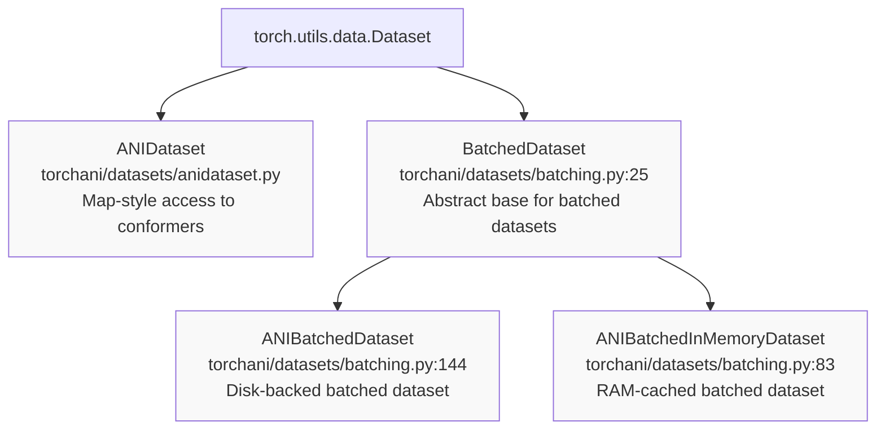
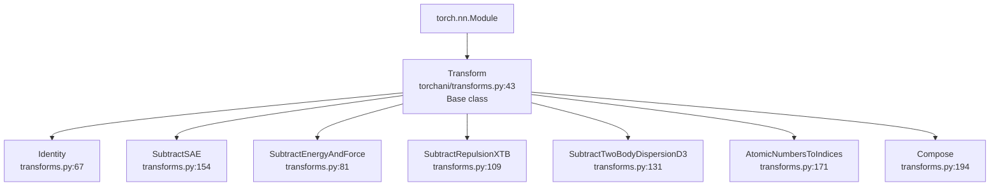
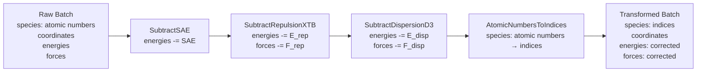

# Datasets API

<details>
<summary>Relevant source files</summary>

The following files were used as context for generating this wiki page:

- [tests/test_datasets.py](tests/test_datasets.py)
- [tests/test_datasets_batching.py](tests/test_datasets_batching.py)
- [tests/test_legacy_data.py](tests/test_legacy_data.py)
- [tests/test_sae.py](tests/test_sae.py)
- [torchani/datasets/__init__.py](torchani/datasets/__init__.py)
- [torchani/datasets/batching.py](torchani/datasets/batching.py)
- [torchani/datasets/builtin.py](torchani/datasets/builtin.py)
- [torchani/datasets/md5s.csv](torchani/datasets/md5s.csv)
- [torchani/legacy_data/__init__.py](torchani/legacy_data/__init__.py)
- [torchani/legacy_data/_pyanitools.py](torchani/legacy_data/_pyanitools.py)
- [torchani/sae.py](torchani/sae.py)
- [torchani/transforms.py](torchani/transforms.py)

</details>


This page provides comprehensive API reference for TorchANI's dataset classes, batching utilities, and transform functions. For conceptual information and usage guides, see [Datasets](#6), [Built-in Datasets](#6.1), [Data Loading and Batching](#6.2), and [Data Transforms](#6.3).

**Scope**: This reference covers:
- Map-style dataset classes (`ANIDataset`)
- Batched dataset classes (`BatchedDataset`, `ANIBatchedDataset`, `ANIBatchedInMemoryDataset`)
- Batching utilities (`Batcher`, `create_batched_dataset`, `batch_all_in_ram`)
- Built-in dataset factory functions
- Transform classes for data preprocessing

All classes and functions documented here are importable from `torchani.datasets` unless otherwise noted. Transform classes are importable from `torchani.transforms`.

---

## Dataset Class Hierarchy

The following diagram shows the relationships between the main dataset classes in TorchANI:



**Sources**: [torchani/datasets/__init__.py:21-29](), [torchani/datasets/batching.py:25-228]()

---

## ANIDataset

`ANIDataset` provides map-style access to molecular conformer data stored in HDF5, Parquet, or Zarr formats. It organizes data into groups (typically by molecular formula or number of atoms) with multiple conformers per group.

### Constructor

```python
ANIDataset(
    store_locations: Union[StrPath, Iterable[StrPath]],
    grouping: Literal["by_formula", "by_num_atoms", "legacy"] = "by_formula",
    dummy_properties: Optional[Dict[str, Dict[str, Any]]] = None,
    keep_files_open: bool = False
) -> ANIDataset
```

**Parameters**:
- `store_locations`: Path(s) to HDF5/Parquet/Zarr file(s) containing the dataset
- `grouping`: How conformers are organized into groups:
  - `"by_formula"`: Group by molecular formula (e.g., "H2O", "CH4")
  - `"by_num_atoms"`: Group by atom count (e.g., "003", "010")
  - `"legacy"`: Use existing group structure from file
- `dummy_properties`: Properties to create if not present, with configuration dict per property
- `keep_files_open`: Whether to keep file handles open for performance

### Key Properties

| Property | Type | Description |
|----------|------|-------------|
| `symbols` | `Tuple[str, ...]` | Unique element symbols in dataset, sorted by atomic number |
| `properties` | `Set[str]` | Set of property names available in dataset |
| `tensor_properties` | `List[str]` | Properties suitable for tensor conversion |
| `num_conformers` | `int` | Total number of conformers across all groups |
| `num_conformer_groups` | `int` | Number of conformer groups |
| `group_sizes` | `Dict[str, int]` | Mapping from group names to conformer counts |
| `store_locations` | `List[str]` | Paths to all storage files |

### Key Methods

**Iteration and Access**:

```python
def keys(self) -> Iterator[str]
```
Returns iterator over group names.

```python
def values(self) -> Iterator[Dict[str, Tensor]]
```
Returns iterator over conformer dictionaries (all conformers in each group).

```python
def items(self) -> Iterator[Tuple[str, Dict[str, Tensor]]]
```
Returns iterator over (group_name, conformers) pairs.

```python
def numpy_items(
    self,
    limit: Optional[int] = None,
    chem_symbols: bool = False
) -> Iterator[Tuple[str, Dict[str, ndarray]]]
```
Like `items()` but returns NumPy arrays instead of tensors. If `chem_symbols=True`, species are returned as element symbols rather than atomic numbers.

```python
def get_conformers(
    self,
    group_name: str,
    indices: Optional[Union[List[int], Tensor, ndarray]] = None,
    properties: Optional[Union[str, Sequence[str]]] = None
) -> Dict[str, Tensor]
```
Get specific conformers from a group. If `indices` is None, returns all conformers in the group.

**Modification Methods**:

```python
def append_conformers(
    self,
    group_name: str,
    conformers: Dict[str, Union[Tensor, ndarray]]
) -> None
```
Add conformers to an existing group or create a new group.

```python
def delete_conformers(self, group_name: str) -> None
```
Delete all conformers in a group and remove the group.

```python
def create_full_property(
    self,
    property_name: str,
    fill_value: Union[int, float] = 0,
    dtype: Optional[type] = None,
    extra_dims: Tuple[int, ...] = (),
    is_atomic: bool = False
) -> None
```
Create a new property across all conformers, initialized with `fill_value`. If `is_atomic=True`, property has shape `(num_conformers, num_atoms, *extra_dims)`, otherwise `(num_conformers, *extra_dims)`.

```python
def delete_properties(self, property_names: Set[str]) -> None
```
Remove properties from all groups. Groups with no remaining properties are deleted.

```python
def rename_properties(self, rename_map: Dict[str, str]) -> None
```
Rename properties across all groups.

**Reorganization Methods**:

```python
def regroup_by_formula(self) -> None
```
Reorganize groups by molecular formula.

```python
def regroup_by_num_atoms(self) -> None
```
Reorganize groups by total atom count.

**Context Manager**:

```python
def keep_open(self) -> ContextManager[ANIDataset]
```
Context manager that keeps file handles open during iteration for improved performance.

**Sources**: [torchani/datasets/__init__.py:21](), [torchani/datasets/anidataset.py]()

---

## Batched Dataset Classes

Batched datasets provide pre-batched and padded conformer data suitable for efficient training.

### BatchedDataset (Abstract Base)

Base class for batched datasets. Implements `torch.utils.data.Dataset[Conformers]` where `Conformers` is a dictionary mapping property names to tensors.

```python
class BatchedDataset(torch.utils.data.Dataset[Conformers]):
    split: str
    transform: Transform
```

**Key Methods**:

```python
def __len__(self) -> int
```
Returns number of batches.

```python
def __getitem__(self, idx: int) -> Conformers
```
Returns batch at index `idx` as a dictionary of tensors.

```python
def cache(
    self,
    verbose: bool = True,
    pin_memory: bool = False
) -> BatchedDataset
```
Load entire dataset into RAM. Returns `ANIBatchedInMemoryDataset`.

```python
def as_dataloader(
    self,
    num_workers: Optional[int] = 0,
    pin_memory: Optional[bool] = None,
    prefetch_factor: Optional[int] = None,
    shuffle: bool = True
) -> torch.utils.data.DataLoader
```
Create a DataLoader for this dataset.

**Sources**: [torchani/datasets/batching.py:25-81]()

---

### ANIBatchedDataset

Disk-backed batched dataset that loads batches from HDF5 files on-demand.

```python
ANIBatchedDataset(
    store_dir: StrPath,
    split: str = "division",
    transform: Transform = identity,
    limit: Union[int, float] = 1.0,
    properties: Sequence[str] = (),
    drop_last: bool = False
)
```

**Parameters**:
- `store_dir`: Directory containing batched data (created by `Batcher`)
- `split`: Name of the split/division (e.g., "training", "validation")
- `transform`: Transform to apply to each batch
- `limit`: Fraction (0.0-1.0) or absolute number of batches to use
- `properties`: Only load these properties (empty means load all)
- `drop_last`: Drop last batch if smaller than others

**Storage Format**: Batches are stored as individual HDF5 files named `{batch_idx:0>n}_batch.h5` in `{store_dir}/{split}/`.

**Sources**: [torchani/datasets/batching.py:144-228]()

---

### ANIBatchedInMemoryDataset

RAM-cached batched dataset for fast iteration without disk I/O.

```python
ANIBatchedInMemoryDataset(
    batches: Sequence[Conformers],
    transform: Transform = identity,
    limit: Union[int, float] = 1.0,
    split: str = "division",
    drop_last: bool = False
)
```

**Parameters**:
- `batches`: Sequence of pre-loaded batches
- Other parameters same as `ANIBatchedDataset`

**Special Methods**:

```python
def pin_memory(self, verbose: bool = True) -> None
```
Pin all tensors to CUDA page-locked memory for faster GPU transfers.

**Note**: This class does not support multiprocessing in DataLoader (`num_workers` must be 0).

**Sources**: [torchani/datasets/batching.py:83-139]()

---

## Batching Utilities

### Batcher Class

The `Batcher` class handles splitting datasets into divisions and batching conformers with padding.

```python
Batcher(
    dest_root: Union[Path, Literal["ram", "default"]] = "default",
    max_batches_per_packet: int = 200,
    verbose: bool = False
)
```

**Parameters**:
- `dest_root`: Directory for saving batches, `"ram"` for in-memory, or `"default"` for `datasets_dir()`
- `max_batches_per_packet`: Maximum batches to process at once (controls memory usage)
- `verbose`: Enable progress output

**Primary Method**:

```python
def divide_and_batch(
    self,
    src: Union[Iterable[StrPath], StrPath, ANIDataset],
    dest_dir: str = "",
    # Dataset modifications
    splits: Optional[Dict[str, float]] = None,
    folds: Optional[int] = None,
    batch_size: int = 2560,
    padding: Optional[Dict[str, float]] = None,
    transform: Transform = identity,
    properties: Iterable[str] = (),
    # RNG seeds
    divs_seed: Optional[int] = None,
    batch_seed: Optional[int] = None,
) -> Dict[str, BatchedDataset]
```

**Parameters**:
- `src`: Source dataset(s) to batch
- `dest_dir`: Subdirectory name within `dest_root`
- `splits`: Dictionary mapping split names to fractions (must sum to 1.0)
  - Example: `{"training": 0.8, "validation": 0.2}`
- `folds`: Number of cross-validation folds (alternative to `splits`)
  - Creates `training{i}` and `validation{i}` for each fold
- `batch_size`: Maximum conformers per batch
- `padding`: Padding values for each property (defaults to `PADDING`)
- `transform`: Transform to apply when creating batches
- `properties`: Properties to include (empty means all)
- `divs_seed`: Random seed for division shuffling
- `batch_seed`: Random seed for batch shuffling

**Returns**: Dictionary mapping split names to `BatchedDataset` instances.

**Class Method**:

```python
@classmethod
def in_ram(cls, verbose: bool = False) -> Batcher
```
Create a `Batcher` that stores batches in RAM instead of on disk.

**Sources**: [torchani/datasets/batching.py:238-618]()

---

### Batching Functions

#### create_batched_dataset

Convenience function wrapping `Batcher.divide_and_batch()`.

```python
def create_batched_dataset(
    src: Union[Collection[StrPath], StrPath, ANIDataset],
    dest_path: Optional[StrPath] = None,
    batch_size: int = 2560,
    properties: Iterable[str] = (),
    padding: Optional[Dict[str, float]] = None,
    splits: Optional[Dict[str, float]] = None,
    folds: Optional[int] = None,
    transform: Transform = identity,
    divs_seed: Optional[int] = None,
    batch_seed: Optional[int] = None,
    direct_cache: bool = False,
    max_batches_per_packet: int = 200,
    verbose: bool = True,
) -> Dict[str, BatchedDataset]
```

**Parameters**: Same as `Batcher.divide_and_batch()`, plus:
- `dest_path`: Full path for output (alternative to `dest_root`/`dest_dir`)
- `direct_cache`: If True, stores in RAM instead of disk

**Sources**: [torchani/datasets/batching.py:621-676]()

---

#### batch_all_in_ram

Simplified batching that creates a single in-memory training dataset.

```python
def batch_all_in_ram(
    src: Union[Collection[StrPath], StrPath, ANIDataset],
    batch_size: int = 2560,
    properties: Iterable[str] = (),
    padding: Optional[Dict[str, float]] = None,
    transform: Transform = identity,
    divs_seed: Optional[int] = None,
    batch_seed: Optional[int] = None,
    verbose: bool = True,
) -> ANIBatchedInMemoryDataset
```

**Returns**: Single `ANIBatchedInMemoryDataset` containing all data.

**Sources**: [torchani/datasets/batching.py:678-700]()

---

## Batching Workflow

```mermaid
flowchart TB
    Source["Source Data<br/>ANIDataset or HDF5 files"]
    Batcher["Batcher<br/>torchani/datasets/batching.py:238"]
    
    subgraph "Batcher.divide_and_batch()"
        Shuffle["Shuffle Conformers<br/>batching.py:339-341"]
        Split["Split into Divisions<br/>splits or folds<br/>batching.py:395-452"]
        Packet["Process in Packets<br/>batching.py:497-505"]
        Batch["Create & Pad Batches<br/>batching.py:542-565"]
    end
    
    OnDisk["ANIBatchedDataset<br/>Disk-backed batches<br/>batching.py:144"]
    InRAM["ANIBatchedInMemoryDataset<br/>RAM-cached batches<br/>batching.py:83"]
    
    Source --> Batcher
    Batcher --> Shuffle
    Shuffle --> Split
    Split --> Packet
    Packet --> Batch
    
    Batch -->|dest_root=Path| OnDisk
    Batch -->|dest_root='ram'| InRAM
    
    OnDisk -->|.cache()| InRAM
```

**Sources**: [torchani/datasets/batching.py:238-618]()

---

## Built-in Datasets

TorchANI provides factory functions for commonly-used datasets. All functions follow this signature:

```python
def DatasetName(
    lot: str = "default_lot",
    verbose: bool = True,
    download: bool = True,
    dummy_properties: Optional[Dict[str, Any]] = None,
    skip_check: bool = False,
) -> ANIDataset
```

**Parameters**:
- `lot`: Level of theory (e.g., `"wb97x-631gd"`, `"b973c-def2mtzvp"`)
- `verbose`: Print download progress
- `download`: Automatically download if not cached
- `dummy_properties`: Properties to create if missing
- `skip_check`: Skip MD5 verification

### Available Datasets

The following table lists built-in dataset factory functions:

| Function | Default LoT | Description |
|----------|-------------|-------------|
| `TestData()` | wb97x-631gd | Small test dataset for debugging |
| `TestDataIons()` | b973c-def2mtzvp | Test dataset with forces, dipoles, charges |
| `TestDataForcesDipoles()` | b973c-def2mtzvp | Test dataset with forces and dipoles |
| `ANI1x()` | wb97x-631gd | ANI-1x dataset (H, C, N, O) |
| `ANI2x()` | wb97x-631gd | ANI-2x dataset (adds S, F, Cl) |
| `ANI1ccx()` | ccsd(t)star-cbs | ANI-1ccx coupled-cluster dataset |
| `ANI1q()` | wb97x-631gd | ANI-1x subset with CM5 charges |
| `ANI2qHeavy()` | wb97x-631gd | ANI-2x heavy subset with CM5 charges |
| `ANI1e()` | wb97x-631gd | Equilibrium structures with thermodynamic properties |
| `COMP6v1()` | wb97x-631gd | Test set v1 (not for training) |
| `COMP6v2()` | wb97x-631gd | Test set v2 (not for training) |
| `IonsLight()` | b973c-def2mtzvp | Light ions dataset (H, C, N, O) |
| `IonsHeavy()` | b973c-def2mtzvp | Heavy ions dataset (adds F, S, Cl) |
| `IonsVeryHeavy()` | b973c-def2mtzvp | Very heavy ions (adds Si, As, Br, Se, P, B, I) |

**Example Usage**:

```python
from torchani.datasets import ANI1x, ANI2x

# Load with default level of theory
ani1x = ANI1x()

# Load with different level of theory
ani2x = ANI2x(lot="wb97md3bj-def2tzvpp")

# Suppress download messages
test = TestData(verbose=False)
```

**Sources**: [torchani/datasets/builtin.py:28-372](), [torchani/datasets/__init__.py:30-48]()

---

### Dataset and LoT Enumerations

Two enumerations help identify datasets and levels of theory programmatically:

```python
class _DatasetId(Enum):
    TESTDATA = "TestData"
    ANI1X = "ANI1x"
    ANI2X = "ANI2x"
    # ... etc
```

```python
class _LotId(Enum):
    DEFAULT = "default"
    ALL = "all"
    WB97X_631GD = "wb97x-631gd"
    B973C_DEF2MTZVP = "b973c-def2mtzvp"
    # ... etc
```

**Sources**: [torchani/datasets/builtin.py:374-400]()

---

## Utility Functions

### concatenate

```python
def concatenate(
    dataset: ANIDataset,
    dest: StrPath,
    verbose: bool = True,
    delete_originals: bool = False
) -> ANIDataset
```

Concatenate multiple HDF5 files from an `ANIDataset` into a single file.

**Parameters**:
- `dataset`: Source `ANIDataset` to concatenate
- `dest`: Path for output HDF5 file
- `verbose`: Show progress
- `delete_originals`: Delete source files after concatenation

**Returns**: New `ANIDataset` pointing to concatenated file.

**Sources**: [torchani/datasets/__init__.py:21]()

---

## Transform Classes

Transforms modify batches during iteration, typically for preprocessing data before training. All transforms are found in `torchani.transforms`.

### Transform Class Hierarchy



**Sources**: [torchani/transforms.py:43-231]()

---

### Transform (Base Class)

```python
class Transform(torch.nn.Module):
    atomic_numbers: Optional[Tensor]
    
    def forward(
        self,
        properties: Dict[str, Tensor]
    ) -> Dict[str, Tensor]
```

Base class for all transforms. Subclasses must implement `forward()`.

**Attribute**:
- `atomic_numbers`: If transform is element-specific, contains supported atomic numbers; otherwise `None`

**Sources**: [torchani/transforms.py:43-64]()

---

### Identity

```python
Identity()
```

Pass-through transform that returns input unchanged.

**Sources**: [torchani/transforms.py:67-76]()

---

### SubtractSAE

```python
SubtractSAE(
    symbols: Sequence[str],
    self_energies: Sequence[float]
)
```

Subtract self-atomic energies from molecular energies.

**Parameters**:
- `symbols`: Element symbols in order
- `self_energies`: Self energy for each element (same order as `symbols`)

**Modifies**: `energies` property (subtracts sum of atomic self energies)

**Example**:
```python
from torchani.transforms import SubtractSAE

sae = SubtractSAE(
    symbols=("H", "C", "N", "O"),
    self_energies=(-0.6, -38.1, -54.7, -75.2)
)
```

**Sources**: [torchani/transforms.py:154-168]()

---

### SubtractEnergyAndForce

```python
SubtractEnergyAndForce(
    potential: Potential,
    subtract_force: bool = True
)
```

Subtract energies (and optionally forces) computed by a potential.

**Parameters**:
- `potential`: Any `Potential` instance (see [Potentials System](#4.4))
- `subtract_force`: Whether to also subtract forces

**Modifies**: `energies` and optionally `forces` properties

**Sources**: [torchani/transforms.py:81-106]()

---

### SubtractRepulsionXTB

```python
SubtractRepulsionXTB(
    symbols: Sequence[str],
    subtract_force: bool = True
)
```

Subtract xTB repulsion energies and forces. Wraps `SubtractEnergyAndForce` with `RepulsionXTB` potential.

**Parameters**: Same as `RepulsionXTB` constructor, plus `subtract_force`

**Sources**: [torchani/transforms.py:109-128]()

---

### SubtractTwoBodyDispersionD3

```python
SubtractTwoBodyDispersionD3(
    symbols: Sequence[str],
    functional: str,
    subtract_force: bool = True
)
```

Subtract DFT-D3 dispersion energies and forces. Wraps `SubtractEnergyAndForce` with `TwoBodyDispersionD3` potential.

**Parameters**: Same as `TwoBodyDispersionD3.from_functional()`, plus `subtract_force`

**Sources**: [torchani/transforms.py:131-151]()

---

### AtomicNumbersToIndices

```python
AtomicNumbersToIndices(symbols: Sequence[str])
```

Convert atomic numbers in `species` tensor to element indices (0, 1, 2, ...).

**Parameters**:
- `symbols`: Element symbols defining the index mapping

**Modifies**: `species` property (converts atomic numbers to 0-based indices)

**Note**: Typically used as the last transform in a pipeline for backward compatibility.

**Sources**: [torchani/transforms.py:171-190]()

---

### Compose

```python
Compose(transforms: Sequence[Transform])
```

Chain multiple transforms into a pipeline.

**Parameters**:
- `transforms`: Sequence of transforms to apply in order

**Validation**: All transforms must support the same `atomic_numbers` (if element-specific).

**Example**:
```python
from torchani.transforms import Compose, SubtractSAE, SubtractRepulsionXTB

pipeline = Compose([
    SubtractSAE(symbols, saes),
    SubtractRepulsionXTB(symbols),
])
```

**Sources**: [torchani/transforms.py:194-231]()

---

## Transform Pipeline Example



**Sources**: [torchani/transforms.py:1-231](), [tests/test_datasets.py:120-194]()

---

## Common Usage Patterns

### Pattern 1: Load and Batch a Dataset

```python
from torchani.datasets import ANI1x, create_batched_dataset
from torchani.transforms import SubtractSAE, Compose

# Load built-in dataset
dataset = ANI1x()

# Create transform
transform = SubtractSAE(
    symbols=("H", "C", "N", "O"),
    self_energies=(-0.6, -38.1, -54.7, -75.2)
)

# Batch dataset
batched = create_batched_dataset(
    dataset,
    dest_path="./batched_ani1x",
    splits={"training": 0.8, "validation": 0.2},
    batch_size=2560,
    transform=transform,
    divs_seed=42,
    batch_seed=42
)

train = batched["training"]
valid = batched["validation"]
```

**Sources**: [torchani/datasets/batching.py:621-676](), [tests/test_datasets_batching.py:32-41]()

---

### Pattern 2: Create Cross-Validation Folds

```python
from torchani.datasets import Batcher

batcher = Batcher(dest_root="./cv_data", verbose=True)

batched = batcher.divide_and_batch(
    src="dataset.h5",
    folds=5,  # Creates training0-4, validation0-4
    batch_size=2560,
    divs_seed=12345,
    batch_seed=12345
)

# Train 5 models with different train/valid splits
for i in range(5):
    train = batched[f"training{i}"]
    valid = batched[f"validation{i}"]
    # ... train model i
```

**Sources**: [torchani/datasets/batching.py:427-452](), [tests/test_datasets_batching.py:205-243]()

---

### Pattern 3: In-Memory Batching for Small Datasets

```python
from torchani.datasets import batch_all_in_ram

# Everything in RAM for maximum speed
dataset = batch_all_in_ram(
    src="small_dataset.h5",
    batch_size=256,
    verbose=True
)

# Use with DataLoader
loader = dataset.as_dataloader(
    shuffle=True,
    pin_memory=True
)
```

**Sources**: [torchani/datasets/batching.py:678-700](), [tests/test_sae.py:40-49]()

---

### Pattern 4: Custom Dataset Creation and Modification

```python
from torchani.datasets import ANIDataset
import torch

# Create new dataset
ds = ANIDataset("my_dataset.h5", grouping="by_formula")

# Add conformers
ds.append_conformers(
    "H2O",
    {
        "species": torch.tensor([[1, 8, 1]], dtype=torch.long),
        "coordinates": torch.randn(1, 3, 3),
        "energies": torch.tensor([10.5])
    }
)

# Create new property across all conformers
ds.create_full_property("charges", fill_value=0)

# Reorganize by atom count
ds.regroup_by_num_atoms()
```

**Sources**: [tests/test_datasets.py:341-389]()

---

## Data Storage Format

### HDF5 Structure for ANIDataset

```
dataset.h5
├── group1/              # e.g., "H2O" or "003"
│   ├── species          # shape: (num_atoms,), dtype: int64 or str
│   ├── coordinates      # shape: (num_conformers, num_atoms, 3), dtype: float32
│   ├── energies         # shape: (num_conformers,), dtype: float64
│   ├── forces           # shape: (num_conformers, num_atoms, 3), dtype: float32 [optional]
│   └── ...              # other properties
├── group2/
│   └── ...
└── ...
```

**Sources**: [torchani/datasets/anidataset.py]()

### HDF5 Structure for Batched Datasets

```
batched_dataset/
├── creation_log.json    # Metadata about batching process
├── training/
│   ├── 00000_batch.h5
│   ├── 00001_batch.h5
│   └── ...
└── validation/
    ├── 00000_batch.h5
    ├── 00001_batch.h5
    └── ...
```

Each `*_batch.h5` contains:
```
batch.h5
├── species             # shape: (batch_size, max_atoms), dtype: int64
├── coordinates         # shape: (batch_size, max_atoms, 3), dtype: float32
├── energies            # shape: (batch_size,), dtype: float64
└── ...                 # other properties
```

**Note**: Padding value for `species` is `-1`, others use `0.0` by default.

**Sources**: [torchani/datasets/batching.py:556-563](), [torchani/datasets/batching.py:581-617]()

---

## Default Padding Values

The default padding dictionary used when batching:

| Property | Padding Value | Type |
|----------|---------------|------|
| `species` | `-1` | `int` |
| `coordinates` | `0.0` | `float` |
| `forces` | `0.0` | `float` |
| `energies` | `0.0` | `float` |

Access via `torchani.utils.PADDING`.

**Sources**: [torchani/utils.py](), [torchani/datasets/batching.py:17]()

---